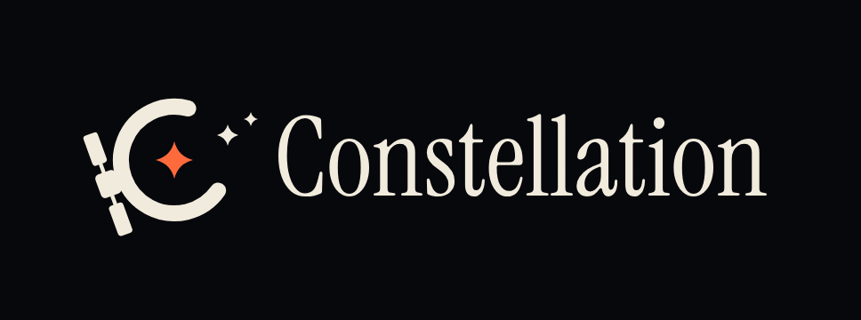
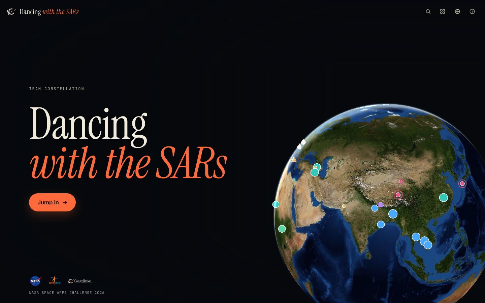
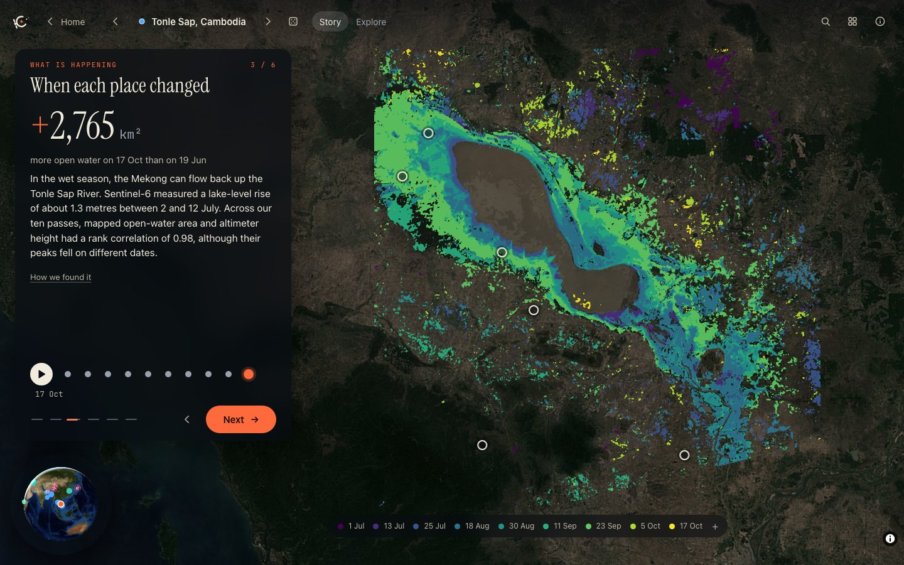
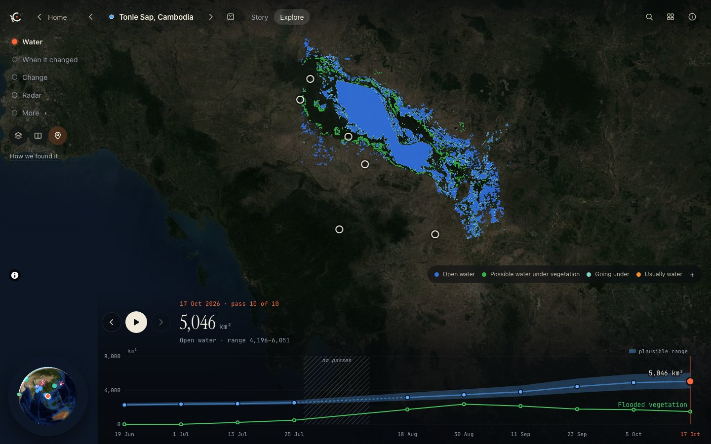
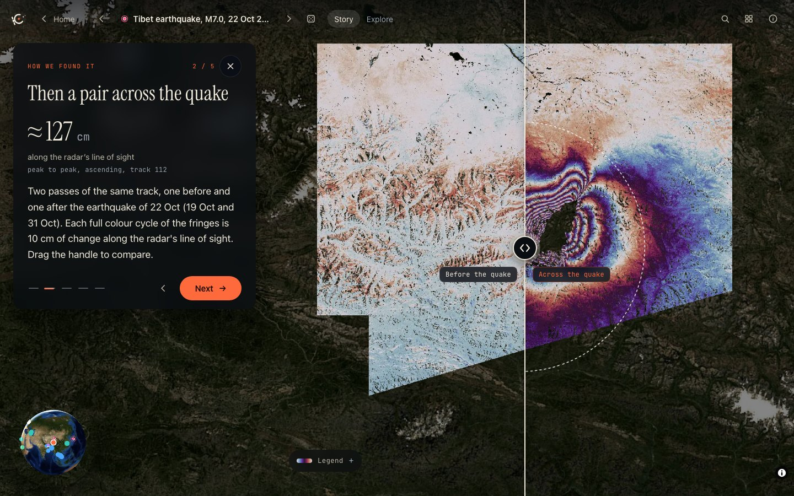
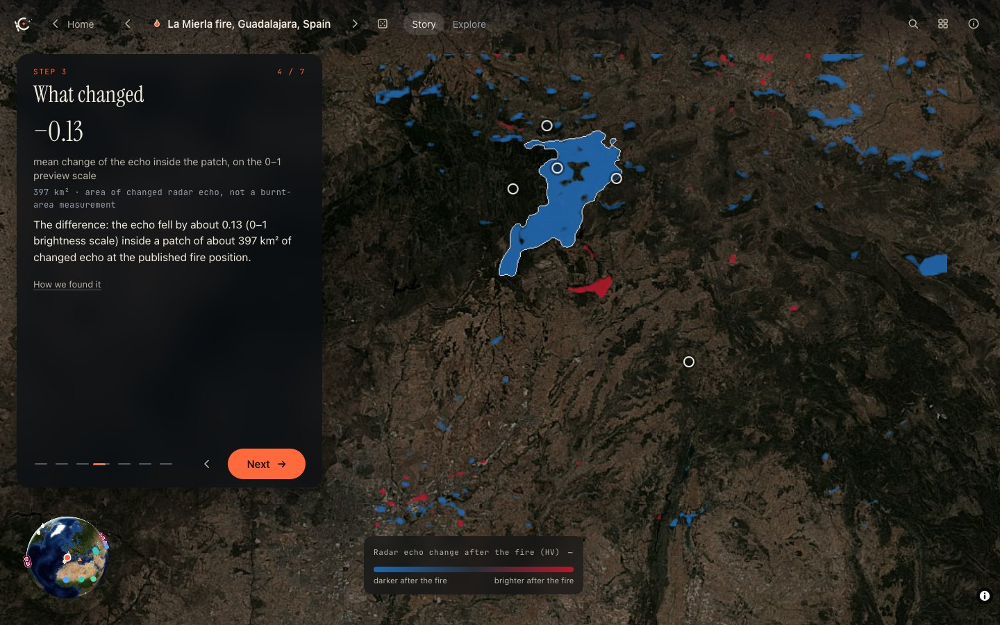
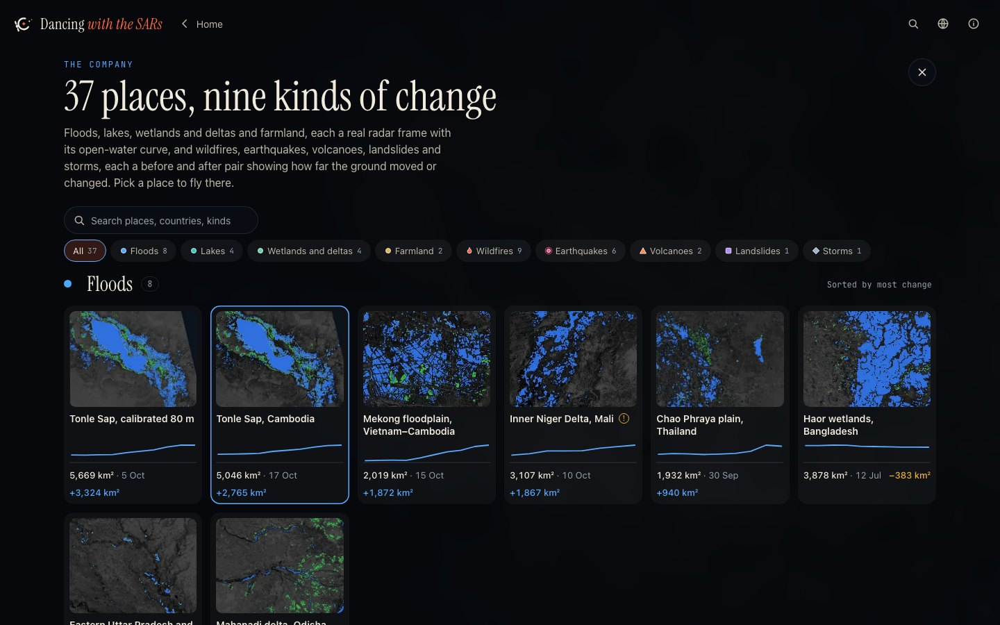
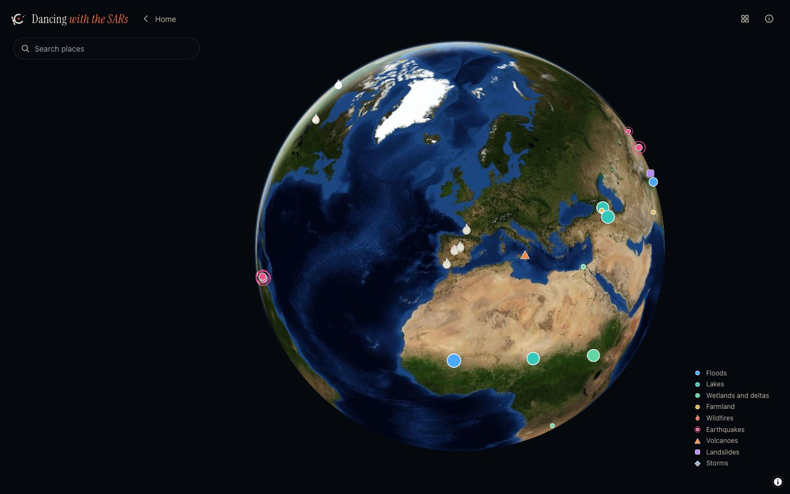

<p align="center"></p>

# Dancing with the SARs

**Press play on a season of radar.** A web app that lets anyone see the Earth's surface change as seen by NASA and ISRO's NISAR radar satellite, June to October 2026, and read what is physically happening and why radar can see it. It shows four kinds of change: **water through a season** (18 places: floods 8, lakes 4, wetlands and deltas 4, farmland 2), **the ground moving in earthquakes** (6 places, before and after one event), **ground events seen as loss of radar coherence** (10 places: 2 volcanoes, 1 landslide, 1 storm and 6 wildfires) and **wildfires seen as a change of radar brightness** (3 places, over the season). That makes 37 places in 9 classes in `src/app/public/data/` (`summary.json`, field `categories`: Floods 8, Lakes 4, Wetlands and deltas 4, Farmland 2, Wildfires 9, Earthquakes 6, Volcanoes 2, Landslides 1, Storms 1). By kind (`kind` in `summary.json`): 21 places are a season of ten passes (the 18 water and farmland places and 3 fires) and 16 are events seen in a before/after pair (6 earthquakes, 6 fires, 2 volcanoes, 1 landslide, 1 storm). Three of the nine wildfires are seen both ways (by brightness change and by lost coherence). Rondônia (Brazil) was taken out of the app: no layer shows new forest clearing (`areas/rondonia/area.json`, `in_app: false`, with the reason); it is kept as a tried place. Sheveluch (Kamchatka) was exported and then withdrawn (`areas/sheveluch-2026/area.json`, `in_app: false`): the lost coherence follows elevation, so first snow explains it. The places lie in Asia (Cambodia, China, Armenia, Bangladesh, Iran, Pakistan, Vietnam, Thailand, India, Nepal, Tibet, Japan; Armenia sits on the Europe–Asia boundary), Africa (Mali, Botswana, Egypt, South Sudan, Chad), South America (Brazil, Venezuela, Chile), North America (Canada, Panama, Hawaii) and Europe (Spain, France, Etna in Italy). There is one app, `src/app/` (globe, gallery, story, Explore with timeline chart, a "How we found it" stepper for every kind of place, before/after compare, caution labels). It was developed as `src/app3` ("the merged app") on branch `front_harut` and moved to `src/app` on 15 November; two earlier designs were removed then and are in git history only. The deploy workflow `.github/workflows/deploy.yml` builds `src/app` for GitHub Pages.

NASA Space Apps Challenge 2026 · challenge *Dancing with the SARs* · team **Constellation**: Harutyun Kesablyan, Arameh Haghverdian, Abel Babayan.



| | |
|---|---|
|  |  |
|  |  |
|  |  |

Screenshots of the app in `src/app` on 15 November 2026.

## What it shows

| Place | What the radar shows |
|---|---|
| **Tonle Sap, Cambodia** | The monsoon flood spreading like a wave: the river plain south-east of the lake goes under in late August, the ring around the lake in September |
| **Lake Sevan, Armenia** | A lake that does not change, and how wind and rain can fool a naive method into thinking it shrank |
| **Ararat Valley, Armenia** | What radar at this resolution does not show: fields smaller than a pixel. (Interferometry does show the farming season there: [docs/eda/insar.md](docs/eda/insar.md)) |

Eleven more water places are in the table below (it had twelve rows of places until Rondônia was taken out of the app). Balanced accuracy of the water map against Landsat water pixels that never change, from [docs/eda/fusion2.md](docs/eda/fusion2.md), section 8. **This is an easy test: it is measured only on pixels where the answer is certain (always water or never water); shorelines and floodplains are not in it. It does not show that a place is solved.** Against NASA's own water product several of these places look much worse (next section):

| Place | Accuracy | Place | Accuracy |
|---|---|---|---|
| Poyang Lake, China | 99.9 % | Lake Chad | 99.3 % |
| Pantanal, Brazil | 99.98 % | Inner Niger Delta, Mali | 97.3 % |
| Lake Urmia, Iran | 97.0 % | The Sudd, South Sudan | 96.7 % |
| Nile Delta, Egypt | 71.4 % (do not quote a water area) | Mekong floodplain, Vietnam–Cambodia | 65.1 % (rivers narrower than a pixel) |
| Haor wetlands, Bangladesh; Okavango Delta, Botswana; Indus plain, Sindh | no permanent water to score; only false water is measured | | |

### Against NASA's OPERA water product

We compared our open-water maps with NASA's operational OPERA DSWx-S1 product ([docs/eda/opera.md](docs/eda/opera.md)). This is agreement between two products, not accuracy against the truth, and OPERA is itself a model.

- At Lake Sevan and Tonle Sap our maps agree with OPERA on 97.5 % of pixels (IoU 0.84, 20 place-dates). At Tonle Sap the IoU falls from 0.83–0.89 in June–July to 0.56–0.65 from mid-August, when the flood spreads into the forest.
- Across 101 place-dates at 15 places the agreement is 94 % of pixels, but most pixels are dry land and the mean IoU is only 0.38.
- Three places where the comparison shows our map is wrong: **Inner Niger Delta** (we map about four times OPERA's open water; 98 % of our extra water is dry in OPERA), **Lake Chad** (we find about half of OPERA's water) and **Lake Urmia** (we call wet salt flat water). The deltas (Mekong, Nile), the Pantanal and the Sudd are weak, because narrow or vegetated water is missed; Okavango and Sindh-Indus show no open water in our maps while OPERA maps 20–200 km². The app now carries a caution label on exactly these five places (Inner Niger, Lake Chad, Urmia, Okavango, Sindh-Indus; field `caution` in each `manifest.json`).

For each water place: a timeline of ten radar passes, a map of open water and flooded vegetation per date, a map of *when* each place changed, a before/after comparison, curves at named spots, and a four-part story.

### How we found it: before, after, difference

For three fires (Thunder Bay 36, La Mierla, Burgohondo/Avila) and six water or farmland places (Okavango, Sindh-Indus, Nile delta, Poyang, Haor, Urmia) the app shows the evidence in steps: the radar image before, the image after, their difference with the changed patch outlined, a check on the same pixels before the event, and later passes. The check is a control: the same difference between two passes that both come before the event; the threshold is the noise level of that control. Method, every number and the figures: [docs/eda/burn.md](docs/eda/burn.md) (figures in `docs/eda/burn/` and `docs/eda/evidence/`); code `scripts/detect/evidence.py`, `burn.py`, `evidence_places.py`; tests `tests/test_burn.py`. The numbers are in each place's `manifest.json` under `evidence.stats` and in [docs/RESULTS.md](docs/RESULTS.md).

What this shows and what it does not: an **area of changed radar echo** on uncalibrated 180 m previews, not a burnt area, a crop or a deforestation measurement. At Thunder Bay 36 the patch is about 1,875 km² against 3,139 km² published, and it is 0 at twice the threshold; the control is "not clean" there and at Sindh-Indus, Poyang and Urmia (8 %, 9 %, 11 % and 16 % of control pixels above the threshold). Negative results of the same test: the Sudd shows nothing above the noise; the Gironde megafire by brightness fades after its first weeks (not clear; it is clear by lost coherence, see below); Rondônia shows many small dark patches inside old cleared land that cannot be told from burning, regrowth or moisture, so no new-clearing claim is made and the place was taken out of the app.

### Can a first-time viewer see it? A visibility audit

We checked every place on the contact sheets of its own overlay images, not on the text ([docs/eda/visibility-audit.md](docs/eda/visibility-audit.md), numbers in `docs/eda/visibility/audit.json`). The audit covered 31 places: **12 show what the story says, 10 show it weakly, 9 do not**. Nine places opened on a view that was empty, static or did not carry the story. Fixes applied since, from each place's `areas/<id>/area.json`: an opening layer (`default_layer`) and date (`default_date`) per place, the `caution` labels above, and one-line captions (`headline_note`) for steady places such as Sevan, Sudd and Pantanal. The audit was not re-run after the fixes, and it did not include the seven places added later (the six wildfires seen by lost coherence and the Atacama storm). Avila's water, HV and class layers are still fully transparent in `src/app/public/data/` (checked 15 Nov; the cause is described in `docs/eda/burn.md`, its one-line fix is not applied); the app opens that place on the burn evidence layers, which are not blank.

### The ground moving: earthquakes

NISAR also records the phase of the radar wave. Two passes 12 to 24 days apart that span an earthquake give an interferogram: colour bands (fringes) that show how far the ground moved along the line between the satellite and the ground. We tried fifteen earthquakes between June and October 2026 against NISAR L2 GUNW pairs. **Six are clear, one is marginal and eight are not detected.** The marginal one (Huancayo, Peru M5.5) and the eight not detected are reported as such and are not in the app.

| Earthquake (USGS) | Peak to peak ground movement along the radar line of sight, within the stated radius | Same-track pair from before the event | Look directions |
|---|---|---|---|
| Tibet M7.0, 22 Oct | 127 cm (45 km) | 5 cm | one |
| Panama M7.7, 9 Oct | 133 cm descending, 85 cm ascending (60 km); frames cover only part of the pattern, value uncertain (107–165 cm across processing variants) | 21 / 15 cm | two |
| Venezuela M7.2, 24 Jun | 51 cm ascending, 55 cm descending (60 km); an approximate east/up split gives east about −46 to +37 cm, vertical under 10 cm | 12 / 10 cm | two |
| Venezuela M7.5, 24 Jun | descending 48 cm (60 km), control 10.8 cm; the ascending view is partial (9 % valid pixels) and its control is not clean, so it is not quoted. Same pairs as the M7.2, about 40 s apart: the two cannot be separated | 10.8 cm (desc) | two |
| Kumamoto, Japan M6.8, 28 Jul | 38 cm (30 km), a 24-day pair | 6 cm | one |
| Qaidam, China M5.6, 18 Aug | one compact patch 3–4 km across, 5 km ESE of the epicentre: mean +6 / +10 / +6 cm within 3 km in three pairs, about 10 km² above 5 cm; controls 0 | 0 km² above 5 cm | both, three pairs |

**Not detected:** Flores Sea M7.8, Mexico M7.3 (offshore), Sanriku, Japan M6.9 (offshore), Qinghai M5.8 (too small), Khuzdar M5.7, Redwood Valley M5.6, Turangi M5.7 and Qaidam M5.3 (all small). Why, for each, in [docs/eda/quake.md](docs/eda/quake.md). **"NISAR sees M5 earthquakes" is not supported:** of seven events of M5.3 to 5.8 tried, one is clear (Qaidam M5.6), one marginal and five showed nothing.


### Other ground events: loss of coherence

We also looked at other ground events between 17 June and 31 October 2026 ([docs/eda/events.md](docs/eda/events.md)). Round 3 of the event hunt (more kinds of event, same pair-coherence rule) ended at about 06:20 on 15 November (final commit `6e3330c`). Final state, read from `docs/eda/events/events.json`, `results.json`, `app_events.json` and `events.md`: `events.json` holds 53 configurations (42 of them added in round 3, per `events.md`), all with results in `results.json`: 10 clear (all 10 are places in the app), 5 marginal (Brits, Kilauea 54, Ambrym, Sakurajima and Sheveluch, which was exported as clear and withdrawn, see below), 31 not detected (one of them decorrelated), 4 entries that support or repeat another event (the Atacama coast, Taltal and east boxes, and Etna's later pairs), 2 fire signals not exported (Hautes Fagnes, Rowe Creek) and 1 not attributed (the Panama earthquake landslides). `results.json` repeats the verdict only for the clear events; `events.json` is the source.

The 10 clear events are the **Langtang Lirung rock-ice collapse** (Nepal, 26 Aug, about 8.5 km²), **Kilauea episode 55** (Hawaii, 17 Oct, about 10.2 km², one look direction), the **Etna Valle del Bove lava field** (Italy, July–August, about 2.5 km², both look directions), six wildfires by lost coherence (Thunder Bay 36 in Ontario, La Mierla, Burgohondo and Niebla in Spain, the Gironde in France, Bald Range in British Columbia) and the **Atacama rain storm of 17–18 August** (Chile), shown on the single-storm ascending pair of 16–28 August against 11–23 July: about 1,004 km² lost coherence, mean coherence 0.82 → 0.62 (`results.json`, view `a_late`); the longer descending pair (about 5,950 km², 0.76 → 0.41) mixes several weather episodes and is text only. Each is a patch where the surface changed and the two passes can no longer be compared (loss of coherence, not fringes). Not detected (`events.json`): Budhi Gandaki and Kali Gandaki landslides, Klyuchevskoy, Krasheninnikov, Nyamulagira, Chillán, Lewotolok, Stromboli, Semeru, Fuego, Great Sitkin, Bezymianny, Etna June, Kilauea episode 53, Santa María, the Hanjia landslide, Hurricane Isaias, Typhoon Noul, the Polo remnants (Arizona, New Mexico, Baja California Sur, Sonora), the Hotan rain, the Big Grass fire, the Gold Ridge mine, the Colombia M7.4 and the two Alaska M5.6 earthquakes, and the Mahanadi, Terai and Chao Phraya floods by coherence. Hautes Fagnes (Belgium) is a clear signal that was not exported because the fire class is capped; Rowe Creek (Oregon) is a patch cut by the window edge.

**Sheveluch: a self-correction.** It was exported as a clear volcanic event and withdrawn as marginal after an elevation test: the lost share of the comparable ground rises with height (8 / 32 / 60 / 77 % at 600–900 / 900–1200 / 1200–1500 / 1500–1800 m) and at one height hardly depends on the distance from the domes; the neighbouring Klyuchevskoy group shows the same dependence; the lobes do not recover in the next pairs. That is first autumn snow, not the explosions (`docs/eda/events.md`; `areas/sheveluch-2026/area.json` has `in_app: false`). Langtang passed the same test (no rise with elevation; a compact patch). The test is now `loss_by_elevation` in `scripts/detect/events.py` with a test (13 event tests).

Where sources disagree: the Gironde megafire is **clear** by lost coherence (`events.json`, in the app as `gironde-coh-2026`) but **marginal** by brightness (it fades; [docs/research/events-2026.md](docs/research/events-2026.md), [docs/eda/burn.md](docs/eda/burn.md)). We do not claim: whether the change is new lava, ash, debris, ash fall, snow, wet soil or burnt forest; areas of damage or burnt area (we write "lost coherence"); volumes or thickness; the date inside the 12-, 24- or 36-day pair; or any ground motion. New do-not-claim items (`events.md`): a 24- or 36-day event pair compared with a 12-day control compares only approximately; an autumn loss of coherence in mountains needs an elevation test before it is called volcanic; the cause of the Atacama loss (rain, snow, mud) is not separable; Hautes Fagnes is a clear signal not exported because the fire class is capped, and Rowe Creek's patch is cut by the window edge.

### Disaster events from previews

We tried further 2026 events as new places from the free previews ([docs/research/events-2026.md](docs/research/events-2026.md)). Its cumulative summary (state at 00:50 on 15 November) lists six clear (Chao Phraya, Mahanadi and Terai floods, three burn scars), four marginal and the rest not detected. All six clear are now places in the app. Chao Phraya (Thailand): open water about 990 km² on 6 September to about 1,930 km² on 30 September, and 82 % of the new water lies inside the JRC maximum water extent (Landsat, 1984–2021). The fires are described above ("How we found it"). Small, town-scale and narrow-channel floods vanish at 180 m.

What we do not claim for earthquakes: damage, casualties or any effect on people; the fault plane, slip or rupture length of any earthquake; that Venezuela M7.2 and M7.5 are separate ruptures; vertical or horizontal motion, except Venezuela's approximate split; agreement with GNSS or other satellites (no such check was made); that the sign (toward or away from the satellite) is confirmed. The products are PROVISIONAL, some of them urgent-response. Method, every number and the full list: [docs/eda/quake.md](docs/eda/quake.md).

## Honest status

State of 15 November 2026, about 04:00 (Armenia time; the 00:50 text was updated for the 37-place app, the evidence layers, the visibility audit and event-hunt round 3). One-page summary of results: [docs/RESULTS.md](docs/RESULTS.md).

- **The app shows previews.** Everything in the app uses NISAR's free preview images: about 180 m per pixel and not calibrated. Patterns and timing are reliable; exact values and areas are not. The app says so on screen.
- **Calibrated data: Tonle Sap is in the app as its own place (`tonle-sap-cal`); the rest is analysed only.** A small remote server reads windows of the large calibrated files, so nothing big is downloaded. All ten Tonle Sap dates (80 m) are analysed, and most Armenia dates (30 m) are extracted. In the app the calibrated open water goes from 2,340 km² (19 June) to about 5,660 km² on 17 October; the study quotes 5,625 km² for the same date, about 5,600 in both, the small difference being the footprint (the study counts inside the preview footprint, the app map covers its own window). On Tonle Sap a dB water rule gives 5,625 km² on 17 October, 5.9 % from the independent estimate on average (previews: 20 %), and its area moves by a factor 1.25 over a justified threshold range at the flood peak (previews: 2.39). The same thresholds find 0 km² at Lake Sevan, because the Armenian product has a noise floor 7–8 dB higher. The calibration is PROVISIONAL. Details: [docs/eda/calibrated.md](docs/eda/calibrated.md).
- **One water detector for every place (fusion v2).** It sizes the Tonle Sap flood at 5,046 km² on 17 October (range 4,196–6,051) against an independent estimate of 5,421 km² (4,198–7,222) built from the lake level and 38 years of Landsat water maps, with no radar; it falls inside that range on 7 of 10 passes (earlier detectors: 1 of 10). Limits: its floodplain threshold was fitted to the same estimate, only 76 % of its water lies inside the independent map, and the estimate is a model, not a measurement. Details: [docs/eda/fusion2.md](docs/eda/fusion2.md), [docs/eda/hydro.md](docs/eda/hydro.md).
- **Compared with NASA's OPERA product.** Agreement at Sevan and Tonle Sap is 97.5 % of pixels (IoU 0.84); across 101 place-dates at 15 places it is 94 % of pixels but mean IoU 0.38; Inner Niger, Lake Chad and Urmia are wrong in our maps (see above). The 97–99 % balanced accuracies in the table above were measured only on certain pixels and do not contradict this. Details: [docs/eda/opera.md](docs/eda/opera.md).
- **Checked against independent sources.** At Lake Sevan our permanent water overlaps 38 years of Landsat water maps (JRC Global Surface Water) at 0.94, and at Tonle Sap our open-water area follows the lake level from a NASA satellite altimeter (rank correlation 0.98 over ten passes). The checks also corrected us: the lake began rising in early July, which radar saw as water under vegetation, and one of the two "windy" passes over Lake Sevan followed a night of rain. Details: [docs/eda/validation.md](docs/eda/validation.md), [docs/eda/validation-2026.md](docs/eda/validation-2026.md).
- **Interferometry.** Radar phase shows the farming season on the Ararat Valley floor (the share of incoherent ground falls from 43–44 % in June–July to 22–25 % from mid-September). We found no ground motion above ±15 mm in 120 days and the soil-moisture product did not help. Details: [docs/eda/insar.md](docs/eda/insar.md).
- **Tried, did not help**: learned despeckling, a physics autoencoder, a network trained on independent labels (a cross-check only), and other models, listed in [docs/RESULTS.md](docs/RESULTS.md).
- **Earthquakes: six of fifteen clear (one marginal, eight not detected), none validated independently.** Each map is one pair per event, not a time series. Ground movement is along the line of sight only; with one look direction, up, east and north movement are mixed. The evidence is a control pair from before the event on the same track (flat), and agreement with the USGS location and mechanism. There is no check against GNSS, Sentinel-1 or any other data, and the sign convention is unconfirmed. Panama's frames cover only part of the pattern. Details and limits: [docs/eda/quake.md](docs/eda/quake.md).
- **Visibility and evidence (15 Nov):** a visibility audit of 31 places (12 show it, 10 weakly, 9 not) led to a per-place opening layer and date, caution labels on five places and captions for steady places; before/after/difference evidence layers exist for three fires and six other places, each with a control test (the control is not clean at Thunder Bay, Sindh-Indus, Poyang and Urmia). See the two sections above and [docs/eda/visibility-audit.md](docs/eda/visibility-audit.md), [docs/eda/burn.md](docs/eda/burn.md).
- **In progress:** Ararat coherence layers (not in the app), and nothing else open in the event hunt (round 3 ended at about 06:20 on 15 November; counts above are final as of commit `6e3330c`).
- **Data size:** the app data folder was 65.7 MB after optimisation (90.0 MB before) when it held 25 places, with thumbnails and a one-file summary ([docs/eda/data-size.md](docs/eda/data-size.md)); with 37 places `du -sm src/app/public/data` shows 81 MB on 15 November (not re-optimised or re-measured in that file).
- **Tests:** 243 passed in 34 test files in the full run of 15 November, about 06:20 (242 at 03:50; [docs/evidence/pytest-full.txt](docs/evidence/pytest-full.txt)). The earlier app design A had its own Node tests (22 of 22 passed, [docs/evidence/app-tests.txt](docs/evidence/app-tests.txt)); that design was removed from `main` on 15 November when the final app took its place in `src/app`.
- **No radar passes exist from 27 July to 10 August 2026** (instrument outage). The timeline shows the gap.
- **One season**, ten passes. All work is on `main`.

## How it works

```
NISAR GCOV (ASF)  →  cut and align  →  detect  →  export  →  static web app
                     scripts/ingest    scripts/detect  scripts/ingest  src/app

USGS catalogue  →  ASF GUNW pair search  →  windows cut on a remote server  →  interferometry  →  event place in the app
                                                                             scripts/detect/quake.py
```

Detection is mathematics on PyTorch tensors: speckle filtering across all dates, quality control of every pass, a terrain mask, a flooded-vegetation rule (HH rises while HV does not), a change-point test that dates each pixel's change, and a probability-based water detector (fusion v2) that combines several experts, including a detector that calibrates itself on each scene, with a time model that lets a pixel turn to water where the radar darkens. Small neural networks are among the experts or are evaluated as alternatives; none draws a layer on its own. For calibrated data, a separate path reads the large files on a small remote server and a dB detector runs on the result. For earthquakes, a third path (interferometry) reads unwrapped phase from NISAR L2 GUNW products on the same kind of server, converts it to line-of-sight displacement, removes a far-field ramp and compares each event with a pair from before it ([docs/eda/quake.md](docs/eda/quake.md)). Scripts that talk to the server read `SERVER` and `SSH_KEY` from the environment; no address is stored in the repository.

- Results at a glance: [docs/RESULTS.md](docs/RESULTS.md)
- Evidence record (every test and experiment, what it showed, where the proof is): [docs/EVIDENCE.md](docs/EVIDENCE.md)
- System design and what is shipped or only evaluated: [docs/ARCHITECTURE.md](docs/ARCHITECTURE.md)
- Full design, formulas, parameters and results: [docs/DETECTION.md](docs/DETECTION.md)
- Lane write-ups: [fusion v2](docs/eda/fusion2.md), [independent flood estimate](docs/eda/hydro.md), [self-calibrating detector](docs/eda/crossscene.md), [calibrated data](docs/eda/calibrated.md) and [how it was extracted](docs/research/calibrated-data.md), [interferometry](docs/eda/insar.md), [despeckling](docs/eda/despeckle.md), [physics autoencoder](docs/eda/unmix.md), [network on independent labels](docs/eda/supervised.md)
- Earthquakes: [docs/eda/quake.md](docs/eda/quake.md) (verdicts for all fifteen, method, limits, what may be claimed); other ground events: [docs/eda/events.md](docs/eda/events.md); before/after evidence layers: [docs/eda/burn.md](docs/eda/burn.md); visibility audit of every place: [docs/eda/visibility-audit.md](docs/eda/visibility-audit.md); OPERA comparison: [docs/eda/opera.md](docs/eda/opera.md)
- Exploratory analysis: [docs/eda/eda-findings.md](docs/eda/eda-findings.md); method note: [docs/eda/math-detection.md](docs/eda/math-detection.md); neural networks: [docs/eda/dl-notes.md](docs/eda/dl-notes.md)
- File formats between the stages: [plan/00-contracts.md](plan/00-contracts.md)

## Run it

Web app (Node 20.19 or newer):

```bash
cd src/app && npm install && npm run dev -- --port 5173
```

Rebuild the detections from scratch (Python 3.12 or newer; no login needed for previews):

```bash
python3 -m venv .venv
.venv/bin/pip install -r requirements.txt -r requirements-detect.txt

for area in tonle-sap sevan ararat; do   # or any id in areas/
  .venv/bin/python scripts/ingest/fetch_previews.py $area   # download preview images
  .venv/bin/python scripts/detect/run.py $area               # detect
  .venv/bin/python scripts/ingest/export.py $area            # write web images
done

.venv/bin/python -m pytest tests -q                          # checks
.venv/bin/python -m scripts.detect.validate                  # compare with Landsat water maps
```

`run.py` reads the fusion v2 products when they exist (`.venv/bin/python -m scripts.detect.fusion2 <area>`, a few seconds to 20 s per place) and falls back to the simple detector otherwise.

The before/after evidence layers are made after `run.py` and before `export.py`: `.venv/bin/python -m scripts.detect.burn <fire-id>` for the fires and `.venv/bin/python -m scripts.detect.evidence <place-id>` for the other places (`--dry` prints numbers only; see [docs/eda/burn.md](docs/eda/burn.md)). A place with `"in_app": false` in its `area.json` is skipped by `export.py`.

Train the networks (Apple GPU or CPU):

```bash
.venv/bin/python -m scripts.detect.train sweep --model unet --versions v2 --workers 3
```

## Repository

| Path | Holds |
|---|---|
| `src/app/` | The web app: globe, story, "How we found it" stepper, before/after compare, caution labels (Vite, React, MapLibre GL JS). `public/data/` holds the exported app data (images, manifests, summaries) written by `scripts/ingest/export.py`. Older documents under `docs/` call this app `src/app3` or "the merged app", and call two earlier designs, removed on 15 November and kept in the git history, `src/app` (A) and `src/app2` (B) |
| `scripts/ingest/` | Search, download, cut, export; the calibrated-data extractor that runs on a remote server |
| `scripts/detect/` | Loader, detection maths, detector entry point, fusion, validation, neural networks, calibrated-data detector, earthquake interferometry (`quake.py`, tests in `tests/test_quake.py`) |
| `areas/` | One folder per place: box, track and frame, story text, spots |
| `tests/` | Automated checks on synthetic scenes |
| `docs/` | Analysis, method, validation, research notes, screenshots, pitch files |
| `plan/` | Work plan and file contracts |

## Data and credits

- **NISAR GCOV preview images**: NASA/JPL-Caltech and ISRO, distributed by the Alaska Satellite Facility DAAC.
- **NISAR GCOV calibrated, GUNW and SME2 products** (PROVISIONAL): NASA/JPL-Caltech and ISRO, distributed by the ASF DAAC. The earthquake maps use NISAR L2 GUNW (urgent-response and PROVISIONAL).
- **Earthquake locations, magnitudes and mechanisms**: U.S. Geological Survey, Earthquake Hazards Program.
- **Global Surface Water** (validation, and labels for some evaluated networks): Pekel, Cottam, Gorelick, Belward (2016), *High-resolution mapping of global surface water and its long-term changes*, Nature 540, 418–422. Source: EC JRC/Google.
- **Basemap**: OpenFreeMap, OpenMapTiles, OpenStreetMap contributors.
- Sources for every figure quoted in the stories: [docs/research/story-sources.md](docs/research/story-sources.md).

## Use of AI

The team did the research, the data analysis and the planning, and designed the detection approach: which radar measurements to use, the formulas, the control tests and the experiments, and what counts as a result. Harutyun Kesablyan and Abel Babayan led detection, data analysis and science; Arameh Haghverdian led the design of the app's back end and front end. AI tools (Claude) were used as an assistant under the team's direction: to help with research, write code, run analyses and draft text. The team reviewed the code, the results and the text.

## Licence

[MIT](LICENSE).
