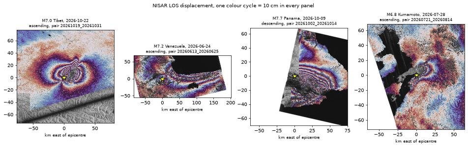

<p align="center"></p>

# Dancing with the SARs

**Press play on a season of radar.** A web app that lets anyone see the Earth's surface change as seen by NASA and ISRO's NISAR radar satellite, June to October 2026, and read what is physically happening and why radar can see it. It shows three kinds of change: **water through a season** (17 places), **the ground moving in earthquakes** (6 places, before and after one event) and **ground events seen as loss of radar coherence** (3 places: two volcanoes and a rock-ice collapse). That makes 26 places in `src/app/public/data/` (by class, from `summary.json`: floods 6, lakes 4, wetlands and deltas 4, farmland and forest 3, earthquakes 6, volcanoes 2, landslide 1). The places lie in Asia (Cambodia, China, Armenia, Bangladesh, Iran, Pakistan, Vietnam, Thailand, Nepal, Tibet, Japan; Armenia sits on the Europe–Asia boundary), Africa (Mali, Botswana, Egypt, South Sudan, Chad), South America (Brazil, Venezuela), North America (Panama, Hawaii) and Europe (Etna, Italy). The app exists in three designs on the same data: `src/app/` (satellite globe), `src/app2/` (story mode) and `src/app3/`, a merged app on branch `front_harut` (in progress). None is deployed and there is no live address; which one is submitted is not decided in this document.

NASA Space Apps Challenge 2026 · challenge *Dancing with the SARs* · team **Constellation**: Harutyun Kesablyan, Arameh Haghverdian, Abel Babayan.


## What it shows

| Place | What the radar shows |
|---|---|
| **Tonle Sap, Cambodia** | The monsoon flood spreading like a wave: the river plain south-east of the lake goes under in late August, the ring around the lake in September |
| **Lake Sevan, Armenia** | A lake that does not change — and how wind and rain can fool a naive method into thinking it shrank |
| **Ararat Valley, Armenia** | What radar at this resolution does not show: fields smaller than a pixel. (Interferometry does show the farming season there: [docs/eda/insar.md](docs/eda/insar.md)) |

Twelve more places use the same detector. Balanced accuracy of the water map against Landsat water pixels that never change, from [docs/eda/fusion2.md](docs/eda/fusion2.md), section 8. **This is an easy test: it is measured only on pixels where the answer is certain (always water or never water); shorelines and floodplains are not in it. It does not show that a place is solved.** Against NASA's own water product several of these places look much worse (next section):

| Place | Accuracy | Place | Accuracy |
|---|---|---|---|
| Poyang Lake, China | 99.9 % | Lake Chad | 99.3 % |
| Pantanal, Brazil | 99.98 % | Inner Niger Delta, Mali | 97.3 % |
| Lake Urmia, Iran | 97.0 % | The Sudd, South Sudan | 96.7 % |
| Nile Delta, Egypt | 71.4 % (do not quote a water area) | Mekong floodplain, Vietnam–Cambodia | 65.1 % (rivers narrower than a pixel) |
| Haor wetlands, Bangladesh; Okavango Delta, Botswana; Indus plain, Sindh; Rondônia, Brazil | no permanent water to score; only false water is measured | | |

### Against NASA's OPERA water product

We compared our open-water maps with NASA's operational OPERA DSWx-S1 product ([docs/eda/opera.md](docs/eda/opera.md)). This is agreement between two products, not accuracy against the truth, and OPERA is itself a model.

- At Lake Sevan and Tonle Sap our maps agree with OPERA on 97.5 % of pixels (IoU 0.84, 20 place-dates). At Tonle Sap the IoU falls from 0.83–0.89 in June–July to 0.56–0.65 from mid-August, when the flood spreads into the forest.
- Across 101 place-dates at 15 places the agreement is 94 % of pixels, but most pixels are dry land and the mean IoU is only 0.38.
- Three places where the comparison shows our map is wrong: **Inner Niger Delta** (we map about four times OPERA's open water; 98 % of our extra water is dry in OPERA), **Lake Chad** (we find about half of OPERA's water) and **Lake Urmia** (we call wet salt flat water). The deltas (Mekong, Nile), the Pantanal and the Sudd are weak, because narrow or vegetated water is missed; Okavango and Sindh-Indus show no open water in our maps while OPERA maps 20–200 km².

For each water place: a timeline of ten radar passes, a map of open water and flooded vegetation per date, a map of *when* each place changed, a before/after comparison, curves at named spots, and a four-part story.

### The ground moving: earthquakes

NISAR also records the phase of the radar wave. Two passes 12 to 24 days apart that span an earthquake give an interferogram: colour bands (fringes) that show how far the ground moved along the line between the satellite and the ground. We tried fifteen earthquakes between June and October 2026 against NISAR L2 GUNW pairs. **Six are clear, one is marginal and eight are not detected.** The marginal one (Huancayo, Peru M5.5) and the eight not detected are reported as such and are not in the app.

| Earthquake (USGS) | Peak to peak ground movement along the radar line of sight, within the stated radius | Same-track pair from before the event | Look directions |
|---|---|---|---|
| Tibet M7.0, 22 Oct | 127 cm (45 km) | 5 cm | one |
| Panama M7.7, 9 Oct | 133 cm descending, 85 cm ascending (60 km); frames cover only part of the pattern, value uncertain (107–165 cm across processing variants) | 21 / 15 cm | two |
| Venezuela M7.2, 24 Jun | 51 cm ascending, 55 cm descending (60 km); an approximate east/up split gives east about −46 to +37 cm, vertical under 10 cm | 12 / 10 cm | two |
| Venezuela M7.5, 24 Jun | descending 48 cm (60 km), control 10.8 cm; the ascending view is partial (9 % valid pixels) and its control is not clean, so it is not quoted. Same pairs as the M7.2, about 40 s apart: the two cannot be separated | 10.8 cm (desc) | two |
| Kumamoto, Japan M6.8, 28 Jul | 38 cm (30 km), a 24-day pair | 6 cm | one |
| Qaidam, China M5.6, 18 Aug | one compact patch 3–4 km across, 5 km ESE of the epicentre: mean +6 / +10 / +6 cm within 3 km in three pairs, about 10 km² above 5 cm; controls 0 | 0 km² above 5 cm | both, three pairs |

**Not detected:** Flores Sea M7.8, Mexico M7.3 (offshore), Sanriku, Japan M6.9 (offshore), Qinghai M5.8 (too small), Khuzdar M5.7, Redwood Valley M5.6, Turangi M5.7 and Qaidam M5.3 (all small). Why, for each, in [docs/eda/quake.md](docs/eda/quake.md). **"NISAR sees M5 earthquakes" is not supported:** of seven events of M5.3 to 5.8 tried, one is clear (Qaidam M5.6), one marginal and five showed nothing.



### Other ground events: loss of coherence

We also looked at other ground events between 17 June and 31 October 2026 ([docs/eda/events.md](docs/eda/events.md)). **Three are clear**, each as a patch with a sharp outline where the surface was rearranged and the two passes can no longer be compared (loss of coherence, not fringes): the **Langtang Lirung rock-ice collapse** (Nepal, 26 Aug, about 8.5 km²), **Kilauea episode 55** (Hawaii, 17 Oct, about 10.2 km², one look direction) and the **Etna Valle del Bove lava field** (Italy, July–August, about 2.5 km², both look directions). Three are marginal (a tailings dam failure near Brits, Kilauea episode 54, Ambrym) and two are not detected (two Nepal landslides). We do not claim: whether the change is new lava, ash or debris; volumes or thickness; the date inside the 12- or 24-day pair; or any ground motion.

### Disaster events from previews

We tried further 2026 events as new places from the free previews ([docs/research/events-2026.md](docs/research/events-2026.md)). So far (a second round is still running) the log lists six clear and three marginal; the rest show nothing. Only the **Chao Phraya flood** (Thailand) is a place in the app: open water about 990 km² on 6 September to about 1,930 km² on 30 September, and 82 % of the new water lies inside the JRC maximum water extent (Landsat, 1984–2021). The other clear ones (Mahanadi and Uttar Pradesh–Terai floods, three burn scars) are not in the app; the others tried are not shown. Small, town-scale and narrow-channel floods vanish at 180 m.

What we do not claim for earthquakes: damage, casualties or any effect on people; the fault plane, slip or rupture length of any earthquake; that Venezuela M7.2 and M7.5 are separate ruptures; vertical or horizontal motion, except Venezuela's approximate split; agreement with GNSS or other satellites (no such check was made); that the sign (toward or away from the satellite) is confirmed. The products are PROVISIONAL, some of them urgent-response. Method, every number and the full list: [docs/eda/quake.md](docs/eda/quake.md).

## Honest status

State of 15 November 2026, 00:50 (Armenia time). One-page summary of results: [docs/RESULTS.md](docs/RESULTS.md).

- **The app shows previews.** Everything in the app uses NISAR's free preview images: about 180 m per pixel and not calibrated. Patterns and timing are reliable; exact values and areas are not. The app says so on screen.
- **Calibrated data: Tonle Sap is in the app as its own place (`tonle-sap-cal`); the rest is analysed only.** A small remote server reads windows of the large calibrated files, so nothing big is downloaded. All ten Tonle Sap dates (80 m) are analysed, and most Armenia dates (30 m) are extracted. In the app the calibrated open water goes from 2,340 km² (19 June) to about 5,660 km² on 17 October; the study quotes 5,625 km² for the same date, about 5,600 in both, the small difference being the footprint (the study counts inside the preview footprint, the app map covers its own window). On Tonle Sap a dB water rule gives 5,625 km² on 17 October, 5.9 % from the independent estimate on average (previews: 20 %), and its area moves by a factor 1.25 over a justified threshold range at the flood peak (previews: 2.39). The same thresholds find 0 km² at Lake Sevan, because the Armenian product has a noise floor 7–8 dB higher. The calibration is PROVISIONAL. Details: [docs/eda/calibrated.md](docs/eda/calibrated.md).
- **One water detector for every place (fusion v2).** It sizes the Tonle Sap flood at 5,046 km² on 17 October (range 4,196–6,051) against an independent estimate of 5,421 km² (4,198–7,222) built from the lake level and 38 years of Landsat water maps, with no radar; it falls inside that range on 7 of 10 passes (earlier detectors: 1 of 10). Limits: its floodplain threshold was fitted to the same estimate, only 76 % of its water lies inside the independent map, and the estimate is a model, not a measurement. Details: [docs/eda/fusion2.md](docs/eda/fusion2.md), [docs/eda/hydro.md](docs/eda/hydro.md).
- **Compared with NASA's OPERA product.** Agreement at Sevan and Tonle Sap is 97.5 % of pixels (IoU 0.84); across 101 place-dates at 15 places it is 94 % of pixels but mean IoU 0.38; Inner Niger, Lake Chad and Urmia are wrong in our maps (see above). The 97–99 % balanced accuracies in the table above were measured only on certain pixels and do not contradict this. Details: [docs/eda/opera.md](docs/eda/opera.md).
- **Checked against independent sources.** At Lake Sevan our permanent water overlaps 38 years of Landsat water maps (JRC Global Surface Water) at 0.94, and at Tonle Sap our open-water area follows the lake level from a NASA satellite altimeter (rank correlation 0.98 over ten passes). The checks also corrected us: the lake began rising in early July, which radar saw as water under vegetation, and one of the two "windy" passes over Lake Sevan followed a night of rain. Details: [docs/eda/validation.md](docs/eda/validation.md), [docs/eda/validation-2026.md](docs/eda/validation-2026.md).
- **Interferometry.** Radar phase shows the farming season on the Ararat Valley floor (the share of incoherent ground falls from 43–44 % in June–July to 22–25 % from mid-September). We found no ground motion above ±15 mm in 120 days and the soil-moisture product did not help. Details: [docs/eda/insar.md](docs/eda/insar.md).
- **Tried, did not help**: learned despeckling, a physics autoencoder, a network trained on independent labels (a cross-check only), and other models, listed in [docs/RESULTS.md](docs/RESULTS.md).
- **Earthquakes: six of fifteen clear (one marginal, eight not detected), none validated independently.** Each map is one pair per event, not a time series. Ground movement is along the line of sight only; with one look direction, up, east and north movement are mixed. The evidence is a control pair from before the event on the same track (flat), and agreement with the USGS location and mechanism. There is no check against GNSS, Sentinel-1 or any other data, and the sign convention is unconfirmed. Panama's frames cover only part of the pattern. Details and limits: [docs/eda/quake.md](docs/eda/quake.md).
- **In progress:** Ararat coherence layers (not in the app), the merged app `src/app3/` (branch `front_harut`), and a second round of disaster events.
- **Data size:** the app data folder is about 66 MB (90 MB before optimisation), including thumbnails and a one-file summary ([docs/eda/data-size.md](docs/eda/data-size.md)).
- **Tests:** 223 passed in 33 test files in the full run ([docs/evidence/pytest-full.txt](docs/evidence/pytest-full.txt)).
- **No radar passes exist from 27 July to 10 August 2026** (instrument outage). The timeline shows the gap.
- **One season**, ten passes. The work is on the `eda` branch and is not merged to `main`.

## How it works

```
NISAR GCOV (ASF)  →  cut and align  →  detect  →  export  →  static web app
                     scripts/ingest    scripts/detect  scripts/ingest  src/app or src/app2

USGS catalogue  →  ASF GUNW pair search  →  windows cut on a remote server  →  interferometry  →  event place in the app
                                                                             scripts/detect/quake.py
```

Detection is mathematics on PyTorch tensors: speckle filtering across all dates, quality control of every pass, a terrain mask, a flooded-vegetation rule (HH rises while HV does not), a change-point test that dates each pixel's change, and a probability-based water detector (fusion v2) that combines several experts, including a detector that calibrates itself on each scene, with a time model that lets a pixel turn to water where the radar darkens. Small neural networks are among the experts or are evaluated as alternatives; none draws a layer on its own. For calibrated data, a separate path reads the large files on a small remote server and a dB detector runs on the result. For earthquakes, a third path (interferometry) reads unwrapped phase from NISAR L2 GUNW products on the same kind of server, converts it to line-of-sight displacement, removes a far-field ramp and compares each event with a pair from before it ([docs/eda/quake.md](docs/eda/quake.md)). Scripts that talk to the server read `SERVER` and `SSH_KEY` from the environment; no address is stored in the repository.

- Results at a glance: [docs/RESULTS.md](docs/RESULTS.md)
- Evidence record (every test and experiment, what it showed, where the proof is): [docs/EVIDENCE.md](docs/EVIDENCE.md)
- System design and what is shipped or only evaluated: [docs/ARCHITECTURE.md](docs/ARCHITECTURE.md)
- Full design, formulas, parameters and results: [docs/DETECTION.md](docs/DETECTION.md)
- Lane write-ups: [fusion v2](docs/eda/fusion2.md), [independent flood estimate](docs/eda/hydro.md), [self-calibrating detector](docs/eda/crossscene.md), [calibrated data](docs/eda/calibrated.md) and [how it was extracted](docs/research/calibrated-data.md), [interferometry](docs/eda/insar.md), [despeckling](docs/eda/despeckle.md), [physics autoencoder](docs/eda/unmix.md), [network on independent labels](docs/eda/supervised.md)
- Earthquakes: [docs/eda/quake.md](docs/eda/quake.md) (verdicts for all fifteen, method, limits, what may be claimed); other ground events: [docs/eda/events.md](docs/eda/events.md); OPERA comparison: [docs/eda/opera.md](docs/eda/opera.md)
- Exploratory analysis: [docs/eda/eda-findings.md](docs/eda/eda-findings.md); method note: [docs/eda/math-detection.md](docs/eda/math-detection.md); neural networks: [docs/eda/dl-notes.md](docs/eda/dl-notes.md)
- File formats between the stages: [plan/00-contracts.md](plan/00-contracts.md)

## Run it

Web app (Node 20.19 or newer). Designs on the same data (`src/app3/` is the merged app on branch `front_harut`, still in progress; see its own `package.json`):

```bash
cd src/app && npm install && npm run dev -- --port 5173     # natural map (globe, compare, reveal)
cd src/app2 && ln -s ../app/node_modules node_modules && npx vite --port 5174   # story mode
```

Rebuild the detections from scratch (Python 3.12 or newer; no login needed for previews):

```bash
python3 -m venv .venv
.venv/bin/pip install -r requirements.txt -r requirements-detect.txt

for area in tonle-sap sevan ararat; do   # or any id in areas/
  .venv/bin/python scripts/ingest/fetch_previews.py $area   # download preview images
  .venv/bin/python scripts/detect/run.py $area               # detect
  .venv/bin/python scripts/ingest/export.py $area            # write web images
done

.venv/bin/python -m pytest tests -q                          # checks
.venv/bin/python -m scripts.detect.validate                  # compare with Landsat water maps
```

`run.py` reads the fusion v2 products when they exist (`.venv/bin/python -m scripts.detect.fusion2 <area>`, a few seconds to 20 s per place) and falls back to the simple detector otherwise.

Train the networks (Apple GPU or CPU):

```bash
.venv/bin/python -m scripts.detect.train sweep --model unet --versions v2 --workers 3
```

## Repository

| Path | Holds |
|---|---|
| `src/app/` | Web app, design A: satellite-imagery globe, glass panels, compare and reveal (Vite, React, MapLibre GL JS). `public/data/` holds the exported images |
| `src/app2/` | Web app, design B: story mode with arrow keys, chart timeline, gallery, "How sure are we?" sheet; same data |
| `src/app3/` | Merged app (branch `front_harut`, in progress, not deployed) |
| `scripts/ingest/` | Search, download, cut, export; the calibrated-data extractor that runs on a remote server |
| `scripts/detect/` | Loader, detection maths, detector entry point, fusion, validation, neural networks, calibrated-data detector, earthquake interferometry (`quake.py`, tests in `tests/test_quake.py`) |
| `areas/` | One folder per place: box, track and frame, story text, spots |
| `tests/` | Automated checks on synthetic scenes |
| `docs/` | Analysis, method, validation, research notes, screenshots, pitch files |
| `plan/` | Work plan and file contracts |

## Data and credits

- **NISAR GCOV preview images**: NASA/JPL-Caltech and ISRO, distributed by the Alaska Satellite Facility DAAC.
- **NISAR GCOV calibrated, GUNW and SME2 products** (PROVISIONAL): NASA/JPL-Caltech and ISRO, distributed by the ASF DAAC. The earthquake maps use NISAR L2 GUNW (urgent-response and PROVISIONAL).
- **Earthquake locations, magnitudes and mechanisms**: U.S. Geological Survey, Earthquake Hazards Program.
- **Global Surface Water** (validation, and labels for some evaluated networks): Pekel, Cottam, Gorelick, Belward (2016), *High-resolution mapping of global surface water and its long-term changes*, Nature 540, 418–422. Source: EC JRC/Google.
- **Basemap**: OpenFreeMap, OpenMapTiles, OpenStreetMap contributors.
- Sources for every figure quoted in the stories: [docs/research/story-sources.md](docs/research/story-sources.md).

## Use of AI

AI tools (Claude) were used for research, planning documents, code, analysis and first drafts of the story text. The team chose the challenge approach and the places, reviewed the results and edited the text.

## Licence

[MIT](LICENSE).
