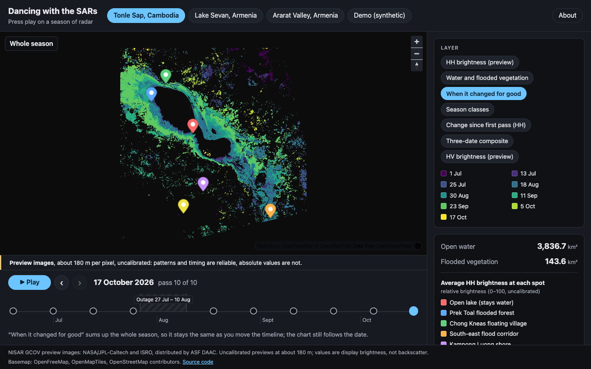

# Dancing with the SARs

**Press play on a season of radar.** A web app that lets anyone watch the Earth's surface change through ten passes of NASA and ISRO's NISAR radar satellite, June to October 2026, and read what is physically happening and why radar can see it.

NASA Space Apps Challenge 2026 · challenge *Dancing with the SARs* · team: Arameh Haghverdian, Abel Babayan, Harutyun Kesablyan.



## What it shows

| Place | What the radar shows |
|---|---|
| **Tonle Sap, Cambodia** | The monsoon flood spreading like a wave: the river plain south-east of the lake goes under in late August, the ring around the lake in September |
| **Lake Sevan, Armenia** | A lake that does not change — and how wind can fool a naive method into thinking it shrank |
| **Ararat Valley, Armenia** | What radar at this resolution does not show: fields smaller than a pixel |

For each place: a timeline of ten radar passes, a map of open water and flooded vegetation per date, a map of *when* each place changed, a before/after comparison, curves at named spots, and a four-part story.

## Honest status

- **The images are previews.** Everything shown today uses NISAR's free preview images: about 180 m per pixel and not calibrated. Patterns and timing are reliable; exact values and areas are not. The app says so on screen. Calibrated full-resolution data (20 m) needs a NASA Earthdata login and is the next step; the pipeline for it is written and tested on synthetic files only.
- **Checked against an independent source.** Our water maps were compared with 38 years of Landsat water maps (JRC Global Surface Water). At Lake Sevan our permanent water overlaps the long-term lake at 0.94; at Tonle Sap 98.9 % of the water we map on 17 October lies inside the historical flood zone. The same check found false "water" on dark dry land in the Armenian mountains. Details: [docs/eda/validation.md](docs/eda/validation.md).
- **No radar passes exist from 27 July to 10 August 2026** (instrument outage). The timeline shows the gap.

## How it works

```
NISAR GCOV (ASF)  →  cut and align  →  detect  →  export  →  static web app
                     scripts/ingest    scripts/detect  scripts/ingest  src/app
```

Detection is mathematics on PyTorch tensors: speckle filtering across all dates, a two-threshold water mask, a flooded-vegetation rule (HH rises while HV does not), and a change-point test that dates each pixel's change. Two small neural networks (a recurrent autoencoder and a U-Net) are included and train on a laptop in about two minutes; the app uses the mathematical detector.

- Full design, formulas, parameters and results: [docs/DETECTION.md](docs/DETECTION.md)
- Exploratory analysis: [docs/eda/eda-findings.md](docs/eda/eda-findings.md)
- Method note: [docs/eda/math-detection.md](docs/eda/math-detection.md)
- Neural networks: [docs/eda/dl-notes.md](docs/eda/dl-notes.md)
- File formats between the stages: [plan/00-contracts.md](plan/00-contracts.md)

## Run it

Web app (Node 20.19 or newer):

```bash
cd src/app
npm install
npm run dev
```

Rebuild the detections from scratch (Python 3.12 or newer; no login needed for previews):

```bash
python3 -m venv .venv
.venv/bin/pip install -r requirements.txt -r requirements-detect.txt

for area in tonle-sap sevan ararat; do
  .venv/bin/python scripts/ingest/fetch_previews.py $area   # download preview images
  .venv/bin/python scripts/detect/run.py $area               # detect
  .venv/bin/python scripts/ingest/export.py $area            # write web images
done

.venv/bin/python -m pytest tests -q                          # checks
.venv/bin/python -m scripts.detect.validate                  # compare with Landsat water maps
```

Train the networks (Apple GPU or CPU):

```bash
.venv/bin/python -m scripts.detect.train sweep --model unet --versions v2 --workers 3
```

## Repository

| Path | Holds |
|---|---|
| `src/app/` | Web app (Vite, React, MapLibre GL JS). `public/data/` holds the exported images |
| `scripts/ingest/` | Search, download, cut, export |
| `scripts/detect/` | Loader, detection maths, detector entry point, validation, neural networks |
| `areas/` | One folder per place: box, track and frame, story text, spots |
| `tests/` | Automated checks on synthetic scenes |
| `docs/` | Analysis, method, validation, research notes, screenshots |
| `plan/` | Work plan and file contracts |

## Data and credits

- **NISAR GCOV preview images**: NASA/JPL-Caltech and ISRO, distributed by the Alaska Satellite Facility DAAC.
- **Global Surface Water** (validation only): Pekel, Cottam, Gorelick, Belward (2016), *High-resolution mapping of global surface water and its long-term changes*, Nature 540, 418–422. Source: EC JRC/Google.
- **Basemap**: OpenFreeMap, OpenMapTiles, OpenStreetMap contributors.
- Sources for every figure quoted in the stories: [docs/research/story-sources.md](docs/research/story-sources.md).

## Use of AI

AI tools (Claude) were used for research, planning documents, code, analysis and first drafts of the story text. The team chose the challenge approach and the places, reviewed the results and edited the text.

## Licence

[MIT](LICENSE).
