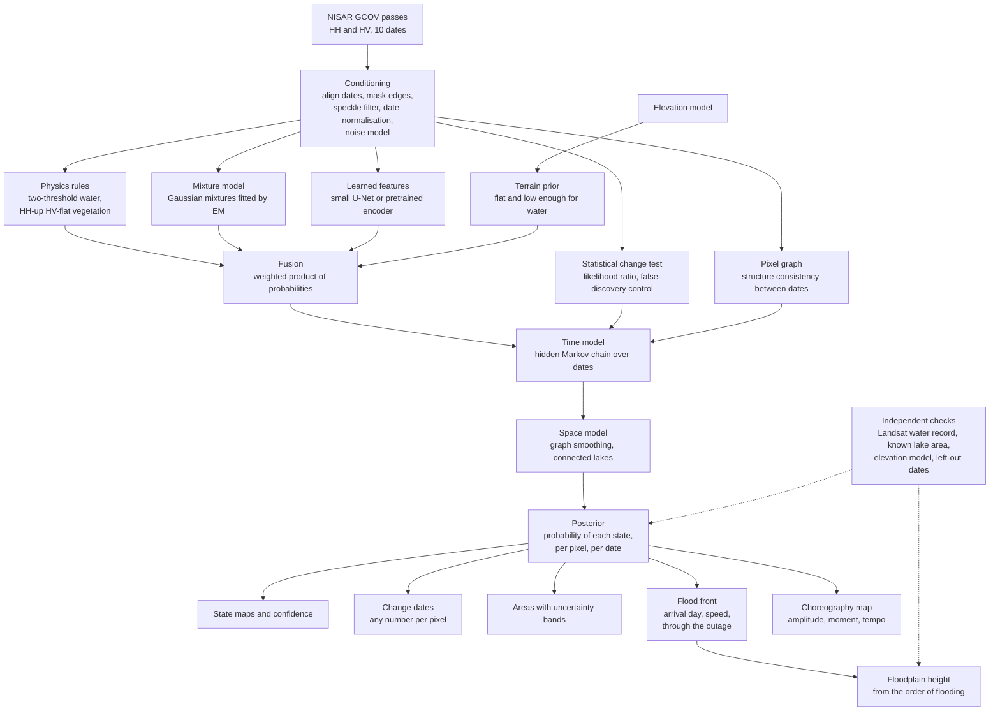

# Detection architecture

Draft of 14 November 2026, 15:30. This is the design that ties the separate detection modules into one system. Parts marked *running* are being built now; the document is updated when their results arrive. A part enters the final system only if it passes the admission rule in section 5.

Current, working detector (what the app shows today): [DETECTION.md](DETECTION.md).

## 1. The idea in four sentences

Each radar pass is weak evidence about the state of each pixel: open water, vegetation standing in water, or dry land. Several independent "experts" read that evidence in different ways — physics rules, fitted probability distributions, statistical tests, the pixel graph, learned features — and each reports a probability, not a verdict. Three kinds of prior knowledge constrain the answer: terrain (water lies flat and low), time (states persist and follow a physical order), and space (neighbours agree). The system multiplies evidence and priors into one probability per pixel per date, and everything shown to the user — maps, dates of change, areas with error bars, the flood's arrival time — is read from that single result.

## 2. Diagram

## 3. Layers

### Layer 0 — Conditioning (built)

Aligns all dates to under 0.1 pixel, keeps only pixels seen on every date, removes the unreliable swath edge, filters speckle using all dates together, and removes per-date brightness drift using stable pixels. Formulas: [DETECTION.md, section 2](DETECTION.md). *Running:* a noise model (equivalent number of looks) so later layers can state probabilities.

Output: $L_{t,c}(i)$, the filtered log-like intensity of pixel $i$ on date $t$ in channel $c \in \{\text{HH}, \text{HV}\}$, and a validity mask.

### Layer 1 — Evidence experts

Each expert $k$ maps the conditioned data to a probability over states $s \in \{\text{water}, \text{flooded vegetation}, \text{land}\}$ for every pixel and date, $p_k(s \mid L_t(i))$, or to evidence that a change happened between dates.

| Expert | Reads | Reports | Status |
|---|---|---|---|
| Physics rules | Absolute darkness in HH and HV; HH rise without HV rise | Hard masks, converted to probabilities by distance from threshold in noise units | Built; baseline |
| Mixture model | Shape of the HH–HV distribution | Posterior probability from Gaussian mixtures fitted by expectation–maximisation; number of components by information criterion | Running |
| Statistical change test | Ratio of intensities between dates | p-value that a pixel changed, with false-discovery control; several changes per pixel | Running |
| Pixel graph | Which pixels resemble each other | Change where the similarity structure of one date is broken on another; immune to a brightness shift between dates | Running |
| Learned features | Spatial context | Probability from a small U-Net, or from a pretrained encoder if one transfers | Built (U-Net); pretrained encoders under test |

### Layer 2 — Priors

| Prior | Statement | Source | Status |
|---|---|---|---|
| Terrain | Open water needs flat, low ground and cannot sit in radar shadow | Public elevation model, never the validation data | Running |
| Permanence | Pixels dark on almost every date are permanent water | The stack itself | Built |
| Time | Water tends to stay water; in a rising flood, land → flooded vegetation → open water is likelier than the reverse | Transition probabilities learned from all pixels | Running |
| Space | Neighbours with similar radar signature share a state; a lake is one connected body | Pixel graph | Running |

### Layer 3 — Fusion

Per pixel and date, experts and the terrain prior are combined by a weighted product (log-linear pooling):

$$
q_t(s \mid i) \;\propto\; \pi_{\text{terrain}}(s \mid i)\;\prod_{k} p_k\big(s \mid L_t(i)\big)^{w_k}
$$

with weights $w_k \ge 0$. A weight of zero removes an expert. Weights are fitted on the tuning split against pixels whose state is known from the independent record (always water, never water), never on the test split.

The fused per-date evidence becomes the emission of a hidden Markov chain over the ten dates. With transition matrix $A$ and the forward–backward recursions,

$$
\gamma_t(s \mid i) \;=\; P\big(S_t = s \;\big|\; q_1,\dots,q_T\big),
$$

where the double-length step across the 27 July – 10 August outage uses $A^2$. Change evidence from the statistical test and the graph raises the probability of a transition between the two dates concerned.

Finally the posteriors are smoothed on the pixel graph, with edge weights from radar similarity, so that speckle-sized disagreements vanish and wind-roughened patches enclosed by confident water are recovered.

Output: $\gamma_t(s \mid i)$ — one probability per state, pixel and date.

### Layer 4 — Products, all read from $\gamma$

| Product | Definition |
|---|---|
| State map per date | $\arg\max_s \gamma_t(s)$, with $\max_s \gamma_t(s)$ shown as confidence |
| Change dates | Dates where the most likely path switches state; any number per pixel |
| Area with uncertainty | $\sum_i \gamma_t(\text{water} \mid i)\,a_i$ for the expected area; band from threshold, shoreline and noise components |
| Flood front (*running*) | Day each pixel went under water, interpolated between consecutive shorelines; front speed; estimate inside the outage with its ±12-day bound; skill measured by leaving one real date out |
| Floodplain height from flood order (*running*) | Earlier flooded means lower; checked against an elevation model that was never used to build it |
| Choreography map (*running*) | Per pixel: how much it changed, when, and how abruptly, painted as one image |

### Layer 5 — Verification

| Check | Independent of the detector? | Status |
|---|---|---|
| Synthetic scenes with known answers | Yes | Built, 9 tests |
| Lake Sevan published area, 1,242 km² | Partly: thresholds were first tuned on it | Built |
| 38 years of Landsat water maps | Yes | Built |
| Tune on one region, test on untouched regions and another country | Yes | Running |
| Elevation model against flood-order height | Yes | Running |
| Leave one radar pass out, predict its shoreline | Yes | Running |

## 4. Why a system and not a list of detectors

- **One answer.** Ten detectors give ten maps that disagree. The fusion gives one probability, and the disagreement becomes the uncertainty.
- **Each weakness is covered by a different part.** Wind on a lake is a time problem (one date against nine); mountain shadow is a terrain problem; ragged shorelines are a space problem; hand-picked thresholds are a distribution-fitting problem.
- **Calibration-proof procedure.** Thresholds fitted on uncalibrated previews will not survive the move to calibrated data. Fitted distributions, learned transitions and tuned weights are re-estimated from the new data by the same code.
- **Every claim has a check that could have failed.**

## 5. Admission rule

A module is added to the fused system only if, on the untouched test split and on Lake Sevan:

1. it does not lower accuracy on always-water and never-water pixels, and
2. it improves at least one named weakness by a measurable amount — false water in mountains, lake area on windy dates, stability of flooded-vegetation area, or false-change rate on stable targets — and
3. it runs on a laptop in minutes.

Modules that fail stay in the repository as documented experiments. Reporting what did not help is part of the result.

## 6. Status

| Part | State |
|---|---|
| Conditioning, physics rules, change point, class map, app export | Built, in the app |
| Small U-Net, temporal autoencoder | Built; not in the app (they copy the physics rules) |
| Independent validation | Built |
| Terrain prior, mixture model and Markov chain, statistical test, graph methods, flooded-vegetation rebuild, threshold tuning | Running |
| Flood front, height from flood order, choreography map | Running |
| Pretrained encoders | Under evaluation |
| Fusion layer | Designed here; built once the experts report |
| More places around the world | Running |
| Calibrated full-resolution data | Blocked: needs a NASA Earthdata login |

## 7. What would make this worth a global stage

Judges score impact, creativity, validity, relevance and presentation. A longer list of algorithms does not move any of those. What can:

- **One original result people remember.** A map of the day the flood arrived at each place, including the days the satellite was blind, and a height map of a floodplain read from nothing but the order in which it went under water. Stated with exactly the novelty it has, after a prior-art check.
- **Validity nobody else at the hackathon will have.** Independent validation, held-out testing, uncertainty on every number, and a public list of our own errors.
- **Real NISAR science.** Flooding under vegetation is what L-band sees and other sensors miss. It needs calibrated data to be shown convincingly.
- **A live app that works on a phone, with places on several continents.**
- **A clear story.** One sentence, one animation, one number.

The largest remaining risk to all of this is not an algorithm. It is that the work is not yet merged and deployed, and that the demo and project page are not started.
