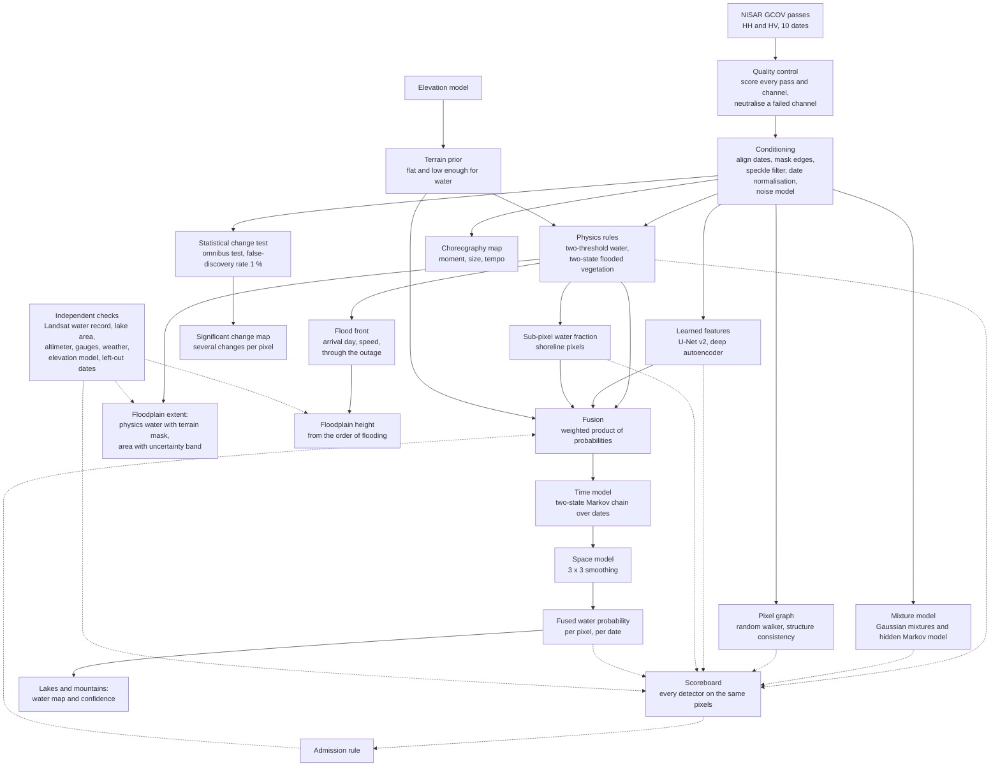

# Detection architecture

Updated 14 November 2026, about 14:00 (Armenia time); first drafted the same day at 11:50, before most of the modules had results. This is the design that ties the separate detection modules into one system, and what happened when each module was built and measured. A part entered the fused system only if it passed the admission rule in section 5.

Formulas and every number in detail: [DETECTION.md](DETECTION.md). One-page summary: [RESULTS.md](RESULTS.md).

## 1. The idea in four sentences

Each radar pass is weak evidence about the state of each pixel: open water, vegetation standing in water, or dry land. Several independent "experts" read that evidence in different ways — physics rules, fitted probability distributions, statistical tests, the pixel graph, learned features — and each reports a probability, not a verdict. Three kinds of prior knowledge constrain the answer: terrain (water lies flat and low), time (states persist and follow a physical order), and space (neighbours agree). The system combines evidence and priors into one probability per pixel per date, and the products shown to the user — maps, dates of change, areas with error bars, the flood's arrival time — are read from that result or, where the result is known to be biased, from the expert that is not.

The last clause is the main lesson of the day (section 5): the combined result is the best answer for lakes and mountains, but not for a rising floodplain, so the app chooses per kind of terrain.

## 2. Diagram

Solid arrows carry data; dotted arrows carry measurements. The mixture model, the graph and the statistical test were offered to the fusion layer but not admitted (section 5); they feed the scoreboard and, for the statistical test, their own app layer.

## 3. Layers

### Layer 0 — Quality control and conditioning (built, in the app)

**Quality control** ([`qc.py`](../scripts/detect/qc.py), [`qc.md`](eda/qc.md)) runs first: it scores every pass of every area against the other dates on stable land (gain, contrast, channel balance, across-track slope, leave-one-date-out departure and its spatial pattern, residual misregistration, metadata) and writes `qc.json`. A channel that fails is replaced by the per-pixel median of the other dates before detection, so it can create neither a fake step nor a fake gain. Result: 134 passes in 15 areas; 3 pass-channels fail, including Armenia's 6 October HV (Sevan: departure 4.6× usual, channel balance $z = -12$); no false alarm on the Tonle Sap flood dates. Neutralising that HV pass halves the HV noise of stable land at Ararat and removes 14–17 % of the spurious change points in Armenia. [`run.py`](../scripts/detect/run.py) applies it.

**Conditioning** aligns all dates to under 0.1 pixel, keeps only pixels seen on every date, removes the unreliable swath edge, filters speckle using all dates together, and removes per-date brightness drift using stable pixels ([DETECTION.md, section 2](DETECTION.md)). The **noise model** was built in the statistical study ([`stats-change.md`](eda/stats-change.md)): preview noise behaves like a logarithmic display stretch of gamma-distributed speckle; temporal equivalent number of looks 10–17 at Tonle Sap and Sevan.

Output: $L_{t,c}(i)$, the filtered log-like intensity of pixel $i$ on date $t$ in channel $c \in \{\text{HH}, \text{HV}\}$, and a validity mask.

### Layer 1 — Evidence experts (results)

Each expert $k$ maps the conditioned data to a probability over states $s \in \{\text{water}, \text{flooded vegetation}, \text{land}\}$ for every pixel and date, $p_k(s \mid L_t(i))$, or to evidence that a change happened between dates.

| Expert | Reads | Result | Fate |
|---|---|---|---|
| Physics rules | absolute darkness in HH and HV; for flooded vegetation, a rise of HH − HV above noise, or both channels falling next to open water | balanced accuracy 99.57–99.58 % on held-out anchors; flooded-vegetation rule rebuilt: threshold sensitivity 7.8× → 1.53×, Armenia false alarms 39 → ≤ 1.4 km² | **the floodplain water layer**; a fusion expert |
| Mixture model | shape of the HH–HV distribution, Gaussian mixtures fitted by EM, read as a sequence by a hidden Markov model | Sevan 1,235.3 km² on every date; Ararat 0 km² false water; Tonle Sap flood shrunk to 3,326 km² | per-date mixture **rejected** by the admission rule (Sevan accuracy −0.66 pp); the HMM water mask is the fallback for lakes |
| Statistical change test | ratio of intensities between dates, empirical null from stable land | false-alarm rate on held-out stable land 0.02 % / 0 % / 0 % against 5.8 % / 0.08 % / 0.03 % for the change point; several changes per pixel | **its own app layer** (`sig`); as a water expert **rejected** |
| Pixel graph | which pixels resemble each other | random walker: 0 km² of false water in Armenia with no elevation data, Sevan calm dates within 0.1 % of 1,242 km²; but the Tonle Sap flood grows only 1.2×; structure-consistency change exactly gain-invariant; spectral clustering follows geography, not water | random walker **rejected** (Tonle Sap accuracy −0.28 pp once time and terrain were in); spectral methods dropped |
| Learned features | spatial context | U-Net v2 follows the physics rules within ±4 %; EfficientNet-B4 autoencoder did not beat a mixture on the raw two channels (water IoU 0.21 against 0.65); the only open L-band model (ALOS-2) reached 0.91 balanced accuracy at a never-seen Lake Sevan against 0.99 for the physics rules | U-Net and deep autoencoder **admitted** as fusion experts; pretrained models documented only |
| Sub-pixel water fraction | how dark a shoreline pixel is between pure water and nearby land | Sevan calm-date area 1,242.5 km² against the published 1,242 km² (hard mask −16 km²); shoreline placed to 52–63 m median from 180 m pixels | **admitted** (Sevan only) |

### Layer 2 — Priors (results)

| Prior | Statement | Source | Result |
|---|---|---|---|
| Terrain | open water needs flat, low ground and cannot sit in radar shadow | Copernicus DEM GLO-90, never the validation data | removes 70 % of the false water at Sevan and 90 % in the Ararat Valley, 0.04 % of the real lake lost; nothing removed at Tonle Sap; radar shadow removed none of it, slope and height above the local low did. **Admitted** (hard mask) |
| Permanence | pixels dark on almost every date are permanent water | the stack itself | built; used by the old flooded-vegetation rule and the sub-pixel fraction |
| Time | water tends to stay water | transition matrix learned by Baum–Welch on tune-strip pixels | **admitted**; fixes the Sevan rough-surface dip (66 → 0.8 km²); but learned on pixels that almost never change, so it resists late flooding (land → water 0.0013 per 12 days at Tonle Sap) |
| Space | neighbours share a state | a masked 3 × 3 mean of the posterior (the graph-weighted smoothing was not built) | **admitted** (small gains) |

### Layer 3 — Fusion (built)

Per pixel and date, experts and the terrain prior are combined by a weighted product (log-linear pooling), written in log-odds:

$$
\operatorname{logit} q_t(i) \;=\; b + \sum_{k} w_k\, f_k(i,t) \;-\; c\,\big[\pi_{\text{terrain}}(i) = 0\big]
$$

with $f_k$ the expert's log-odds (a probabilistic expert's own probability; for a hard mask, two values estimated from its true and false positive rates), $\pi_{\text{terrain}}$ the terrain mask, and weights $w_k \ge 0$ fitted by class-balanced, penalised logistic regression on tune-strip pixels whose state the 38-year Landsat record makes certain, never on the TEST strip. A weight of zero removes an expert. The hard terrain variant sets $q_t = 10^{-3}$ where water is impossible.

The fused evidence is the emission of a two-state hidden Markov chain over the ten dates; with transition matrix $A$ and the forward–backward recursions,

$$
\gamma_t(i) \;=\; P\big(S_t = \text{water} \;\big|\; q_1(i),\dots,q_T(i)\big),
$$

where the double-length step across the 27 July – 10 August outage uses $A^2$. Finally $\gamma$ is smoothed by a 3 × 3 mean inside the footprint.

Planned in the first draft but **not built**: three states (flooded vegetation is not fused), change evidence from the statistical test and the graph raising the transition probability between two dates, and graph-weighted spatial smoothing.

Output: $\gamma_t(i)$, a water probability per pixel and date, in `data/processed/<area>/fusion/products.pt`.

### Layer 4 — Products (results)

| Product | Definition | Read from | Result |
|---|---|---|---|
| Water map per date, lakes and mountains | $\gamma_t > 0.5$, with $\gamma_t$ as confidence | fused map (`"water_source": "fusion"` for Sevan and Ararat) | Sevan 1,239–1,241 km² of water on every date; far false water 9.3 km² (Sevan), 0.4 km² (Ararat) |
| Water map per date, floodplains | physics rules with terrain mask | physics expert | Tonle Sap 2,234 → 3,837 km², the October value a lower bound |
| Area with uncertainty | Monte Carlo over threshold, shoreline and speckle | statistical study | Tonle Sap 17 October about 3,500 km² (5–95 %: 2,000–4,800); the tuning study: 3,800–5,900 km² plausible |
| Change dates | the change point (one per pixel) and the significant-change map (any number per pixel, FDR 1 %) | physics rules; statistical test | flood wave dated: south-east plain 18 August, outer ring 23 September |
| Flood front | day each pixel went under water, interpolated between consecutive shorelines; front speed; the outage band with its ±12-day bound; skill measured by leaving one real pass out | physics water masks | 309 km² flooded across the outage at 12.9 km²/day, between 9.3 before and 13.6 after: no hidden surge; area error 82 km² against 161–178 km² for naive baselines |
| Floodplain height from flood order | earlier flooded means lower | flood front | against the elevation model ρ = 0.45 (0.25 without its flattened water); against 38-year Landsat water frequency ρ = −0.47 |
| Choreography map | per pixel, a fitted logistic step: moment, size and tempo, painted as one colour image | conditioned data | step moment agrees with the change point (ρ = 0.95); a REACTIV-style composite with a significance test |

### Layer 5 — Verification (results)

| Check | Independent of the detector? | Result |
|---|---|---|
| Synthetic scenes with known answers | yes | 22 test files, 129 test functions under [`tests/`](../tests/) ([DETECTION.md, section 7.1](DETECTION.md)) |
| Lake Sevan published area, 1,242 km² | partly: the water threshold was first tuned on it | sub-pixel 1,242.5 km²; HMM 1,235.3 km² every date |
| 38 years of Landsat water maps | yes | permanent-water IoU 0.94 (Sevan), 0.84 (Tonle Sap); the source of every anchor below |
| Tune on one strip, test on an untouched strip and another country | yes, but the TEST strip was looked at three times by the tuning | tuned thresholds rejected by the gate; old thresholds kept; transfer works from Sevan to Tonle Sap, not the other way |
| Independent 2026 data (altimeter, gauges, weather) | yes | area follows lake level, ρ = 0.98; two of our claims corrected ([`validation-2026.md`](eda/validation-2026.md)) |
| Elevation model against flood-order height | yes | ρ = 0.45, conservative 0.25 |
| Leave one radar pass out, predict its shoreline | yes | front best on area error; transformer about equal to a straight line in time |

## 4. Why a system and not a list of detectors

- **One answer per place.** Ten detectors give ten maps that disagree. The scoreboard puts them on one table, the fusion gives one probability for lakes and mountains, and the disagreement becomes the uncertainty.
- **Each weakness was covered by a different part.** Rough lake surfaces were a time problem (the Markov chain fixed the Sevan dip); mountain false water a terrain problem (the terrain mask) and a space problem (the graph); fragile flooded vegetation a definition problem (the rebuilt rule); hand-picked thresholds a tuning problem (the gate kept them, and showed where they are too strict).
- **Calibration-proof procedure.** Thresholds fitted on uncalibrated previews will not survive the move to calibrated data. The tuning procedure, the fitted mixtures, the transition matrices and the fusion weights are re-estimated from new data by the same code.
- **Every claim had a check that could have failed.** Two did fail (section 5 and [RESULTS.md](RESULTS.md)).

## 5. Admission rule, and the gap it had

A module was added to the fused system only if, on the untouched TEST strip and on Lake Sevan (declared in code as `fusion.RULE` before any TEST number was read):

1. it did not lower balanced accuracy on always-water and never-water pixels by more than 0.1 percentage point in any area, and
2. it improved at least one named weakness by a measurable amount — mountain false water by ≥ 10 % and ≥ 1 km², the Sevan rough-surface dip by ≥ 10 km², or date-to-date flips on stable pixels by ≥ 10 % and ≥ 0.005 — and
3. it ran on a laptop in under 10 minutes per area.

Flooded-vegetation stability, listed in the first draft, could not be measured, because the fused model has two states.

**What the rule decided** (greedy, priors first; numbers from [`fusion.md`](eda/fusion.md), section 4):

| Addition | Admitted? | Key number |
|---|---|---|
| terrain, hard mask | **yes** | mountain false water 69.7 → 22.9 km² |
| terrain, soft (fitted penalty) | no | changed nothing at the 0.5 threshold |
| time, two-state Markov chain | **yes** | Sevan dip 65.7 → 0.8 km²; flips 0.0102 → 0.0011 |
| space, 3 × 3 smoothing | **yes** | mountain false water 12.6 → 10.6 km² |
| math HH score | no | Sevan accuracy −0.05 pp |
| statistical water confidence | no | Sevan accuracy −0.04 pp |
| GMM per date | no | Sevan accuracy −0.66 pp |
| graph random walker | no | Tonle Sap accuracy −0.28 pp (although mountain false water → 0) |
| U-Net v2 | **yes** | mountain false water 10.6 → 7.4 km² |
| flood-order monotone mask | no | Sevan accuracy −0.05 pp |
| deep autoencoder + GMM | **yes**, barely | mountain false water −1.7 km² |
| sub-pixel fraction (Sevan only) | **yes**, barely | mountain false water −1.7 km² |
| supervised network (JRC labels at other places) | no | −0.98 km², below the 1 km² bar |

Fused result against the physics rules with terrain mask: balanced accuracy at Tonle Sap 99.57 % → 99.98 % (intervals do not overlap); Sevan rough-surface dip 66 → 1 km²; far false water 39.1 → 9.3 km² (Sevan) and 2.6 → 0.4 km² (Ararat); flicker on stable pixels down 40-fold.

**The gap.** The rule measured lakes and mountains, not the floodplain, because no 2026 truth exists there. So the fused map passed every test while it lost about **700 km²** of the 17 October Tonle Sap flood (3,120 km² against 3,837 km², which the tuning study already calls a lower bound), and its rank agreement with the 38-year record in the floodplain fell from 0.50 to 0.33. The guard columns that showed this were watched but were not part of the rule. The cause is the time prior: learned on tune-strip pixels that almost never change, it pulls a late-flooding pixel with one or two dates of evidence back to land. The GMM + HMM and the random walker show the same loss, so it is a property of persistence models, not a correction.

**The resulting choice, per kind of terrain.** Lakes and mountains (Sevan, Ararat): the fused water map. Floodplains (Tonle Sap and the other places by default): the physics rules with the terrain mask, with the uncertainty band, and the fused probability at most as a confidence layer. To use one fused answer everywhere, the time prior would have to be refitted on floodplain pixels (or fixed from physics) and the rule re-run with a floodplain guard; that was not done, because it would have been one more look at the TEST strip.

**Lessons for the next rule**: measure every kind of terrain the product is shown for; make the guard columns part of the rule; keep the TEST strip unseen by earlier tuning; and treat admissions of 1–2 km² as noise.

Modules that failed stay in the repository as documented experiments. Reporting what did not help is part of the result.

## 6. Status

| Part | What was built | Verdict | In the app |
|---|---|---|---|
| Quality control per pass | more than twenty checks, a same-acquisition rule, channel neutralisation | flags Armenia 6 October HV; no false alarm on the flood | **yes**, before detection |
| Conditioning, physics rules, change point, class map, export | as in [DETECTION.md](DETECTION.md) sections 2–4 | baseline | **yes** |
| Terrain mask | Copernicus DEM, slope, height above local low, shadow | admitted | **yes**, every area that has a DEM |
| Flooded vegetation, rebuilt | two-state rule with self-calibration on null land | replaces the old rule (7.8× → 1.53×) | **yes** |
| Threshold tuning against Landsat | split, search, adoption gate | candidate rejected; old thresholds kept | knobs unchanged |
| Statistical change test | omnibus test, empirical null, FDR, uncertainty bands | stated false-alarm rate; area ranges | **yes**: `sig` layer and the area range in the chart |
| Gaussian mixtures + HMM | per-area EM, phantom slot for the outage | best on Sevan's dip; shrinks the flood; per-date version not admitted | fallback only |
| Graph methods | random walker, TV cut, structure-consistency change, spectral methods | best mountain false water; misses the flood; not admitted; spectral dropped | no |
| Sub-pixel water fraction | linear mixing at the shoreline | Sevan area 1,242.5 km²; admitted (Sevan) | through the fused Sevan map |
| Scoreboard | every detector, same pixels, labels, split and intervals | used by the rule | – |
| Fusion layer | log-linear pooling, two-state Markov chain, 3 × 3 smoothing | admitted configuration: terrain, time, space, U-Net, deep autoencoder, sub-pixel | **yes** for Sevan and Ararat |
| Flood front, height from order, choreography | isotonic first-flood date, shape-based interpolation, logistic step fits | no hidden surge; height ρ 0.45 (conservative 0.25) | **yes**: `arrival` and `choreo` layers for Tonle Sap |
| U-Net v2, temporal autoencoder | trained on the physics labels; season embedding | copy the physics rules; U-Net admitted as an expert | through the fused Sevan map |
| EfficientNet-B4 autoencoder, temporal transformer | large pretrained encoder; masked-date transformer | did not beat a mixture / a straight line in time | no |
| Open pretrained radar models | survey; Microsoft ai4g flood network; ALOS-2 L-band model with a place hold-out | L-band pretraining transfers (0.91 vs 0.67 random) but stays below the physics rules (0.99) | no |
| Independent 2026 validation | altimeter, gauges, reanalysis, weather stations | area follows level (ρ 0.98); two claims corrected | wording of the stories |
| More places | `add_area.py`, one command | 13 places in the app; 2 tried and dropped (Lake Chad, Pantanal) | **yes** |
| In progress at the time of writing | self-supervised speckle filter (`despeckle.py`), physics unmixing autoencoder (`unmix.py`), supervised network on JRC labels (`supervised.py`; scoreboard row exists), calibrated-data extraction (`remote_extract.py`) | notes not complete yet | no |
| Calibrated full-resolution data | extraction code in progress | **blocked**: needs a NASA Earthdata login | no |

## 7. What would make this worth a global stage

Judges score impact, creativity, validity, relevance and presentation. A longer list of algorithms does not move any of those. What can, and where we stand:

- **One original result people remember.** *Exists*: a map of the day the flood arrived at each place, including the 24 days the satellite was blind, with a measured skill (hiding real passes) and the finding that there was no hidden surge; and a relative height map of the floodplain read from the order of flooding alone, checked against an elevation model it never saw. The prior-art check is done ([`novel.md`](eda/novel.md)): the waterline idea is about 30 years old; the chain and the order-as-height reading are, to our knowledge, a new combination, never "first".
- **Validity nobody else at the hackathon will have.** *Exists*: held-out testing with an adoption gate written in advance, one scoreboard for every detector, uncertainty bands on every area, independent 2026 checks against a NASA altimeter and river gauges, and a public list of our own errors — including the two claims the 2026 data corrected and the gap in our own admission rule.
- **Real NISAR science.** *Partly*: water under vegetation, which L-band sees and optical sensors and C-band radar miss, is now a stable layer whose July rise matches the river gauge. Its area cannot be shown convincingly without **calibrated data**, which still needs an Earthdata login.
- **A live app that works on a phone, with places on several continents.** *Partly*: 13 places in Asia, Africa and South America are exported for the app. **Deployment** and a phone check are not confirmed in any document we read.
- **A clear story.** One sentence ("NISAR saw the Tonle Sap rise first under the trees, then on open water, and our area follows NASA's altimeter at 0.98"), one animation (the arrival-day map), one number.

**Still missing**: the work is on the `eda` branch and not yet merged; the app is not yet deployed; the demo video and project page are not started; calibrated data is blocked on a login; the four modules in progress are unfinished. The largest remaining risk is not an algorithm.
