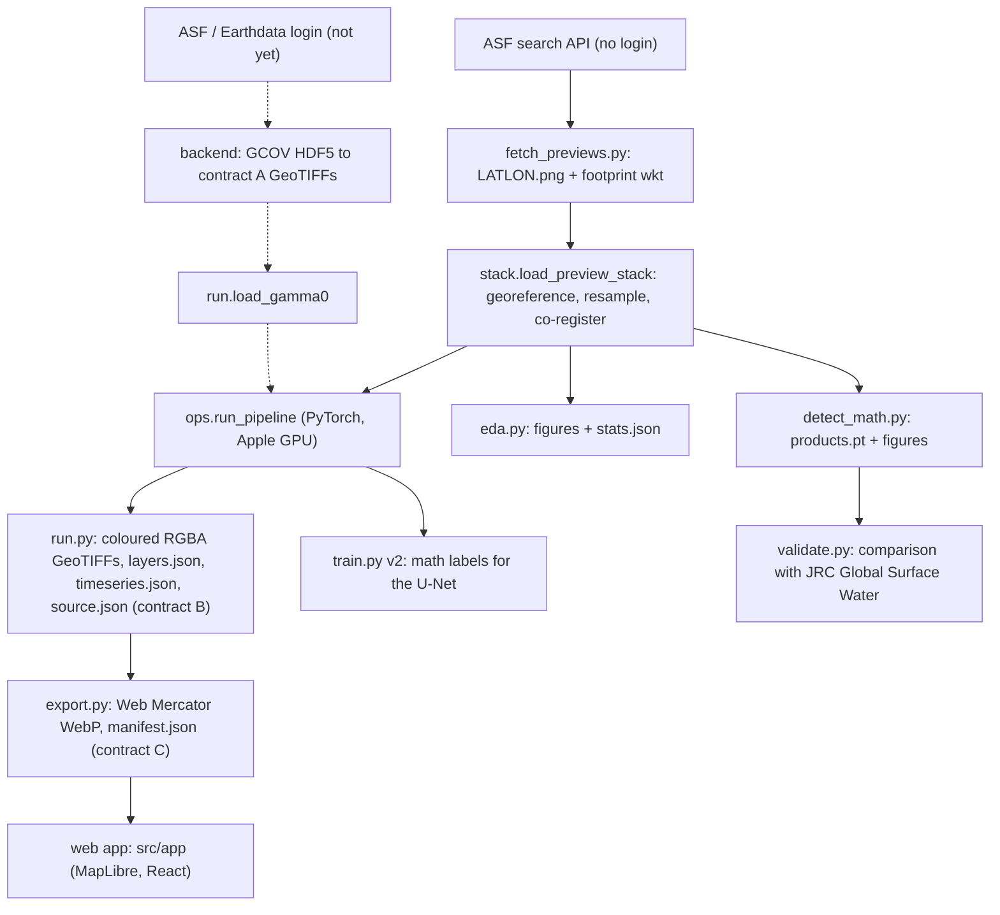
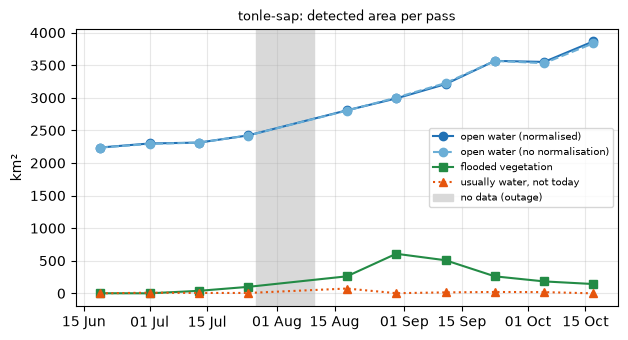
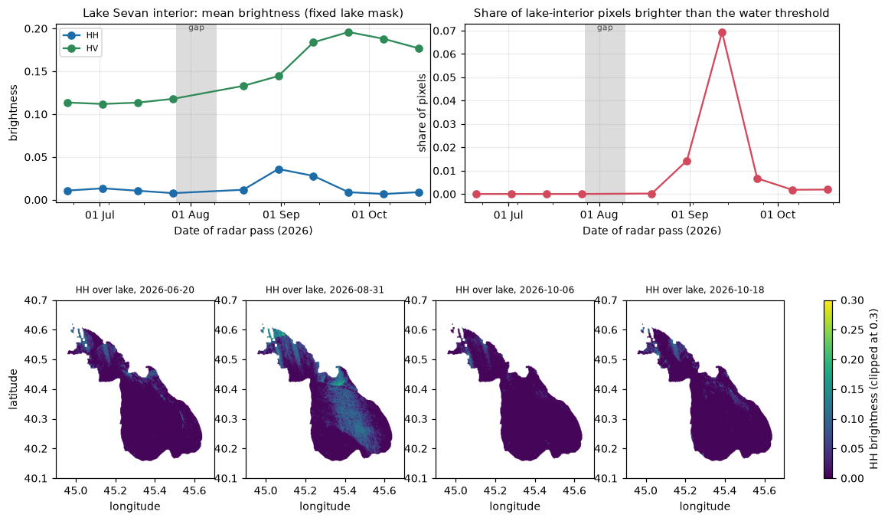
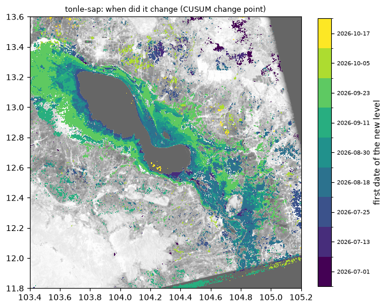
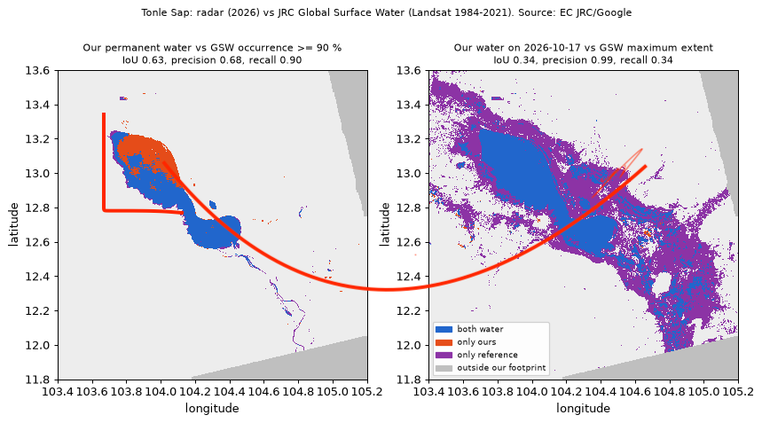

# Radar change detection: design and results

NASA Space Apps 2026, challenge "Dancing with the SARs". Status as of 14 November 2026.

This document describes everything the detection side of the project does, from the downloaded radar images to the layers the web app shows, with every formula as the code computes it and every number taken from a file in this repository. Where a number comes from a file, the file is named. Where the code and older notes disagree, the code was followed (a list is at the end, in [Notes on sources](#notes-on-sources)).

---

## Summary (for judges)

**What goes in.** Ten passes (June to October 2026) of NASA-ISRO NISAR L-band radar over three areas: the Tonle Sap lake and floodplain (Cambodia), Lake Sevan (Armenia) and the Ararat Valley (Armenia). Each pass has two polarisation channels, HH and HV. Today we use the **free preview images** of the provisional GCOV product: 8-bit display brightness at about 180 m per pixel, not calibrated backscatter, because the calibrated files need a NASA Earthdata login we did not have yet. The code also accepts calibrated gamma-naught files (tested only on a synthetic fixture).

**What comes out.** For every pass: an open-water mask, a flooded-vegetation mask (radar "double bounce" off water and tree trunks), a "usually water, not today" wind flag, and a change map against the first pass. For the whole season: the date on which each pixel changed for good (a CUSUM-style change point), and a season class map (permanent water, seasonal open water, flooded vegetation, got darker, got brighter). Everything is written as coloured map layers plus a `timeseries.json` for the web app. The detector is pure mathematics in PyTorch (no learning); two small neural networks were also trained and are documented, but not used for the app.

**Headline results.**

1. **Tonle Sap open water grows from 2,234 km² (19 June) to 3,837 km² (17 October)**, a factor of 1.7, with most of the growth after mid-August. The change-point map dates the spread: 2,046 km² first reached its new level on 18 August (the first pass after the instrument outage), 2,638 km² on 23 September. An independent Otsu-based estimate gives a different absolute area but the same growth factor (×1.67).
2. **Lake Sevan comes out at 1,197–1,329 km² per pass** against the published 1,242 km² (−4 % to +7 %). This is not an independent test: the water threshold was tuned on Sevan.
3. **Independent check against 38 years of Landsat water maps** (JRC Global Surface Water, Pekel et al. 2016): our permanent water matches the long-term lake with IoU 0.94 at Sevan and 0.84 at Tonle Sap (against occurrence ≥ 75 %; 0.90 against "water in all 12 months of 2021"); 98.9 % of the water we map at Tonle Sap on 17 October lies inside the 1984–2021 maximum water extent.
4. **The same check found real false positives**: about 127 km² of late-season "water" on dark dry land near Sevan, essentially all of the 10–31 km² of "water" in the Ararat Valley, most of Sevan's "seasonal open water" class, and all flooded vegetation in Armenia.

**Main limits.** The inputs are uncalibrated display brightness; pixels are about 180 m; the thresholds were chosen on the same data (the water threshold on Sevan); flooded-vegetation area changes by a factor of 8 between plausible thresholds; there is no 2026 ground truth; the outage from 27 July to 10 August hides the flood onset; there is no terrain or radar-shadow mask, which is the likely cause of the Armenian false positives.

---

## Contents

1. [Data](#1-data)
2. [Pre-processing](#2-pre-processing)
3. [Detection mathematics](#3-detection-mathematics)
4. [Products for the app](#4-products-for-the-app)
5. [Machine learning](#5-machine-learning)
6. [Results](#6-results)
7. [Verification](#7-verification)
8. [Limits and open questions](#8-limits-and-open-questions)
9. [Reproduce](#9-reproduce)
10. [What comes next](#10-what-comes-next)
11. [Glossary](#11-glossary)

---

## 1. Data

### 1.1 Sensor and product

NISAR is a NASA-ISRO synthetic aperture radar (SAR) satellite. We use its L-band channel (wavelength about 24 cm), which passes through clouds and partly through vegetation canopies. The product is **Level-2 GCOV**: backscatter on a map grid, terrain-corrected, one file per frame of about 240 × 240 km, repeat cycle 12 days. We use two channels:

* **HH**: horizontal transmit, horizontal receive. Strong from smooth surfaces viewed like a mirror (very low: calm water reflects away from the radar) and from the water-plus-trunk "double bounce" (very high: flooded forest).
* **HV**: horizontal transmit, vertical receive (cross-polarised). Produced mainly by volume scattering in leaves and branches; low on water and bare soil.

Physics background: [`docs/research/science-brief.md`](research/science-brief.md). Data access details: [`docs/research/data-sources.md`](research/data-sources.md).

### 1.2 Calibration tiers

From [`data-sources.md`](research/data-sources.md), section 1:

| ASF collection | Acquired | Status |
|---|---|---|
| `NISAR_L2_GCOV_BETA_V1` | Oct 2025 – Jan 2026 | uncalibrated; must not be differenced against the others |
| `NISAR_L2_GCOV_PROVISIONAL_V1` | 17 Jun – 18 Oct 2026 | provisional calibration: **our stack** |
| `NISAR_L2_GCOV_V1` (validated) | from 21 Oct 2026 | one or two passes per track so far |

### 1.3 Areas and dates

From [`areas/*/area.json`](../areas/) and the preview metadata (`data/raw/previews/T*_F*/meta.json`). All passes are ascending, HH+HV on every date. Grid sizes and pixel areas come from the loader ([`stack.load_preview_stack`](../scripts/detect/stack.py)), as recorded in [`docs/eda/stats.json`](eda/stats.json).

| Area | Box (W, S, E, N, degrees) | Track / frame | Dates (2026) | Grid (rows × cols) | km² per pixel | Footprint used (km²) |
|---|---|---|---|---|---|---|
| Tonle Sap | 103.4, 11.8, 105.2, 13.6 | 83 / 8 | 06-19, 07-01, 07-13, 07-25, 08-18, 08-30, 09-11, 09-23, 10-05, 10-17 | 1105 × 1078 | 0.03266 | 36,036 |
| Lake Sevan | 44.9, 40.1, 45.7, 40.7 | 85 / 22 | 06-20, 07-02, 07-14, 07-26, 08-19, 08-31, 09-12, 09-24, 10-06, 10-18 | 362 × 367 | 0.03387 | 4,499 |
| Ararat Valley | 44.0, 39.8, 44.8, 40.3 | 85 / 22 (same frame as Sevan) | same as Sevan | 302 × 367 | 0.03400 | 3,769 |

"Footprint used" is the area imaged on all ten dates after the edge clean-up of section 2.3 (`valid_km2` in `data/processed/<area>/math/products.pt`). The pixel side is about 181–184 m (√0.0327 km² = 0.181 km).

**Instrument outage.** No NISAR acquisitions exist between **27 July and 10 August 2026** (`GAPS` in [`stack.py`](../scripts/detect/stack.py)). On every track the pass after late July is 17–19 August, so the step from 25 July to 18 August spans 24 days, and the 12-day cadence implies one missing pass around 6 August.

### 1.4 What we use today: the preview images

[`scripts/ingest/fetch_previews.py`](../scripts/ingest/fetch_previews.py) queries the ASF search API (no login) for provisional GCOV passes of the area's track and frame between 17 June and 24 October 2026, keeps only `frameCoverage = "Full"` records (Tonle Sap has a second "Partial" mode per date with a different bandwidth), keeps the last record per date (a newer processing version), and downloads each pass's `…_LATLON.png` browse image together with its footprint polygon (`wkt`).

What these images are:

* **8-bit display brightness**, read as values in 0..1 (steps of 1/255 ≈ 0.0039). The mapping from backscatter to brightness is unknown; we assume only that it is monotonic. Calm water sits at the darkest level 1/255.
* **About 180 m per pixel** on a north-up latitude/longitude grid with a transparent margin outside the swath.
* **Red = blue = HH, green = HV.** The loader reads the red channel as HH and the green channel as HV.

Why previews: the calibrated GCOV HDF5 files (1.9 GB per Tonle Sap pass, 7.5 GB per Armenia pass) require an Earthdata login, which we did not have on the first day. Previews let us build and test the full chain on real imagery.

What changes with calibrated data: values become linear-power gamma-naught (converted to decibels inside the detector), pixels become 30–80 m (`pixel_m` in `area.json`: 80 m for Tonle Sap, 30 m for Armenia), thresholds acquire physical meaning, and absolute brightness becomes comparable between areas and dates.

### 1.5 The two sources and how the code treats each

Every function in [`ops.py`](../scripts/detect/ops.py) works on a "log-like intensity" tensor and takes its thresholds from `KNOBS[source]`:

| | `preview` (used today) | `gamma0` (prepared, untested on real data) |
|---|---|---|
| Loader | [`stack.load_preview_stack`](../scripts/detect/stack.py): georeferencing from footprint corners + co-registration | [`run.load_gamma0`](../scripts/detect/run.py): contract A GeoTIFFs, all on one grid, no resampling |
| Input value $x$ | brightness 0..1 | linear power; values $\le 0$ set to NaN (no-data) |
| No-data | transparent margin + dark rim at the swath edge | NaN |
| Log-like intensity $L$ | $L = J$ (brightness after speckle filter) | $L = 10\log_{10}\max(J, 10^{-6})$ dB |
| Thresholds | chosen on the preview data (section 3.12) | literature-typical L-band starting values, **never tested** |
| Relative normalisation | on, multiplicative gain | off; if switched on, additive offset |
| Spot time series | mean of $L$ × 100, "relative brightness 0–100" | $10\log_{10}$ of the mean raw linear power, dB |

`run.py --source auto` uses `gamma0` if `data/processed/<area>/gamma0/hh/*.tif` exist, otherwise the previews. Today the app shows only preview-based products (`"source": "preview"` in every [`manifest.json`](../src/app/public/data/tonle-sap/manifest.json)).

---

## 2. Pre-processing

Shapes used throughout: a stack $x$ is $[T, C, H, W]$ with $T = 10$ dates, $C = 2$ channels (0 = HH, 1 = HV); a validity mask $v$ is $[T, H, W]$ boolean. Steps 2.1–2.2 are in [`stack.py`](../scripts/detect/stack.py); steps 2.3–2.7 are the start of [`ops.run_pipeline`](../scripts/detect/ops.py), in this order.

### 2.1 Georeferencing the previews from the footprint corners

[`stack._georef`](../scripts/detect/stack.py). A preview is north-up with a transparent (black) margin. The outermost lit pixels (any colour channel $> 0$) are taken to be the west, east, north and south corners of the footprint polygon from the `wkt`. Let $c_W, c_E$ be the minimum and maximum lit column, $r_N, r_S$ the minimum and maximum lit row, and $\lambda_W, \lambda_E, \varphi_S, \varphi_N$ the extreme longitudes and latitudes of the polygon. The code fits a separable linear map from pixel (row $r$, column $c$) to (longitude $\lambda$, latitude $\varphi$):

$$\lambda = a\,c + b,\qquad \varphi = c'\,r + d,$$

$$a = \frac{\lambda_E - \lambda_W}{c_E - c_W},\quad b = \lambda_W - a\,c_W,\qquad c' = \frac{\varphi_S - \varphi_N}{r_S - r_N},\quad d = \varphi_N - c'\,r_N .$$

**Common target grid.** The area box $(w, s, e, n)$ is divided into pixels the size of the first date's pixels: $W = \mathrm{round}((e - w)/a_0)$ columns, $H = \mathrm{round}((s - n)/c'_0)$ rows, $\Delta\lambda = (e - w)/W$, $\Delta\varphi = (s - n)/H$ (negative). Pixel centres are $\lambda_j = w + (j + \tfrac12)\Delta\lambda$, $\varphi_i = n + (i + \tfrac12)\Delta\varphi$. Each date is resampled onto this grid bilinearly (`grid_sample`, zero padding) at the source pixel position $((\lambda - b)/a,\ (\varphi - d)/c')$.

**Validity per date** $v_t$: the target pixel centre is inside the footprint polygon (even-odd ray casting, [`stack._inside`](../scripts/detect/stack.py)) and inside the source image.

**Pixel area** (used for all km² numbers, preview source):

$$A_{\text{px}} = \left(\Delta\lambda \cdot 111.32\,\cos\bar\varphi\right)\cdot\left(|\Delta\varphi| \cdot 110.57\right)\ \text{km}^2,\qquad \bar\varphi = \tfrac12(s + n),$$

one value per area (the latitude variation inside a box, at most 1.8°, changes it by under 1 %). For the `gamma0` source $A_{\text{px}} = |t_a\, t_e| / 10^6$ km² from the GeoTIFF transform (metres, UTM).

### 2.2 Co-registration by FFT cross-correlation

[`stack._shift`](../scripts/detect/stack.py), called from `load_preview_stack(align=True)`. The corner fit is good only to a few pixels (it assumes every pass fills its footprint the same way), so every date is shifted onto the first.

1. Resample all dates once (section 2.1). Let $m$ be the pixels valid on all dates, $a$ the first date and $b$ the date to align, each the mean of HH and HV.
2. Prepare each image: remove the local mean over a 15 × 15 window, multiply by $m$, and taper with a 2-D Hann window $h$:
   $$\tilde a = \big(a - \overline{a}^{\,15\times15}\big)\cdot m \cdot h .$$
3. Circular cross-correlation via the FFT: $\;\mathrm{cc} = \mathcal F^{-1}\!\big[\mathcal F(\tilde b)\cdot\overline{\mathcal F(\tilde a)}\big]$.
4. Integer peak $(p_y, p_x) = \arg\max \mathrm{cc}$, refined independently in each axis by a parabola through the peak and its two neighbours:
   $$\delta = \frac{\tfrac12\,(c_{-1} - c_{+1})}{c_{-1} - 2c_0 + c_{+1}},$$
   then wrapped to a signed shift ($s \ge H/2 \Rightarrow s - H$).
5. Re-resample the date with its sampling coordinates offset by the measured shift (rows × $\Delta\varphi$, columns × $\Delta\lambda$).

Measured shifts against the first date (rows, columns, in pixels; read-only re-run of the loader on 14 Nov):

| Date index | 1 | 2 | 3 | 4 | 5 | 6 | 7 | 8 | 9 |
|---|---|---|---|---|---|---|---|---|---|
| Sevan | 1.06, 0.42 | 1.75, 0.23 | 1.02, 0.02 | 0.66, −0.11 | **5.49**, −0.03 | 2.04, 0.03 | 2.92, 0.00 | 0.19, 0.10 | 0.50, 0.13 |
| Ararat | 1.19, 0.69 | 2.22, 0.09 | 1.15, 0.32 | 0.82, −0.04 | **6.91**, −0.10 | 2.42, −0.05 | 3.71, 0.08 | 0.40, 0.23 | 0.81, 0.12 |
| Tonle Sap | 0.45, 0.46 | 0.02, 0.03 | 0.25, 0.31 | 0.32, 0.53 | −0.28, −0.23 | 0.37, 0.10 | −0.28, −0.32 | −0.19, −0.14 | 0.12, 0.34 |

Index 5 is 31 August in Armenia: a north-south shift of up to 6.9 pixels (about 1.3 km). After alignment, an independent shift estimate between the aligned dates ([`eda.shift_estimate`](../scripts/detect/eda.py)) finds at most 0.07 px, and the residual after applying it at most 0.02 px (`registration` in [`stats.json`](eda/stats.json)). Before this fix, the misregistration produced a fake ring of change around Sevan's shore and most of the 31 August "flooded vegetation" in Armenia (99 km² at Sevan and 190 km² at Ararat before alignment, 6 and 32 km² after; [`math-detection.md`](eda/math-detection.md)). The independent validation (section 6.6) also finds no remaining geolocation offset: shifting our maps by up to ±4 px does not improve the agreement with Landsat (best shift at Sevan 0, 0).

### 2.3 Validity mask, no-data margin, common footprint, edge erosion

In [`ops.run_pipeline`](../scripts/detect/ops.py):

1. **Clean input** ([`ops.clean_input`](../scripts/detect/ops.py)): pixels with a non-finite value in either channel become invalid; invalid pixels are set to 0.
2. **No-data margin** ([`ops.nodata_margin`](../scripts/detect/ops.py), preview only, knob `nodata_floor = 0.01`). The previews draw some area outside the swath at the darkest level, the same value as calm water. Let $F_t = (\mathrm{HH}_t \le 0.01) \wedge (\mathrm{HV}_t \le 0.01) \wedge v_t$ and let $E_t = v_t \wedge \delta_3(\neg v_t)$ be the valid pixels touching the invalid area ($\delta_3$ = 3 × 3 binary dilation). The margin is the morphological reconstruction of $E_t \wedge F_t$ inside $F_t$ (section 3.2), i.e. floor-valued pixels connected to the footprint edge; they are removed from $v_t$. A lake touching the swath edge would be cut too.
3. **Common footprint** (`common_footprint = True`): $v_t \leftarrow v_t \wedge \bigwedge_{\tau} v_\tau$. Only pixels imaged on every date are kept, so per-date areas are comparable and a moving swath edge cannot fake a change.
4. **Edge erosion** (`edge_erode_px = 8`): binary erosion with a $(2\cdot 8 + 1)\times(2\cdot 8+1) = 17 \times 17$ square, which removes 8 pixels along the footprint edge. The EDA found that within 8 px of the Tonle Sap swath edge the brightness is about half the interior (HH 0.31 and 0.30 against 0.576; section 6.7). The erosion treats the outside of the image frame as valid, so the box edge itself is not eroded.

### 2.4 Mask-aware boxcar mean

[`ops.box_mean`](../scripts/detect/ops.py), knob `box` (3 for previews, about 540 m; 7 for gamma0). With $K$ a $k \times k$ window of ones, $*$ 2-D convolution with zero padding, and $v$ the validity mask:

$$\overline{x}^{\,k} = \frac{K * (x\,v)}{K * v},\qquad \text{set to } 0 \text{ where } K * v = 0 .$$

Invalid pixels therefore never pull the mean towards zero.

### 2.5 Multi-temporal speckle filter (Quegan and Yu)

[`ops.quegan_filter`](../scripts/detect/ops.py), knob `quegan = True`. Speckle is multiplicative noise from coherent radar imaging. The filter averages it over time without blurring stable detail. Per channel, with $m_t = \overline{x_t}^{\,k}$ the local mean, $\varepsilon = 10^{-4}$ guarding dark pixels, and $N$ the number of valid dates at the pixel:

$$J_t = m_t \cdot \frac{1}{N}\sum_{\tau:\,v_\tau} \frac{x_\tau}{m_\tau + \varepsilon},\qquad J_t = 0 \text{ where } v_t = \text{false}.$$

Each date keeps its own local mean $m_t$ (so real changes survive), and the fine detail is the time-average of "pixel ÷ local mean" (so independent speckle averages out). The filter is applied before any logarithm, on linear power for gamma0 and on brightness for previews (for previews this assumes the display stretch is close to a power law, so the noise stays roughly multiplicative). With `quegan = False` the plain boxcar mean of section 2.4 is used instead.

### 2.6 Log-like intensity

[`ops.to_loglike`](../scripts/detect/ops.py): $L = J$ for previews, $L = 10\log_{10}\max(J, 10^{-6})$ in dB for gamma0; then $L \leftarrow L\cdot v$. All later steps work on $L$, so the thresholds are in brightness units (0..1) for previews and in dB for gamma0.

### 2.7 Relative radiometric normalisation between dates

[`ops.normalise_dates`](../scripts/detect/ops.py), knobs `normalise`, `norm_mode`, `stable_frac`. If one preview was stretched slightly brighter, that must not become "change".

* **Reference**: the per-pixel temporal median $R_c = \mathrm{median}_t L_{t,c}$.
* **Excluded pixels**: those whose temporal median HH is below `water_hh_weak` (0.12): water sits at the display floor, has almost zero variance, and says nothing about gain.
* **Stable pixels** $S_c$, per channel: valid on all dates, not excluded, and with temporal standard deviation $\sigma_c$ at or below the `stable_frac` = 20 % quantile of $\sigma_c$ over those pixels (the quantile is computed on a regular subsample of at most about 200,000 values). A channel with fewer than 100 candidate pixels is left unchanged.
* **Per date $t$ and channel $c$**, with $\langle\cdot\rangle_S$ the mean over $S_c$:

$$\text{gain mode (previews):}\quad a_{t,c} = \frac{\langle R_c\rangle_S}{\langle L_{t,c}\rangle_S},\ b_{t,c} = 0;\qquad \text{offset mode (dB):}\quad a_{t,c} = 1,\ b_{t,c} = \langle R_c\rangle_S - \langle L_{t,c}\rangle_S;$$

$$L_{t,c} \leftarrow a_{t,c}\,L_{t,c} + b_{t,c}.$$

Gain mode is used for previews because their black point is pinned at 1/255, so a stretch change is multiplicative; in dB a calibration drift is additive. A least-squares line of $R$ on $L_t$ was tried first and rejected: noise in $L_t$ biases the slope towards zero (regression dilution), which turned dark water grey.

Gains found (`norm_gains` in `products.pt`): Tonle Sap 0.981–1.013, Sevan 0.964–1.030, Ararat 0.984–1.009. Normalisation is on by default for previews and off for gamma0.

---

## 3. Detection mathematics

All in [`ops.py`](../scripts/detect/ops.py), called by [`run_pipeline`](../scripts/detect/ops.py) in the order 3.3 → 3.4 → 3.5 → 3.6 → 3.8 → 3.10 → 3.5 (wind), plus 3.7. Numbers in brackets are the preview knob values.

### 3.1 Otsu's threshold (used in the EDA and the v1 network labels, not in the detector)

Otsu's method picks the threshold that best separates a histogram into two classes. With a 256-bin histogram of probabilities $p_i$ and bin centres $z_i$:

$$\omega_0(i) = \sum_{j \le i} p_j,\qquad \mu(i) = \sum_{j\le i} p_j z_j,\qquad \mu_T = \mu(255),\qquad \sigma_B^2(i) = \frac{\big(\mu_T\,\omega_0(i) - \mu(i)\big)^2}{\omega_0(i)\,\big(1 - \omega_0(i)\big)},$$

and the threshold is at bin $i^* = \arg\max_i \sigma_B^2(i)$: [`ops.otsu`](../scripts/detect/ops.py) and [`eda.otsu`](../scripts/detect/eda.py) return the upper edge of bin $i^*$, [`weak_labels.otsu`](../scripts/detect/weak_labels.py) its centre. $\sigma_B^2$ is the between-class variance $\omega_0\omega_1(\mu_0 - \mu_1)^2$ written in cumulative sums.

Where it is used:

* **EDA water proxy** ([`eda.otsu2`](../scripts/detect/eda.py)): a two-level Otsu on the mean of HH and HV pooled over all dates, $t_1 = \mathrm{otsu}(v)$, then $t_2 = t_1\cdot\mathrm{otsu}(v[v < t_1]/t_1)$. Tonle Sap $t_1 = 0.520$, $t_2 = 0.242$; Sevan $t_1 = 0.383$, $t_2 = 0.188$ ([`stats.json`](eda/stats.json)).
* **v1 network weak labels** (section 5.3).
* **Not in the detector.** The math detector uses fixed knob thresholds, because a per-scene Otsu on uncalibrated previews moves with the scene content (the first-level split's "dark class" was 17,400–19,000 km² at Tonle Sap, far too large to be water). `ops.otsu` is exercised only by the tests.

### 3.2 Morphology, connected components and small-blob removal

All binary morphology is done with `max_pool2d` (8-connectivity, square structuring element):

* dilation $\delta_k(M) = \mathrm{maxpool}_{k\times k}(M)$; erosion $\varepsilon_k(M) = \neg\,\delta_k(\neg M)$; opening $\delta_k(\varepsilon_k(M))$; closing $\varepsilon_k(\delta_k(M))$ ([`ops.dilate`, `erode`, `opening`, `closing`](../scripts/detect/ops.py)).
* **Geodesic reconstruction** ([`ops.reconstruct`](../scripts/detect/ops.py)) of a seed $S$ inside an allowed set $A$: $X_0 = S \wedge A$, $X_{n+1} = \delta_3(X_n) \wedge A$, iterated until $X$ stops changing (checked every 16 iterations, at most 5,000). The result is every pixel of $A$ that is 8-connected to the seed.
* **Connected components** ([`ops.label_components`](../scripts/detect/ops.py)): every foreground pixel starts with a unique label (its flat index + 1) and repeatedly takes the maximum label in its 3 × 3 neighbourhood, restricted to the foreground, until stable. Each component ends with one label.
* **Small-blob removal** ([`ops.remove_small`](../scripts/detect/ops.py), knob `min_blob_px` [4]): components with fewer than 4 pixels (about 0.13 km²) are deleted.
* [`ops.clean_mask`](../scripts/detect/ops.py) = optional opening with `open_k` [0 = off; 3 for gamma0], then small-blob removal. It is applied to the water, prior and flooded-vegetation masks.

### 3.3 Open water per date: hysteresis threshold

[`ops.water_masks`](../scripts/detect/ops.py), knobs `water_hh_strong` [0.06], `water_hh_weak` [0.12], `water_hv_max` [0.35].

$$\mathrm{ok}_t = v_t \wedge (\mathrm{HV}_t < 0.35),\qquad W_t = \mathrm{reconstruct}\big(\text{seed} = (\mathrm{HH}_t < 0.06) \wedge \mathrm{ok}_t,\ \ \text{allowed} = (\mathrm{HH}_t < 0.12) \wedge \mathrm{ok}_t\big),$$

then `clean_mask`. A pixel is water if its filtered HH is below the weak threshold **and** it is 8-connected, through such pixels, to a pixel below the strong threshold.

Physical reason: calm open water reflects the radar pulse away (specular reflection), so it is the darkest surface in HH. Hysteresis keeps wind-roughened or shallow patches that are slightly brighter but connected to calm water, and rejects isolated dark land pixels (smooth bare soil, shadow) that never reach the strong threshold. HH is the main cue because on these previews wind brightens the lake surface far more in HV than in HH (section 6.7); the HV limit is deliberately loose.

### 3.4 Permanent-water prior

[`ops.permanent_water_prior`](../scripts/detect/ops.py). Per pixel, sort the valid HH values of the season and take the **second-lowest**, $s_2$ (the second, not the minimum, so one noisy dark date does not count). The prior is the same hysteresis on this "darkest-ever" composite:

$$P = \mathrm{clean}\Big(\mathrm{reconstruct}\big((s_2 < 0.06),\ (s_2 < 0.12)\big)\Big).$$

Prior area: Tonle Sap 3,971 km², Sevan 1,330 km², Ararat 36 km². Its only use is to forbid flooded vegetation inside it (section 3.6): a brightening on a lake is wind, not trees.

### 3.5 Wind-suspect flag

[`ops.wind_suspect`](../scripts/detect/ops.py), knob `wind_frac` [0.7]. With $f$ and $\ell$ the first and last valid date of a pixel and $n_W$, $n_v$ its numbers of water dates and valid dates:

$$U = W_f \wedge W_\ell \wedge \big(n_W / n_v \ge 0.7\big),\qquad \mathrm{wind}_t = U \wedge \neg W_t \wedge v_t .$$

A pixel that is usually water (water at the start, at the end and on at least 70 % of dates) but not today is far more likely roughened by wind (or a shoreline geolocation wobble) than really dry. It is **only flagged** (orange in the app); it is never filled into the water mask, and it does not change any area.

### 3.6 Reference level and flooded vegetation

[`ops.reference`](../scripts/detect/ops.py) and [`ops.flooded_veg_masks`](../scripts/detect/ops.py), knobs `n_ref` [2], `fv_hh_rise` [0.15], `fv_hv_rise_max` [0.06].

Reference (the "dry-season" level): the valid-weighted mean of the first `n_ref` = 2 dates per pixel,

$$\mathrm{ref}_c = \frac{\sum_{t < 2} v_t\,L_{t,c}}{\max\big(1, \sum_{t<2} v_t\big)},\qquad \mathrm{refv} = v_0 \vee v_1 .$$

Flooded vegetation on date $t$:

$$\mathrm{FV}_t = \big(\mathrm{HH}_t - \mathrm{ref}_{\mathrm{HH}} > 0.15\big) \wedge \big(\mathrm{HV}_t - \mathrm{ref}_{\mathrm{HV}} < 0.06\big) \wedge v_t \wedge \mathrm{refv} \wedge \neg W_t \wedge \neg P,$$

then `clean_mask`. Physical reason: when water rises under a forest or shrub canopy, the radar wave bounces off the water surface and then off the trunks straight back to the antenna (double bounce), which raises HH strongly; HV, which comes from the canopy volume, changes much less. The rule is "HH rose a lot, HV did not rise much, and it is not open water".

### 3.7 Change maps and temporal statistics

* Change against the first date ([`ops.change_vs_first`](../scripts/detect/ops.py)): $D_t = (L_t - L_0)$ where $v_t \wedge v_0$, else 0, per channel. This is the app's "change" layer (section 4.1).
* Consecutive change ([`ops.change_consecutive`](../scripts/detect/ops.py)): $D_t = L_t - L_{t-1}$ for $t \ge 1$ where both are valid, $D_0 = 0$. Computed by the pipeline but not written to any product.
* Temporal statistics ([`ops.temporal_stats`](../scripts/detect/ops.py)): per pixel and channel over valid dates, mean $\bar L$, population standard deviation $s = \sqrt{\tfrac1n\sum (L_t - \bar L)^2}$, coefficient of variation $s / \max(|\bar L|, 10^{-6})$, and $p_{95} - p_{5}$ where $p_q$ is the sorted value at rank $\mathrm{round}((n-1)q)$. Available as a function (these are the ASF cookbook's whole-series change indicators) but **not called by the pipeline** today; the EDA computes its own versions.

### 3.8 When did it change: CUSUM-style change point

[`ops.cusum_changepoint`](../scripts/detect/ops.py), knobs `change_step_min` [0.12], `persist_frac` [0.8], `change_t_min` [5.0]. A single, persistent level change per pixel (two-segment mean model), using both channels.

For every split $k = 1, \dots, T-1$ (date $k$ = first date of the new level), with $n_1$ and $n_2$ the numbers of valid dates before and from $k$, and $\mathbf m_1, \mathbf m_2 \in \mathbb R^2$ the channel means of $L$ over those dates:

$$\boldsymbol\Delta_k = \mathbf m_2 - \mathbf m_1,\qquad \mathrm{score}_k = \lVert\boldsymbol\Delta_k\rVert_2\,\sqrt{\frac{n_1 n_2}{n_1 + n_2}}\quad(\text{or } -1 \text{ if } n_1 = 0 \text{ or } n_2 = 0).$$

In plain terms the score is the standardised size of the step (for one channel with unit noise, the two-sample $z$ statistic of a single mean shift). It is the CUSUM idea in another form: the cumulative sum of deviations from the overall mean up to the split is $S_k = \sum_{t<k}(L_t - \bar L) = -\frac{n_1 n_2}{n_1+n_2}\Delta_k$, so the split with the largest standardised $|S_k|$ is the one chosen here. The chosen split is $k^* = \arg\max_k \mathrm{score}_k$ (the earliest $k$ in case of a tie).

Then, in the **dominant channel** $c^* = \arg\max_c |\Delta_{k^*,c}|$ with signed step $s = \Delta_{k^*,c^*}$, before-mean $m_1$ and midpoint $\mu = m_1 + s/2$:

* **Persistence**: the share of valid dates from $k^*$ on with $\mathrm{sign}(s)(L_t - \mu) > 0$, and the share of valid dates before $k^*$ with $\mathrm{sign}(s)(L_t - \mu) \le 0$, must both be at least `persist_frac` = 0.8 ("the series departs for good").
* **Significance**: residual standard deviation of the two-segment fit $\hat\sigma = \sqrt{\mathrm{SSE}/(n_1 + n_2 - 2)}$ (floored at $10^{-6}$), and the two-sample $t$ statistic
  $$t = \frac{|s|}{\hat\sigma\sqrt{1/n_1 + 1/n_2}} \ \ge\ 5 .$$
* **Size**: $\lVert\boldsymbol\Delta_{k^*}\rVert_2 \ge 0.12$ (brightness units; 3 dB for gamma0).

If all three hold, the output is the change date index $k^*$ and the signed step $s$; otherwise $-1$ ("no lasting change") and 0. Because the outage removes the early August passes, a change that happened inside the gap is dated 18 August. A change dated on the last pass has only one "after" sample and is unconfirmed.

How the gates were set: on the synthetic test with heavy speckle (8 looks), the share of far-away pixels classed "stable" rises from 79.5 % without the $t$ gate to 97.9 % with $t \ge 5$; at 30 looks from 99.8 % to 99.95 % ([`math-detection.md`](eda/math-detection.md)).

### 3.9 Area

The area of any mask on date $t$ is $A_t = A_{\text{px}}\sum_{i,j} M_t(i,j)$ with $A_{\text{px}}$ from section 2.1, rounded to 0.1 km² (`_km2` in [`detect_math.py`](../scripts/detect/detect_math.py), `km` in [`run.py`](../scripts/detect/run.py)). Since all masks are inside the common footprint, areas on different dates refer to the same ground.

### 3.10 Season class map

[`ops.classify`](../scripts/detect/ops.py), knobs `perm_frac` [0.9], `seasonal_min_dates` [2], `fv_min_dates` [2]. With $n_v$, $n_W$, $n_F$ the numbers of valid, water and flooded-vegetation dates per pixel, the first matching rule wins:

| Code | Class | Rule |
|---|---|---|
| 1 | permanent water | $n_W / n_v \ge 0.9$ and $n_W > 0$ |
| 2 | seasonal open water | $n_W \ge 2$ |
| 3 | flooded vegetation | $n_F \ge 2$ |
| 4 | other change | a change point was found (section 3.8) |
| 0 | stable | otherwise (and every pixel never valid) |

For the app, [`run.py`](../scripts/detect/run.py) splits code 4 by the sign of the change step $s$: $s < 0$ "Got darker, not open water (wetter ground, shallow or partial flooding)", $s \ge 0$ "Got brighter (growing crops and other causes)". Code 4 is a "something changed here" layer, not a land-cover label.

### 3.11 Pipeline summary

```text
x [T,2,H,W], v [T,H,W]
 → clean_input → no-data margin (preview) → common footprint → erode 8 px
 → Quegan filter (box 3) → L = brightness (or dB) → gain normalisation (stable pixels)
 → water (hysteresis 0.06/0.12, HV<0.35) → prior (2nd-darkest HH) → flooded veg (ΔHH>0.15, ΔHV<0.06)
 → change point (step ≥0.12, persistence 0.8, t ≥ 5) → classes → wind flag, change vs first
```

On the Apple M5 GPU the whole pipeline takes 2.6 s for Tonle Sap (1105 × 1078 × 10 dates, both channels) after a 1.5 s load, and 0.2 s for Sevan after a 0.9 s load (measured in memory on 14 Nov, single run).

### 3.12 All knobs

From `KNOBS` in [`ops.py`](../scripts/detect/ops.py). "Preview units" are display brightness 0..1.

| Knob | `preview` | `gamma0` | Unit | Meaning | How chosen |
|---|---|---|---|---|---|
| `box` | 3 | 7 | px | boxcar window for local means (filter) | preview: ~540 m, enough averaging at 180 m; gamma0: typical 7 × 7 at 30–80 m |
| `quegan` | True | True | – | multi-temporal speckle filter on/off | standard practice |
| `normalise` | True | False | – | relative radiometric normalisation | EDA found small drift (gains 0.96–1.03); kept as a safeguard |
| `norm_mode` | gain | offset | – | multiplicative vs additive correction | preview black point fixed; dB drift additive |
| `stable_frac` | 0.2 | 0.2 | fraction | lowest-variance share used as stable pixels | judgement |
| `water_hh_strong` | 0.06 | −20.0 | preview / dB | hysteresis seed: surely water | by eye on preview histograms; dB: calm water at L-band HH |
| `water_hh_weak` | 0.12 | −16.0 | preview / dB | water if connected to a seed | **tuned on Sevan's published area** (section 6.8) |
| `water_hv_max` | 0.35 | −24.0 | preview / dB | HV must also be below this | loose on purpose (wind brightens HV) |
| `perm_frac` | 0.9 | 0.9 | fraction of dates | permanent water | judgement |
| `seasonal_min_dates` | 2 | 2 | dates | seasonal water | at least two dates, so one noisy date is not enough |
| `n_ref` | 2 | 2 | dates | first dates averaged as the dry-season reference | mid/late June, the driest available |
| `fv_hh_rise` | 0.15 | 3.0 | preview / dB | flooded veg: HH rise over reference | **between 0.12 and 0.20, using Armenia (no flooded forest) as a negative control; very sensitive** |
| `fv_hv_rise_max` | 0.06 | 1.5 | preview / dB | ... while HV rises less than this | judgement |
| `fv_min_dates` | 2 | 2 | dates | flooded-veg class | as `seasonal_min_dates` |
| `change_step_min` | 0.12 | 3.0 | preview / dB | minimum step size (2-channel norm) | about the water threshold; EDA: real changes 0.10–0.5, drift 0.01–0.05 |
| `persist_frac` | 0.8 | 0.8 | fraction | share of dates on their own side of the midpoint | judgement |
| `change_t_min` | 5.0 | 5.0 | – | minimum two-sample $t$ statistic | synthetic test (section 3.8) |
| `min_blob_px` | 4 | 20 | px | remove connected specks smaller than this | ~0.13 km² at 180 m |
| `wind_frac` | 0.7 | 0.7 | fraction | "usually water" share | judgement |
| `nodata_floor` | 0.01 | None | preview | margin pixels at the display floor | previews draw no-data at ~1/255 |
| `edge_erode_px` | 8 | 1 | px | footprint shrink | EDA: the outer 8 px are at half brightness |
| `common_footprint` | True | True | – | keep only pixels valid on all dates | comparability of per-date areas |
| `open_k` | 0 | 3 | px | morphological opening (0 = off) | off at 180 m: a 3 px opening would delete 540 m-wide rivers |
| `untested` | False | **True** | – | marker | the gamma0 column has never been run on real data |

Display knobs (not detection) are in `DISPLAY` in [`run.py`](../scripts/detect/run.py): see section 4.1.

---

## 4. Products for the app

### 4.1 Layers ([`run.py`](../scripts/detect/run.py))

`run.py <area>` runs `ops.run_pipeline` once with the knobs of the chosen source and writes `data/processed/<area>/products/`: one four-band RGBA `uint8` GeoTIFF per layer and date, on the input grid (contract B). Alpha 0 means "show the basemap". In `layers.json` the layers appear in this order:

| id | Dated | What is painted | Colours | Alpha | Legend |
|---|---|---|---|---|---|
| `hh` | yes | filtered, normalised $L$ of HH as grey: $g = 255\cdot\mathrm{clamp}\big((L - lo)/(hi - lo), 0, 1\big)$ with $(lo, hi) = (0, 1)$ (preview) or $(-25, -5)$ dB | grey | 255 where valid | ramp 0–100 "relative brightness (0–100, uncalibrated)", or dB |
| `water` | yes | wind-suspect, then flooded vegetation, then open water on top | `#f28e2b` orange, `#35b04a` green, `#2f6fde` blue | 255 on the mask, else 0 | classes |
| `when` | no | change date $k^*$ for $k = 1..T-1$ | viridis, $T-1$ colours, labelled with the date | 255 | classes ("When it changed for good") |
| `classes` | no | season classes 1–3 and code 4 split by step sign | `#08306b` permanent water, `#4292c6` seasonal open water, `#41ab5d` flooded vegetation, `#9ecae1` got darker, `#c994c7` got brighter; stable transparent | 255 | classes |
| `change` | yes, from the second date | $d_t = L_t - L_0$ on the area's change channel (`change_pol` in `area.json`, default HH; none of our areas sets it); pixels with $\lvert d_t\rvert \ge$ thr kept, specks < `min_blob_px` removed | `#2166ac` darker, `#b2182b` brighter | $255\cdot\big(0.3 + 0.7\,\mathrm{clamp}\big(\tfrac{\lvert d_t\rvert - \mathrm{thr}}{\mathrm{full} - \mathrm{thr}}, 0, 1\big)\big)$, thr = 0.10, full = 0.35 (preview) or 3 and 8 dB | diverging, ±35 (preview, ×100) or ±8 dB; "darker: new water, cleared forest", "brighter: flooded vegetation, growth" |
| `rgb` | no | three-date composite of the change channel: red = first, green = date index $\lfloor T/2\rfloor$, blue = last, each scaled like `hh` | – | 255 where valid on all three | text (grey = no change) |
| `hv` | yes | as `hh`, HV channel; gamma0 range $(-30, -10)$ dB | grey | 255 where valid | ramp |

For Tonle Sap the composite dates are 19 June, 30 August and 17 October.

### 4.2 `timeseries.json`

For each named spot in `areas/<area>/story.json` (for example Tonle Sap `lake-core` at 104.1 E, 12.8 N, radius 1,500 m) the code selects the pixels whose centre lies within `radius_m` (default 1,000 m) of the spot, using $k_x = 111{,}320\cos\varphi_{\text{spot}}$ and $k_y = 110{,}574$ metres per degree. For each date and channel:

* if fewer than half of the circle's pixels are valid on that date: `null`;
* preview: mean of the filtered, normalised $L$ over the valid circle pixels, × 100, rounded to 0.1, unit "relative brightness (0–100, uncalibrated)";
* gamma0: $10\log_{10}$ of the mean **raw** (unfiltered) linear power, rounded to 0.01 dB (averaging in linear power, then converting, as in the ASF cookbook).

`facts` holds two per-date series in km²: "Open water" $= A_{\text{px}}\sum (W_t \wedge v_t)$ and "Flooded vegetation" $= A_{\text{px}}\sum(\mathrm{FV}_t \wedge v_t)$. `source.json` records the source (`preview` or `gamma0`) and the credit line, which [`export.py`](../scripts/ingest/export.py) copies into the manifest.

### 4.3 Contracts A, B, C

Defined in [`plan/00-contracts.md`](../plan/00-contracts.md):

* **Contract A** (backend → detection): `data/processed/<area>/gamma0/<pol>/<date>.tif`, float32 linear gamma-naught, NaN no-data, one identical grid per area. Read by [`run.load_gamma0`](../scripts/detect/run.py), which asserts that HH and HV dates match and every file has the same grid. Not yet produced from real data; the synthetic `demo` area exists in this form ([`make_fixture.py`](../scripts/ingest/make_fixture.py)).
* **Contract B** (detection → backend): the coloured GeoTIFFs, `layers.json`, `timeseries.json` above (plus `source.json`, an addition).
* **Contract C** (backend → app): [`export.py`](../scripts/ingest/export.py) reprojects every layer to Web Mercator (EPSG:3857, nearest neighbour, longer side at most 3,000 px), saves WebP (quality 80) under `src/app/public/data/<area>/`, writes `manifest.json` (bounds, dates, outage gap, layers with legends, story, spots, credits, source) and copies `timeseries.json`. One deviation from the contract text: contract C says time-series values are decibels; for previews they are relative brightness, and the file's `unit` field says so.

### 4.4 Data flow



Dashed arrows are the calibrated-data path, which exists in code but has run only on the synthetic fixture.

---

## 5. Machine learning

Code: [`models.py`](../scripts/detect/models.py) (models, k-means), [`weak_labels.py`](../scripts/detect/weak_labels.py) (labels), [`train.py`](../scripts/detect/train.py) (training, prediction, sweep, robustness). Full notes: [`docs/eda/dl-notes.md`](eda/dl-notes.md). **No ground truth exists**; every network score below is agreement with another algorithm, or reconstruction error, not accuracy. The networks are not used in the app.

The networks use [`train.load_stack`](../scripts/detect/train.py), which applies its own swath-edge clean-up: pixels at most 1.5/255 in both channels that are connected (up to 40 px deep, 3 × 3 growth) to the invalid area are removed, plus every pixel within 8 px (`EDGE_PX`) of that area. The input is the co-registered preview stack.

### 5.1 Temporal autoencoder (`TemporalAE`, 19,546 parameters)

Purpose: compress each pixel's season into a few numbers without labels, then group pixels by behaviour.

* **Input** per pixel and date (3 × 3 valid-weighted mean, [`weak_labels.smooth`](../scripts/detect/weak_labels.py)): $[\mathrm{HH}, \mathrm{HV}, \mathrm{HH} - \mathrm{HV}, \text{day}/120, \text{valid}]$, where "day" is days since the first pass; the first three are zeroed on invalid dates ([`train.ae_features`](../scripts/detect/train.py)). Target: smoothed HH and HV.
* **Encoder**: bidirectional GRU, 5 → hidden 48 per direction; the two final hidden states (96 numbers) go through a linear layer to an **8-number embedding** $z$.
* **Decoder**: an MLP that receives $[z, \text{day}/120]$ (9 numbers) → 48 (GELU) → 48 (GELU) → 2 outputs, evaluated at each date's real day offset. Because it is told the real day, the irregular spacing across the outage is handled.
* **Loss** ([`train.masked_mse`](../scripts/detect/train.py)): $\displaystyle \mathcal L = \frac{\sum_{t} m_t \sum_{c}(\hat y_{t,c} - y_{t,c})^2}{2\sum_t m_t}$ with $m_t$ the validity of date $t$.
* **Date dropout**: during training each date is hidden with probability 0.1 (features HH, HV, HH−HV and valid set to 0, day kept), so the model must use the whole season.
* **Training**: 400,000 pixels with at least 6 valid dates from the western 70 % of columns; validation 20,000 pixels from the eastern 30 %; batch 4,096; 6 epochs; AdamW (learning rate $3\cdot10^{-3}$, weight decay $10^{-4}$) with a one-cycle schedule; seed 0.
* **Outputs**: the embedding map $[8, H, W]$; a reconstruction-error map (per pixel, mean over valid dates of the channel-mean squared error: high = a season unlike what the model learned); and **k-means clusters** ([`models.kmeans`](../scripts/detect/models.py), written in torch): embeddings standardised per dimension, k-means++ initialisation, $k = 8$, on a random 200,000-pixel sample, at most 50 iterations, stop when no centroid moves more than $10^{-5}$; every pixel is then assigned to the nearest centroid, and clusters are ordered by season-mean HH (darkest first).

Tonle Sap result ([`dl-notes.md`](eda/dl-notes.md) section 3): training 7.5 s on the M5 GPU (19 s total), final masked MSE 0.00619 (train), 0.00635 (held-out pixels). Cluster 0 (6 %) is the lake; cluster 1 (10 %, HH 0.36 → 0.19 after mid-September) is floodplain that became open water late; clusters 3–7 differ mainly in brightness, not behaviour. The reconstruction error is highest in the flooded-forest ring and along the river. The autoencoder sweep (6 versions, 83 s) found held-out MSE between 0.00603 and 0.00708: the season compresses easily.

### 5.2 U-Net (`UNetSmall`)

Per-date segmentation into open water / flooded vegetation / other land ([`models.UNetSmall`](../scripts/detect/models.py)).

* **Architecture**: encoder blocks of [3 × 3 convolution (no bias), batch norm, ReLU] × 2 with widths $16\cdot 2^i$, $i = 0..\text{depth}$ (depth 3: 16, 32, 64, 128), each followed by 2 × 2 max-pooling except the last; decoder with 2 × 2 transposed convolutions (stride 2), concatenation with the skip connection and the same double-convolution block; 1 × 1 convolution head to 3 classes. Full-scene prediction reflect-pads to a multiple of $2^{\text{depth}}$.
* **Parameter counts** (verified with `n_params`): 4 inputs, depth 3: 482,915; 4 inputs, depth 2: 117,539; 7 inputs, depth 3: 483,347; 7 inputs, depth 2: 117,971.
* **Inputs v1** ([`train.unet_inputs`](../scripts/detect/train.py)): this date's HH, HV and the reference (first) date's HH, HV, masked by validity, scaled $(x - 0.5)/0.25$.
* **Inputs v2** ([`train.v2_inputs`](../scripts/detect/train.py)): the same 4 channels plus 3 **season channels** of HH over the valid dates: minimum and mean (scaled $(x-0.5)/0.25$) and standard deviation (scaled $/0.1$).
* **Loss**: cross-entropy with `ignore_index = 255` and class weights $w_c = \sqrt{N/n_c}$ normalised to mean 1 ($n_c$ = labelled training pixels of class $c$; v1 Tonle Sap: water 0.53, flooded vegetation 2.09, other 0.38).
* **Optimiser**: AdamW, learning rate $2\cdot10^{-3}$, weight decay $10^{-4}$, one-cycle schedule; batches of 16 patches of 128 × 128 px; the reference date is drawn with relative weight 0.3 (it is 87 % "other" in v1).
* **Augmentation** ([`train.augment`](../scripts/detect/train.py)): a random number of 90° rotations and random horizontal and vertical flips, each drawn once per batch and applied to the whole batch.
* **Spatial hold-out**: training patches lie entirely in the western 70 % of columns; validation uses the eastern 30 % on all dates.

### 5.3 v1: trained on loose physics rules

Weak labels ([`weak_labels.weak_labels`](../scripts/detect/weak_labels.py)) on the 3 × 3-smoothed stack, thresholds from the area's own data ([`weak_labels.thresholds`](../scripts/detect/weak_labels.py)). With $o$ = Otsu on all valid values in [0, 1], and $g$ = Otsu of the values below $o$ on $[0, o]$ ("the water/land gap"), per channel; $\Delta$ = change against the reference date; quantiles over not-dark pixels on dates other than the reference:

| Class | Rule | Tonle Sap values (from the notes) |
|---|---|---|
| open water (0) | $\mathrm{HH} < 0.8\,g_{\mathrm{HH}}$ and $\mathrm{HV} < 0.8\,g_{\mathrm{HV}}$ | HH < 0.20, HV < 0.20 |
| flooded vegetation (1) | $\mathrm{HH} > 1.3\,g_{\mathrm{HH}}$ and $\Delta\mathrm{HH} > \max(q_{0.97}(\Delta\mathrm{HH}), 0.08)$ and $\Delta\mathrm{HV} < 0.5\,\Delta\mathrm{HH}$ | ΔHH > 0.18, HH > 0.33 |
| other land (2) | $\mathrm{HH} > 1.3\,g_{\mathrm{HH}}$ and $\lvert\Delta\mathrm{HH}\rvert < q_{0.35}(\lvert\Delta\mathrm{HH}\rvert)$ and $\lvert\Delta\mathrm{HV}\rvert < q_{0.35}(\lvert\Delta\mathrm{HV}\rvert)$ | \|ΔHH\| < 0.033, \|ΔHV\| < 0.023 |
| ignore (255) | everything else, and invalid pixels | 58–78 % of pixels on dates after the reference |

Priority: water over flooded vegetation over other land. v1 trains on Tonle Sap only, 10 epochs × 120 steps (66 s training, 73 s total on the M5). Held-out agreement **with the rules**: IoU water 0.997, flooded vegetation 0.970, other 0.998. The v1 sweep (6 versions, 3 in parallel, 525 s, [`sweep_unet_tonle-sap.md`](eda/dl/sweep_unet_tonle-sap.md)) showed that the reference-date channels are essential (without them flooded-vegetation IoU drops to about 0.1) and that width and depth barely matter.

### 5.4 v2: trained on the math detector's labels

Labels ([`weak_labels.math_labels`](../scripts/detect/weak_labels.py)) are dense: math-detector water → water, flooded vegetation → flooded vegetation, **every other valid pixel → other land** (so dark slopes, radar shadow and dry dark fields are explicitly land). Ignored only: a band of 1 px on both sides of every class boundary (a pixel is ignored if more than one class occurs in its 3 × 3 neighbourhood), the math detector's wind-suspect pixels, and invalid pixels. Ignored share: 4.9 % Tonle Sap, 5.6 % Sevan, 1.4 % Ararat (v1: 58–78 %).

Scenes: Tonle Sap (east 30 % held out), Sevan (east third held out), Ararat (all for training), sampled 50 / 25 / 25 %. All v2 versions: 8 epochs × 100 steps × 16 patches of 128 px. Optional noise augmentation: half of the samples get multiplicative gamma speckle (one number of looks per batch, uniform integer 2–16; [`train.speckle`](../scripts/detect/train.py)) and a gain error (global uniform 0.9–1.1 times per-date uniform 0.97–1.03). Sweep score ([`train.v2_score`](../scripts/detect/train.py)): $\tfrac12\big(\mathrm{mIoU}_{\text{Tonle Sap}} + \tfrac12(\mathrm{IoU}^{\text{Sevan}}_{\text{water}} + \mathrm{IoU}^{\text{Sevan}}_{\text{other}})\big)$ on the held-out parts.

v2 leaderboard ([`sweep_unet_v2.md`](eda/dl/sweep_unet_v2.md), 6 versions, 3 in parallel on the M5 GPU, 252 s in total):

| Rank | Version | Params | Train s | Tonle Sap IoU water / fl-veg / other | Sevan IoU water / other | Score | Sevan largest body, mean abs. error vs 1,242 km² |
|---|---|---|---|---|---|---|---|
| 1 | `v2_t_d3` (season channels, depth 3) | 483,347 | 105 | 0.822 / 0.332 / 0.996 | 0.999 / 1.000 | 0.858 | 12 |
| 2 | `v2_t_d2_tsonly` (Tonle Sap only) | 117,971 | 101 | 0.817 / 0.313 / 0.996 | 0.999 / 1.000 | 0.854 | 5 |
| 3 | `v2_t_d2` | 117,971 | 97 | 0.797 / 0.247 / 0.995 | 0.999 / 1.000 | 0.839 | 4 |
| 4 | `v2_not_d2_aug` | 117,539 | 119 | 0.848 / 0.185 / 0.995 | 0.997 / 0.999 | 0.837 | 17 |
| 5 | `v2_t_d2_aug` | 117,971 | 122 | 0.845 / 0.158 / 0.994 | 0.999 / 1.000 | 0.832 | 11 |
| 6 | `v2_not_d2` (no season channels) | 117,539 | 92 | 0.665 / 0.339 / 0.992 | 0.996 / 0.999 | 0.832 | 4 |

### 5.5 Frank assessment

* **What the 0.97–1.0 agreement of v1 means**: the network can reproduce simple threshold rules computed from the same input, on ground it has not seen. **What it does not mean**: that the rules or the network are right. Where the rules said "not sure" (most pixels), v1 guessed, and it guessed badly. On Tonle Sap, 17 October, v1 maps 10,192 km² of open water and 6,139 km² of flooded vegetation, against 3,837 and 144 km² from the math detector (v1 water is 1.3–2.9 × the math detector on every date). At Sevan, with the Tonle Sap weights, v1 maps 1,493–2,311 km² of water against the real 1,242 km², because dark mountain slopes and radar shadow look like water; on 31 August it also calls 662 km² of hillside flooded vegetation ([`dl-notes.md`](eda/dl-notes.md) section 4).
* **Why v2 is trained on the math detector's labels**: those labels cover every pixel and explicitly call dark slopes "land", which v1's rules never did. It worked for open water: v2 follows the math detector within ±4 % on every Tonle Sap date (for example 3,693 vs 3,837 km² on 17 October) and puts Sevan's largest water body at 1,207–1,236 km² (math detector 1,133–1,234 km²). The Tonle-Sap-only version gets Sevan equally right without seeing Armenia, so the fix came from the labels and season channels, not from extra scenes.
* **What v2 does not add**: independent evidence. It learned the math detector, inherits its thresholds (tuned on Sevan) and its flooded-vegetation definition. Its flooded vegetation is about 2 × the math detector from August to October (for example 1,221 vs 611 km² on 30 August) with held-out IoU of only 0.16–0.34.
* **Robustness** ([`robust_v2.md`](eda/dl/robust_v2.md)): under synthetic speckle and gain errors, the best network is a few IoU points steadier than the math detector for moderate speckle (Tonle Sap open water, self-consistency at 8 looks: 0.851 vs 0.823) and roughly tied under gain errors (±10 %: 0.842–0.851 vs 0.848–0.856). The noise is synthetic and applied to display brightness, so this is a weak test.
* **Verdict** (shared with [`dl-notes.md`](eda/dl-notes.md)): the app shows the math detector alone. The networks stay as a ready-to-retrain pipeline for calibrated data and real reference masks.

---

## 6. Results

All per-date numbers below are from `data/processed/<area>/math/products.pt` (written by [`detect_math.py`](../scripts/detect/detect_math.py)) and match the `facts` in the app's `timeseries.json`. "No-norm" is the same run without the normalisation of section 2.7.

### 6.1 Tonle Sap

Common footprint 36,036 km².

| Date | Open water (km²) | Water, no-norm | Flooded veg (km²) | Flooded veg, no-norm | Wind-suspect (km²) |
|---|---|---|---|---|---|
| 2026-06-19 | 2,234.0 | 2,232.5 | 1.2 | 1.3 | 0.0 |
| 2026-07-01 | 2,297.0 | 2,290.5 | 0.4 | 0.7 | 9.7 |
| 2026-07-13 | 2,310.0 | 2,310.3 | 38.7 | 35.2 | 5.9 |
| 2026-07-25 | 2,421.4 | 2,419.4 | 98.5 | 102.4 | 5.9 |
| *27 Jul – 10 Aug: no data* | | | | | |
| 2026-08-18 | 2,802.5 | 2,798.3 | 262.5 | 223.8 | 73.8 |
| 2026-08-30 | 2,954.2 | 2,965.6 | 610.6 | 421.2 | 2.2 |
| 2026-09-11 | 3,147.4 | 3,162.0 | 509.4 | 301.7 | 14.7 |
| 2026-09-23 | 3,522.4 | 3,522.6 | 263.6 | 180.0 | 20.8 |
| 2026-10-05 | 3,541.0 | 3,522.0 | 184.8 | 165.7 | 15.5 |
| 2026-10-17 | 3,836.7 | 3,807.9 | 143.6 | 131.0 | 0.0 |

Normalisation changes open water by less than 1 % on every date but flooded vegetation by up to 69 % (11 September: 509 vs 302 km²), because flooded vegetation is a difference from June and a 1–2 % gain moves many borderline pixels. Flooded vegetation peaks on 30 August and then falls while open water keeps rising: as the water deepens, vegetation is submerged or the canopy no longer produces double bounce, and pixels turn into open water.




### 6.2 Lake Sevan

Common footprint 4,499 km². Published lake area 1,242 km². The EDA identified 31 August and 12 September as windy (section 6.7).

| Date | Open water (km²) | vs 1,242 | Water, no-norm | Flooded veg | Wind-suspect (km²) |
|---|---|---|---|---|---|
| 2026-06-20 | 1,245.3 | +0.3 % | 1,244.3 | 0.0 | 0.0 |
| 2026-07-02 | 1,235.0 | −0.6 % | 1,233.4 | 0.0 | 6.7 |
| 2026-07-14 | 1,234.8 | −0.6 % | 1,232.2 | 0.1 | 6.1 |
| 2026-07-26 | 1,283.8 | +3.4 % | 1,285.6 | 0.3 | 1.0 |
| 2026-08-19 | 1,260.6 | +1.5 % | 1,256.4 | 0.3 | 2.2 |
| 2026-08-31 | 1,236.1 | −0.5 % | 1,233.4 | 6.5 | 36.4 |
| 2026-09-12 | 1,197.1 | −3.6 % | 1,197.0 | 0.0 | 66.7 |
| 2026-09-24 | 1,279.2 | +3.0 % | 1,283.7 | 0.2 | 5.2 |
| 2026-10-06 | 1,329.1 | +7.0 % | 1,329.2 | 0.1 | 0.4 |
| 2026-10-18 | 1,304.0 | +5.0 % | 1,308.9 | 0.5 | 0.0 |

Because the water rule keys on HH, which stays at the display floor over the lake on every pass, the lake is not lost on the windy dates; the dips are flagged as wind-suspect (36 and 67 km², mostly the shallow north-west bay). A 1-pixel shoreline error on Sevan's roughly 250 km perimeter is about 45 km². The late-season excess (1,304–1,329 km² in October) is **not** lake growth: the independent check (section 6.6) shows that about 127 km² of late-season "water" lies on dark dry land more than 540 m from any water Landsat has ever mapped.



### 6.3 Ararat Valley

Common footprint 3,769 km². Open water 10.0–30.6 km² per pass (maximum 30.6 km² on 6 October, the date with the anomalous HV channel); flooded vegetation 0–31.9 km² (maximum on 31 August, the misregistered and brightened date). Classes: stable 3,724.4, permanent water 8.9, seasonal open water 17.9, flooded vegetation 4.7, other change 12.9 km². The independent check shows that **essentially all of this "water" is false** (dark land in the eastern strip of the box), while the fish ponds and reservoirs Landsat does map (35.9 km² maximum extent) are mostly smaller than our pixels and missed. No Ararat area number from this detector should be quoted.

### 6.4 Season classes

| Class (km²) | Tonle Sap | Sevan | Ararat |
|---|---|---|---|
| stable | 27,272.2 | 3,138.3 | 3,724.4 |
| permanent water | 2,173.4 | 1,204.4 | 8.9 |
| seasonal open water | 1,778.4 | 125.0 | 17.9 |
| flooded vegetation | 491.9 | 0.2 | 4.7 |
| other change, got darker | 5,351.8 | 12.1 | 6.9 |
| other change, got brighter | 1,836.7 | 19.3 | 6.0 |


### 6.5 When and where the Tonle Sap flood spread

Area (km²) whose lasting change point $k^*$ falls on each date (all pixels with a change point, any class; from `change_date` in `products.pt`):

| 1 Jul | 13 Jul | 25 Jul | 18 Aug | 30 Aug | 11 Sep | 23 Sep | 5 Oct | 17 Oct |
|---|---|---|---|---|---|---|---|---|
| 202 | 211 | 557 | 2,046 | 1,312 | 1,605 | 2,638 | 319 | 61 |

Of the 8,754 km² with a change point, 6,909 km² got darker (step < 0) and 2,041 km² brighter. The lake itself is stable. Changes ring outward from the lake: the south-eastern river plain first (18 August, i.e. somewhere inside the outage or just after it), the outer north-western plain last (23 September). Very little changes before the outage. The EDA spot series show the same at the south-east corridor (104.85 E, 12.0 N): HH 0.61–0.63 until 13 July, 0.80 on 25 July, 0.24 on 18 August (bright just before the gap, dark and water-like after it). We cannot date the onset more precisely than "between 25 July and 18 August".



### 6.6 Independent validation against JRC Global Surface Water

Full write-up: [`docs/eda/validation.md`](eda/validation.md); numbers in [`docs/eda/validation/results.json`](eda/validation/results.json); code [`validate.py`](../scripts/detect/validate.py). The reference is JRC Global Surface Water v1.4 (Pekel, Cottam, Gorelick, Belward 2016, *Nature* 540:418–422; source: EC JRC/Google), built from 30 m Landsat optical images 1984–2021: a different sensor, different years, different team and algorithm, never used to tune our thresholds. The 30 m reference is averaged exactly (area-weighted) onto our grid; one of our pixels counts as reference water if at least 50 % of its area is covered.

Permanent water (our class 1) against the long-term reference:

| Area | Reference | Ours km² | Ref km² | IoU | Precision | Recall |
|---|---|---|---|---|---|---|
| Tonle Sap | occurrence ≥ 75 % | 2,173.4 | 2,566.4 | 0.84 | 0.99 | 0.84 |
| Tonle Sap | occurrence ≥ 90 % | 2,173.4 | 1,661.5 | 0.63 | 0.68 | 0.90 |
| Tonle Sap | water all 12 months of 2021 | 2,173.4 | 2,341.7 | 0.90 | 0.98 | 0.91 |
| Sevan | occurrence ≥ 90 % | 1,204.4 | 1,239.3 | 0.94 | 0.98 | 0.96 |
| Ararat | occurrence ≥ 90 % | 8.9 | 1.1 | 0.00 | 0.00 | 0.00 |

At Sevan 70 % of the disagreement lies within one pixel of a shoreline; excluding a 1-pixel band the IoU is 0.98. At Tonle Sap the lower score against occurrence ≥ 90 % is a definition difference: the lake shrinks in March–May, outside our season, so its shallow north-western half has long-term occurrence 75–90 %.

Seasonal and late-season water against the 1984–2021 maximum extent: at Tonle Sap 96.1 % of our seasonal open water and **98.9 % of the 17 October water** lie inside it, and the seasonal water sits on land with intermediate long-term occurrence (median 22.6 %), as seasonally flooded land should. But the 17 October water covers only 34 % of the maximum extent (recall 0.34): the maximum is the union of all floods since 1984, and our rule sees only open water, not flooded forest (bright in L-band). GSW ends in 2021 and says nothing about 2026 timing.

False positives found (the most important output of this check; see also section 8): Sevan, 126.7 km² of late-season water outside the maximum extent, 96 % of it more than 3 pixels from any mapped water; Sevan's "seasonal open water" class is 65 % land never seen as water and 32 % lake pixels lost on windy dates; Ararat, 97 % of late-season water outside the maximum extent; flooded vegetation in Armenia (39 km² Ararat, 8 km² Sevan on any date) outside any known water.



### 6.7 EDA findings that shaped the design

From [`docs/eda/eda-findings.md`](eda/eda-findings.md) and [`stats.json`](eda/stats.json):

* **Misregistration in Armenia** up to 6.9 px (31 August, Ararat) and 5.5 px (Sevan), mostly north-south; Tonle Sap at most 0.53 px. Fixed by co-registration in the loader (section 2.2). Before the fix, the mean difference between neighbouring dates at Ararat on 31 August was 0.147 (HH) against 0.044 after.
* **Radiometric drift** is small: the stable-pixel median varies (max − min over dates) by 0.041 (4.7 %) in HH and 0.033 (4.0 %) in HV at Tonle Sap, 0.012 and 0.017 at Ararat; at Sevan HV varies by 0.072 (14 %), mostly the 6 October pass; real changes are 0.10–0.5 (`stability` in `stats.json`). Hence normalisation is a safeguard, not a necessity, and `change_step_min` = 0.12 sits well above the drift.
* **The 6 October HV pass in Armenia is anomalous**: its departure from its two neighbours is 0.041 (Sevan) and 0.065 (Ararat) in HV but normal in HH, with opposite signs in the two boxes; across the frame the west-east HV gradient flattens on that date. Not a ground change. The water rule barely uses HV; HV-based quantities on that date (gains, flooded-vegetation HV test, HV steps) are not trustworthy.
* **Edge artefact**: within 8 px of the Tonle Sap swath edge brightness is about half the interior. Hence `edge_erode_px = 8`. Without it a 24 px strip on the east edge was "permanent water".
* **West-east HV gradient** in the Armenia frame: HV about 0.54–0.58 in the western third, 0.375–0.394 in the eastern third on every date except 6 October (ratio about 1.5), and HV variability ramping up towards the south of the Ararat box. Plausibly an instrument or geometry effect; unproven with previews.
* **Wind on Sevan**: lake mean HH 0.007–0.013 on calm dates but 0.036 on 31 August and 0.028 on 12 September; HH stays at the floor otherwise, so HH, not HV, is the water cue. Lake HV rises steadily from 0.112 (June) to about 0.19 (late September), not explained by wind.
* **Saturation**: 20 % of Sevan's HH pixels sit at the floor (1/255), so HH cannot rank very dark surfaces; 1.8–2.4 % of Ararat HH at the ceiling (Yerevan).


### 6.8 Sensitivity of the headline numbers

Re-runs of the pipeline in memory with one knob changed (14 Nov, not saved):

| Quantity | Knob value → result |
|---|---|
| Tonle Sap peak flooded vegetation (km², any date) | `fv_hh_rise` 0.12 → 1,083; **0.15 → 611**; 0.20 → 139 |
| Tonle Sap flooded-vegetation class (km²) | 0.12 → 1,065; **0.15 → 492**; 0.20 → 53 |
| Tonle Sap open water 19 Jun / 17 Oct (km²) | `water_hh_weak` 0.10 → 2,204 / 3,450; **0.12 → 2,234 / 3,837**; 0.14 → 2,264 / 4,160 |
| Sevan open water, range over dates (km²) | 0.10 → 1,118–1,296; **0.12 → 1,197–1,329**; 0.14 → 1,251–1,364 |

Flooded vegetation changes by a factor of 8 between plausible thresholds: quote it only as "a few hundred km², peaking around 30 August". The June lake area is insensitive (±1.4 %), the October flood area moves by about ±9 %, and the growth factor from June to October stays between 1.57 and 1.84.

**Why two honest methods differ by about 2×.** The EDA's water proxy (Otsu threshold 0.242 on the mean of HH and HV, every pixel below it counted) gives 4,763 km² on 19 June and 7,978 km² on 17 October at Tonle Sap; the detector gives 2,234 and 3,837 km². The EDA proxy is looser in three ways: its threshold is twice ours and on the HH-HV mean, so wet fields, smooth bare soil and shadows count; it has no connectivity requirement; and it uses a slightly larger footprint (36,723 vs 36,036 km², no 8 px edge erosion). At Sevan, the same unconnected threshold count gives 1,603–1,819 km² (1.3–1.5 × the true lake), while requiring connection to the lake (EDA flood fill) gives 1,231–1,238 km² on calm dates, close to our hysteresis numbers. Both methods agree on the growth factor (×1.67 EDA, ×1.72 detector) and on the timing.

Which number is safe to quote: the **relative growth** (about 1.7 × from June to October, mostly after mid-August) and the **timing** are robust. Of the absolute areas, the detector's low-water lake area (about 2,200–2,300 km²) is supported by Landsat (precision 0.99 against occurrence ≥ 75 %; 2,342 km² of water in all 12 months of 2021); the October flood area is an open-water area on uncalibrated previews, roughly ±10 % from the threshold alone, and excludes flooded forest. The EDA's 4,763–7,978 km² includes dark land and should not be quoted as water area.

---

## 7. Verification

### 7.1 Automated tests

Run: `.venv/bin/python -m pytest tests/test_detect.py tests/test_run.py` (`test_detect.py` passed, 5 tests in 0.6 s, on 14 Nov).

[`tests/test_detect.py`](../tests/test_detect.py): a synthetic $6 \times 2 \times 160 \times 160$ stack, valid everywhere; background HH 0.5, HV 0.4; a dark disc (HH = HV = 0.02) at the centre whose radius grows 15, 20, … 40 px over the six dates; a ring at radius 48–56 px whose HH (only) rises to 0.85 from date 2 on; multiplicative gamma speckle with 30 looks (relative noise $1/\sqrt{30} = 0.18$); run through `run_pipeline` with the preview knobs on CPU.

| Test | Assertion | Tolerance |
|---|---|---|
| `test_water_area_tracks_disc` | per-date water pixels vs true disc pixels | relative error < 10 % on every date |
| `test_change_date_in_annuli` | in the annulus that turned dark at date $k$ (1.5 px margin each side), change date = $k$ | > 80 % of pixels, every $k$ |
| `test_far_pixels_stable` | pixels more than 6 px outside the ring are class "stable" | ≥ 99 % |
| `test_ring_is_flooded_vegetation` | ring interior (1.5 px margin) is class 3; water in the ring | > 90 % class 3; < 1 % water |
| `test_otsu_and_morphology` | Otsu of {0.1 × 500, 0.9 × 500} lies in (0.1, 0.9); small-blob removal and 3 × 3 opening keep a 7 × 7 square (49 px) and drop a 1 px speck; dilation/erosion edge behaviour | exact |

**Caveat on the noise level** (stated in the test file and [`math-detection.md`](eda/math-detection.md)): the 30-look speckle is about twice the 0.06–0.10 relative noise measured on the previews. At 8 looks (35 % noise) the "far pixels stable" share falls to 97.9 % and the test would fail; the method relies on the averaging that the 180 m previews already provide.

[`tests/test_run.py`](../tests/test_run.py) runs `run.py demo --source gamma0 --cpu` on the synthetic contract-A fixture ([`make_fixture.py`](../scripts/ingest/make_fixture.py): a dark disc growing over six dates in linear power on a UTM grid) and checks contract B: every expected layer file exists as a 4-band `uint8` GeoTIFF on exactly the contract-A grid; no change image for the first date; on the last date more than 90 % of the disc interior is painted water blue (`#2f6fde`); far from the disc at least 99 % of change pixels are transparent on every date; more than 90 % of the newly flooded ring is painted "darker" (`#2166ac`); `layers.json` has the order hh, water, when, classes, change, rgb, hv with the right `dated` flags and legend types and $T-1$ "when" items; `timeseries.json` has unit dB and last-date water more than 5 × the first; `source.json` says gamma0. This is the only test of the gamma0 path. (It rewrites `data/processed/demo/`; not re-run for this document.)

### 7.2 The one real-world anchor

Lake Sevan's published area, 1,242 km², and the JRC long-term lake (1,239.7 km² at occurrence ≥ 90 % inside our footprint). Our per-date areas are 1,197–1,329 km², the permanent class 1,204.4 km² with IoU 0.94 against JRC. Since `water_hh_weak` was tuned on Sevan's area, only the JRC shape comparison (IoU, precision, recall) is independent; the area match is partly by construction.

---

## 8. Limits and open questions

**False positives found by the independent check (fix before claiming anything in Armenia).**

* About **127 km² of late-season "water" near Sevan** lies on dark dry land, 96 % of it more than 540 m from any water mapped by Landsat (largest clusters 16.8 km² at 45.67 E 40.29 N and 10.2 km² at 45.14 E 40.12 N), plus 10.9 km² of "permanent water" outside any historical water. This is what pushes Sevan's October numbers to 1,304–1,329 km².
* **Essentially all detected water in the Ararat Valley is false** (eastern strip, 44.65–44.80 E), and the real fish ponds are missed (smaller than a pixel).
* **Sevan's "seasonal open water" class (125 km²) is mostly artefact**: 65 % land never seen as water, 32 % lake lost on windy dates. It is not lake change.
* **Flooded vegetation in Armenia is false alarm** (wet soil or irrigation raising HH).

Likely cause: smooth dry fields or terrain (radar shadow, slopes facing away) as dark as calm water on 8-bit previews, combined with no terrain mask and no requirement of connection to known water.

**Other limits.**

* **Uncalibrated previews.** 8-bit display brightness with an unknown stretch, not backscatter. Thresholds are in display units; nothing transfers directly to calibrated data.
* **180 m pixels.** One shoreline pixel on Sevan's perimeter is about 45 km²; small water bodies (ponds, narrow rivers, fields) are below resolution.
* **Thresholds tuned on the same data**, the water threshold on Sevan's known area, the flooded-vegetation threshold with Armenia as a negative control. Flooded-vegetation area changes 8 × between thresholds 0.12 and 0.20.
* **No 2026 ground truth.** JRC checks *where* water has been (1984–2021), not *when* it was there in 2026, and is blind under canopy and clouds.
* **One change date per pixel.** A flood that comes and goes, or a gradual rise, gets a single (often mid-ramp) date. Changes on the last date have one "after" sample.
* **The outage hides the flood onset** (25 July to 18 August, 24 days).
* **Wind.** Handled for Sevan on these previews only because HH stays dark; with calibrated data and stronger wind the HH rule may fail, and the wind flag is a warning, not a correction.
* **No terrain, shadow or layover mask** (no DEM used).
* **The flooded-vegetation reference** is the mean of the first two passes (19 June and 1 July at Tonle Sap), which may already be partly wet; vegetation already flooded then is invisible.
* **The open-water rule misses flooded forest** (bright, not dark), which is why October water covers only 34 % of the historical maximum extent at Tonle Sap.
* **"Other change" (7,189 km² at Tonle Sap) is broad**: crop cycles, partly flooded fields, soil moisture.
* **The gamma0 path is tested only on a synthetic fixture**; its knobs are untested literature values; there is no co-registration on that path (contract A promises one grid).
* **Iterative morphology** (reconstruction, labelling) is fine at these sizes but slow on full-resolution frames.
* **Networks**: agreement with another algorithm only; one seed per version; model selection on the held-out parts; synthetic robustness noise.

---

## 9. Reproduce

From a fresh clone, on macOS with Apple silicon (Python 3.14.4 and PyTorch 2.15.0 in our environment). Times are on the team's Apple M5 MacBook.

```bash
# 1. environment
python3 -m venv .venv
.venv/bin/pip install -r requirements.txt -r requirements-detect.txt

# 2. free preview images (no login); Sevan and Ararat share track 85 / frame 22
.venv/bin/python scripts/ingest/fetch_previews.py tonle-sap
.venv/bin/python scripts/ingest/fetch_previews.py sevan

# 3. exploratory analysis: docs/eda/figures/*.png and docs/eda/stats.json
.venv/bin/python -m scripts.detect.eda                         # 65 s (stats.json runtime_seconds)

# 4. math detection: data/processed/<area>/math/products.pt and docs/eda/math/*.png
.venv/bin/python -m scripts.detect.detect_math tonle-sap       # pipeline 2.6 s per run (runs twice) + figures
.venv/bin/python -m scripts.detect.detect_math sevan
.venv/bin/python -m scripts.detect.detect_math ararat

# 5. detector for the app (contract B), then export (contract C)
.venv/bin/python scripts/detect/run.py tonle-sap               # --source auto|preview|gamma0, --cpu
.venv/bin/python scripts/ingest/export.py tonle-sap            # repeat 5 for sevan, ararat

# 6. independent validation against JRC Global Surface Water (reads only our windows over HTTP)
.venv/bin/python -m scripts.detect.validate

# 7. tests
.venv/bin/python -m pytest tests/test_detect.py tests/test_run.py   # test_detect: 0.6 s

# 8. neural networks (optional; not used by the app)
.venv/bin/python -m scripts.detect.train ae      --area tonle-sap        # 7.5 s training, 19 s total
.venv/bin/python -m scripts.detect.train unet    --area tonle-sap        # v1: 66 s training, 73 s total
.venv/bin/python -m scripts.detect.train unet    --version v2_t_d3       # v2: ~105 s training, ~2 min total
.venv/bin/python -m scripts.detect.train predict --area tonle-sap        # best v2 by default, 16 s
.venv/bin/python -m scripts.detect.train sweep --model unet --versions v2 --workers 3   # 252 s
.venv/bin/python -m scripts.detect.train sweep --model unet --area tonle-sap --workers 3   # v1 sweep, 525 s
.venv/bin/python -m scripts.detect.train sweep --model ae   --area tonle-sap --workers 3   # 83 s
.venv/bin/python -m scripts.detect.train robust --versions v2_t_d3,v2_t_d2,v2_t_d2_aug   # 50 s

# 9. web app
cd src/app && npm install && npm run dev
```

The end-to-end times of steps 4–6 were not measured as a whole; the network times come from [`dl-notes.md`](eda/dl-notes.md) (measured with other jobs sharing the GPU). The EDA notes quote "about 25 seconds" for step 3; the last recorded run took 65.2 s.

---

## 10. What comes next

In order of value:

1. **Calibrated data** via a NASA Earthdata login: GCOV HDF5 windows → contract A GeoTIFFs at 30–80 m. The detector, products and app already accept them (`--source gamma0`). Then re-derive the dB thresholds (the gamma0 knobs are untested) and re-run the validation.
2. **Fix the false positives**: require water to be connected to a known water body or larger than a minimum size, and add a terrain mask (below). Re-run [`validate.py`](../scripts/detect/validate.py) to confirm the Armenian false water disappears. Using GSW as a prior would remove it as an independent check.
3. **Terrain shadow and layover mask** from the Copernicus DEM (slope and look geometry), or the GCOV layover/shadow layers, as an ignore region.
4. **Independent 2026 validation**: Sentinel-1 water masks or Sentinel-2 cloud-free scenes for the same dates, to test timing and October extent.
5. **Flooded vegetation**: calibrated HH/HV ratio, a reference from the previous dry season (the beta or validated tiers cannot be differenced against provisional data, so this needs care), and validation against forest maps.
6. **Change detection**: allow two change points (rise and fall), report a confidence from the $t$ statistic, and test incidence-angle effects on the Armenia HV gradient.
7. **Networks**: retrain v2 on calibrated data with real reference masks; only then can they add evidence.

---

## 11. Glossary

* **Backscatter**: the fraction of the radar pulse a surface sends back to the antenna. Gamma-naught ($\gamma^0$) is backscatter normalised for the illuminated area; usually given in decibels, $10\log_{10}$ of linear power.
* **HH / HV**: polarisation channels. HH = horizontal transmit and receive (sensitive to smooth surfaces and double bounce); HV = horizontal transmit, vertical receive (sensitive to vegetation volume).
* **Speckle**: grainy, multiplicative noise inherent to coherent radar images. Reduced by averaging over space (boxcar) or time (Quegan filter). "Looks" = number of independent samples averaged; relative noise is $1/\sqrt{\text{looks}}$.
* **Double bounce**: the wave reflects off a water surface and then a trunk (or the reverse) and returns to the radar, making flooded forest very bright in HH.
* **Otsu's method**: chooses the histogram threshold that maximises the between-class variance of the two resulting groups.
* **Hysteresis threshold**: two thresholds; pixels past the strict one are certain, pixels past the loose one are accepted only if connected to a certain pixel.
* **Morphological reconstruction**: repeatedly growing a seed mask inside an allowed mask until it stops changing; selects the connected parts of the allowed mask that touch the seed.
* **CUSUM**: cumulative sum of deviations from the mean; its maximum marks the most likely point where the mean of a series changed. We use the equivalent two-segment mean model with persistence and $t$-statistic gates.
* **IoU** (intersection over union): $|A\cap B| / |A \cup B|$ for two masks; 1 = identical. Precision = $|A\cap B|/|A|$ (how much of what we call water is reference water), recall = $|A \cap B|/|B|$ (how much reference water we find).
* **Co-registration**: aligning images of different dates so the same pixel is the same ground.
* **GCOV**: NISAR Level-2 geocoded polarimetric covariance product (backscatter on a map grid).
* **Weak labels**: training labels produced by rules or another algorithm instead of by people, with an "ignore" value where they are unsure.

---

## Notes on sources

Places where the code and the existing notes disagree; this document follows the code (or the most recent saved data):

* `ops.permanent_water_prior`: its docstring and `math-detection.md` say "2nd-lowest HH < `water_hh_weak`"; the code applies the full hysteresis (seed below `water_hh_strong`, grown inside `water_hh_weak`).
* `eda.components_from_seed`: docstring says 4-neighbour; the 3 × 3 max-pool makes it 8-connected.
* `train.augment`: docstring mentions per-sample flips; the code draws each flip once per batch.
* `fetch_previews.py` docstring: "about 150 m per pixel"; the loaded grids are 181–184 m.
* `eda-findings.md` was partly written before co-registration: its flooded-vegetation proxy per date (peak 1,614 km²) and sensitivity range (peak 623–3,136 km²) differ from the current [`stats.json`](eda/stats.json) (peak 1,292 km²; 490–2,534 km²); the Otsu-water areas differ slightly (4,770 vs 4,763 km² on 19 June). This document quotes `stats.json`. Its raw misregistration figures were confirmed by re-running the loader.
* `math-detection.md` says a weak threshold of 0.10–0.12 gives 1,190–1,240 km² at Sevan; a re-run at 0.10 gives 1,118–1,296 km² per date (the note probably refers to calm dates or an earlier data state).
* `plan/00-contracts.md` (contract C) says time-series values are dB; for previews they are relative brightness, labelled in the `unit` field.
* `ops.otsu` and `ops.temporal_stats` exist but are not called by the detector; `change_consec` is computed but not saved.

Not documented because the information is missing: end-to-end run times of `detect_math.py`, `run.py`, `export.py` and `validate.py`; the exact ASF processing behind the preview brightness stretch; the GCOV mask value meanings.
