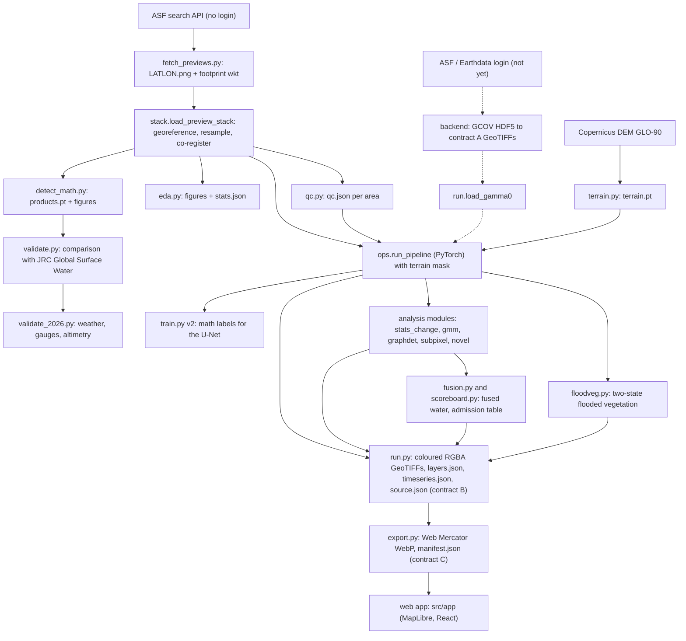
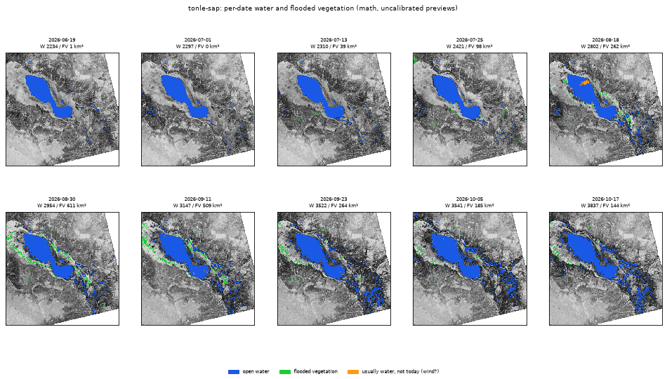
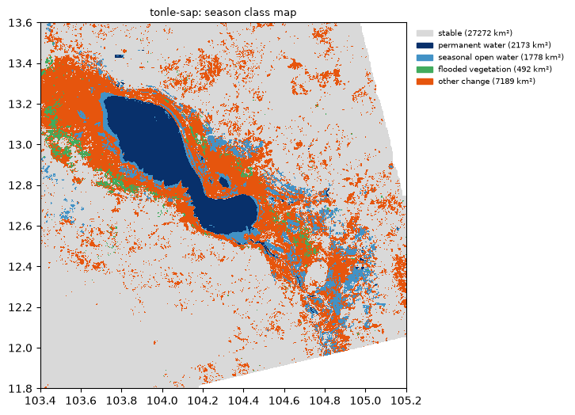
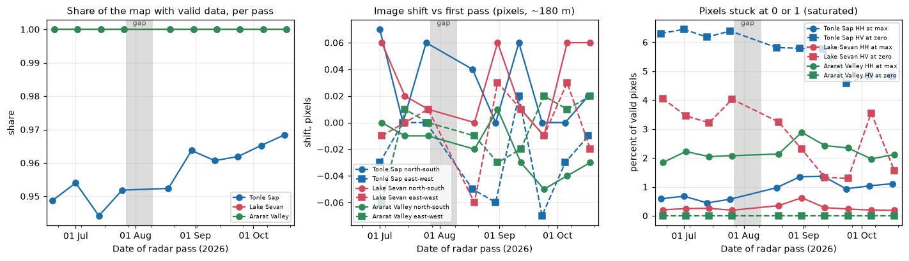
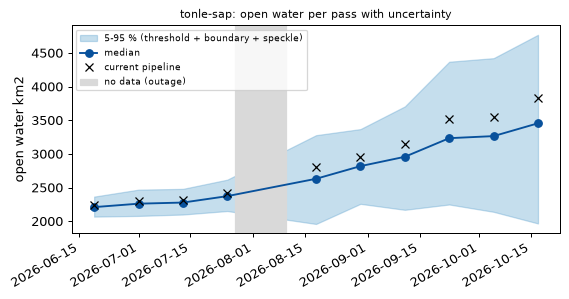
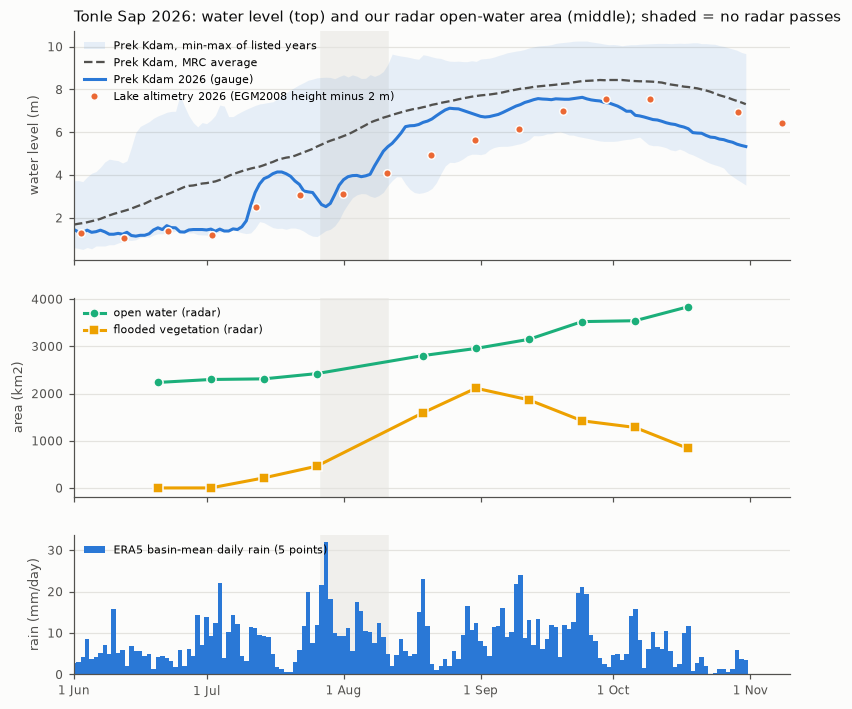
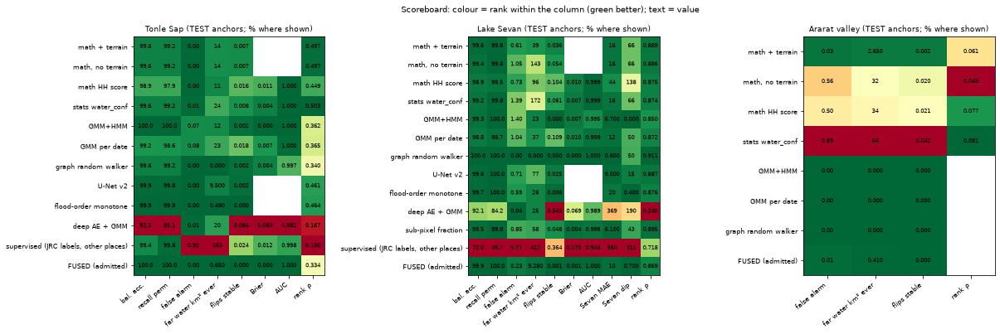
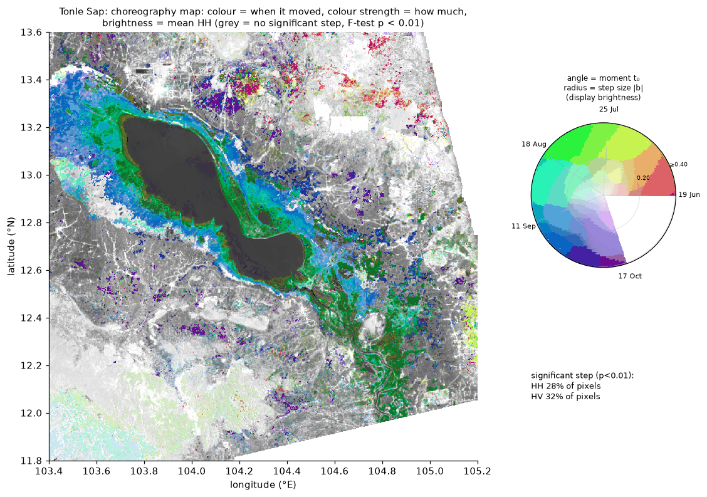

# Radar change detection: design and results

NASA Space Apps 2026, challenge "Dancing with the SARs". Status as of 14 November 2026, about 14:00 (Armenia time). The one-page summary for judges is [RESULTS.md](RESULTS.md); the design that ties the modules together is [ARCHITECTURE.md](ARCHITECTURE.md).

This document describes everything the detection side of the project does, from the downloaded radar images to the layers the web app shows, with every formula as the code computes it and every number taken from a file in this repository. Where a number comes from a file, the file is named. Where the code and older notes disagree, the code was followed; where two notes disagree, the more recent or more carefully measured one is used (both lists are at the end, in [Notes on sources](#notes-on-sources)).

---

## Summary (for judges)

**What goes in.** Ten passes (June to October 2026) of NASA-ISRO NISAR L-band radar over three study areas: the Tonle Sap lake and floodplain (Cambodia), Lake Sevan (Armenia) and the Ararat Valley (Armenia); ten more places use the same chain in the app ([`areas.md`](research/areas.md)). Each pass has two polarisation channels, HH and HV. Today we use the **free preview images** of the provisional GCOV product: 8-bit display brightness at about 180 m per pixel, not calibrated backscatter, because the calibrated files need a NASA Earthdata login. The code also accepts calibrated gamma-naught files (tested only on a synthetic fixture).

**What comes out.** For every pass: an open-water mask (cut by a terrain mask built from an elevation model), a flooded-vegetation mask with two states (radar "double bounce" appearing; vegetation going under or a pixel partly open water), a "usually water, not today" rough-surface flag, and a change map against the first pass. For the whole season: the date on which each pixel changed for good, and a season class map. Around this physics detector (pure mathematics in PyTorch) sit the modules built on 14 November: automatic quality control of every pass, a statistical change test with a stated false-discovery rate, a Gaussian-mixture and hidden-Markov model, graph refinement, a sub-pixel water fraction, a fusion layer that combines them under a written admission rule, a flood-front model that dates the flood day by day, and a per-pixel "choreography" map. One scoreboard measures every detector the same way.

**Which detector feeds the app.** Following the fusion study ([`fusion.md`](eda/fusion.md), section 6): for **lakes and mountains (Lake Sevan, Ararat Valley)** the fused (or Markov) water probability; for the **Tonle Sap flood extent and its area** the math detector with the terrain mask, because every persistence model shrinks the late flood. Details in [section 4.5](#45-which-detector-feeds-which-layer).

**Headline results.**

1. **Our Tonle Sap open-water area follows the real lake level**: rank correlation 0.98 (Pearson 0.96, n = 10) against the NASA/USDA G-REALM Sentinel-6 altimeter ([section 6.10](#610-independent-2026-validation-and-what-it-corrected)).
2. **Held-out accuracy on pixels whose state Landsat makes certain** (permanent water, never water; a TEST strip kept out of tuning): balanced accuracy 99.57 % at Tonle Sap and 99.58 % at Sevan for the math detector with terrain mask, 99.98 % and 99.89 % for the fused map ([section 6.11](#611-one-scoreboard-and-the-fusion-layer)).
3. **Lake Sevan**: 1,242.5 km² (calm-date mean of the sub-pixel water fraction) against the published 1,242 km²; 1,235.3 km² largest body on every date, including the two rough-surface dates, with the hidden Markov model.
4. **False water in the mountains** (more than 3 pixels from any water Landsat has seen in 38 years): Sevan 142.9 km² without terrain mask, 39.1 km² with it, 9.3 km² fused; Ararat 31.7 → 2.6 → 0.4 km².
5. **Flooded vegetation is stable now**: the rebuilt rule moves by at most 1.53× under a one-step threshold change (old rule 7.8×), is ≤ 1.4 km² in Armenia (old 39 km²), and its July growth (1 → 213 → 462 km²) matches the early-July rise of the river gauge.
6. **Tonle Sap open water grows from 2,234 km² (19 June) to 3,837 km² (17 October)**, a factor of 1.7. The absolute October area is uncertain: about 3,500 km² with a 5–95 % range of 2,000–4,800 km² from the threshold alone, while the tuning study calls 3,837 km² a lower bound with 3,800–5,900 km² plausible ([section 6.9](#69-uncertainty-of-the-water-areas)).
7. **The flood front**: 309 km² flooded across the 24-day outage at 12.9 km²/day, between the rates of the intervals before (9.3) and after (13.6): no sign of a hidden surge.

**Main limits** (section 8). Still unproven: the floodplain extent (no 2026 truth), the flooded-vegetation area (no reference map), and whether the little water left in the Ararat Valley is real. Then: uncalibrated 8-bit previews at 180 m; thresholds chosen on the same data; one season; the outage from 27 July to 10 August.

---

## Contents

1. [Data](#1-data)
2. [Pre-processing](#2-pre-processing)
3. [Detection mathematics](#3-detection-mathematics)
4. [Products for the app](#4-products-for-the-app)
5. [Machine learning](#5-machine-learning)
6. [Results](#6-results)
7. [Verification](#7-verification)
8. [Limits and open questions](#8-limits-and-open-questions)
9. [Reproduce](#9-reproduce)
10. [What comes next](#10-what-comes-next)
11. [Glossary](#11-glossary)

---

## 1. Data

### 1.1 Sensor and product

NISAR is a NASA-ISRO synthetic aperture radar (SAR) satellite. We use its L-band channel (wavelength about 24 cm), which passes through clouds and partly through vegetation canopies. The product is **Level-2 GCOV**: backscatter on a map grid, terrain-corrected, one file per frame of about 240 × 240 km, repeat cycle 12 days. We use two channels:

* **HH**: horizontal transmit, horizontal receive. Strong from smooth surfaces viewed like a mirror (very low: calm water reflects away from the radar) and from the water-plus-trunk "double bounce" (very high: flooded forest).
* **HV**: horizontal transmit, vertical receive (cross-polarised). Produced mainly by volume scattering in leaves and branches; low on water and bare soil.

Physics background: [`docs/research/science-brief.md`](research/science-brief.md). Data access details: [`docs/research/data-sources.md`](research/data-sources.md).

### 1.2 Calibration tiers

From [`data-sources.md`](research/data-sources.md), section 1:

| ASF collection | Acquired | Status |
|---|---|---|
| `NISAR_L2_GCOV_BETA_V1` | Oct 2025 – Jan 2026 | uncalibrated; must not be differenced against the others |
| `NISAR_L2_GCOV_PROVISIONAL_V1` | 17 Jun – 18 Oct 2026 | provisional calibration: **our stack** |
| `NISAR_L2_GCOV_V1` (validated) | from 21 Oct 2026 | one or two passes per track so far |

### 1.3 Areas and dates

From [`areas/*/area.json`](../areas/) and the preview metadata (`data/raw/previews/T*_F*/meta.json`). All passes are ascending, HH+HV on every date. Grid sizes and pixel areas come from the loader ([`stack.load_preview_stack`](../scripts/detect/stack.py)), as recorded in [`docs/eda/stats.json`](eda/stats.json).

| Area | Box (W, S, E, N, degrees) | Track / frame | Dates (2026) | Grid (rows × cols) | km² per pixel | Footprint used (km²) |
|---|---|---|---|---|---|---|
| Tonle Sap | 103.4, 11.8, 105.2, 13.6 | 83 / 8 | 06-19, 07-01, 07-13, 07-25, 08-18, 08-30, 09-11, 09-23, 10-05, 10-17 | 1105 × 1078 | 0.03266 | 36,036 |
| Lake Sevan | 44.9, 40.1, 45.7, 40.7 | 85 / 22 | 06-20, 07-02, 07-14, 07-26, 08-19, 08-31, 09-12, 09-24, 10-06, 10-18 | 362 × 367 | 0.03387 | 4,499 |
| Ararat Valley | 44.0, 39.8, 44.8, 40.3 | 85 / 22 (same frame as Sevan) | same as Sevan | 302 × 367 | 0.03400 | 3,769 |

"Footprint used" is the area imaged on all ten dates after the edge clean-up of section 2.3 (`valid_km2` in `data/processed/<area>/math/products.pt`). The pixel side is about 181–184 m (√0.0327 km² = 0.181 km).

**Instrument outage.** No NISAR acquisitions exist between **27 July and 10 August 2026** (`GAPS` in [`stack.py`](../scripts/detect/stack.py)). On every track the pass after late July is 17–19 August, so the step from 25 July to 18 August spans 24 days, and the 12-day cadence implies one missing pass around 6 August.

### 1.4 What we use today: the preview images

[`scripts/ingest/fetch_previews.py`](../scripts/ingest/fetch_previews.py) queries the ASF search API (no login) for provisional GCOV passes of the area's track and frame between 17 June and 24 October 2026, keeps only `frameCoverage = "Full"` records (Tonle Sap has a second "Partial" mode per date with a different bandwidth), keeps the last record per date (a newer processing version), and downloads each pass's `…_LATLON.png` browse image together with its footprint polygon (`wkt`).

What these images are:

* **8-bit display brightness**, read as values in 0..1 (steps of 1/255 ≈ 0.0039). The mapping from backscatter to brightness is unknown; we assume only that it is monotonic. Calm water sits at the darkest level 1/255.
* **About 180 m per pixel** on a north-up latitude/longitude grid with a transparent margin outside the swath.
* **Red = blue = HH, green = HV.** The loader reads the red channel as HH and the green channel as HV.

Why previews: the calibrated GCOV HDF5 files (1.9 GB per Tonle Sap pass, 7.5 GB per Armenia pass) require an Earthdata login, which we did not have on the first day. Previews let us build and test the full chain on real imagery.

What changes with calibrated data: values become linear-power gamma-naught (converted to decibels inside the detector), pixels become 30–80 m (`pixel_m` in `area.json`: 80 m for Tonle Sap, 30 m for Armenia), thresholds acquire physical meaning, and absolute brightness becomes comparable between areas and dates.

### 1.5 The two sources and how the code treats each

Every function in [`ops.py`](../scripts/detect/ops.py) works on a "log-like intensity" tensor and takes its thresholds from `KNOBS[source]`:

| | `preview` (used today) | `gamma0` (prepared, untested on real data) |
|---|---|---|
| Loader | [`stack.load_preview_stack`](../scripts/detect/stack.py): georeferencing from footprint corners + co-registration | [`run.load_gamma0`](../scripts/detect/run.py): contract A GeoTIFFs, all on one grid, no resampling |
| Input value $x$ | brightness 0..1 | linear power; values $\le 0$ set to NaN (no-data) |
| No-data | transparent margin + dark rim at the swath edge | NaN |
| Log-like intensity $L$ | $L = J$ (brightness after speckle filter) | $L = 10\log_{10}\max(J, 10^{-6})$ dB |
| Thresholds | chosen on the preview data (section 3.12) | literature-typical L-band starting values, **never tested** |
| Relative normalisation | on, multiplicative gain | off; if switched on, additive offset |
| Spot time series | mean of $L$ × 100, "relative brightness 0–100" | $10\log_{10}$ of the mean raw linear power, dB |

`run.py --source auto` uses `gamma0` if `data/processed/<area>/gamma0/hh/*.tif` exist, otherwise the previews. Today the app shows only preview-based products (`"source": "preview"` in every [`manifest.json`](../src/app/public/data/tonle-sap/manifest.json)).

---

## 2. Pre-processing

Shapes used throughout: a stack $x$ is $[T, C, H, W]$ with $T = 10$ dates, $C = 2$ channels (0 = HH, 1 = HV); a validity mask $v$ is $[T, H, W]$ boolean. Steps 2.1–2.2 are in [`stack.py`](../scripts/detect/stack.py); steps 2.3–2.7 are the start of [`ops.run_pipeline`](../scripts/detect/ops.py), in this order.

### 2.1 Georeferencing the previews from the footprint corners

[`stack._georef`](../scripts/detect/stack.py). A preview is north-up with a transparent (black) margin. The outermost lit pixels (any colour channel $> 0$) are taken to be the west, east, north and south corners of the footprint polygon from the `wkt`. Let $c_W, c_E$ be the minimum and maximum lit column, $r_N, r_S$ the minimum and maximum lit row, and $\lambda_W, \lambda_E, \varphi_S, \varphi_N$ the extreme longitudes and latitudes of the polygon. The code fits a separable linear map from pixel (row $r$, column $c$) to (longitude $\lambda$, latitude $\varphi$):

$$\lambda = a\,c + b,\qquad \varphi = c'\,r + d,$$

$$a = \frac{\lambda_E - \lambda_W}{c_E - c_W},\quad b = \lambda_W - a\,c_W,\qquad c' = \frac{\varphi_S - \varphi_N}{r_S - r_N},\quad d = \varphi_N - c'\,r_N .$$

**Common target grid.** The area box $(w, s, e, n)$ is divided into pixels the size of the first date's pixels: $W = \mathrm{round}((e - w)/a_0)$ columns, $H = \mathrm{round}((s - n)/c'_0)$ rows, $\Delta\lambda = (e - w)/W$, $\Delta\varphi = (s - n)/H$ (negative). Pixel centres are $\lambda_j = w + (j + \tfrac12)\Delta\lambda$, $\varphi_i = n + (i + \tfrac12)\Delta\varphi$. Each date is resampled onto this grid bilinearly (`grid_sample`, zero padding) at the source pixel position $((\lambda - b)/a,\ (\varphi - d)/c')$.

**Validity per date** $v_t$: the target pixel centre is inside the footprint polygon (even-odd ray casting, [`stack._inside`](../scripts/detect/stack.py)) and inside the source image.

**Pixel area** (used for all km² numbers, preview source):

$$A_{\text{px}} = \left(\Delta\lambda \cdot 111.32\,\cos\bar\varphi\right)\cdot\left(|\Delta\varphi| \cdot 110.57\right)\ \text{km}^2,\qquad \bar\varphi = \tfrac12(s + n),$$

one value per area (the latitude variation inside a box, at most 1.8°, changes it by under 1 %). For the `gamma0` source $A_{\text{px}} = |t_a\, t_e| / 10^6$ km² from the GeoTIFF transform (metres, UTM).

### 2.2 Co-registration by FFT cross-correlation

[`stack._shift`](../scripts/detect/stack.py), called from `load_preview_stack(align=True)`. The corner fit is good only to a few pixels (it assumes every pass fills its footprint the same way), so every date is shifted onto the first.

1. Resample all dates once (section 2.1). Let $m$ be the pixels valid on all dates, $a$ the first date and $b$ the date to align, each the mean of HH and HV.
2. Prepare each image: remove the local mean over a 15 × 15 window, multiply by $m$, and taper with a 2-D Hann window $h$:
   $$\tilde a = \big(a - \overline{a}^{\,15\times15}\big)\cdot m \cdot h .$$
3. Circular cross-correlation via the FFT: $\;\mathrm{cc} = \mathcal F^{-1}\!\big[\mathcal F(\tilde b)\cdot\overline{\mathcal F(\tilde a)}\big]$.
4. Integer peak $(p_y, p_x) = \arg\max \mathrm{cc}$, refined independently in each axis by a parabola through the peak and its two neighbours:
   $$\delta = \frac{\tfrac12\,(c_{-1} - c_{+1})}{c_{-1} - 2c_0 + c_{+1}},$$
   then wrapped to a signed shift ($s \ge H/2 \Rightarrow s - H$).
5. Re-resample the date with its sampling coordinates offset by the measured shift (rows × $\Delta\varphi$, columns × $\Delta\lambda$).

Measured shifts against the first date (rows, columns, in pixels; read-only re-run of the loader on 14 Nov):

| Date index | 1 | 2 | 3 | 4 | 5 | 6 | 7 | 8 | 9 |
|---|---|---|---|---|---|---|---|---|---|
| Sevan | 1.06, 0.42 | 1.75, 0.23 | 1.02, 0.02 | 0.66, −0.11 | **5.49**, −0.03 | 2.04, 0.03 | 2.92, 0.00 | 0.19, 0.10 | 0.50, 0.13 |
| Ararat | 1.19, 0.69 | 2.22, 0.09 | 1.15, 0.32 | 0.82, −0.04 | **6.91**, −0.10 | 2.42, −0.05 | 3.71, 0.08 | 0.40, 0.23 | 0.81, 0.12 |
| Tonle Sap | 0.45, 0.46 | 0.02, 0.03 | 0.25, 0.31 | 0.32, 0.53 | −0.28, −0.23 | 0.37, 0.10 | −0.28, −0.32 | −0.19, −0.14 | 0.12, 0.34 |

Index 5 is 31 August in Armenia: a north-south shift of up to 6.9 pixels (about 1.3 km). After alignment, an independent shift estimate between the aligned dates ([`eda.shift_estimate`](../scripts/detect/eda.py)) finds at most 0.07 px, and the residual after applying it at most 0.02 px (`registration` in [`stats.json`](eda/stats.json)). Before this fix, the misregistration produced a fake ring of change around Sevan's shore and most of the 31 August "flooded vegetation" in Armenia (99 km² at Sevan and 190 km² at Ararat before alignment, 6 and 32 km² after; [`math-detection.md`](eda/math-detection.md)). The independent validation (section 6.6) also finds no remaining geolocation offset: shifting our maps by up to ±4 px does not improve the agreement with Landsat (best shift at Sevan 0, 0).

### 2.3 Validity mask, no-data margin, common footprint, edge erosion

In [`ops.run_pipeline`](../scripts/detect/ops.py):

1. **Clean input** ([`ops.clean_input`](../scripts/detect/ops.py)): pixels with a non-finite value in either channel become invalid; invalid pixels are set to 0.
2. **No-data margin** ([`ops.nodata_margin`](../scripts/detect/ops.py), preview only, knob `nodata_floor = 0.01`). The previews draw some area outside the swath at the darkest level, the same value as calm water. Let $F_t = (\mathrm{HH}_t \le 0.01) \wedge (\mathrm{HV}_t \le 0.01) \wedge v_t$ and let $E_t = v_t \wedge \delta_3(\neg v_t)$ be the valid pixels touching the invalid area ($\delta_3$ = 3 × 3 binary dilation). The margin is the morphological reconstruction of $E_t \wedge F_t$ inside $F_t$ (section 3.2), i.e. floor-valued pixels connected to the footprint edge; they are removed from $v_t$. A lake touching the swath edge would be cut too.
3. **Common footprint** (`common_footprint = True`): $v_t \leftarrow v_t \wedge \bigwedge_{\tau} v_\tau$. Only pixels imaged on every date are kept, so per-date areas are comparable and a moving swath edge cannot fake a change.
4. **Edge erosion** (`edge_erode_px = 8`): binary erosion with a $(2\cdot 8 + 1)\times(2\cdot 8+1) = 17 \times 17$ square, which removes 8 pixels along the footprint edge. The EDA found that within 8 px of the Tonle Sap swath edge the brightness is about half the interior (HH 0.31 and 0.30 against 0.576; section 6.7). The erosion treats the outside of the image frame as valid, so the box edge itself is not eroded.

### 2.4 Mask-aware boxcar mean

[`ops.box_mean`](../scripts/detect/ops.py), knob `box` (3 for previews, about 540 m; 7 for gamma0). With $K$ a $k \times k$ window of ones, $*$ 2-D convolution with zero padding, and $v$ the validity mask:

$$\overline{x}^{\,k} = \frac{K * (x\,v)}{K * v},\qquad \text{set to } 0 \text{ where } K * v = 0 .$$

Invalid pixels therefore never pull the mean towards zero.

### 2.5 Multi-temporal speckle filter (Quegan and Yu)

[`ops.quegan_filter`](../scripts/detect/ops.py), knob `quegan = True`. Speckle is multiplicative noise from coherent radar imaging. The filter averages it over time without blurring stable detail. Per channel, with $m_t = \overline{x_t}^{\,k}$ the local mean, $\varepsilon = 10^{-4}$ guarding dark pixels, and $N$ the number of valid dates at the pixel:

$$J_t = m_t \cdot \frac{1}{N}\sum_{\tau:\,v_\tau} \frac{x_\tau}{m_\tau + \varepsilon},\qquad J_t = 0 \text{ where } v_t = \text{false}.$$

Each date keeps its own local mean $m_t$ (so real changes survive), and the fine detail is the time-average of "pixel ÷ local mean" (so independent speckle averages out). The filter is applied before any logarithm, on linear power for gamma0 and on brightness for previews (for previews this assumes the display stretch is close to a power law, so the noise stays roughly multiplicative). With `quegan = False` the plain boxcar mean of section 2.4 is used instead.

### 2.6 Log-like intensity

[`ops.to_loglike`](../scripts/detect/ops.py): $L = J$ for previews, $L = 10\log_{10}\max(J, 10^{-6})$ in dB for gamma0; then $L \leftarrow L\cdot v$. All later steps work on $L$, so the thresholds are in brightness units (0..1) for previews and in dB for gamma0.

### 2.7 Relative radiometric normalisation between dates

[`ops.normalise_dates`](../scripts/detect/ops.py), knobs `normalise`, `norm_mode`, `stable_frac`. If one preview was stretched slightly brighter, that must not become "change".

* **Reference**: the per-pixel temporal median $R_c = \mathrm{median}_t L_{t,c}$.
* **Excluded pixels**: those whose temporal median HH is below `water_hh_weak` (0.12): water sits at the display floor, has almost zero variance, and says nothing about gain.
* **Stable pixels** $S_c$, per channel: valid on all dates, not excluded, and with temporal standard deviation $\sigma_c$ at or below the `stable_frac` = 20 % quantile of $\sigma_c$ over those pixels (the quantile is computed on a regular subsample of at most about 200,000 values). A channel with fewer than 100 candidate pixels is left unchanged.
* **Per date $t$ and channel $c$**, with $\langle\cdot\rangle_S$ the mean over $S_c$:

$$\text{gain mode (previews):}\quad a_{t,c} = \frac{\langle R_c\rangle_S}{\langle L_{t,c}\rangle_S},\ b_{t,c} = 0;\qquad \text{offset mode (dB):}\quad a_{t,c} = 1,\ b_{t,c} = \langle R_c\rangle_S - \langle L_{t,c}\rangle_S;$$

$$L_{t,c} \leftarrow a_{t,c}\,L_{t,c} + b_{t,c}.$$

Gain mode is used for previews because their black point is pinned at 1/255, so a stretch change is multiplicative; in dB a calibration drift is additive. A least-squares line of $R$ on $L_t$ was tried first and rejected: noise in $L_t$ biases the slope towards zero (regression dilution), which turned dark water grey.

Gains found (`norm_gains` in `products.pt`): Tonle Sap 0.981–1.013, Sevan 0.964–1.030, Ararat 0.984–1.009. Normalisation is on by default for previews and off for gamma0.

### 2.8 Automatic quality control of every pass (runs before steps 2.3–2.7)

[`qc.py`](../scripts/detect/qc.py), notes [`docs/eda/qc.md`](eda/qc.md), tests [`tests/test_qc.py`](../tests/test_qc.py). It scores every pass of every area and writes `data/processed/<area>/qc.json`. It runs after the previews are fetched and before detection (`fetch / add_area → qc.py → run.py → export.py`), on the CPU, about 5–40 s per area.

All radiometric checks compare a date with the **other** dates on *stable land*: pixels inside the common footprint, 8 px from the swath edge, not water (temporal median HH ≥ 0.12), not saturated, and in the lowest 25 % of temporal standard deviation of the other dates in both channels. A per-date number $v_t$ is turned into a robust $z$-score

$$z_t = \frac{v_t - \operatorname{median}_{s\ne t} v_s}{\max\big(1.4826\cdot\operatorname{MAD}_{s\ne t} v_s,\ \text{floor}\big)},$$

with MAD the median absolute deviation and "floor" a minimum spread in natural units per check (for example 1 % for the gain, 0.005 brightness for the channel balance). For radiometric checks the date must also depart from its two neighbours in time, $z_\text{local} = (v_t - \tfrac12(v_{t-1} + v_{t+1}))/\text{scale}$, and the $z$ used is $\operatorname{sign}(z)\min(|z|, z_\text{local})$, so a smooth seasonal drift is not a bad pass. Verdicts: `warn` at $|z| \ge 4$, `fail` at $|z| \ge 8$. One indicator alone cannot exclude a channel (it is downgraded to `warn` unless another indicator of that channel at least warns). The checks: polarisations and mode from the metadata; coverage; residual misregistration after co-registration (warn 0.75 px, fail 1.5 px); per-channel gain, contrast, channel balance HH − HV, across-track slope, noise, floor and ceiling shares; a leave-one-date-out departure $A_t = \operatorname{median}_{\text{stable}}\lvert x_t - \tilde x_{-t}\rvert$ that may fail only if its pattern over 6 × 6 blocks is `uniform` or `gradient` (a `patchy` departure is real change and is never flagged); stripes; burned-in marks; edge width; and a same-acquisition rule (Sevan and Ararat are crops of one frame, so a channel that fails in one is failed in the other).

Results ([`qc.md`](eda/qc.md)): 15 areas, 134 passes; 3 pass-channels fail, 19 passes get a caution, 112 are `ok`. **Armenia, 6 October: HV fails, HH is fine** (Sevan: HV departs 4.6× more than usual, uniformly; HH − HV on stable land −0.055 against a usual +0.065, $z = -12$; Ararat fails through the same-acquisition rule). Armenia, 31 August: caution only. Tonle Sap: every date `ok`, flood dates included. Misregistration is caught when co-registration is switched off (Sevan 31 Aug 4.5 px, Ararat 5.7 px); with it on, the residual is ≤ 0.05 px everywhere.

**Neutralising a failed channel** ([`qc.apply_qc`](../scripts/detect/qc.py)): a date that failed in every channel gets `valid = False`; a date that failed in one channel has that channel replaced by the per-pixel median of the other dates, so it can create neither a fake step nor a fake gain, while its good channel is still used. For Armenia on 6 October this halves the HV temporal standard deviation of stable land at Ararat (0.0250 → 0.0117), cuts the change-point area by 17 % at Sevan (39.3 → 32.5 km²) and 14 % at Ararat (16.9 → 14.6 km²), and removes 3.2 of the 3.8 km² of Ararat "open water" on that date. **Status:** [`run.py`](../scripts/detect/run.py) now calls `apply_qc` with `data/processed/<area>/qc.json` before detection (patch (a) of [`qc.md`](eda/qc.md)); without a `qc.json` nothing changes. The optional per-date quality key in `manifest.json` (patch (b)) was not checked for this document.

### 2.9 Terrain mask (where open water is physically possible)

[`terrain.py`](../scripts/detect/terrain.py), notes [`docs/eda/terrain.md`](eda/terrain.md), tests [`tests/test_terrain.py`](../tests/test_terrain.py). Built from the **Copernicus DEM GLO-90** only (GLO-30 is not published for Armenia; Tonle Sap also uses GLO-90), never from the validation data. Everything is computed at the DEM's native resolution and then area-averaged onto our grid.

* **Slope** from central differences, $s = \arctan\sqrt{g_x^2 + g_y^2}$ with $g_x = \partial z/\partial x_{\text{east}}$, $g_y = \partial z/\partial y_{\text{north}}$; per grid pixel the mean and the 90th percentile of the native slope are kept.
* **Local incidence** for a left-looking radar with look azimuth $\alpha$ (heading − 90°: 251° for track 85 in Armenia, 256° for Tonle Sap) and incidence $\theta$ assumed to grow linearly from 33° to 47° across the swath:
  $$\cos\theta_{\text{loc}} = \frac{\cos\theta + \sin\theta\,(g_x \sin\alpha + g_y\cos\alpha)}{\sqrt{1 + g_x^2 + g_y^2}} .$$
  Shadow: $\theta_{\text{loc}} \ge 90°$ or cast shadow (terrain at horizontal distance $d$ towards the sensor higher than $z + d\cot\theta$).
* **Relative height**: elevation minus the local minimum within 4 km, smoothed over 4 km (a cheap "height above nearest drainage").

**Rule** (`terrain.classify`, constants at the top of the file). Open water is **not** possible in a pixel if it is

| Test | Threshold | Reason |
|---|---|---|
| steep | mean native slope > 5° **or** 90th percentile > 15° | a water surface is flat |
| high | > 60 m above the smoothed local minimum within 4 km | water collects in lows |
| faces away or in shadow | > 50 % of the pixel at local incidence > 65°, **or** > 25 % in shadow | the radar sees too little; rough dry land is as dark as calm water |

except that "steep" and "high" are waived within 1 pixel of a flat basin (mean slope ≤ 1°, 90th percentile ≤ 2°, at least 0.5 km²), so lake shores and reservoirs held up by a dam are kept. Shadow is never waived. The mask `water_possible` enters the detector as `ops.run_pipeline(..., water_ok=...)`: $W_t \leftarrow W_t \wedge M_{\text{terrain}}$ (with $M_{\text{terrain}}$ = `water_possible`) after the hysteresis step (section 3.3), so the classes are computed on the cleaned water. [`run.py`](../scripts/detect/run.py) applies it whenever `data/processed/<area>/terrain.pt` exists ([`terrain.cached_water_possible`](../scripts/detect/terrain.py)); [`add_area.py`](../scripts/ingest/add_area.py) builds it for every new place.

What it did ([`terrain.md`](eda/terrain.md); "false" = outside the 1984–2021 Landsat maximum water extent, on any date): Sevan 150.7 → 45.3 km² of false water (70 % removed) while losing 0.5 km² (0.04 %) of real lake; Ararat 34.0 → 3.4 km² (90 % removed); Tonle Sap unchanged (the floodplain is flat and low). Slope and above all **height above the local low** removed the false water; radar shadow removed none of it. What it cannot remove is flat, smooth, dry ground: 72 % (Sevan) and 78 % (Ararat) of the remaining false water has a mean slope below 2°.

---

## 3. Detection mathematics

Sections 3.1–3.11 are the physics detector in [`ops.py`](../scripts/detect/ops.py), called by [`run_pipeline`](../scripts/detect/ops.py) in the order 3.3 (then the terrain cut of section 2.9) → 3.4 → 3.6 (old rule) → 3.8 → 3.10 → 3.5 (rough-surface flag), plus 3.7. For previews, [`run.py`](../scripts/detect/run.py) then replaces the flooded-vegetation mask with the rebuilt rule of section 3.6 and recomputes the classes. Numbers in brackets are the preview knob values. Sections 3.13–3.17 are the modules built on 14 November on top of this detector.

### 3.1 Otsu's threshold (used in the EDA and the v1 network labels, not in the detector)

Otsu's method picks the threshold that best separates a histogram into two classes. With a 256-bin histogram of probabilities $p_i$ and bin centres $z_i$:

$$\omega_0(i) = \sum_{j \le i} p_j,\qquad \mu(i) = \sum_{j\le i} p_j z_j,\qquad \mu_T = \mu(255),\qquad \sigma_B^2(i) = \frac{\big(\mu_T\,\omega_0(i) - \mu(i)\big)^2}{\omega_0(i)\,\big(1 - \omega_0(i)\big)},$$

and the threshold is at bin $i^* = \arg\max_i \sigma_B^2(i)$: [`ops.otsu`](../scripts/detect/ops.py) and [`eda.otsu`](../scripts/detect/eda.py) return the upper edge of bin $i^*$, [`weak_labels.otsu`](../scripts/detect/weak_labels.py) its centre. $\sigma_B^2$ is the between-class variance $\omega_0\omega_1(\mu_0 - \mu_1)^2$ written in cumulative sums.

Where it is used:

* **EDA water proxy** ([`eda.otsu2`](../scripts/detect/eda.py)): a two-level Otsu on the mean of HH and HV pooled over all dates, $t_1 = \mathrm{otsu}(v)$, then $t_2 = t_1\cdot\mathrm{otsu}(v[v < t_1]/t_1)$. Tonle Sap $t_1 = 0.520$, $t_2 = 0.242$; Sevan $t_1 = 0.383$, $t_2 = 0.188$ ([`stats.json`](eda/stats.json)).
* **v1 network weak labels** (section 5.3).
* **Not in the detector.** The math detector uses fixed knob thresholds, because a per-scene Otsu on uncalibrated previews moves with the scene content (the first-level split's "dark class" was 17,400–19,000 km² at Tonle Sap, far too large to be water). `ops.otsu` is exercised only by the tests.

### 3.2 Morphology, connected components and small-blob removal

All binary morphology is done with `max_pool2d` (8-connectivity, square structuring element):

* dilation $\delta_k(M) = \mathrm{maxpool}_{k\times k}(M)$; erosion $\varepsilon_k(M) = \neg\,\delta_k(\neg M)$; opening $\delta_k(\varepsilon_k(M))$; closing $\varepsilon_k(\delta_k(M))$ ([`ops.dilate`, `erode`, `opening`, `closing`](../scripts/detect/ops.py)).
* **Geodesic reconstruction** ([`ops.reconstruct`](../scripts/detect/ops.py)) of a seed $S$ inside an allowed set $A$: $X_0 = S \wedge A$, $X_{n+1} = \delta_3(X_n) \wedge A$, iterated until $X$ stops changing (checked every 16 iterations, at most 5,000). The result is every pixel of $A$ that is 8-connected to the seed.
* **Connected components** ([`ops.label_components`](../scripts/detect/ops.py)): every foreground pixel starts with a unique label (its flat index + 1) and repeatedly takes the maximum label in its 3 × 3 neighbourhood, restricted to the foreground, until stable. Each component ends with one label.
* **Small-blob removal** ([`ops.remove_small`](../scripts/detect/ops.py), knob `min_blob_px` [4]): components with fewer than 4 pixels (about 0.13 km²) are deleted.
* [`ops.clean_mask`](../scripts/detect/ops.py) = optional opening with `open_k` [0 = off; 3 for gamma0], then small-blob removal. It is applied to the water, prior and flooded-vegetation masks.

### 3.3 Open water per date: hysteresis threshold

[`ops.water_masks`](../scripts/detect/ops.py), knobs `water_hh_strong` [0.06], `water_hh_weak` [0.12], `water_hv_max` [0.35].

$$\mathrm{ok}_t = v_t \wedge (\mathrm{HV}_t < 0.35),\qquad W_t = \mathrm{reconstruct}\big(\text{seed} = (\mathrm{HH}_t < 0.06) \wedge \mathrm{ok}_t,\ \ \text{allowed} = (\mathrm{HH}_t < 0.12) \wedge \mathrm{ok}_t\big),$$

then `clean_mask`, then, where a terrain mask exists, $W_t \leftarrow W_t \wedge M_{\text{terrain}}$ (section 2.9). A pixel is water if its filtered HH is below the weak threshold **and** it is 8-connected, through such pixels, to a pixel below the strong threshold, **and** the ground there is flat and low enough to hold water.

Physical reason: calm open water reflects the radar pulse away (specular reflection), so it is the darkest surface in HH. Hysteresis keeps wind-roughened or shallow patches that are slightly brighter but connected to calm water, and rejects isolated dark land pixels (smooth bare soil, shadow) that never reach the strong threshold. HH is the main cue because on these previews wind brightens the lake surface far more in HV than in HH (section 6.7); the HV limit is deliberately loose.

### 3.4 Permanent-water prior

[`ops.permanent_water_prior`](../scripts/detect/ops.py). Per pixel, sort the valid HH values of the season and take the **second-lowest**, $s_2$ (the second, not the minimum, so one noisy dark date does not count). The prior is the same hysteresis on this "darkest-ever" composite:

$$P = \mathrm{clean}\Big(\mathrm{reconstruct}\big((s_2 < 0.06),\ (s_2 < 0.12)\big)\Big).$$

Prior area (before the terrain mask): Tonle Sap 3,971 km², Sevan 1,330 km², Ararat 36 km². It forbids flooded vegetation inside it in the old rule (section 3.6; a brightening on a lake is a rough surface, not trees) and excludes lake pixels from the land end-member of the sub-pixel fraction (section 3.16). The rebuilt flooded-vegetation rule uses its own lake definition (water on ≥ 90 % of dates).

### 3.5 Rough-surface flag ("usually water, not today")

[`ops.wind_suspect`](../scripts/detect/ops.py), knob `wind_frac` [0.7]. The code calls it "wind suspect"; the 2026 validation showed that rain roughens the lake as well (section 6.10), so this document calls it the rough-surface flag. With $f$ and $\ell$ the first and last valid date of a pixel and $n_W$, $n_v$ its numbers of water dates and valid dates:

$$U = W_f \wedge W_\ell \wedge \big(n_W / n_v \ge 0.7\big),\qquad \mathrm{wind}_t = U \wedge \neg W_t \wedge v_t .$$

A pixel that is usually water (water at the start, at the end and on at least 70 % of dates) but not today is far more likely roughened by wind or rain (or a shoreline geolocation wobble) than really dry. It is **only flagged** (orange in the app); it is never filled into the water mask, and it does not change any area.

### 3.6 Flooded vegetation (rebuilt rule, two states)

[`floodveg.detect_flooded_veg`](../scripts/detect/floodveg.py), knobs `FV_KNOBS` in the same file, notes [`docs/eda/floodveg.md`](eda/floodveg.md), tests [`tests/test_floodveg.py`](../tests/test_floodveg.py). Used by [`run.py`](../scripts/detect/run.py) for previews (the gamma0 path keeps the old rule below, because the new thresholds are in preview brightness).

**Physics.** An L-band pulse (24 cm) passes through leaves. Over dry forest it is scattered inside the canopy, so HH and HV are both bright (volume scattering). When water stands under the trees, the pulse bounces off the water and a trunk straight back to the radar (double bounce); this keeps the polarisation, so **HH gets brighter relative to HV**. Open water is dark in both channels. The difference $D = \mathrm{HH} - \mathrm{HV}$ of the log-like display brightness is used as a ratio proxy (not a calibrated dB ratio).

**What the data showed** (Tonle Sap): the textbook "HH up, HV flat" is rare (0.4 % of land pixels next to water); a rise of $D$ above noise is common and tied to the flood (14–20 % of land 1–10 px from water after mid-August, 0.1–1.5 % in Armenia); and the textbook "dry → double bounce → open water" sequence is not observable at 12-day, 180 m sampling. So the rule looks for a rise of $D$, and separately for both channels falling next to open water.

**Step 0, self-calibration on null land.** Null land on date $t$: valid, not water, more than 20 px (3.6 km) from open water on any date. Reference = mean of the first 2 dates. For each pixel and date, $\Delta\mathrm{HH}$, $\Delta\mathrm{HV}$, $\Delta D$ against the reference; from each the median over null land on that date is subtracted (subscript $c$, "centred"), so a per-date brightness offset cancels. The noise floor is $\sigma_t = 1.4826\cdot\mathrm{MAD}(\Delta D \text{ over null land})$ (0.011 on the reference dates, 0.02–0.045 later at Tonle Sap).

**Evidence**, each a soft score with $\mathrm{sig}(x) = 1/(1 + e^{-x/0.02})$:

$$e_{\text{db}} = \mathrm{sig}\big(\Delta D_c - \max(0.08,\ 3\sigma_t)\big)\cdot\mathrm{sig}\big(\Delta\mathrm{HH}_c + 0.10\big)\cdot\mathrm{sig}(\mathrm{HH} - 0.30)$$

(state 1, double bounce appearing: $D$ rose clearly above noise, HH did not fall by more than 0.10, and the pixel is not dark);

$$e_{\text{sub}} = \mathrm{sig}\big(\min(-\Delta\mathrm{HH}_c,\ -\Delta\mathrm{HV}_c) - 0.10\big)$$

(state 2, going under: both channels fell, and the pixel touches open water now, within 1 px, or becomes open water later); and $e_{\text{abs}}$ (state 1 on any date including the first: $D$ above the 95th percentile of null land at the same HV by 0.02, HH ≥ 0.30, within 2 px of open water, not a permanently bright built-up pixel).

**Context and decision.** Weight $w = 1$ within 10 px (1.8 km) of open water on any date, $e^{-(d - 10)/5}$ out to 30 px, 0 beyond; multiplied by the terrain mask where it exists. The score $S = w\cdot\max(e_{\text{db}}, e_{\text{abs}}, e_{\text{sub}})$ (`fv_score`) is set to 0 on open water and on the lake (water on ≥ 90 % of dates). A pixel is flooded vegetation on date $t$ if $S \ge 0.5$ **and** it is flagged on ≥ 2 consecutive passes (this removes one-date artefacts such as the Armenian 6 October HV pass); specks under 4 px are removed. `fv_state` is 1 where double-bounce evidence is larger and 2 where going-under evidence is larger. The app paints state 1 green ("possible water under vegetation") and state 2 pale teal ("going under: vegetation submerging, or part open water"); at 180 m the two meanings of state 2 cannot be separated.

**Old rule and why it was replaced.** [`ops.flooded_veg_masks`](../scripts/detect/ops.py) (still the gamma0 path), knobs `n_ref` [2], `fv_hh_rise` [0.15], `fv_hv_rise_max` [0.06], with $\mathrm{ref}_c$ the valid-weighted mean of the first two dates:

$$\mathrm{FV}^{\text{old}}_t = \big(\mathrm{HH}_t - \mathrm{ref}_{\mathrm{HH}} > 0.15\big) \wedge \big(\mathrm{HV}_t - \mathrm{ref}_{\mathrm{HV}} < 0.06\big) \wedge v_t \wedge \mathrm{refv} \wedge \neg W_t \wedge \neg P .$$

It was fragile and in the wrong places ([`floodveg.md`](eda/floodveg.md), section 4): its Tonle Sap peak moved from 1,083 to 611 to 139 km² for `fv_hh_rise` 0.12 / 0.15 / 0.20 (**7.8×**), and normalisation changed it by 41 % (11 September: 509 vs 302 km²); 31.9 km² of it appeared at Ararat on 31 August and 39 km² in Armenia over the season, where there is no flooded forest; only 40 % of it lay inside the Landsat maximum water extent; and it missed Prek Toal, the best-known flooded forest, completely. The rebuilt rule moves by at most 1.53× for the spatial-context knob and 1.07–1.29× for the radar thresholds, by 5.7 % with normalisation off, stays ≤ 1.4 km² in Armenia, and lies 77 % inside (88 % within one pixel of) the maximum extent.

### 3.7 Change maps and temporal statistics

* Change against the first date ([`ops.change_vs_first`](../scripts/detect/ops.py)): $D_t = (L_t - L_0)$ where $v_t \wedge v_0$, else 0, per channel. This is the app's "change" layer (section 4.1).
* Consecutive change ([`ops.change_consecutive`](../scripts/detect/ops.py)): $D_t = L_t - L_{t-1}$ for $t \ge 1$ where both are valid, $D_0 = 0$. Computed by the pipeline but not written to any product.
* Temporal statistics ([`ops.temporal_stats`](../scripts/detect/ops.py)): per pixel and channel over valid dates, mean $\bar L$, population standard deviation $s = \sqrt{\tfrac1n\sum (L_t - \bar L)^2}$, coefficient of variation $s / \max(|\bar L|, 10^{-6})$, and $p_{95} - p_{5}$ where $p_q$ is the sorted value at rank $\mathrm{round}((n-1)q)$. Available as a function (these are the ASF cookbook's whole-series change indicators) but **not called by the pipeline** today; the EDA computes its own versions.

### 3.8 When did it change: CUSUM-style change point

[`ops.cusum_changepoint`](../scripts/detect/ops.py), knobs `change_step_min` [0.12], `persist_frac` [0.8], `change_t_min` [5.0]. A single, persistent level change per pixel (two-segment mean model), using both channels.

For every split $k = 1, \dots, T-1$ (date $k$ = first date of the new level), with $n_1$ and $n_2$ the numbers of valid dates before and from $k$, and $\mathbf m_1, \mathbf m_2 \in \mathbb R^2$ the channel means of $L$ over those dates:

$$\boldsymbol\Delta_k = \mathbf m_2 - \mathbf m_1,\qquad \mathrm{score}_k = \lVert\boldsymbol\Delta_k\rVert_2\,\sqrt{\frac{n_1 n_2}{n_1 + n_2}}\quad(\text{or } -1 \text{ if } n_1 = 0 \text{ or } n_2 = 0).$$

In plain terms the score is the standardised size of the step (for one channel with unit noise, the two-sample $z$ statistic of a single mean shift). It is the CUSUM idea in another form: the cumulative sum of deviations from the overall mean up to the split is $S_k = \sum_{t<k}(L_t - \bar L) = -\frac{n_1 n_2}{n_1+n_2}\Delta_k$, so the split with the largest standardised $|S_k|$ is the one chosen here. The chosen split is $k^* = \arg\max_k \mathrm{score}_k$ (the earliest $k$ in case of a tie).

Then, in the **dominant channel** $c^* = \arg\max_c |\Delta_{k^*,c}|$ with signed step $s = \Delta_{k^*,c^*}$, before-mean $m_1$ and midpoint $\mu = m_1 + s/2$:

* **Persistence**: the share of valid dates from $k^*$ on with $\mathrm{sign}(s)(L_t - \mu) > 0$, and the share of valid dates before $k^*$ with $\mathrm{sign}(s)(L_t - \mu) \le 0$, must both be at least `persist_frac` = 0.8 ("the series departs for good").
* **Significance**: residual standard deviation of the two-segment fit $\hat\sigma = \sqrt{\mathrm{SSE}/(n_1 + n_2 - 2)}$ (floored at $10^{-6}$), and the two-sample $t$ statistic
  $$t = \frac{|s|}{\hat\sigma\sqrt{1/n_1 + 1/n_2}} \ \ge\ 5 .$$
* **Size**: $\lVert\boldsymbol\Delta_{k^*}\rVert_2 \ge 0.12$ (brightness units; 3 dB for gamma0).

If all three hold, the output is the change date index $k^*$ and the signed step $s$; otherwise $-1$ ("no lasting change") and 0. Because the outage removes the early August passes, a change that happened inside the gap is dated 18 August. A change dated on the last pass has only one "after" sample and is unconfirmed.

How the gates were set: on the synthetic test with heavy speckle (8 looks), the share of far-away pixels classed "stable" rises from 79.5 % without the $t$ gate to 97.9 % with $t \ge 5$; at 30 looks from 99.8 % to 99.95 % ([`math-detection.md`](eda/math-detection.md)).

### 3.9 Area

The area of any mask on date $t$ is $A_t = A_{\text{px}}\sum_{i,j} M_t(i,j)$ with $A_{\text{px}}$ from section 2.1, rounded to 0.1 km² (`_km2` in [`detect_math.py`](../scripts/detect/detect_math.py), `km` in [`run.py`](../scripts/detect/run.py)). Since all masks are inside the common footprint, areas on different dates refer to the same ground.

### 3.10 Season class map

[`ops.classify`](../scripts/detect/ops.py), knobs `perm_frac` [0.9], `seasonal_min_dates` [2], `fv_min_dates` [2]. With $n_v$, $n_W$, $n_F$ the numbers of valid, water and flooded-vegetation dates per pixel, the first matching rule wins:

| Code | Class | Rule |
|---|---|---|
| 1 | permanent water | $n_W / n_v \ge 0.9$ and $n_W > 0$ |
| 2 | seasonal open water | $n_W \ge 2$ |
| 3 | flooded vegetation | $n_F \ge 2$ |
| 4 | other change | a change point was found (section 3.8) |
| 0 | stable | otherwise (and every pixel never valid) |

For the app, [`run.py`](../scripts/detect/run.py) splits code 4 by the sign of the change step $s$: $s < 0$ "Got darker, not open water (wetter ground, shallow or partial flooding)", $s \ge 0$ "Got brighter (growing crops and other causes)". Code 4 is a "something changed here" layer, not a land-cover label.

### 3.11 Pipeline summary

```text
x [T,2,H,W], v [T,H,W]
 → (run.py: qc.json failed channel neutralised)
 → clean_input → no-data margin (preview) → common footprint → erode 8 px
 → Quegan filter (box 3) → L = brightness (or dB) → gain normalisation (stable pixels)
 → water (hysteresis 0.06/0.12, HV<0.35) ∧ terrain mask → prior (2nd-darkest HH)
 → flooded veg (preview: rebuilt two-state rule; gamma0: ΔHH>0.15, ΔHV<0.06)
 → change point (step ≥0.12, persistence 0.8, t ≥ 5) → classes → rough-surface flag, change vs first
```

On the Apple M5 GPU the whole pipeline takes 2.6 s for Tonle Sap (1105 × 1078 × 10 dates, both channels) after a 1.5 s load, and 0.2 s for Sevan after a 0.9 s load (measured in memory on 14 Nov, single run, before the terrain mask and the rebuilt flooded-vegetation rule were added; on the CPU the scoreboard run measured 116.5 s for Tonle Sap and 8.9 s for Sevan).

### 3.12 All knobs

From `KNOBS` in [`ops.py`](../scripts/detect/ops.py). "Preview units" are display brightness 0..1.

| Knob | `preview` | `gamma0` | Unit | Meaning | How chosen |
|---|---|---|---|---|---|
| `box` | 3 | 7 | px | boxcar window for local means (filter) | preview: ~540 m, enough averaging at 180 m; gamma0: typical 7 × 7 at 30–80 m |
| `quegan` | True | True | – | multi-temporal speckle filter on/off | standard practice |
| `normalise` | True | False | – | relative radiometric normalisation | EDA found small drift (gains 0.96–1.03); kept as a safeguard |
| `norm_mode` | gain | offset | – | multiplicative vs additive correction | preview black point fixed; dB drift additive |
| `stable_frac` | 0.2 | 0.2 | fraction | lowest-variance share used as stable pixels | judgement |
| `water_hh_strong` | 0.06 | −20.0 | preview / dB | hysteresis seed: surely water | by eye on preview histograms; dB: calm water at L-band HH |
| `water_hh_weak` | 0.12 | −16.0 | preview / dB | water if connected to a seed | **tuned on Sevan's published area** (section 6.8) |
| `water_hv_max` | 0.35 | −24.0 | preview / dB | HV must also be below this | loose on purpose (wind brightens HV) |
| `perm_frac` | 0.9 | 0.9 | fraction of dates | permanent water | judgement |
| `seasonal_min_dates` | 2 | 2 | dates | seasonal water | at least two dates, so one noisy date is not enough |
| `n_ref` | 2 | 2 | dates | first dates averaged as the dry-season reference | mid/late June, the driest available |
| `fv_hh_rise` | 0.15 | 3.0 | preview / dB | old flooded-veg rule: HH rise over reference (preview: replaced by `FV_KNOBS`, section 3.6) | **between 0.12 and 0.20, using Armenia (no flooded forest) as a negative control; very sensitive** |
| `fv_hv_rise_max` | 0.06 | 1.5 | preview / dB | ... while HV rises less than this (old rule) | judgement |
| `fv_min_dates` | 2 | 2 | dates | flooded-veg class | as `seasonal_min_dates` |
| `change_step_min` | 0.12 | 3.0 | preview / dB | minimum step size (2-channel norm) | about the water threshold; EDA: real changes 0.10–0.5, drift 0.01–0.05 |
| `persist_frac` | 0.8 | 0.8 | fraction | share of dates on their own side of the midpoint | judgement |
| `change_t_min` | 5.0 | 5.0 | – | minimum two-sample $t$ statistic | synthetic test (section 3.8) |
| `min_blob_px` | 4 | 20 | px | remove connected specks smaller than this | ~0.13 km² at 180 m |
| `wind_frac` | 0.7 | 0.7 | fraction | "usually water" share | judgement |
| `nodata_floor` | 0.01 | None | preview | margin pixels at the display floor | previews draw no-data at ~1/255 |
| `edge_erode_px` | 8 | 1 | px | footprint shrink | EDA: the outer 8 px are at half brightness |
| `common_footprint` | True | True | – | keep only pixels valid on all dates | comparability of per-date areas |
| `open_k` | 0 | 3 | px | morphological opening (0 = off) | off at 180 m: a 3 px opening would delete 540 m-wide rivers |
| `untested` | False | **True** | – | marker | the gamma0 column has never been run on real data |

Display knobs (not detection) are in `DISPLAY` in [`run.py`](../scripts/detect/run.py): see section 4.1. The rebuilt flooded-vegetation rule has its own knobs (`FV_KNOBS` in [`floodveg.py`](../scripts/detect/floodveg.py): `db_rise_min` 0.08, `db_k_sigma` 3, `db_hh_drop_max` 0.10, `db_hh_min` 0.30, `sub_drop` 0.10, `near_px` 10, `decay_px` 5, `max_px` 30, `score_thr` 0.5, `persist` 2, `min_blob_px` 4). The terrain thresholds are listed in section 2.9.

**Threshold tuning against an independent reference** ([`tune.py`](../scripts/detect/tune.py), [`docs/eda/tuning.md`](eda/tuning.md)). The water knobs were re-chosen by a fixed procedure against JRC Global Surface Water: labels *permanent water* (≥ 90 % of the pixel at occurrence ≥ 90 % and water all 12 months of 2021, minus a 2 px shoreline band) and *never water* (no 30 m water pixel ever within 3 px); column strips tune / validation / TEST with 10 px buffers, fixed in code before any search; objective $J$ = mean over areas of balanced accuracy $+\,0.2\times$ mean Spearman $\rho$ in the unlabelled floodplain; 400 seeded evaluations; an adoption gate written before TEST was read. The tuned candidate failed the gate (worse at Sevan and Ararat), so **the current thresholds were kept**. Lasting findings: the old by-eye thresholds sit near the best point on the labelled pixels; a single Otsu threshold gives 17–70 % false alarms; a threshold tuned at Tonle Sap lets in 10 % false water at Sevan, while one tuned at Sevan transfers to Tonle Sap without loss; and the rank test says the current threshold is too strict on the Tonle Sap floodplain (section 6.9).

### 3.13 Statistical change test with a stated false-discovery rate

[`stats_change.py`](../scripts/detect/stats_change.py), notes [`docs/eda/stats-change.md`](eda/stats-change.md), tests [`tests/test_stats_change.py`](../tests/test_stats_change.py). It runs alongside the change point of section 3.8 and answers a different question: "did this pixel change more than stable land does, and how many times?"

**Noise model.** An $n$-look intensity is gamma distributed, $I \sim \Gamma(n, \mu/n)$. Preview noise is roughly additive in brightness, which is what a logarithmic display stretch of multiplicative speckle produces, so previews are mapped to a pseudo-intensity $I = 10^{D b/10}$ with $b$ the brightness and $D = 30$ dB assumed (the test does not depend on $D$ to first order). The equivalent number of looks (ENL) is estimated by quantile matching of the squared coefficient of variation against simulated gamma windows; temporal ENL: Tonle Sap 10.2 (HH) / 17.0 (HV), Sevan 16.8 / 17.5, Ararat 53.3 / 60.0.

**Omnibus test** (Conradsen, Nielsen and Skriver 2016, single-polarisation case) that all $k$ dates of a pixel have the same mean:

$$\ln Q = n\Big[k\ln k + \sum_{i=1}^{k}\ln I_i - k\ln\sum_{i=1}^{k} I_i\Big],\qquad \rho = 1-\frac{1}{6(k-1)}\Big(\frac{k}{n}-\frac{1}{nk}\Big),$$

with $-2\rho\ln Q$ approximately $\chi^2_{k-1}$ (plus a second-order correction); HH and HV are summed as independent channels ($f = 2(k-1)$). A **sequential factorisation** $Q = \prod_j R_j$ dates every significant change, so a pixel can change more than once. **Multiple testing**: Benjamini–Hochberg over all pixels at $q = 0.01$ (at most 1 % of the flagged pixels expected to be false). **Empirical null**: the theoretical $\chi^2$ tail is far too light on real land (phenology, soil moisture, the display stretch), so $p$-values come from a reference of bright, stable land more than 10 px from any water ever mapped, split in a 32-px checkerboard: one half builds the null, the other half measures the false-alarm rate. The null hypothesis therefore reads "no more change than typical stable land shows".

**Results** (previews, $q = 0.01$): changed area Tonle Sap 5,619 km² (15.6 %), Sevan 4 km², Ararat 0 km². False-alarm rate on held-out stable land: Tonle Sap **0.02 %**, Sevan 0 %, Ararat 0 %, against 5.8 %, 0.08 % and 0.03 % for the change point of section 3.8. Most changed Tonle Sap pixels change more than once (2,200 km² twice, 1,394 km² three times). The two methods agree on changed / unchanged for 84.8 % of the Tonle Sap footprint; where both flag a change, the date of the **largest** statistical change equals the change-point date on 71 % of pixels. Limits: at Ararat the stable-land null is very broad, so nothing is significant there (real irrigation changes may be missed); HH and HV are not really independent; the dates inside a flagged pixel are not themselves FDR-controlled.

**App layer** `sig`: "Significant change (1 % false-discovery rate)", coloured by `largest_change` (section 4.1), read from `data/processed/<area>/stats/products.pt`. The same products give the 5–95 % area range of section 6.9.

### 3.14 Gaussian mixtures and a hidden Markov model over the dates

[`gmm.py`](../scripts/detect/gmm.py), notes [`docs/eda/gmm.md`](eda/gmm.md), tests [`tests/test_gmm.py`](../tests/test_gmm.py). Thresholds picked by eye are replaced by two mixtures fitted by expectation–maximisation (EM), and the ten dates of a pixel are read as one sequence.

* **Features**: a logit with offset, $a = \log\big((L + \varepsilon)/(1 - L + \varepsilon)\big)$, $\varepsilon = 0.01$, which turns the pile-up of calm water at the display floor into a narrow finite Gaussian. Appearance $\mathbf a_t = (a_{\mathrm{HH}}, a_{\mathrm{HV}})$; change $\mathbf c_t = \mathbf a_t - \bar{\mathbf a}_{\text{ref}}$ (mean of the first two dates).
* **Mixtures** $p(\mathbf x) = \sum_{k=1}^{K} w_k\,\mathcal N(\mathbf x\mid\boldsymbol\mu_k,\boldsymbol\Sigma_k)$, $K = 6$ for both (the knee of the BIC curves), fitted per area on 100,000 pixel-dates, best of 3 restarts.
* **Components → states by one rule on the component means**: open water if mean HH ≤ 0.08 and mean HV ≤ 0.25; a flooded-vegetation change if the HH odds at least doubled ($\mu_{c,\mathrm{HH}} \ge \ln 2$) and HV rose at least 0.25 nats less. State densities are naive-Bayes products of the two sub-mixtures, mixed with a 5 % "looks like anything" term.
* **Hidden Markov model** with states {open water, flooded vegetation, land}, 12-day transition matrix $A$ learned by Baum–Welch. The 24-day step across the outage gets an unobserved phantom slot, so the transition there is exactly $A^2$. Forward–backward gives $\gamma_t(s) = P(S_t = s \mid \mathbf x_1, \dots, \mathbf x_T)$; Viterbi gives the most likely path. The terrain mask enters as a prior (water emission × $10^{-6}$ where water is impossible).

**Results.** Lake Sevan: largest body **1,235.3 km² on every date**, including 31 August and 12 September; Ararat Valley: **0 km²** of water (the Ararat mixtures contain no dark component); late-season false water at Sevan 23.0 km² against 31.6 km² for the terrain-masked detector. Tonle Sap: 3,326 km² on 17 October, more conservative than a detector that is already a lower bound. Learned Tonle Sap transitions per 12 days: water stays water 0.9975; 1.4 % of land becomes flooded vegetation and 0.35 % open water per pass; flooded vegetation goes back to land (10 %) rather than on to open water (0.16 %). Calibration: the per-date mixture probability is well calibrated; the HMM probability is over-confident in its rare uncertain cases. Per-area fits are clearly better than one pooled model.

### 3.15 Graph refinement of water and structure-consistency change

[`graphdet.py`](../scripts/detect/graphdet.py), notes [`docs/eda/graph.md`](eda/graph.md), tests [`tests/test_graphdet.py`](../tests/test_graphdet.py). Every valid pixel is a node linked to its 8 neighbours with weight

$$w_{ij} = \exp\Big(-\frac{\lVert f_i - f_j\rVert^2}{2\sigma^2}\Big),\qquad f_i = \big[\mathrm{HH}_t, \mathrm{HV}_t, \widetilde{\mathrm{HH}}, \widetilde{\mathrm{HV}}\big],$$

where the tilde is the pixel's ten-date median and $\sigma$ the median neighbour distance (0.068 at Sevan, 0.073 at Tonle Sap); Laplacian $L = D - W$.

* **Random walker** (Grady 2006). Water seeds: very dark in both channels and part of a dark patch of at least 300 px (about 10 km²); land seeds: clearly bright on this date and in the season median. The water probability $x_u$ of the unknown pixels solves the Dirichlet problem $L_{uu}x_u = -L_{ul}x_l$ (conjugate gradients, matrix-free). A relaxed binary graph cut (total variation, Chambolle–Pock, $\lambda = 0.25$) then cleans the boundary; it adds almost nothing.
* **Structure-consistency change.** For pixel $i$, $N_A(i)$ = its 10 most similar pixels at date A in a 21 × 21 window; the score $\tfrac12\big(r_{A\to B} + r_{B\to A}\big)$ with $r_{A\to B}(i) = \frac{1}{k}\sum_{j\in N_A(i)}\lVert f_B(i) - f_B(j)\rVert / s_B$ is exactly invariant to a global gain and offset of either date.
* **Spectral methods**: Laplacian eigenvectors (own Lanczos), spectral clustering, the normalised (Fiedler) cut, a graph low-pass filter; and, in time, a least-squares periodogram and EOF / PCA of the space–time matrix.

**Results.** Random walker for lakes: Sevan calm dates 1,241.3–1,243.4 km² in one body, **0.0 km²** of far false water in Armenia without any elevation data, best Landsat IoU (0.976 Sevan, 0.882 Tonle Sap against occurrence ≥ 75 %), no specks. But it **misses most of the flood**: Tonle Sap grows only 1.2× (2,308 → 2,767 km²), because new flood water is rarely dark enough to hold a seed patch; and it does worse on 12 September at Sevan (1,149.8 km², the long north-west bay). Structure-consistency change: unchanged by a ×1.1 gain plus +0.02 offset (IoU 1.00) where a plain difference flags up to 2.8× more, but it misses uniform changes. Spectral clustering and the Fiedler cut follow geography, not water (Fiedler cut IoU 0.28 with water at Sevan, 0.0005 at Tonle Sap): dropped. Graph filter: within a few per cent of the Quegan filter: dropped. EOF timing recovers the flood wave (south-east 18 August, lake ring 23 September; 91 % within one date of the change point).

### 3.16 Sub-pixel water fraction at the shoreline

[`subpixel.py`](../scripts/detect/subpixel.py), notes [`docs/eda/subpixel.md`](eda/subpixel.md), tests [`tests/test_subpixel.py`](../tests/test_subpixel.py). A 180 m shoreline pixel is part water, part land. In a band within 1 px of the detected water edge, linear mixing gives the water fraction

$$I = f\,I_w + (1-f)\,I_l \quad\Longrightarrow\quad f = \mathrm{clip}\Big(\frac{I_l - I}{I_l - I_w},\ 0,\ 1\Big),$$

with $I_w$ the local mean of the water interior (31 × 31 window, water shrunk by 2 px) and $I_l$ a trimmed local mean of confident land (11 × 11 window, more than 2 px from water, not in the permanent-water prior); detected water outside the band has $f = 1$, everything else $f = 0$. HH and HV fractions are combined with minimum-variance weights. On previews the mixing is done on the display brightness itself ($I = b$), because it fits the 30 m truth better than mixing in pseudo-power for every assumed stretch; the browse images appear to be averaged after the display stretch. For calibrated data `domain="auto"` mixes in power. Lake area $A = s^2\sum f$ over the largest water body plus a 2 px ring.

**Results** (Lake Sevan, 8 calm dates, against 30 m Landsat): lake area **1,242.5 km²** against the published 1,242 km² (hard mask 1,225.9 km², −16.1 km²); date-to-date scatter 5.6 km² (hard 6.6); the median distance of the $f = 0.5$ line to the 30 m shoreline 52–63 m (hard staircase 84–107 m). A single pixel's fraction is still poor (RMSE about 0.35). At Tonle Sap the partial pixels add 80–290 km² that cannot be verified; quote them only as the upper side of the open-water range.

### 3.17 Fusion layer and the admission rule

[`fusion.py`](../scripts/detect/fusion.py), [`scoreboard.py`](../scripts/detect/scoreboard.py), notes [`docs/eda/fusion.md`](eda/fusion.md) and [`docs/eda/scoreboard.md`](eda/scoreboard.md), tests [`tests/test_fusion.py`](../tests/test_fusion.py). Ten water detectors and three priors are combined into one probability of water per pixel and date.

**Each expert becomes a log-odds feature.** A probabilistic expert $k$ gives $f_k = \operatorname{logit}\big(\operatorname{clip}(p_k, \varepsilon, 1-\varepsilon)\big)$, $\varepsilon = 10^{-3}$. A hard-mask expert $m_k \in \{0, 1\}$ gets two values estimated on the tune-strip anchors, $f_k = \operatorname{logit}\frac{\mathrm{TPR}}{\mathrm{TPR} + \mathrm{FPR}}$ if $m_k = 1$ and $\operatorname{logit}\frac{1 - \mathrm{TPR}}{(1-\mathrm{TPR}) + (1-\mathrm{FPR})}$ if $m_k = 0$ (TPR, FPR = true and false positive rates; +3.8 and −3.0 for the math detector).

**Log-linear pooling** (a weighted product of probabilities, written in log-odds), with $M_{\text{terrain}}$ the terrain mask:

$$\operatorname{logit} q_t(i) = b + \sum_k w_k\, f_k(i,t) - c\,\big[M_{\text{terrain}}(i) = 0\big],\qquad w_k \ge 0,\ c \ge 0,$$

fitted by class-balanced, penalised logistic regression on tune-strip anchor pixels of Tonle Sap and Sevan only; each area is refitted on exactly the experts it has. **Time**: a two-state chain (water / not water) with emissions $(q_t, 1 - q_t)$, Baum–Welch on tune-strip pixels, $A^2$ across the outage, giving $\gamma_t(i) = P(S_t = \text{water} \mid q_1(i), \dots, q_T(i))$. **Space**: a masked 3 × 3 mean of $\gamma$. Products: `water` $= \gamma > 0.5$; expected area $\sum_i \gamma_t(i)\,a_i$; a band from the areas at $\gamma > 0.75$ and $\gamma > 0.25$ (a measure of sharpness, not a confidence interval).

**Admission rule**, declared in code (`fusion.RULE`) before any TEST number was read. Starting from the math detector alone, one addition at a time is kept only if (1) balanced accuracy on the TEST anchors drops by no more than 0.1 percentage point in any area (Ararat: specificity), (2) at least one named weakness improves: mountain false water (km² ever, Sevan TEST strip plus Ararat) by ≥ 10 % and ≥ 1 km², or the Sevan rough-surface dip by ≥ 10 km², or flips per stable anchor pixel by ≥ 10 % and ≥ 0.005, and (3) it runs in under 10 minutes per area. Flooded-vegetation stability is not measured (the model has two states). The Tonle Sap floodplain is **not** measured either: the last two columns are guards that were watched but were not part of the rule.

| Addition (in order tried) | Admitted | Mountain false water km² | Sevan dip km² | Flips per stable px | Guard: Tonle Sap rank ρ | Guard: Tonle Sap 17 Oct km² |
|---|---|---|---|---|---|---|
| *start: math detector alone* | – | 69.7 | 65.7 | 0.0182 | 0.497 | 3,837 |
| terrain, hard mask | **yes** | → 22.9 | 65.7 | → 0.0102 | 0.497 | 3,837 |
| terrain, soft | no (no change at 0.5) | 69.7 | – | – | – | – |
| time, two-state Markov chain | **yes** | → 12.6 | → 0.8 | → 0.0011 | → **0.392** | → **3,482** |
| space, 3 × 3 smoothing | **yes** | → 10.6 | → 0.4 | → 0.0009 | 0.388 | 3,451 |
| math HH score | no | 12.2 | 0.0 | 0.0007 | 0.385 | 3,431 |
| statistical water confidence | no | 12.0 | −0.1 | 0.0006 | 0.382 | 3,410 |
| GMM per date | no (Sevan −0.66 pp) | 23.7 | – | – | 0.347 | 3,182 |
| graph random walker | no (Tonle Sap −0.28 pp) | 0.0 | 0.0 | 0.00001 | 0.246 | 2,684 |
| U-Net v2 | **yes** | → 7.4 | 1.8 | → 0.0006 | 0.382 | 3,394 |
| flood-order monotone mask | no | 9.7 | – | – | 0.387 | 3,486 |
| deep autoencoder + GMM | **yes** (barely, −1.7 km²) | → 5.7 | 1.2 | → 0.0004 | → **0.334** | → **3,120** |
| sub-pixel fraction (Sevan only) | **yes** (barely, −1.7 km²) | → 4.0 | 0.7 | → 0.0002 | 0.334 | 3,120 |
| supervised network (JRC labels at other places) | no (−0.98 km², below the 1 km² bar) | 3.1 | 0.5 | 0.0001 | 0.300 | 2,963 |

Admitted weights: Tonle Sap U-Net 0.74, deep autoencoder 0.42, math 0.11; Sevan U-Net 0.62, deep autoencoder 0.48, sub-pixel 0.26; Ararat math 0.98. **The gap in the rule**: it measured lakes and mountains but not the floodplain, so the fused map passed while losing about 700 km² of the 17 October Tonle Sap flood (3,120 against 3,837 km², which is itself a lower bound) and while its rank agreement with the 38-year record fell from 0.50 to 0.33. The cause is the time prior: learned on tune-strip pixels that almost never change, its land → water probability is 0.0013 per 12 days at Tonle Sap, so a pixel that floods late, with only one or two dates of evidence, is pulled back to land. The GMM + HMM and the random walker show the same loss. Hence the per-terrain choice in section 4.5. Further caveats: the anchors are easy pixels; several experts are copies of the math detector (U-Net, flood-order, statistical confidence and sub-pixel all derive from its masks); the TEST strip had been looked at three times by the tuning; the two admissions at 1.7 km² are within what the greedy selection could produce by chance.

---

## 4. Products for the app

### 4.1 Layers ([`run.py`](../scripts/detect/run.py))

`run.py <area>` runs `ops.run_pipeline` once with the knobs of the chosen source and writes `data/processed/<area>/products/`: one four-band RGBA `uint8` GeoTIFF per layer and date, on the input grid (contract B). Alpha 0 means "show the basemap". In `layers.json` the layers appear in this order:

| id | Dated | What is painted | Colours | Alpha | Legend |
|---|---|---|---|---|---|
| `hh` | yes | filtered, normalised $L$ of HH as grey: $g = 255\cdot\mathrm{clamp}\big((L - lo)/(hi - lo), 0, 1\big)$ with $(lo, hi) = (0, 1)$ (preview) or $(-25, -5)$ dB | grey | 255 where valid | ramp 0–100 "relative brightness (0–100, uncalibrated)", or dB |
| `water` | yes | rough-surface flag, then flooded vegetation (state 1), then "going under" (state 2, previews only), then open water on top | `#f28e2b` orange "Usually water, not today (wind?)", `#35b04a` green "Possible water under vegetation", `#7fd3c4` teal "Going under: vegetation submerging, or part open water", `#2f6fde` blue "Open water" | 255 on the mask, else 0 | classes |
| `when` | no | change date $k^*$ for $k = 1..T-1$ | viridis, $T-1$ colours, labelled with the date | 255 | classes ("When it changed for good") |
| `classes` | no | season classes 1–3 and code 4 split by step sign | `#08306b` permanent water, `#4292c6` seasonal open water, `#41ab5d` flooded vegetation, `#9ecae1` got darker, `#c994c7` got brighter; stable transparent | 255 | classes |
| `change` | yes, from the second date | $d_t = L_t - L_0$ on the area's change channel (`change_pol` in `area.json`, default HH; none of our areas sets it); pixels with $\lvert d_t\rvert \ge$ thr kept, specks < `min_blob_px` removed | `#2166ac` darker, `#b2182b` brighter | $255\cdot\big(0.3 + 0.7\,\mathrm{clamp}\big(\tfrac{\lvert d_t\rvert - \mathrm{thr}}{\mathrm{full} - \mathrm{thr}}, 0, 1\big)\big)$, thr = 0.10, full = 0.35 (preview) or 3 and 8 dB | diverging, ±35 (preview, ×100) or ±8 dB; "darker: new water, cleared forest", "brighter: flooded vegetation, growth" |
| `rgb` | no | three-date composite of the change channel: red = first, green = date index $\lfloor T/2\rfloor$, blue = last, each scaled like `hh` | – | 255 where valid on all three | text (grey = no change) |
| `hv` | yes | as `hh`, HV channel; gamma0 range $(-30, -10)$ dB | grey | 255 where valid | ramp |

For Tonle Sap the composite dates are 19 June, 30 August and 17 October. The legend text "(wind?)" predates the 2026 validation; rain also roughens the lake (section 6.10).

**Added on 14 November** (in `run.py` as read at about 13:50, and in the app export of 13:49; the lead was still editing the file):

* quality-control neutralisation of a failed channel before detection (section 2.8); the `hh`/`hv` image layers keep the pass as observed, and the spot time series shows a gap for the neutralised channel;
* a per-area water source: `"water_source": "fusion"` in `areas/<area>/area.json` replaces the open-water mask with the fused map from `data/processed/<area>/fusion/products.pt` (then the rough-surface flag is switched off and the classes are recomputed); set for Sevan and Ararat, not for Tonle Sap (section 4.5);
* extra season layers, chosen per area by `"extra_layers"` (default `["sig"]`) and inserted after `when` in `layers.json`, each only if its product exists:

| id | What is painted | Source |
|---|---|---|
| `sig` | pixels flagged by the statistical change test, coloured (viridis) by the date of their largest change; label "Significant change (1 % false-discovery rate)" | `stats/products.pt`, section 3.13 |
| `arrival` | estimated day the water arrived, 48 viridis steps from the first to the last pass; label "Day the water arrived (estimated between passes)" | `novel/products.pt`, section 4.6 (Tonle Sap only) |
| `choreo` | the choreography colour image (hue = moment of the step, saturation = size, value = mean HH; grey = no significant step) | `novel/products.pt`, section 4.6 (Tonle Sap only) |

* for the math water source, the "Open water" fact in `timeseries.json` also carries `lo` / `hi`: the 5–95 % range per date from the uncertainty study (section 6.9); a third fact "of which going under" gives the state-2 flooded-vegetation area.

The layer order in `layers.json` is now hh, water, when, (sig, arrival, choreo), classes, change, rgb, hv. [`tests/test_run.py`](../tests/test_run.py) still checks the original seven layers on the synthetic gamma0 fixture (which has no extra products).

### 4.2 `timeseries.json`

For each named spot in `areas/<area>/story.json` (for example Tonle Sap `lake-core` at 104.1 E, 12.8 N, radius 1,500 m) the code selects the pixels whose centre lies within `radius_m` (default 1,000 m) of the spot, using $k_x = 111{,}320\cos\varphi_{\text{spot}}$ and $k_y = 110{,}574$ metres per degree. For each date and channel:

* if fewer than half of the circle's pixels are valid on that date: `null`;
* preview: mean of the filtered, normalised $L$ over the valid circle pixels, × 100, rounded to 0.1, unit "relative brightness (0–100, uncalibrated)";
* gamma0: $10\log_{10}$ of the mean **raw** (unfiltered) linear power, rounded to 0.01 dB (averaging in linear power, then converting, as in the ASF cookbook).

`facts` holds two per-date series in km²: "Open water" $= A_{\text{px}}\sum (W_t \wedge v_t)$ and "Flooded vegetation" $= A_{\text{px}}\sum(\mathrm{FV}_t \wedge v_t)$, both after the terrain mask and, for previews, with the rebuilt flooded-vegetation rule. `source.json` records the source (`preview` or `gamma0`) and the credit line, which [`export.py`](../scripts/ingest/export.py) copies into the manifest.

### 4.3 Contracts A, B, C

Defined in [`plan/00-contracts.md`](../plan/00-contracts.md):

* **Contract A** (backend → detection): `data/processed/<area>/gamma0/<pol>/<date>.tif`, float32 linear gamma-naught, NaN no-data, one identical grid per area. Read by [`run.load_gamma0`](../scripts/detect/run.py), which asserts that HH and HV dates match and every file has the same grid. Not yet produced from real data; the synthetic `demo` area exists in this form ([`make_fixture.py`](../scripts/ingest/make_fixture.py)).
* **Contract B** (detection → backend): the coloured GeoTIFFs, `layers.json`, `timeseries.json` above (plus `source.json`, an addition).
* **Contract C** (backend → app): [`export.py`](../scripts/ingest/export.py) reprojects every layer to Web Mercator (EPSG:3857, nearest neighbour, longer side at most 3,000 px), saves WebP (quality 80) under `src/app/public/data/<area>/`, writes `manifest.json` (bounds, dates, outage gap, layers with legends, story, spots, credits, source) and copies `timeseries.json`. One deviation from the contract text: contract C says time-series values are decibels; for previews they are relative brightness, and the file's `unit` field says so.

### 4.4 Data flow



Dashed arrows are the calibrated-data path, which exists in code but has run only on the synthetic fixture.

### 4.5 Which detector feeds which layer

Following the recommendation of [`fusion.md`](eda/fusion.md) (section 6), the choice depends on the kind of place:

| Kind of area | Open water layer and area | Why | Set by |
|---|---|---|---|
| **Lakes and mountains** (Lake Sevan, Ararat Valley) | the **fused** water map, $\gamma > 0.5$ (section 3.17); the HMM water mask of section 3.14 is the equivalent fallback | removes the rough-surface dip (Sevan dip 66 → 1 km²), almost all mountain false water and almost all date-to-date flicker; every gain measured on the TEST strip | `"water_source": "fusion"` in `areas/sevan/area.json` and `areas/ararat/area.json` |
| **Floodplains** (Tonle Sap, and by default every other place) | the **math detector with the terrain mask** (sections 3.3, 2.9), with the 5–95 % range of section 6.9 | every persistence model (fusion, HMM, random walker) shrinks the late flood: fused 3,120 km² on 17 October against the detector's 3,837 km², which the tuning study already calls a lower bound | default (no `water_source`) |
| everywhere | flooded vegetation: the rebuilt two-state rule (section 3.6); change: the change point (`when`) and the statistical test (`sig`) | – | `run.py` |

The fused probability can also be shown as a confidence layer on floodplains; that layer is not in `run.py` yet. The other ten places in the app use the default (math detector with terrain mask, rebuilt flooded vegetation, `sig` layer).

### 4.6 Flood front, height from flood order, choreography

[`novel.py`](../scripts/detect/novel.py), notes [`docs/eda/novel.md`](eda/novel.md), tests [`tests/test_novel.py`](../tests/test_novel.py). Input: the per-pass open-water masks $W_t$ of the math detector with terrain mask, on days $t_1 < \dots < t_{10}$.

* **Monotone first date under water.** For each pixel with water series $w_1, \dots, w_T$ the best single step $k^* = \arg\min_k \big[\sum_{t<k} w_t + \sum_{t\ge k}(1 - w_t)\big]$ (isotonic regression for binary data; ties go to the later step). The staircase $S_k = \{k^* \le k\}$ is nested by construction.
* **Arrival day between two shorelines** (shape-based interpolation, Raya and Udupa 1990, with time in place of slice position): with $d_{\text{prev}}$ the distance to the earlier water $S_{k-1}$ and $d_{\text{next}}$ the distance to land still dry at $t_k$,
  $$\hat t = t_{k-1} + (t_k - t_{k-1})\,\frac{d_{\text{prev}}}{d_{\text{prev}} + d_{\text{next}}},\qquad \hat t \in [t_{k-1}, t_k];$$
  the interval $[t_{k-1}, t_k]$ is stored as the honest uncertainty. Front speed $v = (d_{\text{prev}} + d_{\text{next}} - 1)\,\Delta x/(t_k - t_{k-1})$, $\Delta x = 0.181$ km, only where the new water is within 2 km of the earlier water.
* **Relative height from flood order**: $h_{\text{rel}}(x) = (\operatorname{rank}\hat t(x) - 1)/(N - 1)$; with gauge levels $z(t_k)$ it would become metres, $h(x) = z(\hat t(x))$ (not done: no 2026 on-lake gauge data).
* **Choreography**: per pixel and channel the logistic step $L_c(t) = a + b/(1 + e^{-(t - t_0)/\tau})$ (moment $t_0$, tempo $\tau$, size and direction $b$), fitted by variable projection on a 2-day grid and refined by Adam; significance by an F-test of step against constant at $p < 0.01$. Composite: hue = $t_0$, saturation = $|b|$ (saturating at 0.40), value = mean HH, grey where not significant. This is a REACTIV-style composite (prior art in [`novel.md`](eda/novel.md)); the hue comes from a fitted step time with a test instead of the date of the maximum.

Results are in section 6.12.

---

## 5. Machine learning

Code: [`models.py`](../scripts/detect/models.py) (models, k-means), [`weak_labels.py`](../scripts/detect/weak_labels.py) (labels), [`train.py`](../scripts/detect/train.py) (training, prediction, sweep, robustness). Full notes: [`docs/eda/dl-notes.md`](eda/dl-notes.md). **No ground truth exists**; every network score below is agreement with another algorithm, or reconstruction error, not accuracy. No network draws a layer on its own. Two of them, the U-Net v2 and the deep autoencoder of section 5.6, are admitted experts in the fusion layer (section 3.17) and therefore contribute to the fused water map that the app shows for Lake Sevan (weights 0.62 and 0.48; Ararat's fused map uses the math detector only).

The networks use [`train.load_stack`](../scripts/detect/train.py), which applies its own swath-edge clean-up: pixels at most 1.5/255 in both channels that are connected (up to 40 px deep, 3 × 3 growth) to the invalid area are removed, plus every pixel within 8 px (`EDGE_PX`) of that area. The input is the co-registered preview stack.

### 5.1 Temporal autoencoder (`TemporalAE`, 19,546 parameters)

Purpose: compress each pixel's season into a few numbers without labels, then group pixels by behaviour.

* **Input** per pixel and date (3 × 3 valid-weighted mean, [`weak_labels.smooth`](../scripts/detect/weak_labels.py)): $[\mathrm{HH}, \mathrm{HV}, \mathrm{HH} - \mathrm{HV}, \text{day}/120, \text{valid}]$, where "day" is days since the first pass; the first three are zeroed on invalid dates ([`train.ae_features`](../scripts/detect/train.py)). Target: smoothed HH and HV.
* **Encoder**: bidirectional GRU, 5 → hidden 48 per direction; the two final hidden states (96 numbers) go through a linear layer to an **8-number embedding** $z$.
* **Decoder**: an MLP that receives $[z, \text{day}/120]$ (9 numbers) → 48 (GELU) → 48 (GELU) → 2 outputs, evaluated at each date's real day offset. Because it is told the real day, the irregular spacing across the outage is handled.
* **Loss** ([`train.masked_mse`](../scripts/detect/train.py)): $\displaystyle \mathcal L = \frac{\sum_{t} m_t \sum_{c}(\hat y_{t,c} - y_{t,c})^2}{2\sum_t m_t}$ with $m_t$ the validity of date $t$.
* **Date dropout**: during training each date is hidden with probability 0.1 (features HH, HV, HH−HV and valid set to 0, day kept), so the model must use the whole season.
* **Training**: 400,000 pixels with at least 6 valid dates from the western 70 % of columns; validation 20,000 pixels from the eastern 30 %; batch 4,096; 6 epochs; AdamW (learning rate $3\cdot10^{-3}$, weight decay $10^{-4}$) with a one-cycle schedule; seed 0.
* **Outputs**: the embedding map $[8, H, W]$; a reconstruction-error map (per pixel, mean over valid dates of the channel-mean squared error: high = a season unlike what the model learned); and **k-means clusters** ([`models.kmeans`](../scripts/detect/models.py), written in torch): embeddings standardised per dimension, k-means++ initialisation, $k = 8$, on a random 200,000-pixel sample, at most 50 iterations, stop when no centroid moves more than $10^{-5}$; every pixel is then assigned to the nearest centroid, and clusters are ordered by season-mean HH (darkest first).

Tonle Sap result ([`dl-notes.md`](eda/dl-notes.md) section 3): training 7.5 s on the M5 GPU (19 s total), final masked MSE 0.00619 (train), 0.00635 (held-out pixels). Cluster 0 (6 %) is the lake; cluster 1 (10 %, HH 0.36 → 0.19 after mid-September) is floodplain that became open water late; clusters 3–7 differ mainly in brightness, not behaviour. The reconstruction error is highest in the flooded-forest ring and along the river. The autoencoder sweep (6 versions, 83 s) found held-out MSE between 0.00603 and 0.00708: the season compresses easily.

### 5.2 U-Net (`UNetSmall`)

Per-date segmentation into open water / flooded vegetation / other land ([`models.UNetSmall`](../scripts/detect/models.py)).

* **Architecture**: encoder blocks of [3 × 3 convolution (no bias), batch norm, ReLU] × 2 with widths $16\cdot 2^i$, $i = 0..\text{depth}$ (depth 3: 16, 32, 64, 128), each followed by 2 × 2 max-pooling except the last; decoder with 2 × 2 transposed convolutions (stride 2), concatenation with the skip connection and the same double-convolution block; 1 × 1 convolution head to 3 classes. Full-scene prediction reflect-pads to a multiple of $2^{\text{depth}}$.
* **Parameter counts** (verified with `n_params`): 4 inputs, depth 3: 482,915; 4 inputs, depth 2: 117,539; 7 inputs, depth 3: 483,347; 7 inputs, depth 2: 117,971.
* **Inputs v1** ([`train.unet_inputs`](../scripts/detect/train.py)): this date's HH, HV and the reference (first) date's HH, HV, masked by validity, scaled $(x - 0.5)/0.25$.
* **Inputs v2** ([`train.v2_inputs`](../scripts/detect/train.py)): the same 4 channels plus 3 **season channels** of HH over the valid dates: minimum and mean (scaled $(x-0.5)/0.25$) and standard deviation (scaled $/0.1$).
* **Loss**: cross-entropy with `ignore_index = 255` and class weights $w_c = \sqrt{N/n_c}$ normalised to mean 1 ($n_c$ = labelled training pixels of class $c$; v1 Tonle Sap: water 0.53, flooded vegetation 2.09, other 0.38).
* **Optimiser**: AdamW, learning rate $2\cdot10^{-3}$, weight decay $10^{-4}$, one-cycle schedule; batches of 16 patches of 128 × 128 px; the reference date is drawn with relative weight 0.3 (it is 87 % "other" in v1).
* **Augmentation** ([`train.augment`](../scripts/detect/train.py)): a random number of 90° rotations and random horizontal and vertical flips, each drawn once per batch and applied to the whole batch.
* **Spatial hold-out**: training patches lie entirely in the western 70 % of columns; validation uses the eastern 30 % on all dates.

### 5.3 v1: trained on loose physics rules

Weak labels ([`weak_labels.weak_labels`](../scripts/detect/weak_labels.py)) on the 3 × 3-smoothed stack, thresholds from the area's own data ([`weak_labels.thresholds`](../scripts/detect/weak_labels.py)). With $o$ = Otsu on all valid values in [0, 1], and $g$ = Otsu of the values below $o$ on $[0, o]$ ("the water/land gap"), per channel; $\Delta$ = change against the reference date; quantiles over not-dark pixels on dates other than the reference:

| Class | Rule | Tonle Sap values (from the notes) |
|---|---|---|
| open water (0) | $\mathrm{HH} < 0.8\,g_{\mathrm{HH}}$ and $\mathrm{HV} < 0.8\,g_{\mathrm{HV}}$ | HH < 0.20, HV < 0.20 |
| flooded vegetation (1) | $\mathrm{HH} > 1.3\,g_{\mathrm{HH}}$ and $\Delta\mathrm{HH} > \max(q_{0.97}(\Delta\mathrm{HH}), 0.08)$ and $\Delta\mathrm{HV} < 0.5\,\Delta\mathrm{HH}$ | ΔHH > 0.18, HH > 0.33 |
| other land (2) | $\mathrm{HH} > 1.3\,g_{\mathrm{HH}}$ and $\lvert\Delta\mathrm{HH}\rvert < q_{0.35}(\lvert\Delta\mathrm{HH}\rvert)$ and $\lvert\Delta\mathrm{HV}\rvert < q_{0.35}(\lvert\Delta\mathrm{HV}\rvert)$ | \|ΔHH\| < 0.033, \|ΔHV\| < 0.023 |
| ignore (255) | everything else, and invalid pixels | 58–78 % of pixels on dates after the reference |

Priority: water over flooded vegetation over other land. v1 trains on Tonle Sap only, 10 epochs × 120 steps (66 s training, 73 s total on the M5). Held-out agreement **with the rules**: IoU water 0.997, flooded vegetation 0.970, other 0.998. The v1 sweep (6 versions, 3 in parallel, 525 s, [`sweep_unet_tonle-sap.md`](eda/dl/sweep_unet_tonle-sap.md)) showed that the reference-date channels are essential (without them flooded-vegetation IoU drops to about 0.1) and that width and depth barely matter.

### 5.4 v2: trained on the math detector's labels

Labels ([`weak_labels.math_labels`](../scripts/detect/weak_labels.py)) are dense: math-detector water → water, flooded vegetation → flooded vegetation, **every other valid pixel → other land** (so dark slopes, radar shadow and dry dark fields are explicitly land). Ignored only: a band of 1 px on both sides of every class boundary (a pixel is ignored if more than one class occurs in its 3 × 3 neighbourhood), the math detector's wind-suspect pixels, and invalid pixels. Ignored share: 4.9 % Tonle Sap, 5.6 % Sevan, 1.4 % Ararat (v1: 58–78 %).

Scenes: Tonle Sap (east 30 % held out), Sevan (east third held out), Ararat (all for training), sampled 50 / 25 / 25 %. All v2 versions: 8 epochs × 100 steps × 16 patches of 128 px. Optional noise augmentation: half of the samples get multiplicative gamma speckle (one number of looks per batch, uniform integer 2–16; [`train.speckle`](../scripts/detect/train.py)) and a gain error (global uniform 0.9–1.1 times per-date uniform 0.97–1.03). Sweep score ([`train.v2_score`](../scripts/detect/train.py)): $\tfrac12\big(\mathrm{mIoU}_{\text{Tonle Sap}} + \tfrac12(\mathrm{IoU}^{\text{Sevan}}_{\text{water}} + \mathrm{IoU}^{\text{Sevan}}_{\text{other}})\big)$ on the held-out parts.

v2 leaderboard ([`sweep_unet_v2.md`](eda/dl/sweep_unet_v2.md), 6 versions, 3 in parallel on the M5 GPU, 252 s in total):

| Rank | Version | Params | Train s | Tonle Sap IoU water / fl-veg / other | Sevan IoU water / other | Score | Sevan largest body, mean abs. error vs 1,242 km² |
|---|---|---|---|---|---|---|---|
| 1 | `v2_t_d3` (season channels, depth 3) | 483,347 | 105 | 0.822 / 0.332 / 0.996 | 0.999 / 1.000 | 0.858 | 12 |
| 2 | `v2_t_d2_tsonly` (Tonle Sap only) | 117,971 | 101 | 0.817 / 0.313 / 0.996 | 0.999 / 1.000 | 0.854 | 5 |
| 3 | `v2_t_d2` | 117,971 | 97 | 0.797 / 0.247 / 0.995 | 0.999 / 1.000 | 0.839 | 4 |
| 4 | `v2_not_d2_aug` | 117,539 | 119 | 0.848 / 0.185 / 0.995 | 0.997 / 0.999 | 0.837 | 17 |
| 5 | `v2_t_d2_aug` | 117,971 | 122 | 0.845 / 0.158 / 0.994 | 0.999 / 1.000 | 0.832 | 11 |
| 6 | `v2_not_d2` (no season channels) | 117,539 | 92 | 0.665 / 0.339 / 0.992 | 0.996 / 0.999 | 0.832 | 4 |

### 5.5 Frank assessment

* **What the 0.97–1.0 agreement of v1 means**: the network can reproduce simple threshold rules computed from the same input, on ground it has not seen. **What it does not mean**: that the rules or the network are right. Where the rules said "not sure" (most pixels), v1 guessed, and it guessed badly. On Tonle Sap, 17 October, v1 maps 10,192 km² of open water and 6,139 km² of flooded vegetation, against 3,837 km² (the detector's open water, itself a lower bound, section 6.9) and 144 km² (old flooded-vegetation rule) from the math detector (v1 water is 1.3–2.9 × the math detector on every date). At Sevan, with the Tonle Sap weights, v1 maps 1,493–2,311 km² of water against the real 1,242 km², because dark mountain slopes and radar shadow look like water; on 31 August it also calls 662 km² of hillside flooded vegetation ([`dl-notes.md`](eda/dl-notes.md) section 4).
* **Why v2 is trained on the math detector's labels**: those labels cover every pixel and explicitly call dark slopes "land", which v1's rules never did. It worked for open water: v2 follows the math detector within ±4 % on every Tonle Sap date (for example 3,693 against the detector's 3,837 km² on 17 October, both below the plausible range of section 6.9) and puts Sevan's largest water body at 1,207–1,236 km² (math detector 1,133–1,234 km²). The Tonle-Sap-only version gets Sevan equally right without seeing Armenia, so the fix came from the labels and season channels, not from extra scenes.
* **What v2 does not add**: independent evidence. It learned the math detector, inherits its thresholds (tuned on Sevan) and its flooded-vegetation definition. Its flooded vegetation is about 2 × the old flooded-vegetation rule from August to October (for example 1,221 vs 611 km² on 30 August) with held-out IoU of only 0.16–0.34; it was trained before the rule was rebuilt.
* **Robustness** ([`robust_v2.md`](eda/dl/robust_v2.md)): under synthetic speckle and gain errors, the best network is a few IoU points steadier than the math detector for moderate speckle (Tonle Sap open water, self-consistency at 8 looks: 0.851 vs 0.823) and roughly tied under gain errors (±10 %: 0.842–0.851 vs 0.848–0.856). The noise is synthetic and applied to display brightness, so this is a weak test.
* **Verdict** (shared with [`dl-notes.md`](eda/dl-notes.md)): no network draws its own layer. The U-Net v2 enters the fused map as an expert (it passed the admission rule: mountain false water 10.6 → 7.4 km²). The networks stay as a ready-to-retrain pipeline for calibrated data and real reference masks.

### 5.6 A large pretrained encoder (EfficientNet-B4 autoencoder + Gaussian mixture)

[`deep_ae.py`](../scripts/detect/deep_ae.py), notes [`docs/eda/deep-ae.md`](eda/deep-ae.md), tests [`tests/test_deep_ae.py`](../tests/test_deep_ae.py). The stem and first three stages of an ImageNet-pretrained EfficientNet-B4 (stride 8, 269,362 parameters; 316,805 for the whole autoencoder), a learnable 1 × 1 adapter from 8 input channels (this date's HH, HV and the season minimum, mean and standard deviation of each) to 3, a light decoder, and a masked-reconstruction loss (40 % of 16 × 16 blocks hidden). The 16-channel bottleneck is clustered by a full-covariance Gaussian mixture (BIC over $k$ = 3…10), and a cluster is called water if at least half of its western pixel-dates are math-detector water.

**Verdict: it did not beat a mixture on the two raw numbers.** Water agreement with the math detector on the Tonle Sap east hold-out: IoU 0.21 for the best B4 variant (best single cluster) against **0.65** for a Gaussian mixture on raw HH and HV (union of its water clusters); rank correlation with the Landsat occurrence 0.47 against 0.63. Pretraining did not help (random initialisation reached a lower held-out loss, 0.457 against 0.507). Transferred to Lake Sevan unchanged, the pretrained variants find 600–930 km² of a 1,242 km² lake. On the scoreboard (section 6.11) it has balanced accuracy 92.5 % at Tonle Sap. It was nevertheless admitted to the fused map on a 1.7 km² improvement in mountain false water, mostly as redundancy with the U-Net (section 3.17).

### 5.7 A temporal transformer for the missing outage pass

[`ttransformer.py`](../scripts/detect/ttransformer.py), notes [`docs/eda/ttransformer.md`](eda/ttransformer.md), tests [`tests/test_ttransformer.py`](../tests/test_ttransformer.py). One token per date with features $[\mathrm{HH}, \mathrm{HV}, \mathrm{HH} - \mathrm{HV}]$ plus 5 × 5 mean and standard deviation; a continuous-time encoding of the real day of year (sines and cosines with periods 6–384 days), so 25 July and 18 August are 24 days apart and 6 August can be queried; 3 encoder layers, $d_{\text{model}} = 48$, 61,156 parameters; trained by masked-date modelling with a Gaussian negative log-likelihood, and in the final variant as a correction to linear interpolation of the visible neighbours.

**Verdict: about equal to a straight line in time for a pass nobody observed.** With the hidden date seen elsewhere in the scene (transductive), pixel RMSE skill against linear interpolation is +15 %; in the strict test that matches the outage (retrained without the hidden pass anywhere), about +2 %, and 0 for a double gap. On the water map it is slightly worse than linear interpolation (shoreline IoU 0.40 against 0.42, boundary distance 1.33 against 1.21 km). Its per-pixel uncertainty is roughly calibrated (69 % of errors within ±1σ). The 6 August estimate (2,516 km² raw, 2,737 km² anchored to the observed passes) is a model estimate, not an observation; the app should show at most a dashed segment across the outage.

### 5.8 Open pretrained radar models

Survey and tests in [`docs/research/hf-models.md`](research/hf-models.md), code [`foundation.py`](../scripts/detect/foundation.py), tests [`tests/test_foundation.py`](../tests/test_foundation.py), numbers in [`docs/eda/foundation/`](eda/foundation/). Almost every open model is pretrained on Sentinel-1 C-band (VV/VH) or on optical images; the NASA–IBM Prithvi flood model is optical only.

* **Microsoft `ai4g_flood`** (global Sentinel-1 flood network, MIT, 6.6 M parameters), loaded in plain PyTorch with HH in the VV slot and HV in the VH slot: zero-shot it equals its own threshold rule (flood IoU 0.390 against 0.389); fine-tuned for 90 s on math-detector labels it reproduces the detector (IoU 0.725), which shows it runs on NISAR, not that it knows more.
* **`gsvrg/ALOS-2_FM`**, the only open L-band model (Swin-B pretrained on ALOS-2 PALSAR-2 HH, about 87 M parameters, SHA-256 verified): with the encoder frozen, a light head trained on independent JRC labels at nine other places, and **Lake Sevan held out**, balanced accuracy at Sevan is **0.91**, against 0.67 for the same network with random weights and **0.99** for the math detector (largest-body error 50 against 29 km²). L-band pretraining carries real knowledge, but on previews it does not beat the detector. One seed, 2 minutes of training per variant.

---

## 6. Results

Unless stated otherwise, per-date open-water numbers are from the math detector with the terrain mask (the terrain mask removes nothing at Tonle Sap, so its numbers equal the earlier `data/processed/<area>/math/products.pt`), flooded-vegetation numbers from [`floodveg/results.json`](eda/floodveg/results.json), ranges from [`stats-change.md`](eda/stats-change.md), and the fused and scoreboard numbers from [`fusion/results.json`](eda/fusion/results.json). The rough-surface flag (section 3.5) is from the earlier products.

### 6.1 Tonle Sap

Common footprint 36,036 km². "5–95 %" is the open-water range from the uncertainty study (section 6.9). "Flooded veg" is the rebuilt rule (states 1 + 2); "going under" is its state 2; "old rule" is the replaced rule of section 3.6, on the same terrain-masked stack.

| Date | Open water (km²) | 5–95 % range | Flooded veg (km²) | of which going under | Old rule | Rough-surface flag (km²) |
|---|---|---|---|---|---|---|
| 2026-06-19 | 2,234.0 | 2,069–2,366 | 1 | 0 | 1 | 0.0 |
| 2026-07-01 | 2,297.0 | 2,079–2,469 | 1 | 0 | 0 | 9.7 |
| 2026-07-13 | 2,310.0 | 2,100–2,481 | 213 | 49 | 39 | 5.9 |
| 2026-07-25 | 2,421.4 | 2,152–2,618 | 462 | 94 | 99 | 5.9 |
| *27 Jul – 10 Aug: no data* | | | | | | |
| 2026-08-18 | 2,802.5 | 1,959–3,278 | 1,591 | 509 | 263 | 73.8 |
| 2026-08-30 | 2,954.2 | 2,258–3,369 | **2,113** | 725 | 611 | 2.2 |
| 2026-09-11 | 3,147.4 | 2,170–3,706 | 1,865 | 755 | 509 | 14.7 |
| 2026-09-23 | 3,522.4 | 2,249–4,369 | 1,423 | 671 | 264 | 20.8 |
| 2026-10-05 | 3,541.0 | 2,140–4,422 | 1,282 | 636 | 185 | 15.5 |
| 2026-10-17 | 3,836.7 | 1,967–4,769 | 836 | 279 | 144 | 0.0 |

Open water grows 1.7× from June to October; normalisation changes it by less than 1 % on every date. Flooded vegetation, which the old rule put at "a few hundred km²", is now **about 1,600–2,500 km² at the 30 August peak** (the spread over the spatial-context knob, 5–15 px; no reference map exists to say which is right). It already rises in July (1 → 213 → 462 km²), when the river gauge and the lake altimeter show the lake rising sharply (section 6.10): the radar saw the early rise as water spreading under vegetation, not as open water. Flooded vegetation peaks on 30 August and then falls while open water keeps rising: as the water deepens, vegetation is submerged and pixels turn into open water (31 % of the 2,326 km² that become open water from 13 July on were flagged as flooded vegetation on an earlier pass; old rule 0.6 %). Open water kept growing to 17 October while the lake level was already falling after its peak on 24–29 September; open water plus flooded vegetation did fall (4,823 → 4,673 km² from 5 to 17 October), so late in the season part of the "new open water" is vegetation that drowned or died back.




### 6.2 Lake Sevan

Common footprint 4,499 km². Published lake area 1,242 km². The two rough-surface dates are 31 August (a rain night) and 12 September (a steady breeze); see section 6.10.

| Date | Math, no terrain mask | Math + terrain | Math + terrain, largest body | HMM, largest body | Graph (random walker) | Fused (app layer) | Rough-surface flag |
|---|---|---|---|---|---|---|---|
| 2026-06-20 | 1,245.3 | 1,239.0 | 1,229.7 | 1,235.3 | 1,242.6 | 1,240.3 | 0.0 |
| 2026-07-02 | 1,235.0 | 1,226.9 | 1,215.5 | 1,235.3 | 1,241.8 | 1,240.3 | 6.7 |
| 2026-07-14 | 1,234.8 | 1,228.3 | 1,218.3 | 1,235.3 | 1,241.3 | 1,240.3 | 6.1 |
| 2026-07-26 | 1,283.8 | 1,252.8 | 1,230.5 | 1,235.3 | 1,243.0 | 1,240.7 | 1.0 |
| 2026-08-19 | 1,260.6 | 1,240.6 | 1,226.1 | 1,235.3 | 1,242.0 | 1,240.2 | 2.2 |
| **2026-08-31** | 1,236.1 | 1,210.5 | 1,186.5 | 1,235.3 | 1,235.6 | 1,239.3 | 36.4 |
| **2026-09-12** | 1,197.1 | 1,176.4 | 1,133.8 | 1,235.3 | 1,149.8 | 1,239.5 | 66.7 |
| 2026-09-24 | 1,279.2 | 1,244.8 | 1,221.9 | 1,235.3 | 1,243.4 | 1,239.6 | 5.2 |
| 2026-10-06 | 1,329.1 | 1,251.6 | 1,234.1 | 1,235.3 | 1,242.5 | 1,239.6 | 0.4 |
| 2026-10-18 | 1,304.0 | 1,255.2 | 1,230.8 | 1,235.3 | 1,242.3 | 1,239.6 | 0.0 |

Sources: columns 2–3 [`terrain.md`](eda/terrain.md), 4–5 [`gmm.md`](eda/gmm.md), 6 [`graph.md`](eda/graph.md), 7 the fused `water_km2` in [`fusion/results.json`](eda/fusion/results.json) (total fused water; the scoreboard's fused largest body is 1,231–1,232 km²), 8 the earlier products. The **sub-pixel water fraction** (section 3.16) gives **1,242.5 km²** as the mean of the eight calm dates (hard mask 1,225.9 km²) and 1,206.9 / 1,152.7 km² on the two rough-surface dates.

* The terrain mask removed the October excess: 1,304–1,329 km² without it, 1,252–1,255 km² with it. The altimeter shows that the lake **fell** 0.23 m between 18 July and 7 October, so the excess was never lake growth.
* On the rough-surface dates the water rule loses the shallow north-west bay. The time model (HMM, fused map) keeps the lake at the same size on every date; the sub-pixel fraction recovers about a third of the loss; the graph recovers 31 August but not 12 September.
* A 1-pixel shoreline error on Sevan's roughly 250 km perimeter is about 45 km², and the two Landsat references (occurrence ≥ 90 %: 1,239.7 km²; maximum extent: 1,261.6 km²) are 22 km² apart, so differences of a few km² between methods are within the truth's own uncertainty.
* Independence: the weak water threshold was originally tuned on Sevan's area, so the math detector's area match is partly by construction; the HMM, graph, sub-pixel and fused parameters were not chosen with it (the fused Sevan weights were fitted on Sevan's tune strip against Landsat anchors, not on its area).


### 6.3 Ararat Valley

Common footprint 3,769 km². Without the terrain mask the detector found 10.0–30.6 km² of "water" per pass, essentially all false (dark dry land), while the real fish ponds and reservoirs (35.9 km² Landsat maximum extent) are mostly smaller than our pixels and are missed. With the terrain mask: 0.5–3.8 km² per pass, all but about 0.1 km² of it still false. The HMM and the random walker find 0 km²; the fused map 0 km² on the first and last date, with 0.4 km² of water far from any recorded water over the season. Quality control removes 3.2 of the 3.8 km² of "open water" on 6 October (the failed HV pass). Flooded vegetation: 31.9 km² on 31 August with the old rule, 0.5 km² over the whole season with the new one. **No Ararat water area should be quoted**; the valley is useful as a negative control.

### 6.4 Season classes

From the earlier products (old flooded-vegetation rule, no terrain mask; the Tonle Sap open-water classes are unchanged by the terrain mask):

| Class (km²) | Tonle Sap | Sevan | Ararat |
|---|---|---|---|
| stable | 27,272.2 | 3,138.3 | 3,724.4 |
| permanent water | 2,173.4 | 1,204.4 | 8.9 |
| seasonal open water | 1,778.4 | 125.0 | 17.9 |
| flooded vegetation | 491.9 | 0.2 | 4.7 |
| other change, got darker | 5,351.8 | 12.1 | 6.9 |
| other change, got brighter | 1,836.7 | 19.3 | 6.0 |

What has changed since: with the rebuilt rule the Tonle Sap flooded-vegetation class (flagged on ≥ 2 passes) is **3,145 km²** ([`floodveg.md`](eda/floodveg.md)); Ararat's "permanent water" falls from 8.9 to 0.4 km² with the terrain mask, all of it false ([`terrain.md`](eda/terrain.md)); Sevan's seasonal open water is 168 km² (75–282) in the uncertainty study and was 65 % land never seen as water before the terrain mask. The full class table was not recomputed for this document.



### 6.5 When and where the Tonle Sap flood spread

Area (km²) whose lasting change point $k^*$ (section 3.8) falls on each date:

| 1 Jul | 13 Jul | 25 Jul | 18 Aug | 30 Aug | 11 Sep | 23 Sep | 5 Oct | 17 Oct |
|---|---|---|---|---|---|---|---|---|
| 202 | 211 | 557 | 2,046 | 1,312 | 1,605 | 2,638 | 319 | 61 |

Of the 8,754 km² with a change point, 6,909 km² got darker and 2,041 km² brighter; the lake itself is stable. Lasting changes ring outward from the lake: the south-eastern river plain first (18 August, the first pass after the outage), the outer north-western plain last (23 September). Few lasting changes are dated before the outage, but that does **not** mean the flood started late: the lake rose sharply in July (section 6.10), and the radar recorded that rise as flooded vegetation (213 km² on 13 July, 462 km² on 25 July), which is mostly a brightening rather than a lasting darkening. At the south-east corridor (104.85 E, 12.0 N) HH is 0.61–0.63 until 13 July, 0.80 on 25 July and 0.24 on 18 August: bright just before the gap, dark and water-like after it; open water reached it somewhere between 25 July and 18 August. The flood-front model (section 6.12) places most of that band in the second half of the window, but the interval, not the interpolated day, is the measurement.

Three independent timing methods agree on the wave: the HMM's first-water date matches the change point within one pass on 84 % of shared pixels; the date of the largest statistically significant change on 71 % exactly; and the EOF timing of the graph study within one date on 91 %.


### 6.6 Independent validation against JRC Global Surface Water

Full write-up: [`docs/eda/validation.md`](eda/validation.md); numbers in [`docs/eda/validation/results.json`](eda/validation/results.json); code [`validate.py`](../scripts/detect/validate.py). The reference is JRC Global Surface Water v1.4 (Pekel, Cottam, Gorelick, Belward 2016, *Nature* 540:418–422; source: EC JRC/Google), built from 30 m Landsat optical images 1984–2021: a different sensor, different years, different team and algorithm, never used to tune our thresholds (the later tuning study of section 3.12 and the fusion weights use it only on the tune strips). The 30 m reference is averaged exactly (area-weighted) onto our grid; one of our pixels counts as reference water if at least 50 % of its area is covered.

Permanent water (our class 1) against the long-term reference (before the terrain mask):

| Area | Reference | Ours km² | Ref km² | IoU | Precision | Recall |
|---|---|---|---|---|---|---|
| Tonle Sap | occurrence ≥ 75 % | 2,173.4 | 2,566.4 | 0.84 | 0.99 | 0.84 |
| Tonle Sap | occurrence ≥ 90 % | 2,173.4 | 1,661.5 | 0.63 | 0.68 | 0.90 |
| Tonle Sap | water all 12 months of 2021 | 2,173.4 | 2,341.7 | 0.90 | 0.98 | 0.91 |
| Sevan | occurrence ≥ 90 % | 1,204.4 | 1,239.3 | 0.94 | 0.98 | 0.96 |
| Ararat | occurrence ≥ 90 % | 8.9 | 1.1 | 0.00 | 0.00 | 0.00 |

At Sevan 70 % of the disagreement lies within one pixel of a shoreline; excluding a 1-pixel band the IoU is 0.98. With the terrain mask the Sevan permanent-class IoU is 0.945 and the any-date water against the maximum extent rises from 0.876 to 0.946; the random walker reaches 0.976. At Tonle Sap the lower score against occurrence ≥ 90 % is a definition difference: the lake shrinks in March–May, outside our season, so its shallow north-western half has long-term occurrence 75–90 %.

Seasonal and late-season water against the 1984–2021 maximum extent: at Tonle Sap 96.1 % of our seasonal open water and **98.9 % of the 17 October water** lie inside it, and the seasonal water sits on land with intermediate long-term occurrence (median 22.6 %), as seasonally flooded land should. But the 17 October water covers only 34 % of the maximum extent: the maximum is the union of all floods since 1984, and our rule sees only open water, not flooded forest.

False positives this check found, and what fixed them: about 127 km² of late-season "water" on dark dry land near Sevan (terrain mask: 126.7 → 35.2 km²; fused map 9.3 km² far from any record water); essentially all "water" in the Ararat Valley (terrain mask 90 % removed; HMM, graph: none left); most of Sevan's "seasonal open water" class; and all flooded vegetation in Armenia (rebuilt rule: 39 → ≤ 1.4 km²).


### 6.7 EDA findings that shaped the design

From [`docs/eda/eda-findings.md`](eda/eda-findings.md) and [`stats.json`](eda/stats.json):

* **Misregistration in Armenia** up to 6.9 px (31 August, Ararat) and 5.5 px (Sevan), mostly north-south; Tonle Sap at most 0.53 px. Fixed by co-registration in the loader (section 2.2) and now also checked per pass by quality control (section 2.8).
* **Radiometric drift** is small: the stable-pixel median varies by 0.041 (4.7 %) in HH and 0.033 (4.0 %) in HV at Tonle Sap, 0.012 and 0.017 at Ararat; at Sevan HV varies by 0.072 (14 %), mostly the 6 October pass; real changes are 0.10–0.5. Hence normalisation is a safeguard, and `change_step_min` = 0.12 sits well above the drift.
* **The 6 October HV pass in Armenia is anomalous**: its departure from its two neighbours is 0.041 (Sevan) and 0.065 (Ararat) in HV but normal in HH, with opposite signs in the two boxes. Rain before the pass is ruled out (at most 1 mm in 48 hours, section 6.10); an instrument or processing effect is the more likely cause. Quality control fails that channel and neutralises it before detection.
* **Edge artefact**: within 8 px of the Tonle Sap swath edge brightness is about half the interior; hence `edge_erode_px = 8` (quality control finds the dim edge 9–10 px wide there).
* **West-east HV gradient** in the Armenia frame: HV about 0.54–0.58 in the western third and 0.375–0.394 in the eastern third on every date except 6 October. Plausibly an instrument or geometry effect; unproven with previews.
* **Lake Sevan on 31 August and 12 September**: lake mean HH 0.036 and 0.028 against 0.007–0.013 on the other dates, while HH stays at the floor otherwise, so HH, not HV, is the water cue. The EDA called this wind; the 2026 validation found a rain night on 31 August and a steady breeze on 12 September, with no source above about 3 m/s at pass time (section 6.10). Lake HV rises steadily from 0.112 (June) to about 0.19 (late September), unexplained.
* **Saturation**: 20 % of Sevan's HH pixels sit at the floor (1/255), so HH cannot rank very dark surfaces; 1.8–2.4 % of Ararat HH at the ceiling (Yerevan).



### 6.8 Sensitivity of the headline numbers

One knob changed at a time (14 November):

| Quantity | Knob value → result |
|---|---|
| Tonle Sap peak flooded vegetation, **old rule** (km²) | `fv_hh_rise` 0.12 → 1,083; **0.15 → 611**; 0.20 → 139 (7.8×) |
| Tonle Sap peak flooded vegetation, **rebuilt rule** (km²) | `near_px` 5 → 1,602; **10 → 2,113**; 15 → 2,457 (1.53×, the largest); `db_k_sigma` 2.5 / 3.5 → 2,388 / 1,855; `score_thr` 0.4 / 0.6 → 2,347 / 1,896; `sub_drop` 0.08 / 0.12 → 2,185 / 2,042 |
| Tonle Sap open water 19 Jun / 17 Oct (km²) | `water_hh_weak` 0.10 → 2,204 / 3,450; **0.12 → 2,234 / 3,837**; 0.14 → 2,264 / 4,160 |
| Sevan open water, range over dates (km², no terrain mask) | 0.10 → 1,118–1,296; **0.12 → 1,197–1,329**; 0.14 → 1,251–1,364 |

The June lake area is insensitive (±1.4 %); the October flood area moves by about ±9 % for this small step, and by far more over the full plausible threshold interval (section 6.9); the June-to-October growth factor stays between 1.57 and 1.84.

**Why two honest methods differ by about 2×.** The EDA's water proxy (Otsu threshold 0.242 on the mean of HH and HV, every pixel below it counted) gives 4,763 km² on 19 June and 7,978 km² on 17 October at Tonle Sap, against the detector's 2,234 and 3,837 km² (the latter a lower bound, section 6.9). The proxy is looser in three ways: its threshold is twice ours and on the HH–HV mean, so wet fields, smooth bare soil and shadows count; it has no connectivity requirement; and it uses a slightly larger footprint. At Sevan the same unconnected count gives 1,603–1,819 km² (1.3–1.5× the lake). The tuning study (section 3.12) confirms that this second-level Otsu lights up 1–5 % of the never-water pixels at Tonle Sap and Sevan, so it should not be quoted as water area. Both methods agree on the growth factor (×1.67 EDA, ×1.72 detector).

**Which numbers are safe to quote**: the relative growth (about 1.7× from June to October), the timing (with the corrections of section 6.10), the agreement with the altimeter, the Lake Sevan area, and the low-water Tonle Sap lake (about 2,200–2,300 km², precision 0.99 against Landsat). The October flood area only as a range (section 6.9). Flooded vegetation only as "about 1,600–2,500 km² at the 30 August peak, unvalidated".

### 6.9 Uncertainty of the water areas

**From the uncertainty study** ([`stats-change.md`](eda/stats-change.md), section 4). Three components are combined by Monte Carlo (4,000 draws; median and 5–95 %):

* (a) **threshold**: the weak HH threshold $t \sim U[t_{lo}, t_{hi}]$, where $[t_{lo}, t_{hi}]$ is every $t$ that keeps Sevan's calm-date area within one shoreline pixel of 1,242 km², $|\bar A_{\text{Sevan}}(t) - 1242| \le P_{\text{Sevan}}\,s$ ($P$ the perimeter, $s$ the pixel side); this gives $t$ from 0.045 to 0.160, used for every area;
* (b) **boundary**: $\pm P s/2$ along the whole shore, fully correlated;
* (c) **speckle**: a parametric bootstrap with 12 replicates at the calibrated ENL.

On 17 October at Tonle Sap the 5–95 % widths of the components alone are 2,264 km² (threshold), 956 km² (boundary) and 15 km² (speckle): **the threshold dominates every date**. The combined result is **3,455 km², 5–95 %: 1,967–4,769 km²**, quoted as "about 3,500 km² (2,000–4,800)". The median lies below the detector's 3,837 km² because 0.12 sits in the upper half of the interval. Sevan has a steep, clean shore, so it cannot pin the threshold down; Tonle Sap's floodplain has much land at intermediate brightness, so the same interval moves its area by up to ±1,100 km².

**From the tuning study** ([`tuning.md`](eda/tuning.md), section 5). Tuned against Landsat anchors, every looser setting that still passes the never-water test grows the 17 October flood (top-5 % band 4,109–4,837 km²; the extended setting with terrain 5,857 km²), the added water stays about 94 % inside the 38-year maximum extent, and the rank consistency with the long-term record improves (ρ 0.50 → 0.61–0.65). Its reading: **3,837 km² is a lower bound, and about 3,800–5,900 km² is plausible**.

**What the two mean together.** The first range says how far the area moves if we do not know the right threshold and only demand that Lake Sevan comes out right; it is centred near the current threshold. The second says which way the threshold is probably wrong on the floodplain: too strict. Neither can be narrowed without 2026 truth for the floodplain. Two more numbers sit at the low end and explain why the app does not use them for the flood: the fused map gives 3,120 km² (expected 3,200 km²; $\gamma$ band 2,827–3,515 km²), the HMM 3,326 km², both because their time prior resists late flooding. The sub-pixel fraction adds 290 km² of partial pixels on 17 October (4,127 km²), which belongs on the upper side of the range. The 2026 altimeter fit (open water ≈ 1,379 + 228 × h km², h in metres, R² 0.92) describes our detector, not the lake (section 6.10).



### 6.10 Independent 2026 validation, and what it corrected

Full write-up: [`docs/eda/validation-2026.md`](eda/validation-2026.md); numbers in [`validation2026/results.json`](eda/validation2026/results.json); code [`validate_2026.py`](../scripts/detect/validate_2026.py). Data: ERA5 and ECMWF IFS reanalysis and NASA POWER (via Open-Meteo and NASA Langley), SYNOP station reports from Armenian Hydromet (via Ogimet), the Yerevan airport METAR, Mekong River Commission daily gauges (Prek Kdam, Phnom Penh Port, Kratie), and G-REALM satellite altimetry (NASA GSFC / USDA; Sentinel-6A over Tonle Sap, Sentinel-3A over Sevan).

| Claim | Verdict | Evidence |
|---|---|---|
| Tonle Sap open-water area follows the flood | **supported** | Spearman 0.976, Pearson 0.959 against the lake altimeter (n = 10); Prek Kdam gauge 0.721 / 0.820 |
| "The flood pulse arrived late; the largest rise was 11–23 September" | **contradicted as worded** | Prek Kdam rose 2.76 m in the 12 days from 5 July (its fastest rise); the altimeter shows the lake up 1.3 m from 2 to 12 July; the 2026 crest came on 24 September at the gauge and 29 September in the altimeter, on time or early (about three weeks before the 2008–2025 mean, at a normal height). Level gains were largest from 1 to 13 July and across the outage; 11 → 23 September was only +0.18 m at the gauge. The lake was low (0.6–2.4 m below the MRC average at the gauge) and partly behind on the rising limb, but did not peak late |
| Sevan 31 August and 12 September: brighter lake because of wind at pass time | **undecided** | no source shows wind above about 3 m/s at pass time on either date; 31 August followed a rain night (29.1 mm in 48 hours at the shore station, the wettest of the ten passes); 12 September was dry with a steady 2–4 m/s north-west breeze. Wording changed to "surface roughening by wind and rain" |
| Armenia 6 October HV anomaly caused by rain | **contradicted** | 0–1 mm in the 48 hours before the pass; the much wetter 31 August showed up in HH, not as an HV-only change. Instrument or processing remains the more likely cause |
| Sevan level during our passes (context) | – | the altimeter shows the lake **falling** 0.23 m from 18 July to 7 October |

What this changes in our story: the July rise is visible in our data as flooded vegetation (1 → 462 km² from 1 to 25 July), not as open water; our open-water layer **lags** the lake and kept rising for three weeks after the lake peaked; and the two Sevan dates are "rough-surface dates", not "windy dates". Area against level: open water ≈ 1,379 + 228 × h km² (h in m above EGM2008, R² 0.92, RMSE 159 km²), about 230 km² per metre inside our frame, several times less steep than the published relation for the whole lake, because our frame and the open-water class cover only part of the flood.



### 6.11 One scoreboard, and the fusion layer

[`scoreboard.md`](eda/scoreboard.md) measures every detector on the same pixels with the same labels and split as the tuning study; all anchor numbers are on the TEST strip (Ararat: all TEST; it has no permanent water, so only false alarms are measured). "Far false" = water more than 3 px from any water in 38 years of Landsat, km² on any date over the whole area. 95 % intervals are from a block bootstrap.

| Detector | Tonle Sap bal. acc. % | Sevan bal. acc. % | Sevan largest body km² (calm-date MAE) / rough-surface dip km² | Far false km²: Sevan / Ararat | Tonle Sap water 19 Jun → 17 Oct km² |
|---|---|---|---|---|---|
| math, no terrain mask | 99.57 | 99.36 | 1,134–1,234 (16) / 66 | 142.9 / 31.7 | 2,234 → 3,837 |
| **math + terrain mask** | 99.57 [99.27, 99.80] | 99.58 [99.28, 99.77] | 1,134–1,234 (16) / 66 | 39.1 / 2.6 | 2,234 → 3,837 |
| statistical water confidence | 99.59 | 99.19 | 1,134–1,234 (16) / 66 | 172.3 / 64.1 | 2,270 → 4,008 |
| GMM + HMM | 99.95 | 99.30 | 1,235 (7) / 0 | 23.0 / 0.0 | 2,289 → 3,326 |
| graph random walker | 99.58 | 100.00 | 1,150–1,243 (1) / 50 | 0.0 / 0.0 | 2,308 → 2,766 |
| U-Net v2 | 99.90 | 99.64 | 1,208–1,236 (9) / 15 | 77.2 / – | 2,245 → 3,693 |
| flood-order monotone mask | 99.94 | 99.71 | 1,211–1,233 (20) / 0 | 25.5 / – | 2,176 → 4,052 |
| deep autoencoder + GMM | 92.53 | 92.10 | 636–923 (369) / 190 | 25.5 / – | 1,915 → 1,955 |
| sub-pixel fraction | – | 99.47 | 1,182–1,253 (6) / 43 | 57.7 / – | – |
| supervised (JRC labels, other places) | 99.44 | 71.98 | 411–1,110 (554) / −311 | 412.3 / – | 4,142 → 4,030 |
| **fused (admitted configuration)** | **99.98** [99.95, 100.00] | **99.89** [99.71, 99.99] | 1,231–1,232 (10) / 1 | **9.3 / 0.4** | 2,207 → 3,120 |

The anchors are easy pixels (deep lake interiors, land far from water), so almost every detector is near the ceiling there; the differences show in far-false water, the rough-surface dip, date-to-date flips (fused 0.002 flips per permanent-water pixel at Tonle Sap against 0.139 for the math detector) and the Tonle Sap flood area, which has no truth. The fused probability is the best calibrated on the anchors (balanced Brier score 0.00013 at Tonle Sap, 0.00088 at Sevan). How the fused configuration was chosen, and why it is not used for the Tonle Sap flood: section 3.17 and section 4.5.



### 6.12 Flood front, height from flood order, choreography

From [`novel.md`](eda/novel.md) (numbers in `docs/eda/novel/tonle-sap_summary.json`):

* **Flooded during the record** (monotone open water): 1,877 km², on top of 2,176 km² of water on the first pass. 44 % of these pixels "blink" at least once, so monotonicity is imposed, not observed.
* **Through the outage**: 309 km² flooded between the passes of 25 July and 18 August, at 12.9 km²/day, between the rates of the intervals before (9.3 km²/day) and after (13.6 km²/day). The growth rate rises smoothly through the season, from 1.9 to 42.5 km²/day: **no sign of a sudden surge hidden in the outage**. Interpolated arrival days in that band: median 14 August (10–90 %: 1–17 August); every pixel is only known to lie between 25 July and 18 August.
* **Leave-one-date-out skill** (hide a real pass, predict it from the other nine): mean absolute area error 82 km² for the front, against 161 km² for "nothing changed" and 178 km² for "already like the next pass"; accuracy in the zone that changed 0.63 / 0.61 / 0.39. The front is biased early (39 % of the zone was really wet at the hidden date, against the 50 % a steady front implies), so the real arrival days are probably later than the interpolated ones.
* **Height from flood order** against the Copernicus DEM, which the method never sees: Spearman ρ = 0.45 over 57,464 pixels, **0.25** after removing pixels the DEM sets to a flat water level (the conservative number), median 0.30 within local 12-km blocks; against the 38-year Landsat water frequency ρ = −0.47 (flooded earlier = more often water). A moderate agreement; the tie rule of the monotone step moves ρ by about 0.1.
* **Choreography**: a significant HH step on 28 % and an HV step on 32 % of Tonle Sap pixels (median |b| = 0.20, against date-to-date drift of about 0.04); the fitted HH moment agrees with the change-point date (ρ = 0.95). Inside the outage the per-pixel step date is not located (median profile width 16 days). Joint step classes: both darker 5,727 km², HH up and HV flat (double bounce) 1,554 km², HV up (growth) 2,574 km².
* **Null control, Lake Sevan**: 41 km² "newly flooded" (3 % of the lake, 93 % of it within 2 km of the shore); a significant HH step on 3.6 % of pixels. HV choreography in Armenia is not trustworthy (the 6 October HV pass creates a fake late step).

Prior art and the claim: the waterline method (shorelines as height contours, 1990s), shape-based interpolation (1990), logistic fits (TIMESAT) and hue-equals-time composites (REACTIV) are not new; the chain "isotonic first-flood date → day of arrival between SAR shorelines → leave-one-date-out skill test" is a new combination to our knowledge; reading the order of flooding within one season, with no water levels, DEM or hydraulic model, as a relative height map is possibly new, with Shastry and Durand (2019) as the nearest relative. See the claim / no-claim box in [`novel.md`](eda/novel.md).




---

## 7. Verification

### 7.1 Automated tests

22 test files under [`tests/`](../tests/), 129 test functions (136 cases counting parametrised ones), counted by reading the files on 14 November; they were **not** run for this document. Times and pass counts in the right-hand column are from each module's notes where recorded. The four files marked † belong to work still in progress (section 8).

| File | Tests | What it covers |
|---|---|---|
| [`test_detect.py`](../tests/test_detect.py) | 5 | the physics detector on a synthetic growing disc and flooding ring (details below); passed in 0.6 s |
| [`test_run.py`](../tests/test_run.py) | 1 | `run.py demo --source gamma0` on the synthetic contract-A fixture: contract B files, colours, layer order, units (details below) |
| [`test_pipeline.py`](../tests/test_pipeline.py) | 2 | end to end on synthetic NISAR-shaped HDF5: extract → stand-in detection → export; the second test runs a live ASF search (network) |
| [`test_export.py`](../tests/test_export.py) | 1 | contract C: Web Mercator export, manifest keys, a predicted dark pixel lands within 1 px |
| [`test_add_area.py`](../tests/test_add_area.py) | 10 | pass selection and footprint geometry of `add_area.py` on synthetic search results |
| [`test_qc.py`](../tests/test_qc.py) | 11 | clean stack all `ok`; one-channel gain fault fails that channel only; a 4-px shift; an across-track ramp; a growing flood never flagged; a fixed mark; an HH-only pass; metadata rules; `apply_qc`; the robust $z$-scores (about 6 s) |
| [`test_terrain.py`](../tests/test_terrain.py) | 4 | slope and aspect of a plane; local incidence on flat and tilted faces; the mask on a synthetic scene; the 90th percentile finds narrow steep slopes |
| [`test_floodveg.py`](../tests/test_floodveg.py) | 3 | a synthetic ring that floods is found while a town and drifting cropland are not; area tolerance and shapes; invariance to a global offset |
| [`test_stats_change.py`](../tests/test_stats_change.py) | 7 (10 cases) | the omnibus test is calibrated under no change (one and two channels); a step is found on the right date; two changes are found; ENL recovery at 4, 10 and 30 looks; the two-date test, special functions and empirical null against SciPy (about 7 s) |
| [`test_gmm.py`](../tests/test_gmm.py) | 7 | EM recovers known components; log-density against SciPy and BIC prefers the true $K$; forward–backward and Viterbi against brute force; the phantom slot equals $A^2$; a synthetic scene where the HMM keeps a windy lake and finds the dry → flooded-vegetation → water ring |
| [`test_graphdet.py`](../tests/test_graphdet.py) | 8 | Laplacian by hand; random walker against a dense solve; eigenvectors against SciPy; a windy lake kept and a dark blob rejected; TV-cut energy below the threshold's; structural change invariant to a global gain; heat filter; periodogram amplitude |
| [`test_subpixel.py`](../tests/test_subpixel.py) | 7 | power mixing recovers true fractions; the fractional area beats the hard mask and the half-pixel rule; power-domain beats log-domain mixing on synthetic power data; hard values away from the shore; contour and half-pixel helpers |
| [`test_fusion.py`](../tests/test_fusion.py) | 9 | weights favour a good expert, give a copy no extra credit and a useless expert zero; the fused probability is better calibrated than any expert; the two-value mapping; Markov smoothing removes a windy flip but keeps a real change; spatial smoothing stays in the footprint; the admission rule rejects a do-nothing expert, an accuracy loss and a slow module and accepts a real improvement |
| [`test_novel.py`](../tests/test_novel.py) | 8 | exact distance transform against SciPy; isotonic first-wet date; arrival time and height order recovered on a synthetic cone; leave-one-date-out beats the naive baselines; a static scene has no front and no amplitude; the logistic fit recovers a step through the gap |
| [`test_tune.py`](../tests/test_tune.py) | 6 | label masks and shoreline band; disjoint split strips with buffers; the fast water rule equals `ops`; block-bootstrap intervals; the objective peaks at the true threshold; rank ties |
| [`test_deep_ae.py`](../tests/test_deep_ae.py) | 7 (10 cases) | shapes on odd sizes; RGB and skip variants; CPU and MPS; the embedding depends on the input; the GMM recovers a mixture; ARI/NMI; a tiny training run lowers the loss; no download (about 15 s) |
| [`test_ttransformer.py`](../tests/test_ttransformer.py) | 7 (8 cases) | shapes and parameter count; querying an unobserved day; no leakage from the hidden input (with and without the residual); the time encoding tells gaps apart; adjacent-pair masks; synthetic training beats persistence; the interpolation prior is linear (about 20 s) |
| [`test_foundation.py`](../tests/test_foundation.py) | 8 | channel adaptation keeps pretrained weights; pseudo-dB and the ai4g change rule; ai4g U-Net, Swin encoder and head shapes; ALOS-2 input normalisation; no downloads |
| [`test_supervised.py`](../tests/test_supervised.py) † | 3 | JRC labels with an ignore band; gain invariance; a tiny training run generalises to an unseen synthetic scene |
| [`test_despeckle.py`](../tests/test_despeckle.py) † | 6 | self-supervised speckle removal on synthetic scenes (noise-to-noise beats a boxcar at edges; blind spot; the multi-temporal variant cannot see the target's noise; mean preserved) |
| [`test_unmix.py`](../tests/test_unmix.py) † | 5 | a physics autoencoder that unmixes each pixel into fractions summing to one, with a terrain prior |
| [`test_remote_extract.py`](../tests/test_remote_extract.py) † | 4 | extraction of calibrated GCOV windows from a synthetic HDF5 onto an 80 m UTM grid (grid against rasterio, block coverage) |

**`test_detect.py` in detail**: a synthetic $6 \times 2 \times 160 \times 160$ stack, valid everywhere; background HH 0.5, HV 0.4; a dark disc (HH = HV = 0.02) whose radius grows 15, 20, … 40 px over the six dates; a ring at radius 48–56 px whose HH rises to 0.85 from date 2; multiplicative gamma speckle with 30 looks; run through `run_pipeline` with the preview knobs on CPU. Assertions: water area within 10 % of the disc on every date; change date correct on > 80 % of each newly dark annulus; ≥ 99 % of far pixels stable; ring interior > 90 % class 3 (old flooded-vegetation rule, which `run_pipeline` still computes) with < 1 % water; Otsu and morphology exact. **Caveat**: the 30-look speckle is about twice the 0.06–0.10 relative noise measured on the previews; at 8 looks the "far pixels stable" share falls to 97.9 % and the test would fail.

**`test_run.py` in detail**: runs `run.py demo --source gamma0 --cpu` on the synthetic fixture ([`make_fixture.py`](../scripts/ingest/make_fixture.py)) and checks that every layer file is a 4-band `uint8` GeoTIFF on the contract-A grid; no change image on the first date; on the last date > 90 % of the disc interior painted water blue; ≥ 99 % of far change pixels transparent; > 90 % of the newly flooded ring painted "darker"; `layers.json` order hh, water, when, classes, change, rgb, hv (the demo area has no extra products, so no `sig`, `arrival` or `choreo`); `timeseries.json` in dB with last-date water > 5× the first; `source.json` says gamma0. This is the only test of the gamma0 path; it rewrites `data/processed/demo/`.

### 7.2 Real-world checks

| Check | Independent of the detector? | Result |
|---|---|---|
| Lake Sevan published area, 1,242 km² | partly (the water threshold was first tuned on it) | sub-pixel 1,242.5 km² (calm-date mean); HMM 1,235.3 km² every date |
| 38 years of Landsat water maps (JRC GSW) | yes | section 6.6; also the anchors of the tuning, scoreboard and fusion |
| Held-out TEST strip of the map | yes, but looked at three times during tuning | balanced accuracy 99.57–99.98 % (section 6.11) |
| 2026 lake altimetry, river gauges, weather | yes | area follows level (ρ 0.976); two claims corrected (section 6.10) |
| Elevation model against height from flood order | yes | ρ 0.45, conservative 0.25 (section 6.12) |
| Leave one radar pass out, predict it | yes (uses only the other passes) | front area error 82 km² against 161–178 km² for naive baselines |
| Place hold-out for the L-band pretrained model | yes (Sevan never seen) | 0.91 against the math detector's 0.99 (section 5.8) |

---

## 8. Limits and open questions

**Still unproven (read these first).**

* **The Tonle Sap floodplain extent.** No 2026 truth exists for the floodplain. The 17 October open-water area is about 3,500 km² (5–95 %: 2,000–4,800) from the threshold uncertainty, at least 3,800 and plausibly up to 5,900 km² from the tuning study; persistence models give 3,100–3,300 km² (section 6.9). The altimeter checks the timing, not the extent. Open water also misses flooded forest and lagged the lake by about three weeks at the end of the season.
* **The flooded-vegetation area.** About 1,600–2,500 km² at the 30 August peak, depending on the spatial-context knob; no reference map exists, Landsat cannot see under a canopy, and state 2 ("going under") cannot be told apart from a pixel partly covered by open water. Supported: its location (77 % inside the Landsat maximum extent), its stability, near-zero false alarms in Armenia, its July rise matching the gauge, Prek Toal found. Not supported: the area, and that state 1 is forest (shrub, reeds and flooded rice also double-bounce).
* **The Ararat Valley.** The 0.5–3.8 km² left by the terrain mask is almost all false; the graph and HMM find nothing, including the real fish ponds, which are smaller than a pixel. Nothing at Ararat is significant in the statistical change test, so real irrigation changes may be missed.

**Other limits.**

* **Uncalibrated previews**: 8-bit display brightness with an unknown stretch, at about 180 m. Thresholds are in display units; nothing transfers directly to calibrated data, but the procedures (tuning, mixtures, fusion weights, transition matrices) can be re-run unchanged.
* **Thresholds chosen on the same data**: the water threshold originally on Sevan's area (the tuning study kept it); the flooded-vegetation rule by looking at Tonle Sap trajectories with Armenia as a check.
* **The admission rule had a blind spot**: it measured lakes and mountains, not the floodplain (section 3.17). Its accuracy condition is on easy pixels, and the TEST strip had been looked at before.
* **Several experts share labels** (U-Net, flood-order mask, statistical confidence and sub-pixel fraction derive from the math detector), so their agreement is not independent confirmation.
* **One season** of one year, ten passes; the outage (27 July – 10 August) hides the open-water onset in the south-east; the day-level arrival inside it is a model estimate.
* **Rough surfaces**: on these previews HH stays dark enough on most dates; with calibrated data and stronger wind or rain the HH rule may fail. The fused and HMM maps keep the lake through it, but by persistence, not by seeing the water.
* **Terrain mask**: a 2011–2015 surface model at 90 m (trees and buildings included), an assumed 33°–47° incidence range; it cannot remove flat, smooth, dry ground, and may remove real water on slopes (0.2 of 1.0 km² in the Ararat box).
* **Change detection**: the change point gives one date per pixel; the statistical test allows several but treats HH and HV as independent and its dates are not FDR-controlled; the structural test misses uniform changes.
* **Quality control** compares each pass with the other dates of the same area, so a bias shared by all passes (such as the Armenia HV gradient) is invisible to it; its thresholds were set on these areas.
* **The gamma0 path** is tested only on a synthetic fixture; its knobs are untested literature values; it still uses the old flooded-vegetation rule.
* **Networks and pretrained models**: agreement with another algorithm or with Landsat anchors only; one seed per version; short training.

---

## 9. Reproduce

From a fresh clone, on macOS with Apple silicon (Python 3.14.4 and PyTorch 2.15.0 in our environment). Run **one heavy job at a time**: Tonle Sap needs 2–3.5 GB per process for several modules. Times are from each module's notes on the team's Apple M5 MacBook, mostly with other jobs sharing the machine.

```bash
# 1. environment
python3 -m venv .venv
.venv/bin/pip install -r requirements.txt -r requirements-detect.txt

# 2. free preview images (no login); Sevan and Ararat share track 85 / frame 22
.venv/bin/python scripts/ingest/fetch_previews.py tonle-sap
.venv/bin/python scripts/ingest/fetch_previews.py sevan
#    or a new place in one command (search, previews, terrain mask, detection, export):
.venv/bin/python scripts/ingest/add_area.py <id> --name "Name, Country" --bbox W S E N

# 3. exploratory analysis and the earlier math products
.venv/bin/python -m scripts.detect.eda                          # 65 s
.venv/bin/python -m scripts.detect.detect_math tonle-sap        # repeat for sevan, ararat

# 4. pass quality control and terrain mask (before detection)
.venv/bin/python -m scripts.detect.qc                           # every area -> data/processed/<area>/qc.json
.venv/bin/python -m scripts.detect.terrain                      # Copernicus DEM -> data/processed/<area>/terrain.pt
.venv/bin/python -m scripts.detect.terrain sevan --report       # one area, with the measured effect

# 5. analysis modules (each writes data/processed/<area>/<module>/products.pt)
.venv/bin/python -m scripts.detect.floodveg                     # products; --report tonle-sap for checks (~5 min)
.venv/bin/python -m scripts.detect.stats_change                 # all three areas, ~80 s
.venv/bin/python -m scripts.detect.gmm                          # Tonle Sap 121 s, Sevan 26 s, Ararat 17 s
.venv/bin/python -m scripts.detect.graphdet                     # ~20 min in all (Tonle Sap 16.5 min)
.venv/bin/python -m scripts.detect.subpixel                     # sevan, tonle-sap, ararat
.venv/bin/python -m scripts.detect.novel tonle-sap              # 3-7 min; `sevan` as the null control
.venv/bin/python -m scripts.detect.tune                         # 400 evaluations + TEST, ~3.5 min

# 6. fusion and scoreboard (need the products above; the networks of step 9 for the U-Net and deep-AE experts)
.venv/bin/python -m scripts.detect.fusion                       # fit, admission rule, products, ~5 min CPU
.venv/bin/python -m scripts.detect.scoreboard                   # ~2.5 min

# 7. detector for the app (contract B), then export (contract C); repeat for every area
.venv/bin/python scripts/detect/run.py tonle-sap                # --source auto|preview|gamma0, --cpu
.venv/bin/python scripts/ingest/export.py tonle-sap

# 8. independent validation
.venv/bin/python -m scripts.detect.validate                     # JRC Global Surface Water (reads only our windows over HTTP)
.venv/bin/python -m scripts.detect.validate_2026                # weather, gauges, altimetry (downloads cached in data/external/)

# 9. networks and pretrained models (optional)
.venv/bin/python -m scripts.detect.train unet --version v2_t_d3        # ~105 s training
.venv/bin/python -m scripts.detect.train predict --area tonle-sap      # 16 s
.venv/bin/python -m scripts.detect.train sweep --model unet --versions v2 --workers 3   # 252 s
.venv/bin/python -m scripts.detect.train ae --area tonle-sap           # 7.5 s training
.venv/bin/python -m scripts.detect.deep_ae sweep --jobs 1              # B4 variants; then `compare` (624 s), `predict --area sevan`
.venv/bin/python -m scripts.detect.ttransformer train --area tonle-sap --variant ctx5res --epochs 8   # 160 s
.venv/bin/python -m scripts.detect.ttransformer evaluate --area tonle-sap --variant ctx5res --no-ae  # ~7 min
.venv/bin/python -m scripts.detect.ttransformer predict-gap --area tonle-sap --variant ctx5res --draws 10
.venv/bin/python -m scripts.detect.foundation download ai4g && .venv/bin/python -m scripts.detect.foundation finetune --minutes 3 --control
.venv/bin/python -m scripts.detect.foundation download alos2 && .venv/bin/python -m scripts.detect.foundation alos2-finetune --minutes 2

# 10. tests (light ones; see section 7.1)
.venv/bin/python -m pytest tests/test_detect.py tests/test_qc.py tests/test_terrain.py tests/test_floodveg.py tests/test_fusion.py

# 11. web app
cd src/app && npm install && npm run dev
```

The end-to-end time of the whole chain was not measured. The fusion run per area also runs the math detector on the CPU once (Tonle Sap 215 s, about 2 GB peak) and caches reduced arrays in `$FUSION_CACHE` or the system temp folder.

---

## 10. What comes next

In order of value:

1. **Calibrated data** via a NASA Earthdata login: GCOV HDF5 windows → contract A GeoTIFFs at 30–80 m (an extraction script is in progress; see the end of [Notes on sources](#notes-on-sources)). Then re-run the tuning, mixtures, fusion fit and validation by the same code; the gamma0 knobs and the flooded-vegetation floors must be re-derived in dB.
2. **Close the admission rule's blind spot**: add a floodplain guard (rank consistency and an area lower bound) to the rule, refit the time prior on floodplain pixels (or use a fixed, physically motivated land → water probability), and only then consider the fused map for Tonle Sap.
3. **2026 truth for the floodplain**: Sentinel-1 or Sentinel-2 water masks for the same dates, and an on-lake gauge (Kampong Luong) to turn the flood order into metres.
4. **Flooded vegetation**: calibrated HH/HV ratio, a reference from a dry season, and validation against forest and rice maps.
5. **Deployment and demo**: merge, deploy the app, record the demo (see [ARCHITECTURE.md](ARCHITECTURE.md), section 7).

---

## 11. Glossary

* **Backscatter**: the fraction of the radar pulse a surface sends back to the antenna. Gamma-naught ($\gamma^0$) is backscatter normalised for the illuminated area; usually given in decibels, $10\log_{10}$ of linear power.
* **HH / HV**: polarisation channels. HH = horizontal transmit and receive (sensitive to smooth surfaces and double bounce); HV = horizontal transmit, vertical receive (sensitive to vegetation volume).
* **Speckle**: grainy, multiplicative noise inherent to coherent radar images. Reduced by averaging over space (boxcar) or time (Quegan filter). "Looks" = number of independent samples averaged; relative noise is $1/\sqrt{\text{looks}}$. ENL = equivalent number of looks.
* **Double bounce**: the wave reflects off a water surface and then a trunk (or the reverse) and returns to the radar, making flooded forest very bright in HH.
* **Otsu's method**: chooses the histogram threshold that maximises the between-class variance of the two resulting groups.
* **Hysteresis threshold**: two thresholds; pixels past the strict one are certain, pixels past the loose one are accepted only if connected to a certain pixel.
* **Morphological reconstruction**: repeatedly growing a seed mask inside an allowed mask until it stops changing.
* **CUSUM**: cumulative sum of deviations from the mean; its maximum marks the most likely point where the mean of a series changed. We use the equivalent two-segment mean model with persistence and $t$-statistic gates.
* **False-discovery rate (FDR)**: the expected share of false alarms among the pixels flagged as changed; the Benjamini–Hochberg procedure keeps it below $q$.
* **Empirical null**: the distribution of a test statistic measured on data known (or assumed) to be unchanged, used instead of the textbook formula.
* **Gaussian mixture / EM**: a density made of several Gaussian bumps, fitted by expectation–maximisation.
* **Hidden Markov model (HMM)**: a model in which each pixel moves between hidden states (water, flooded vegetation, land) with fixed transition probabilities and each date gives noisy evidence of the state; forward–backward gives the probability of each state on each date.
* **Random walker**: a graph method in which the water probability of a pixel is the chance that a random walk from it, preferring similar neighbours, reaches a water seed before a land seed.
* **Balanced accuracy**: the mean of the recall on water and the specificity on land, so the larger class does not dominate.
* **Admission rule**: the written test a module had to pass to enter the fused map (section 3.17).
* **IoU** (intersection over union): $|A\cap B| / |A \cup B|$ for two masks; 1 = identical. Precision = $|A\cap B|/|A|$, recall = $|A \cap B|/|B|$.
* **Co-registration**: aligning images of different dates so the same pixel is the same ground.
* **GCOV**: NISAR Level-2 geocoded polarimetric covariance product (backscatter on a map grid).
* **Weak labels**: training labels produced by rules or another algorithm instead of by people, with an "ignore" value where they are unsure.

---

## Notes on sources

Places where the code and the existing notes disagree; this document follows the code (or the most recent saved data):

* `ops.permanent_water_prior`: its docstring and `math-detection.md` say "2nd-lowest HH < `water_hh_weak`"; the code applies the full hysteresis.
* `eda.components_from_seed`: docstring says 4-neighbour; the 3 × 3 max-pool makes it 8-connected.
* `train.augment`: docstring mentions per-sample flips; the code draws each flip once per batch.
* `fetch_previews.py` docstring: "about 150 m per pixel"; the loaded grids are 181–184 m.
* `plan/00-contracts.md` (contract C) says time-series values are dB; for previews they are relative brightness, labelled in the `unit` field.
* `ops.otsu` and `ops.temporal_stats` exist but are not called by the detector; `change_consec` is computed but not saved.
* The `run.py` legend still says "Usually water, not today (wind?)"; rain is an equally likely cause (section 6.10).

Places where two notes disagree, and the number used here:

* **Lake HH on 31 August**: `eda-findings.md` 0.040, `stats.json` 0.036 (a later mask); 0.036 is used, as in `validation-2026.md`.
* **Fused Sevan area**: `fusion.md` section 5 labels "1,239–1,240 km² on every date" as the largest body; those are the fused *total* water (`fused_area.water_km2` in `fusion/results.json`); the scoreboard's fused largest body is 1,231–1,232 km². Both are given in section 6.2.
* **False water in the mountains**: `terrain.md` counts water outside the Landsat maximum extent (Sevan 150.7 → 45.3 km²), the scoreboard counts water more than 3 px from any recorded water (Sevan 142.9 → 39.1 km²). Different definitions; the scoreboard is used for the before/after/fused chain because it measures all detectors the same way.
* **Normalisation effect on the old flooded-vegetation rule**: the earlier version of this document said 69 %, `floodveg.md` says 41 %; both are 509 against 302 km² on 11 September, relative to the smaller and to the larger value.
* **Flood timing**: `eda-findings.md` and the earlier version of this document said the flood barely grew until late July and jumped 11–23 September; `validation-2026.md` shows the level rose from early July and the 11–23 September level change was small. The 11–23 September step is the largest *open-water area* step per pass in the EDA proxy, not the largest rise of the lake.
* **Sevan "wind"**: `eda-findings.md` and `math-detection.md` attribute both dates to wind; `validation-2026.md` finds rain on 31 August and only a breeze on 12 September. The newer wording is used.
* **Places used by the ALOS-2 test**: `hf-models.md` lists nine training places including the Tonle Sap west strip; `fusion.md` describes the supervised network as trained "at eight other places".
* **Number of areas in quality control**: `qc.md` says 15 areas in its summary and 16 in its limits section; 15 is used.
* **Terrain mask availability**: `graph.md` and `tuning.md` were run when only Sevan (and Ararat) had a terrain mask; Tonle Sap has one now, and it removes nothing there.

Not documented because the information is missing or the work is unfinished: end-to-end run times; the exact ASF processing behind the preview brightness stretch; the GCOV mask value meanings; and, still in progress at the time of writing, the self-supervised speckle filter ([`despeckle.md`](eda/despeckle.md) has no results yet), the physics unmixing autoencoder (`unmix.py`, no note yet), the supervised network trained on JRC labels at other places (`supervised.py`; its scoreboard row is in section 6.11, but `supervised.md` does not exist yet) and the calibrated-data extraction (`remote_extract.py`; `docs/research/calibrated-data.md` does not exist yet).
