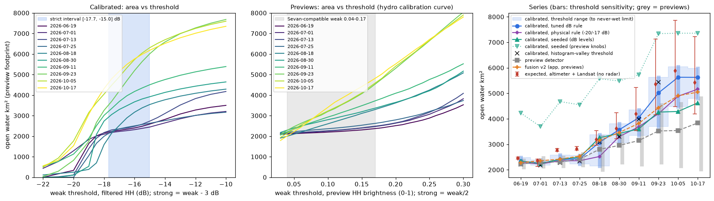
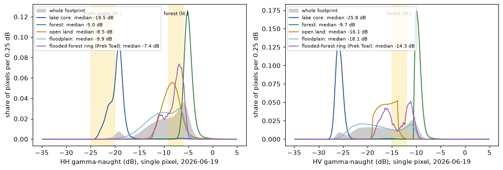
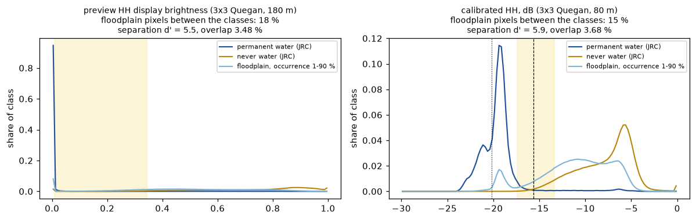
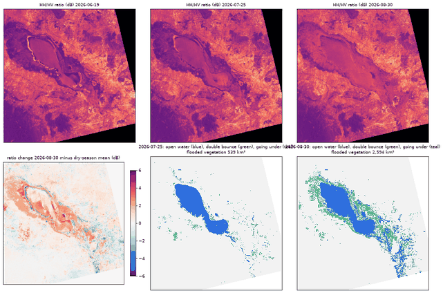
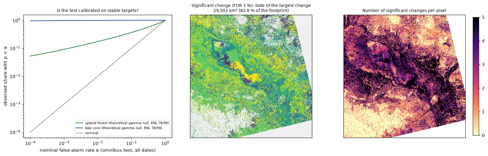
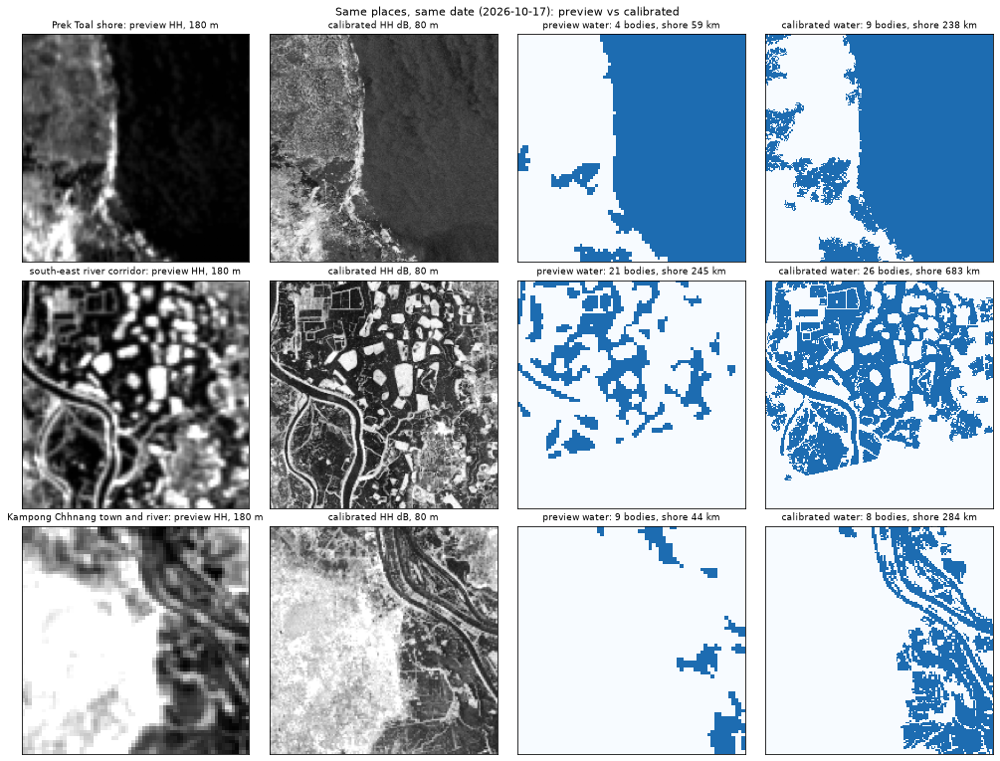
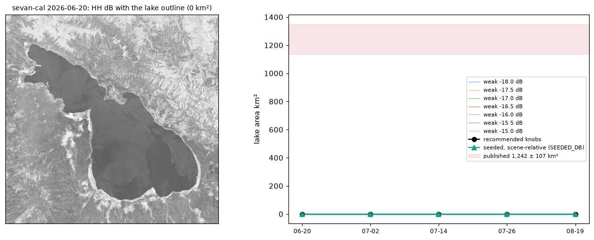

# The detector on calibrated NISAR data

State of Saturday 14 November 2026, about 18:40 Armenia time. All ten calibrated Tonle Sap dates
(19 June – 17 October 2026) are analysed. Armenia: see section 8.

Code: `scripts/detect/calibrated.py` · tests: `tests/test_calibrated.py` · figures and every number:
`docs/eda/calibrated_det/` (`results.json`, `gamma0_knobs.json`) · masks: `data/processed/tonle-sap-cal/det/`.

Data credit: NISAR GCOV, NASA/JPL-Caltech and ISRO, distributed by the ASF DAAC. The calibration is
**PROVISIONAL** (`NISAR_L2_GCOV_PROVISIONAL_V1`, release P05023).

## 1. What changed, in plain words

Until today the detector ran on the free 180 m preview pictures. Their brightness is a display stretch, not a
measurement: the whole lake is clipped to black, and every threshold was a number on an arbitrary 0–1 scale.
The calibrated product (GCOV) gives the radar backscatter itself (gamma-naught, linear power; we convert to
decibels, dB) on an 80 m grid, each cell the exact average of 4 × 4 native 20 m pixels. So every threshold is
now a physical number, the map is about 2.3 times sharper in each direction, and calm and rough water can be
told apart.

**The headline.** With one set of dB thresholds, tuned on a strip of the map and tested on another, the
calibrated detector's open-water area follows the expected flood (from the altimeter and 38 years of Landsat,
no radar) within **5.9 %** on average over the ten dates, against **20 %** for the preview detector and
**8.5 %** for fusion v2 (the app's current water map). On 17 October it gives **5,625 km²** (expected 5,421,
range 4,198–7,222; preview 3,837; fusion v2 5,046). The rank correlation with the lake level is **1.0**
(Pearson 0.94). Calibrated data closes the October gap that the previews could not.



## 2. Measured levels (dB), against the textbook

Medians of single 80 m pixels (unfiltered), per class, `results.json → look.levels`. Classes come from the JRC
Landsat water record (lake core = permanent water, eroded; forest = never-wet land in the brightest 15 % of
dry-season HV, far from any water; open land = never-wet land in the 15–45 % HV band; floodplain = Landsat
occurrence 1–50 %; ring = 3 km around the Prek Toal flooded-forest spot).

| class | HH 19 Jun | HV 19 Jun | HH range over 10 dates | HV range | textbook (science brief, [T]) |
|---|---|---|---|---|---|
| calm lake core | −19.5 | −25.8 | −20.7 … −18.4 | −26.8 … −25.5 | water −20 to −25; HV at the noise floor |
| upland forest | −5.0 | −9.7 | −5.0 … −4.4 | −9.7 … −9.2 | forest −6 to −9 HH, −12 to −15 HV |
| open land (fields, grass) | −8.5 | −16.1 | −8.5 … −6.5 | −16.1 … −14.2 | — |
| floodplain (Landsat 1–50 %) | −9.9 | −18.1 | −9.3 … −15.0 | −17.6 … −22.7 | — |
| Prek Toal ring (3 km) | −7.4 | −14.3 | −7.4 → −18.4 | −14.3 → −24.9 | flooded forest: HH +3–8 dB |

* **Water** is where the textbook says, but at its bright end: calm lake HH −19.5 dB in June, so the untested
  `KNOBS["gamma0"]` strong threshold of −20 dB sat on the water itself. Wind moves the lake median between
  −20.7 dB (1 Jul) and −18.4 dB (18 Aug), 2.3 dB. **HV of the lake is the instrument noise floor**
  (−25.5 to −26.8 dB; the darkest 1 % of 5 × 5-averaged lake HV is −26.4 to −27.8 dB) and does not care about
  wind: HV is the stable water channel.
* **Forest** is 2–4 dB brighter than the textbook in both channels (−5.0 / −9.7 dB). This is gamma-naught
  (terrain-flattened), which runs brighter than sigma-naught (the file's gamma-to-sigma factor is ~0.75,
  −1.2 dB), and dense tropical forest; it is not a calibration error we can show.
* **Prek Toal does not brighten in HH.** The textbook flooded-forest signal (HH up 3–8 dB, double bounce) is
  not what this ring does: both channels fall together, HH −7.4 → −18.4 dB and HV −14.3 → −24.9 dB, and by late
  September the ring is open water. The same "going under" was found on the previews (floodveg.md). A true
  double-bounce rise is seen at Kampong Luong (HH −8.3 → −6.1 dB on 18 Aug while HV stays at −14.2 dB).
* **Incidence angle:** forest brightness changes by +0.38 dB (HH) and −0.16 dB (HV) per 100 km across the
  swath: negligible; no correction needed.

**Speckle (ENL).** Spatial ENL (7 × 7 windows, quantile-matched) on the calm lake: HH 67–88, HV 97–100 over
the ten dates; on forest 54–65 (texture lowers it). Each 80 m cell averages 16 samples of ~9.5 looks
(nominal ~150); neighbouring 20 m samples are correlated, so use **ENL ≈ 80 (HH) and 100 (HV)**. One pixel's
dB noise at ENL 80 is ±0.49 dB (1 sigma). The temporal ENL of the lake HH is only 7.8: the lake really changes
from date to date (wind), it is not speckle.

**Stability between dates (is normalisation still needed?).** No. Stable upland forest varies by 0.27 dB (HH)
and 0.17 dB (HV) standard deviation over the ten dates; the largest single-date offset is 0.40 dB. Part of it
is a slow seasonal rise (+0.7 dB HH from June to October, also in open land, +1.7 dB): the wet season, not the
instrument. The preview needed a per-date gain correction; the calibrated data do not (`normalise = False`).
No date was flagged by the QC check (forest level within 1 dB, valid share ≥ 0.9).



## 3. Is the water/land valley deeper?



Figure: 19 June, preview brightness (left) and calibrated HH dB (right), for Landsat permanent water,
never-water land and the floodplain.

* By the classic measure (d′ = gap between class medians in pooled spreads) the two are **the same**: 5.5
  (preview) and 5.7 (calibrated); histogram overlap 3.5 % and 3.6 %. Calibrated data do not make the easy
  pixels easier.
* What changed is the **floodplain**, where the hard pixels are: on the preview the lake is a spike at black
  and the floodplain spreads evenly over the whole 0.01–0.34 gap (18 % of its pixels lie between the classes,
  with no valley). In dB the floodplain has **its own water mode at −19 dB and a valley at about −17 dB**;
  13 % of its pixels lie between the classes. A threshold now has a natural place to sit.

## 4. The dB water rule, tuned on one strip and tested on another

Same procedure as `tune.py`: labels from the JRC record (permanent water vs never-water land, shore bands
removed); map split into column strips (tune 0–42 %, validation 42–50 %, **test 50–100 %**, never seen during
the search); random + local search over strong/weak HH, HV maximum, filter size, speck size, shoreline
refinement; objective = balanced accuracy + rank agreement with Landsat occurrence in the ambiguous zone,
with a hard false-alarm budget (never-wet land ≤ 0.02 %; without it the search bought rank agreement by
flooding dry land: 0.18 % false alarms, 14 km²/date). Ten dates, 40 evaluations.

**Result (all thresholds on the 3 × 3 Quegan-filtered HH, dB):**
`strong −20.15 · weak −15.66 · HV < −24.0 · box 3 · specks < 9 px removed · 2-px shoreline refinement`

| rule (test strip, 10 dates) | recall on permanent water | false water on never-wet land | balanced accuracy (95 % CI) | IoU |
|---|---|---|---|---|
| **tuned (above)** | 0.990 | 2.0 km²/date (0.03 %) | **0.995** (0.993–0.996) | 0.983 |
| physical rule −20 / −17 dB, no search | 0.964 | 1.0 km²/date | 0.982 | 0.961 |
| untested `KNOBS["gamma0"]` (−20/−16, box 7, opening 3) | 0.979 | 1.3 km²/date | 0.990 | 0.975 |
| brief's guess −18 / −15 | 0.983 | 9.6 km²/date | 0.991 | 0.954 |
| self-calibrating seeded detector, preview knobs | 0.994 | **122 km²/date** | 0.989 | 0.718 |
| seeded detector, levels re-derived for dB | 0.981 | 4.0 km²/date | 0.990 | 0.969 |

The tuned values land almost exactly on the values the physics gives without any search: strong = 1 dB
below the calm-lake median (−19.5), weak inside the interval [−17.7, −15.0] dB that keeps 95 % of the calm
lake and leaves 99 % of never-wet land out, HV = the noise floor + 2 dB. The search was run three times while
the dates arrived (1, 5 and 10 dates): −20.2/−15.8, −20.2/−16.3, −20.15/−15.7 dB — **the thresholds are stable**.

**The self-calibrating seeded detector (`crossscene.detect_water_adaptive(..., source="gamma0")`) does NOT
transfer to dB as designed.** Its scene-relative levels were fitted on preview logits, where the clipped black
lake squeezes the dark end; in dB the same "63.5 % of the way from water to land" is −13.3 dB HH, deep into
wet fields: 7,356 km² on 17 Oct and 122 km² of false water per date. With its two levels re-derived for dB
(`SEEDED_DB`: s_weak 0.25, s_strong 0.10, chosen from the 19 June distributions) it works (balanced accuracy
0.990, Spearman 0.99 with the lake level), but it undercounts the October flood (4,626 km² on 17 Oct) because
its per-date weak threshold (−15.1 to −16.2 dB) follows a land level that itself darkens as the floodplain
fills. Its claim of "no re-tuning in decibels" is therefore not confirmed. Note also that
`crossscene._equiv` reports thresholds in preview brightness; `calibrated.seeded_equiv_db` gives them in dB.

## 5. THE key number: how much does the area depend on the threshold?

On previews, the 17 October area ranged **1,967–4,769 km²** across defensible thresholds (here recomputed:
2,015–4,819 km² for weak 0.04–0.17, the Sevan-compatible range) — a factor of 2.4. On calibrated data, with
the weak threshold anywhere in the physically justified interval [−17.7, −15.0] dB (strong = weak − 3 dB):

| date | calibrated, weak −17.5 … −15.5 dB | max/min | preview, weak 0.04 … 0.17 | max/min |
|---|---|---|---|---|
| 19 Jun | 2,232 – 2,483 | 1.11 | 2,107 – 2,370 | 1.12 |
| 1 Jul | 2,181 – 2,381 | 1.09 | 2,125 – 2,470 | 1.16 |
| 13 Jul | 2,305 – 2,581 | 1.12 | 2,143 – 2,488 | 1.16 |
| 25 Jul | 2,231 – 2,568 | 1.15 | 2,186 – 2,623 | 1.20 |
| 18 Aug (windy) | 2,145 – 3,378 | **1.58** | 2,000 – 3,301 | 1.65 |
| 30 Aug | 3,054 – 3,812 | 1.25 | 2,295 – 3,368 | 1.47 |
| 11 Sep | 3,346 – 4,346 | 1.30 | 2,206 – 3,722 | 1.69 |
| 23 Sep | 3,696 – 5,630 | 1.52 | 2,286 – 4,537 | 1.98 |
| 5 Oct | 4,481 – 6,049 | 1.35 | 2,145 – 4,594 | 2.14 |
| **17 Oct** | **4,793 – 5,984** | **1.25** | **2,015 – 4,819** | **2.39** |

* At the flood peak the range **shrinks from 2,804 km² to 1,191 km²** (factor 2.4 → 1.25). Above −15 dB the
  calibrated October curves flatten (6,000–7,500 km² at −14 … −10 dB) while the preview curves keep rising
  linearly: in dB, the flooded floodplain is a separate population; in preview brightness it is not.
* In the dry season (June–July) the calibrated and preview ranges are the same (~10–15 %): there is little
  ambiguous water and the uncertainty is the shoreline.
* **Wind is still a problem.** On 18 August the lake median rose to −18.4 dB; a weak threshold below −18 dB
  loses most of the lake (1,591 km² at −18.0 against 3,079 km² with the tuned rule). The physical rule (−17 dB)
  gives 2,520 km² that day, the tuned rule (−15.7) 3,079 km². Calibrated data show the wind (the previews
  clipped it), they do not remove it. Hence weak must stay ≥ −16 dB and strong ≥ −20.5 dB.
* A per-date "histogram valley" threshold works while the floodplain is mostly land (19 Jun–11 Sep:
  −17.1 to −15.1 dB, areas within 6 % of the tuned rule) and fails once it is mostly water (23 Sep onwards the
  land mode disappears). It is a check, not a rule.

## 6. The open-water series, against the lake level and the independent estimate

Open water in km², inside the preview footprint (so all columns cover the same ground):

| date | lake level (m) | **calibrated (tuned dB rule)** | preview detector | fusion v2 (app) | expected (altimeter + Landsat, range) |
|---|---|---|---|---|---|
| 19 Jun | 3.32 | **2,340** | 2,234 | 2,281 | 2,458 (2,415–2,496) |
| 1 Jul | 3.21 | **2,261** | 2,297 | 2,355 | 2,361 (2,137–2,425) |
| 13 Jul | 4.60 | **2,400** | 2,310 | 2,418 | 2,772 (2,729–2,827) |
| 25 Jul | 5.09 | **2,432** | 2,421 | 2,537 | 2,822 (2,766–2,909) |
| 18 Aug | 6.78 | **3,079** | 2,803 | 3,152 | 3,189 (2,969–3,541) |
| 30 Aug | 7.66 | **3,569** | 2,954 | 3,461 | 3,609 (3,216–4,231) |
| 11 Sep | 8.35 | **4,042** | 3,147 | 3,818 | 4,185 (3,533–5,233) |
| 23 Sep | 9.25 | **5,015** | 3,522 | 4,436 | 5,360 (4,163–7,134) |
| 5 Oct | 9.55 | **5,629** | 3,541 | 4,904 | 5,888 (4,473–7,859) |
| 17 Oct | 9.29 | **5,625** | 3,837 | 5,046 | 5,421 (4,198–7,222) |
| mean abs. deviation from expected | | **5.9 %** | 20 % | 8.5 % | |
| Spearman / Pearson with the lake level | | **1.00 / 0.94** | 0.98 / 0.96 | 0.98 / 0.95 | |

* Calibrated data **close the October gap**: 7 of 10 dates fall inside the independent range (all six from 18 August on); the preview
  detector is inside on 1 (it undercounts every date from August), fusion v2 on 7 (it undercounts late September–October).
* The misses are 19 June (−5 %, just under the narrow range) and 13 and 25 July (−13 %, −14 %): the lake had risen 1.4–1.9 m, but the new water is under
  the flooded forest and shrubs; open-water radar cannot see it (section 7) and neither could the previews.
* The rank correlation is perfect: the lake level fell slightly from 5 to 17 October (9.55 → 9.29 m) and the
  calibrated area is flat (5,629 → 5,625 km²), while the preview series kept rising.

## 7. Water under vegetation, in dB

The rebuilt rule of `floodveg.py` (HH − HV ratio rising beyond 3 sigma of dry land while HH stays bright =
"double bounce"; or both channels falling next to open water = "going under"), with its floors translated to
dB (rise ≥ 1 dB, HH may fall ≤ 1 dB, HH ≥ −14 dB, both fall ≥ 1.5 dB) and its distances scaled from 180 m to
80 m (`calibrated.fv_db`, knobs in `gamma0_knobs.json → FV_KNOBS_db`). Early-season reference = mean of 19 Jun
and 1 Jul.

| date | 19 Jun | 1 Jul | 13 Jul | 25 Jul | 18 Aug | 30 Aug | 11 Sep | 23 Sep | 5 Oct | 17 Oct |
|---|---|---|---|---|---|---|---|---|---|---|
| calibrated, km² | 1 | 2 | **284** | **539** | 1,870 | **2,594** | 2,405 | 2,030 | 1,861 | 1,363 |
| … double bounce | 1 | 2 | 160 | 311 | 1,095 | 1,537 | 1,326 | 1,031 | 964 | 810 |
| … going under | 0 | 0 | 123 | 228 | 775 | 1,057 | 1,078 | 999 | 897 | 552 |
| preview rule, km² | 1 | 1 | 213 | 461 | 1,591 | 2,113 | 1,865 | 1,423 | 1,282 | 836 |
| simple ops rule (HH +3 dB, HV < +1.5 dB) | 0 | 2 | 41 | 90 | 201 | 280 | 494 | 353 | 203 | 162 |

* **Same story as the previews, in physical units.** Nothing in June, then 2 → 284 → 539 km² from 1 to 25 July
  while the river gauge rose 2.76 m and the altimeter 1.4–1.9 m: the early-July rise appears first as water
  under vegetation, exactly when the open-water rule falls 13–14 % short of the expected extent (section 6).
  Peak on 30 August (2,594 km², previews 2,113), then the vegetation goes under and the area turns into open
  water.
* 88 % of the calibrated flooded vegetation lies inside the Landsat maximum water extent (previews: 77 %);
  68 % of it lies within 2 preview pixels of the preview map; calibrated adds ~1,100 km² ever-flooded
  (4,282 vs 3,175 km²), mostly narrow fringes the 180 m previews could not resolve.
* **HH/HV ratio in dB.** Near the lake (not water) the median ratio is a steady 7.6–8.1 dB all season. In the
  Prek Toal ring it rises from 5.2 dB (June) to 7.4 dB (18 Aug) and stays ~7 dB: HV falls faster than HH
  (HV −14.3 → −17.6, HH −7.4 → −9.7 by 18 Aug) — the same "HV falls, HH holds" signature the previews
  showed, now measured: +2.2 dB of ratio.
* **The simple textbook rule (HH rises > 3 dB) finds almost nothing** (≤ 494 km²): at L-band in this forest,
  HH mostly does not brighten by 3 dB. The rebuilt rule is needed.
* **Threshold sensitivity is NOT better than on previews.** Peak area over eight variants: 1,711 km² (4 sigma)
  to 3,671 km² (context distance halved), a factor of 2.1; on previews the rebuilt rule moved by ≤ 1.5×. The
  noise of the dB ratio change on dry land grows from 0.20 dB (June) to 0.62 dB (October) as the wet season
  changes the land itself, so the 3-sigma floor moves. Calibration did not make this rule more stable; the
  location and timing are solid, the km² are ± a factor of ~1.5.



## 7b. Change statistics with the theoretical gamma null

The omnibus likelihood-ratio test over all ten dates and the sequential (date-of-change) test of
`stats_change.py` (Conradsen et al. 2016), on the UNFILTERED 80 m intensities, with the theoretical
chi-square null at the measured ENL (HH 77.9, HV 99.2: spatial, calm lake core), false-discovery rate 1 %.
On synthetic gamma speckle this null gives exactly the nominal false-alarm rate (tests pass at ENL 4/16/64).

| stable target | nominal α = 0.1 | 0.05 | 0.01 | 0.001 |
|---|---|---|---|---|
| upland forest, 10-date omnibus, ENL from the lake | 0.37 | 0.29 | **0.17** | 0.09 |
| same, ENL from the forest's own temporal variance (68.9 / 81.4) | 0.25 | 0.19 | 0.10 | 0.05 |
| upland forest, consecutive-date pairs, HH (exact F test) | | | **0.006–0.022** (median 0.011) | |

* **On real data the 10-date test is not at its nominal level**: 17 % of stable forest is flagged at α = 1 %.
  The two-date tests are close to nominal (median 1.1 % at 1 %). The difference is real, slow change: over the
  wet season the forest brightens by ~0.7 dB, and at ENL ~80 a 0.3 dB shift is already "significant". The
  null is right about speckle; the forest is not perfectly stable.
* Consequence: the FDR map flags **83 % of the footprint** (29,500 km²), statistically correct and useless
  as a map. On previews the test needed an empirical null for a different reason (the stretch); on calibrated
  data it needs a **minimum effect size** (e.g. ≥ 1.5 dB, the display threshold recommended in section 11) or
  the empirical null, not a different ENL.
* Agreement with the preview change map: 99.9 % of the preview's 5,618 km² of change is also flagged here;
  the date of the largest change agrees on 59 % of those pixels. Largest changes cluster on 18 Aug
  (5,799 km²), 11 Sep (5,329) and 23 Sep (6,183): the flood fronts.



## 8. Resolution: 180 m previews against 80 m calibrated



Same date (17 Oct), approximately the same windows (preview crop on its lon/lat grid, calibrated on UTM),
water masks from each detector:

| crop | water km², preview → calibrated | water bodies | shoreline length |
|---|---|---|---|
| Prek Toal shore (16 km) | 150 → 170 | 4 → 9 | 59 → 238 km |
| south-east river corridor (16 km) | 49 → **110** | 21 → 26 | 245 → 683 km |
| Kampong Chhnang town and river (12 km) | 9 → **34** | 9 → 8 | 44 → 284 km |
| whole preview footprint | 3,837 → 5,625 | 344 → 773 | 5,877 → 22,944 km |

* **Rivers and channels become continuous.** The Tonle Sap river and the side channels at Kampong Chhnang
  (200–400 m wide) are broken specks on the previews and continuous ribbons at 80 m; the river corridor holds
  2.3× more open water. The fish ponds and the field pattern in the south-east are resolved individually.
* Smallest water body: the detector's floor is 9 cells = **0.06 km²** (preview: 4 cells = 0.13 km², and in
  practice no preview body under 0.1 km² survived; calibrated keeps 16 of them in the scene).
* The shoreline is ~4× longer: the flooded-forest edge at Prek Toal is now a fringe of channels and clearings
  instead of a smooth line. Part of that length is real detail, part is speckle along the edge; the 2-px
  shoreline refinement keeps the shore from shrinking but does not smooth it.
* The 20 m native product would resolve fields (Ararat) and single canals; a 40 m version of a sub-area costs
  the same server read (see docs/research/calibrated-data.md).

## 9. Armenia: can ONE dB rule serve Tonle Sap and Lake Sevan?

`sevan-cal` (30 m, 3 × 3 native 10 m pixels, 40 + 5 MHz mode, track 85 frame 22): five dates were local at
18:30 (20 Jun – 19 Aug); `ararat-cal` had arrived but was not analysed (no time).

**No.** With the Tonle Sap knobs unchanged, Lake Sevan comes out at **0 km²** on every date, and so does every
weak threshold from −18 to −15 dB. The reason is in the data, not the rule:

| | Tonle Sap (20 MHz mode, 80 m) | Lake Sevan (40 MHz mode, 30 m) |
|---|---|---|
| calm lake HH (3 × 3 filtered, median) | −19.5 dB | **−15.0 to −15.6 dB** |
| lake HV | −25.8 dB (noise floor) | **−16.8 to −17.1 dB** |
| never-wet land HV, median | open land −14.2 to −16.1 dB, forest −9.7 dB | −14.9 to −15.3 dB |
| darkest 1 % of the whole scene, HV | −26.4 dB | −19.3 to −19.4 dB |

* At Sevan the lake HV (−17 dB) is barely below dry land (−15 dB), so the rule's HV < −24 dB guard rejects all
  of it; and the lake HH (−15.3 dB) is above Tonle Sap's whole water/land boundary. The 40 MHz Armenia product
  has a noise floor roughly **7–8 dB higher** than the 20 MHz Tonle Sap product (its darkest HV pixels sit at
  −19 dB instead of −27 dB), so calm water there is "noise-floor dark" at a much brighter level. Absolute dB
  water thresholds are therefore **mode-specific** (bandwidth / noise floor), not universal.
* The scene-relative seeded detector (`SEEDED_DB`) also finds nothing: its dark-mode test picks HV, where the
  lake and land overlap.
* A diagnostic HH-only rule at Sevan's own level (no HV guard) recovers the lake: strong −15.5 / weak −14.0 dB
  gives **1,210–1,239 km²** on all five dates (published 1,242 ± 107 km²), but with 26–60 km²/date of false
  water on never-wet land (preview pipeline after the terrain mask: 39 km²); −16.0 / −14.5 dB gives
  1,029–1,144 km² with 11–23 km²/date. These thresholds were read off Sevan itself, so this shows the data can
  measure the lake, not that a rule transfers.
* The 6 October HV anomaly and the Ararat field-by-field harvest could not be checked: those dates/areas were
  not analysed in time. Command: `.venv/bin/python -m scripts.detect.calibrated sevan-cal --step lake`
  (and `--step look` for the per-date HV levels) once all ten Sevan dates are local.

**Recommendation:** keep `KNOBS["gamma0"]` for the 20 MHz mode (Tonle Sap) and give Armenia (40 MHz) its own
water knobs, or make the HV guard relative to the scene's own noise floor (e.g. HV < scene HV 1st percentile
+ 2 dB) and the HH thresholds relative to the calm-water level. Before trusting Armenia's levels, check the
product's noise-equivalent sigma-zero in the GCOV metadata.



## 10. What is solid, what is still open

**Solid**
* Calibrated levels: water −19.5 dB HH / −25.8 dB HV (noise floor); forest −5 / −9.7 dB; ENL 80 / 100.
* No date-to-date normalisation needed (forest stable to 0.27 dB).
* One dB water rule (−20.15 / −15.66 / HV −24), stable across three tuning runs, 99.5 % balanced accuracy on a
  held-out strip, Spearman 1.0 with the lake level, within 5.9 % of the independent flood estimate.
* Threshold sensitivity at the flood peak cut from a factor 2.4 to 1.25.

**Open / not fixed by calibration**
* Wind still brightens the lake by up to ~2.3 dB; on a windy date the area depends on the weak threshold
  (factor 1.6 on 18 Aug). Calibrated data make the wind visible, not harmless. HV is wind-proof but noisy at
  the noise floor; a HV-weighted rule (`hv_w`) was in the search and was not chosen.
* Water hidden under vegetation in July is still missed by the open-water rule.
* The self-calibrating seeded detector needs dB-specific levels; its "no re-tuning" property did not hold.
* PROVISIONAL calibration; `inputDataExceptionMask` (sample slip) not applied; one season, one area.
* The tuning labels come from Landsat 1984–2021, which cannot see water under trees either.

## 11. Knobs and the code changes the lead must make

`docs/eda/calibrated_det/gamma0_knobs.json` holds the recommended values with one reason each.

1. **`scripts/detect/run.py`, gamma0 branch** — replace
   `out = ops.run_pipeline(x, valid_det, source, dev=dev, water_ok=water_ok)` by
   ```python
   if source == "gamma0":
       from scripts.detect import calibrated as cal
       water_ok = cal.terrain_on_grid(area.removesuffix("-cal"), grid)   # preview terrain mask -> UTM grid
       out = cal.run_pipeline_gamma0(x, valid_det, abs(grid.transform.a), water_ok=water_ok,
                                     dev=torch.device("cpu"))
   else:
       out = ops.run_pipeline(x, valid_det, source, dev=dev, water_ok=water_ok)
   ```
   `run_pipeline_gamma0` = `ops.run_pipeline` with the knob file, then the dB water rule with shoreline
   refinement and the rebuilt flooded-vegetation rule in dB (`fv_state` included), same output keys. Run it on
   the CPU: on the full 80 m stack ops copies the 510 MB stack several times.
2. In `run.py` skip the `if source == "preview":` floodveg block for gamma0 (already done inside), and skip the
   `water_source == "fusion"` override for a `-cal` area (fusion products are on the preview grid).
   `load_area`, `load_qc`, `cached_water_possible` are keyed by area name: call them with
   `area.removesuffix("-cal")` or give the `-cal` areas their own config.
3. **`ops.KNOBS["gamma0"]`**: box 7 → 3, open_k 3 → 0, min_blob_px 20 → 9, edge_erode_px 1 → 2,
   water_hh_strong −20 → −20.15, water_hh_weak −16 → −15.66, water_hv_max stays −24, untested → False
   (or load `gamma0_knobs.json` via `calibrated.load_gamma0_knobs()`).
4. **`run.py DISPLAY["gamma0"]`**: grey HH (−25, −5) → (−25, −3) and HV (−30, −10) → (−30, −8) (forest is
   −5 / −9.7 dB and was clipped); change `thr` 3.0 → 1.5 dB, `full` 8 → 6 dB (pixel noise ±0.5 dB at ENL 80).
5. **`floodveg.cond_quantile`** bins HV assuming 0..1 brightness; give it `lo, hi` arguments (calibrated:
   −36 … −6 dB). `calibrated._db_cond_quantile` does this by a temporary patch.
6. **`crossscene`**: for `source="gamma0"` use `calibrated.SEEDED_DB` levels and report thresholds with
   `calibrated.seeded_equiv_db` (`_equiv` converts to preview brightness).
7. **`stats_change`**: on calibrated data pass the measured ENL (HH 80, HV 100) — see section 7b for whether
   the theoretical null is calibrated.

## 12. Commands

```bash
.venv/bin/python -m pytest -q tests/test_calibrated.py                      # synthetic checks (~1 min)
.venv/bin/python -m scripts.detect.calibrated tonle-sap-cal --step look     # levels, ENL, stability (~2 min)
.venv/bin/python -m scripts.detect.calibrated tonle-sap-cal --step water --evals 40   # tune/test, sweep, series (~20 min; --no-seeded saves ~12)
.venv/bin/python -m scripts.detect.calibrated tonle-sap-cal --step fv       # flooded vegetation in dB
.venv/bin/python -m scripts.detect.calibrated tonle-sap-cal --step change   # gamma-null change tests
.venv/bin/python -m scripts.detect.calibrated tonle-sap-cal --step res      # preview vs calibrated crops
.venv/bin/python -m scripts.detect.calibrated tonle-sap-cal --step knobs    # writes gamma0_knobs.json
.venv/bin/python -m scripts.detect.calibrated sevan-cal --step lake         # Sevan area with the same knobs
```
One Python process at a time; each step reloads the stack (10 dates × 2 channels × 6.4 M cells, 510 MB).
