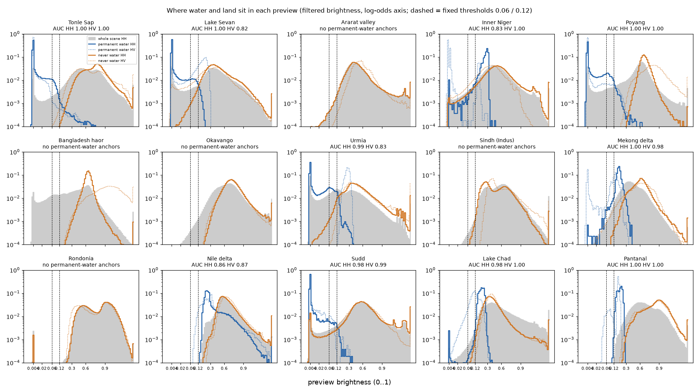
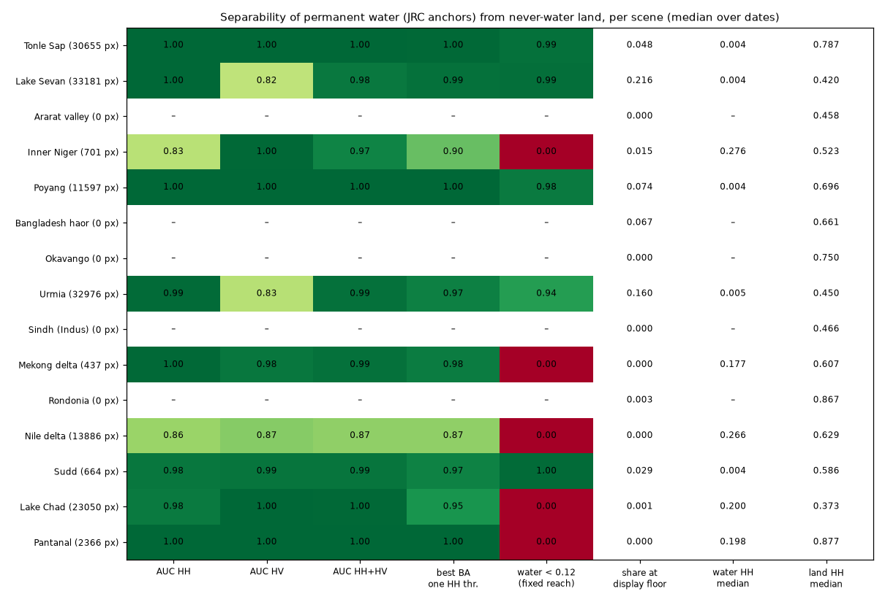
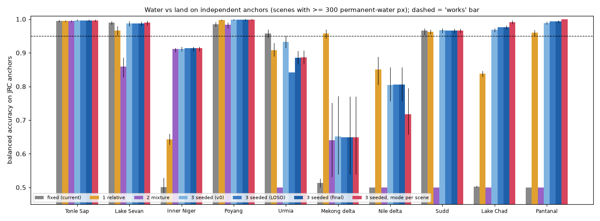
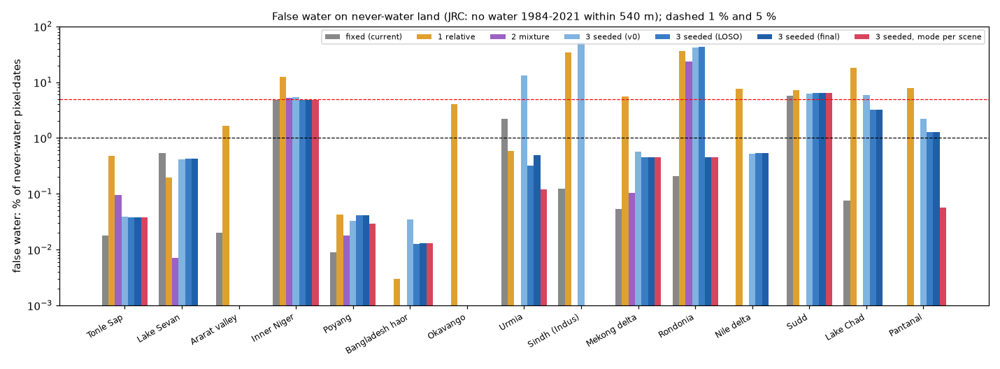
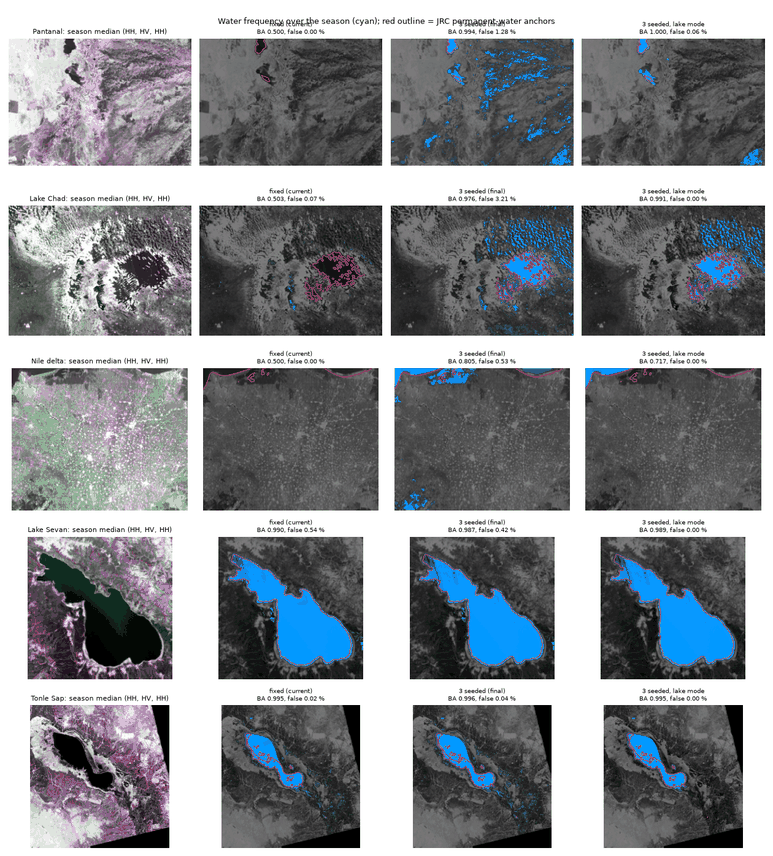
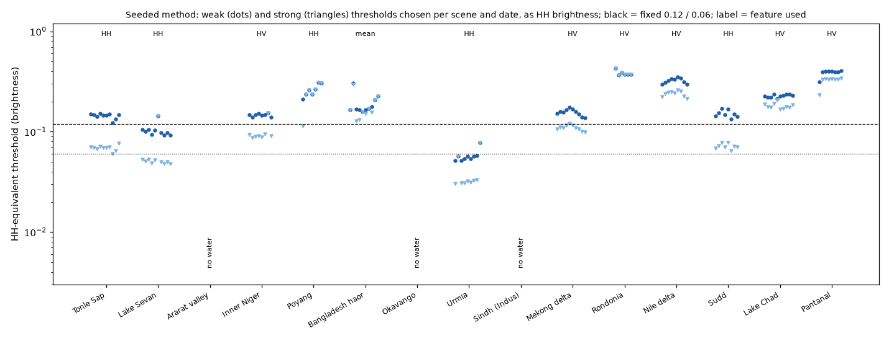
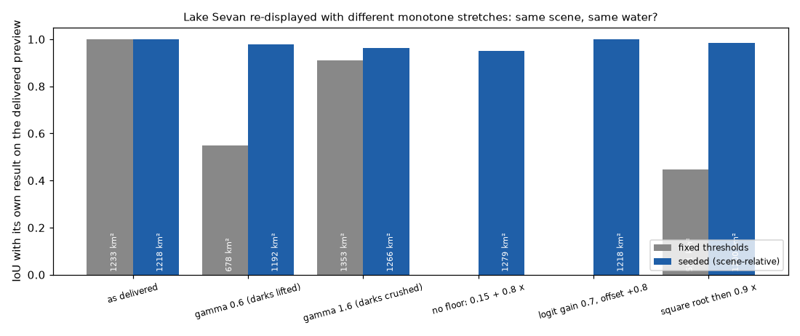

# A water detector that calibrates itself on every scene

Code: `scripts/detect/crossscene.py` · tests: `tests/test_crossscene.py` (6 tests, CPU, < 2 s) ·
numbers: `docs/eda/crossscene/results.json` · settings per place: `docs/eda/crossscene/scene_knobs.json` ·
figures: `docs/eda/crossscene/*.png` · products: `data/processed/<area>/crossscene/products.pt`.

    .venv/bin/python -m scripts.detect.crossscene              # all 15 places: grid, final run, report (~25 min)
    .venv/bin/python -m scripts.detect.crossscene --skip-grid  # reuse the grid results (~6 min)
    .venv/bin/python -m scripts.detect.crossscene --report     # figures + results.json from the cached results
    .venv/bin/python -m pytest tests/test_crossscene.py

## Bottom line

* **Fixed brightness thresholds cannot work across these previews.** Every preview is stretched in its own way. In
  Tonle Sap, Sevan, Poyang, Urmia and the Sudd, calm water sits at the display floor (brightness 0.004). In
  Pantanal, Lake Chad, the Mekong and the Nile it never gets below about 0.15: those previews have no floor at
  all (0.0 % of pixels there). The current rule (HH < 0.06 / 0.12) reaches **0 % of the permanent-water
  pixels** in Pantanal, the Mekong and the Nile, and **0.2 %** in Lake Chad. That is why those layers were empty.
* **The new method ("seeded")** finds the water in each scene from that scene's own numbers. It first looks for a
  separate dark population of pixels. If there is one, it takes the stable core of it as "seeds". Each date
  is then measured relative to those seeds and to that date's land. No absolute brightness is used anywhere.
  Its two thresholds were set to match the current detector on Tonle Sap and Sevan.
* **Pantanal and Lake Chad are rescued.** Pantanal: balanced accuracy 0.500 → **1.000** (lake mode), false water
  0.06 %. Lake Chad: 0.503 → **0.991**, false water 0.00 %. Both also pass when the method's free settings were
  chosen without them (leave-one-scene-out: Pantanal 0.994, Lake Chad 0.976). Both can go back into the app.
* **The two original places do not get worse.** Sevan: 1,121–1,229 km² per date (published 1,242). Tonle Sap
  grows 2,301 → 4,389 km² (current detector 2,234 → 3,837), with a better rank agreement with the 38-year
  water frequency (0.583 vs 0.566). Ararat: 0 km² of false water (current 0.5–1 km²).
* **The Nile Delta is not rescued.** Its sea and lagoons overlap land in brightness: AUC 0.86, and the best
  possible single threshold reaches only 0.87 balanced accuracy. The method finds part of the sea and lagoon
  (balanced accuracy 0.72–0.81) but not enough for a water layer. **These previews cannot do it.**
* **Across 15 places:** 10 work with the new method (fixed thresholds: 9). 2 fail badly (fixed: 6). Mean balanced
  accuracy on the 10 places with permanent-water anchors is 0.917 (fixed 0.741). False water on never-water land
  is 1.2 % on average (fixed 0.9 %). The method is honest about "no water here": Ararat, Okavango and Sindh are
  correctly declared water-free.
* **Calibrated data:** the seeded method is unchanged by any per-channel gain and offset (test and figure 7). It
  should carry over to decibel data without re-tuning. Only the input feature changes: dB instead of the
  logit of brightness. The fixed thresholds will not carry over.

## 1. Diagnosis: where water sits in each preview

**Independent anchors.** These come from JRC Global Surface Water 1984–2021 (Landsat), resampled to our grid with
`validate.reference_on_grid`. The labels are the same as in `tuning.md`:

* **permanent water**: at least 90 % of the pixel has water occurrence ≥ 90 %, and at least 50 % of it was water
  in all 12 months of 2021. A 2-pixel shoreline band is removed.
* **never water**: no 30 m pixel within 3 px was ever water.

GSW layers for the five places that had none (Nile, Okavango, Poyang, Rondônia, Urmia) were fetched and cached
(`data/external/gsw/`). Quality control was applied first: Sevan and Ararat HV on 6 Oct were replaced by the
median, as `qc.apply_qc` does. Okavango 30 Sep failed QC in HH, so it is left out of every metric. Five places
have no permanent-water anchors at all: Ararat, Bangladesh, Okavango, Sindh and Rondônia. There we can only
measure false water.



*Figure 1. Brightness of permanent-water pixels (blue) and never-water pixels (orange) on every date, HH solid,
HV dotted, over the whole scene (grey). The x axis is log-odds, so both the floor and the bright end are
visible. Dashed lines: the fixed thresholds 0.06 and 0.12.*



*Figure 2. How separable water is from land, using brightness only (medians over dates). AUC = probability that a
random water pixel is darker than a random land pixel. "Best BA one HH thr." = the best balanced accuracy that
ANY single HH threshold could reach on that scene: the ceiling for a fixed-threshold detector, even one tuned
on that scene.*

| place | anchors (px) | water HH (median) | land HH (median) | share at floor | AUC HH | AUC HV | best single-threshold BA | fixed rule reaches (water < 0.12) |
|---|---|---|---|---|---|---|---|---|
| Tonle Sap | 30,655 | 0.004 | 0.79 | 4.8 % | 1.00 | 1.00 | 1.00 | 99 % |
| Lake Sevan | 33,181 | 0.004 | 0.42 | 21.6 % | 1.00 | 0.82 | 0.99 | 99 % |
| Poyang | 11,597 | 0.004 | 0.70 | 7.4 % | 1.00 | 1.00 | 1.00 | 98 % |
| Urmia | 32,976 | 0.005 | 0.45 | 16.0 % | 0.99 | 0.83 | 0.97 | 94 % |
| Sudd | 664 | 0.004 | 0.59 | 2.9 % | 0.98 | 0.99 | 0.97 | 100 % |
| **Pantanal** | 2,366 | **0.20** | 0.88 | **0.0 %** | **1.00** | 1.00 | **1.00** | **0 %** |
| **Lake Chad** | 23,050 | **0.20** | 0.37 | 0.1 % | 0.98 (0.80–0.995) | **1.00** | 0.95 | **0.2 %** |
| Mekong delta | 437 | 0.18 | 0.61 | 0.0 % | 1.00 | 0.98 | 0.98 | 0 % |
| Inner Niger | 701 | 0.28 | 0.52 | 1.5 % | 0.83 | **1.00** | 0.90 | 0 % |
| **Nile delta** | 13,886 | **0.27** (tail to 0.8) | 0.63 | 0.0 % | **0.86** | **0.87** | **0.87** | 0 % |
| Ararat, Bangladesh, Okavango, Sindh, Rondônia | 0 | – | 0.46–0.87 | 0–6.7 % | – | – | – | – |

What the numbers say:

* **The stretch decides where water lands, and it differs between scenes.** Within a scene it moves little from
  date to date (Pantanal water HH 0.16–0.23, land 0.87–0.90 on all eight dates). Between scenes the water level
  moves by a factor of 50 (0.004 → 0.2). The fixed rule is right only where the preview has a display floor.
* **This is observable without the reference.** The share of pixels at the display floor is 0.0–0.1 % in every
  scene where the fixed rule fails because of the stretch (Pantanal, Lake Chad, Mekong, Nile). It is 3–22 % in
  every scene where the fixed rule works. Latitude, track direction and bandwidth (20+5 vs 40+5 MHz) do not
  explain it: Pantanal and Sevan, for example, have different modes but both have separable water. The scene
  percentiles alone do not tell water from land either. What does carry over is the **shape** of the
  histogram: a separate dark mode, with a valley before the land. The seeded method relies on this.
* **Why Pantanal failed:** only the stretch. The lakes on the Bolivian border are the darkest thing in the scene
  (HH 0.15–0.25, HV 0.08–0.18; land HH 0.5–0.95). They are perfectly separable (AUC 1.00, best threshold BA
  0.999), but they sit above 0.12 on every date. The HV limit (0.35) was never the problem.
* **Why Lake Chad failed:** the stretch, plus HH that is not very dark. The open southern pool is at HH 0.14–0.24,
  likely wind-roughened or partly vegetated water; we cannot tell which from these images. Dark dune troughs
  overlap it in HH in June–July (AUC HH 0.80–0.92 on those dates; 0.98–0.995 from August on). In HV, water
  (0.08–0.14) is clearly below land (0.36–0.44), with AUC 0.998 on every date. **HV is the reliable channel at
  Lake Chad**, and the method picks it by itself.
* **Why the Nile lagoons and sea are grey:** the sea and lagoon surface is rough at L-band. Water HH has median
  0.27 with a tail to 0.8. 86 % of never-water land is darker than the brightest 5 % of water. HV gives no
  rescue either (AUC 0.87), and 32 % of the water is even above the fixed HV limit of 0.35. This is not a
  stretch problem: **open water and farmland overlap in these previews**, at the pixel level, in both
  channels.
* **Inner Niger:** the anchor lake is wind-roughened. HH reaches 0.11–0.31, but HV stays at the floor (0.003),
  because cross-polarised Bragg scattering from rough water is weak. HV separates it perfectly (AUC 0.997).
* **Mekong:** the anchors are the river itself, 437 px. It is HH 0.17, separable (AUC 0.996), but thin and
  fragmented at 180 m, so stable seeds are scarce (see section 4).

## 2. The methods (all in `crossscene.py`, every constant a named knob in `CKNOBS`)

All methods work on `u` = log-odds of the filtered, normalised preview brightness `L` that `ops.run_pipeline`
returns. Because the preview stretch is close to logarithmic, `u` is close to an affine function of dB. For
calibrated data `u` = dB (`source="gamma0"`).

**0 · fixed (current).** Hysteresis on HH: seed below 0.06, grow below 0.12, HV < 0.35, terrain mask.

**1 · relative** (`detect_relative`). Each date and channel is standardised by its land mode: land = pixels above
that date's Otsu threshold, z = (u − median_land) / IQR_land. Then the old hysteresis is applied in z units. The
z thresholds are the old 0.06 / 0.12 / 0.35 expressed in z on Tonle Sap + Sevan: z_HH < −2.22 / −1.71, z_HV <
−0.94. No has-water test.

**2 · mixture** (`detect_gmm`). A 5-component Gaussian mixture is fitted per scene on (u_HH, u_HV), reusing
`gmm.fit_gmm`. The relative rule: D = the darkest component, L = the heaviest. A component is water if it lies
within 35 % of the way from D to L. Water exists only if D is at least 3 land standard deviations below L.

**3 · seeded, self-calibrating** (`detect_seeded`, recommended):

1. **Season composite and robust units.** m = per-pixel median over dates. Each channel is standardised by the
   scene median and inter-quartile range: z_c = (u_c − med_c) / IQR_c. This does not change under any gain and
   offset of the stretch.
2. **Is there water? (dark-mode test, `dark_mode`).** For z_HH, z_HV and their mean, smooth the histogram and
   look for a valley. The valley must be at most 0.70 × the smaller neighbouring peak (`valley_depth_max`). At
   least 300 px (~10 km², `mode_min_px`) must lie left of it, and at most 40 % of the scene
   (`mode_max_frac`). The feature with the most prominent valley (pixels left × (1 − depth)) is used. If no
   feature has such a valley, **has_water = False** and the masks are empty. This is how Ararat, Okavango and
   Sindh come out water-free, without any terrain argument.
3. **Seeds.** Pixels below the valley in the composite, and on ≥ 70 % of their dates (temporally stable). Then a
   3-px opening, components of ≥ 30 px, and inside the terrain mask. At least 100 seed px are needed.
4. **Per date, scene-relative units.** a_t = median of the feature on the seeds today. b_t = 25th percentile on
   land today (`land_q`). Then s = (f − a_t) / (b_t − a_t): 0 = this scene's permanent water today, 1 = its
   darker land today. Water = hysteresis: seed where s < 0.447 (or ≥ 3 seed spreads), grow where s < 0.635.
   When the feature is a single channel, the other channel must also be < 0.936 in its own s units (land
   median as 1); this is the old "HV < 0.35" rule, in scene units. Stable seed pixels stay water while s < 0.70.
   That re-anchors windy dates: when the lake brightens, a_t moves with it.
5. **Lake mode** (`seeds_only=True`): grow only from the seeds, so no new isolated water bodies appear. For lake
   scenes it removes most false water (Pantanal 1.28 % → 0.06 %, Lake Chad 3.2 % → 0.0 %). It cannot show new
   floodwater that is not connected to permanent water, so floodplains use the full mode.

**Where the numbers came from.** The thresholds s_strong = 0.447, s_weak = 0.635 and s_other = 0.936 are exactly
where the current 0.06 / 0.12 / 0.35 sit in Tonle Sap and Sevan (`calibrate_seeded`; Tonle Sap 0.41 / 0.59,
Sevan 0.48 / 0.68). So on those two scenes the new method reproduces the old one by construction. Tonle Sap and
Sevan cannot pin down `valley_depth_max`, `mode_max_frac` and `land_q`: both have an obvious water mode. These
three were chosen on a small grid (3 × 3 × 2) over all 15 places, and tested leave-one-scene-out (section 3).
A-priori values (v0: 0.75 / 0.70 / 0.5) are reported too. Lake mode and the per-scene mode list (`MODE`) were
added after looking at the Pantanal map. That is a judgement about what each place is FOR (lake or floodplain),
not a fit.

## 3. Results: leave-one-scene-out on independent anchors

Metrics are over all evaluable pixel-dates. Balanced accuracy (BA) = ½ (recall on permanent water + 1 − false-
alarm rate on never-water); 95 % intervals come from a 20-px block bootstrap (`results.json`). "Works" = BA ≥
0.95 and false water ≤ 5 % (places with ≥ 300 anchor px), or false water ≤ 1 % (places without anchors). "Fails"
= BA < 0.80 or false water > 5 %.

| method | places that work (of 15) | fail badly | mean BA (10 anchored) | worst BA | mean false water | worst false water | mean false km²/date |
|---|---|---|---|---|---|---|---|
| 0 fixed (current, terrain mask) | 9 | 6 | 0.741 | 0.500 | 0.92 % | 5.7 % (Sudd) | 83 |
| 1 relative | 4 | 8 | 0.908 | 0.643 | 9.0 % | 35.7 % (Rondônia) | 854 |
| 2 mixture | 6 | 8 | 0.689 | 0.500 | 1.9 % | 23.4 % | 306 |
| 3 seeded, v0 (a priori; set on Tonle Sap + Sevan only) | 7 | 7 | 0.921 | 0.651 | 8.5 % | 51.8 % (Sindh) | 857 |
| **3 seeded, leave-one-scene-out** | **9** | **3** | 0.913 | 0.649 | 4.0 % | 43.0 % (Rondônia) | 613 |
| 3 seeded, final (knobs chosen on all 15) | 10 | 2 | 0.917 | 0.649 | 1.2 % | 6.4 % (Sudd) | 105 |
| 3 seeded, lake mode everywhere | 11 | 2 | 0.909 | 0.624 | 0.50 % | 4.9 % (Sudd) | 57 |
| **3 seeded, mode per place (for the app)** | 10 | 3 | 0.911 | 0.649 | 0.82 % | 6.4 % (Sudd) | 87 |



*Figure 3. Balanced accuracy per place with bootstrap intervals; dashed = 0.95.*



*Figure 4. False water on never-water land, % of pixel-dates (log scale); dashed 1 % and 5 %.*

Per place, BA / false water (full table in `results.json` → `areas.<id>.methods`):

| place | fixed | seeded (LOSO) | seeded final | lake mode | app choice |
|---|---|---|---|---|---|
| Tonle Sap | 0.995 / 0.02 % | 0.996 / 0.04 % | 0.996 / 0.04 % | 0.995 / 0.00 % | seeded (flood) |
| Lake Sevan | 0.990 / 0.54 % | 0.987 / 0.42 % | 0.987 / 0.42 % | **0.989 / 0.00 %** | seeded (lake) |
| Ararat | – / 0.02 % | – / 0.00 % (no water) | – / 0.00 % | – / 0.00 % | no water |
| Poyang | 0.985 / 0.01 % | 0.998 / 0.04 % | 0.998 / 0.04 % | 0.999 / 0.03 % | seeded (lake) |
| Urmia | **0.957** / 2.2 % | 0.841 / 0.32 % | 0.885 / 0.50 % | 0.886 / 0.12 % | **keep fixed** |
| Sudd | 0.966 / 5.7 % | 0.966 / 6.4 % | 0.966 / 6.4 % | 0.967 / 4.9 % | caution (see limits) |
| **Pantanal** | 0.500 / 0.00 % | **0.994 / 1.28 %** | 0.994 / 1.28 % | **1.000 / 0.06 %** | **seeded (lake)** |
| **Lake Chad** | 0.503 / 0.07 % | **0.976 / 3.2 %** | 0.976 / 3.2 % | **0.991 / 0.00 %** | **seeded (lake)** |
| Inner Niger | 0.501 / 4.8 % | 0.913 / 4.8 % | 0.913 / 4.8 % | 0.924 / 2.2 % | caution |
| Mekong delta | 0.513 / 0.05 % | 0.649 / 0.45 % | 0.649 / 0.45 % | 0.624 / 0.00 % | caution |
| **Nile delta** | 0.500 / 0.00 % | 0.805 / 0.53 % | 0.805 / 0.53 % | 0.717 / 0.00 % | **no water layer** |
| Bangladesh haor | – / 0.00 % | – / 0.01 % | – / 0.01 % | – / 0.00 % | seeded (flood) |
| Okavango | – / 0.00 % | – / 0.00 % (no water) | – / 0.00 % | – / 0.00 % | no water |
| Sindh | – / 0.12 % | – / 0.00 % (no water) | – / 0.00 % | – / 0.00 % | no water |
| Rondônia | – / 0.21 % | **– / 43 %** | – / 0.45 % | – / 0.14 % | seeded (flood) |

How to read the protocols:

* **v0, set on Tonle Sap + Sevan only (the honest generalisation test of the first design):** it rescues Pantanal
  (0.989) and nearly rescues Lake Chad (0.968, but false water 5.9 %). It **invents water** in Sindh (52 %) and
  Rondônia (42 %), and over-grows Urmia (13 %). In both Sindh and Rondônia, a land class (dark sand; pasture in
  HV) forms a large second mode that the a-priori limits let through as "water".
* **Leave-one-scene-out:** the three structural knobs are chosen on the other 14 places, and ties go back to the
  a-priori values. 9 of 15 work. Pantanal is rescued even with Pantanal held out (0.994). **Rondônia held out
  fails (43 % false water):** Rondônia is the only place that shows a land mode can be as large as 47 % of the
  scene, so without it nothing teaches the 40 % limit. This is a real limitation. A place with an unusual land
  cover can still fool the dark-mode test.
* The final knobs (chosen on all 15) are the same as the LOSO choice for 13 of 15 places.

### Effect on the two original places and Ararat

* **Lake Sevan** (lake mode; published area 1,242 km², JRC permanent 1,239 km²): 1,221 / 1,191 / 1,199 / 1,216 /
  1,211 / **1,229 (31 Aug)** / **1,121 (12 Sep)** / 1,207 / 1,228 / 1,213 km². Fixed: 1,239 … 1,211 (31 Aug) /
  1,176 (12 Sep) … 1,255. The windy 31 Aug is better than fixed (recall 0.991 vs 0.965). On 12 Sep the method
  loses about 5 % more of the lake than fixed (recall 0.919 vs 0.937). False water around the lake drops from
  0.54 % (16 km²/date) to 0.00 %. That is the dark-land false positive that `validation.md` found.
* **Tonle Sap** (flood mode): 2,301 → 2,385 → 2,370 → 2,540 → 3,051 → 3,146 → 3,468 → 3,568 → 3,770 → 4,389 km²
  (fixed 2,234 → … → 3,837). The growth factor is 1.91 (fixed 1.72). The extra area is floodplain where JRC
  occurrence is high. Rank agreement with the 38-year occurrence improves (0.583 vs 0.566), which is what
  `tuning.md` found when it called the old weak threshold "too strict at Tonle Sap". Anchors: BA 0.996
  [0.994, 0.998], false water 0.04 % (5 km²/date). Lake mode would give only 2,145 → 2,606 km², because new
  floodwater not connected to the lake is excluded, so Tonle Sap must use flood mode.
* **Ararat:** has_water = False (no valley in any channel), so 0 km² on every date. Fixed: 0.5–1.0 km².

### Places that go back into the app

* **Pantanal: yes, in lake mode.** Water 255–299 km² per date. The largest lake is 108–115 km²; JRC: 202 km² with
  occurrence ≥ 90 %, 374 km² with mean occurrence ≥ 50 %. Recall 1.00 on every date, false water 0.06 %. The
  layer would show the border lakes (Uberaba / Gaíba / Mandioré region) as stable open water with small changes
  at their margins. The water area falls slightly from 295 to 255 km² over the season. About 91 km² of our
  "always water" has JRC occurrence < 10 %, mostly dark patches in the south-east corner; a teammate should
  check them on an optical image. Flood mode (not recommended here) adds about 1,000 km² of dark savanna /
  wetland patches in the east, which the reference cannot confirm.
* **Lake Chad: yes, in lake mode (HV feature).** 1,428–1,519 km² per date; largest body 924–989 km². JRC
  permanent is 1,199 km² (up to 2021); mean occurrence ≥ 50 % gives 1,830 km². Recall 0.97–0.99 on every date,
  false water 0.00 %. The layer would show the open southern pool plus water between the islands of the
  archipelago. Flood mode would add the interdune troughs of the dune field to the north-east (3.2 % false
  water), so do not use it.
* **Nile delta: no.** See section 1. This is a limit of the previews.



*Figure 5. Water frequency over the season (cyan) for the current rule, the seeded method in flood mode and in
lake mode; red outline = JRC permanent-water anchors.*



*Figure 6. The thresholds the seeded method chose for every place and date, shown as the HH brightness they
correspond to. This assumes both channels move together, so it is only for reading: for HV-feature places the
real decision is in HV. They range from 0.03–0.08 (Urmia) to 0.3–0.4 (Pantanal, Rondônia). No single fixed
value could be right everywhere.*

## 4. Stretch invariance (why this carries over to calibrated data)



*Figure 7. Lake Sevan, the same filtered images re-displayed with five other monotone stretches. IoU of each
method's water (all dates) with its own result on the delivered preview.*

| stretch | fixed IoU | seeded IoU |
|---|---|---|
| gamma 0.6 (darks lifted) | 0.550 | 0.979 |
| gamma 1.6 (darks crushed) | 0.911 | 0.962 |
| no floor: 0.15 + 0.8 x (like Pantanal) | **0.000** | 0.952 |
| log-odds gain 0.7, offset +0.8 | **0.000** | **1.000** |
| square root then × 0.9 | 0.447 | 0.985 |

The log-odds gain/offset case is the model for "calibrated dB instead of previews" (dB = gain × feature +
offset). The seeded method returns exactly the same mask (IoU 1.000), because every threshold is a position
relative to the scene's own water and land. The tests check the same on synthetic scenes: identical content
under 5 stretches gives IoU > 0.9 with the truth, while the fixed rule drops below 0.5. Other tests: a scene
without water returns has_water = False; a wind-brightened date is still found through the stable seeds; the
result does not change when the frame grows 4×; and an unimaged corner at the floor is not water.

**Consequence for calibrated data:** call `detect_water_adaptive(..., source="gamma0")`. The feature is then dB
as it is, and none of the s-unit thresholds needs re-tuning. Two things change: `dead_level` (a preview
artefact, skipped for gamma0), and the fact that calm water will have a real spread instead of a point mass at
the floor. The valley test may then become easier. The fixed `KNOBS["gamma0"]` thresholds remain untested
literature values; the relative method's z thresholds and the mixture's 35 % rule would also carry over, but
both are weaker here.

## 5. Integration (for the lead; nothing outside this module was changed)

```python
from scripts.detect import crossscene
knobs = json.load(open("docs/eda/crossscene/scene_knobs.json"))
out = ops.run_pipeline(x, valid_det, "preview", dev=dev, water_ok=water_ok)
res = crossscene.detect_water_adaptive(out["L"], out["valid"], water_ok=water_ok, method="seeded",
                                       kn=dict(knobs["knobs"], seeds_only=knobs["areas"][area]["seeds_only"]))
out["water"] = res["water"].to(out["water"].device)   # then ops.classify / floodveg as now
```

This was checked on Pantanal: the call above on a fresh `run_pipeline` output is bit-identical to
`data/processed/pantanal/crossscene/products.pt["water"]`. `res` also holds `has_water`, the seeds, the score
`s` per pixel and date, and `thresholds` per date (`a_seed`, `b_land`, `s_strong`, `s_weak` and their HH/HV
brightness equivalents). `adaptive_knobs(L, valid, water_ok)` returns only the thresholds.

Recommended water source per place (`scene_knobs.json → areas.<id>.recommended_water_source`):

* **seeded, lake mode**: Sevan, Poyang, Pantanal (returns), Lake Chad (returns).
* **seeded, flood mode**: Tonle Sap, Bangladesh haor, Rondônia.
* **keep fixed**: Urmia. Fixed with terrain gives BA 0.957 vs 0.886: the lake is partly rough every date and
  the seeds miss it.
* **no water (method says has_water = False)**: Ararat, Okavango, Sindh.
* **caution / no water layer**:
  * Nile delta: not separable.
  * Mekong: the river is too thin for seeds; recall 0.30.
  * Inner Niger: BA 0.91. Much better than fixed (0.50), but false water 4.8 % on dunes.
  * Sudd: 5–6 % "false" water with every method. Most of it is probably real swamp water that GSW does not
    see under vegetation, but we cannot prove it.

## 6. Limits

* **The anchors are easy pixels.** Permanent water at least 2 px from the shore and land at least 3 px from any
  water ever. A method can score well on them and still be wrong at shorelines and in floodplains. The
  rank-agreement numbers and the maps are the only check there.
* **The reference ends in 2021, and some lakes have changed.** Before using each place's anchors we checked them:
  * **Trusted:** Sevan (JRC permanent 1,239 km² ≈ published 1,242). Tonle Sap. Pantanal (our lake area is
    stable over the season; recall 1.00).
  * **Lake Chad and Urmia: changed or wind-roughened.** Chad has a variable open pool; our water is larger than
    JRC permanent (1,471 vs 1,199 km²), but recall on the 2021 anchors is 0.97–0.99, so the anchors are inside
    today's lake. Urmia has shrunk; recall < 1 there may be partly real drying, not only detector failure.
  * **Poyang drains in the season.** JRC permanent is only 1,308 km² vs our 3,100–3,300 km² of July–October
    water.
  * **Weak anchors (< 800 px):** Inner Niger 701, Mekong 437, Sudd 664. Their metrics are uncertain (Mekong BA
    interval 0.54–0.77).
  * **Sudd "never water":** includes swamp that JRC likely misses (all methods 5–6 % there).
* **Five places have no permanent-water anchors** (Ararat, Bangladesh, Okavango, Sindh, Rondônia). For them only
  false water is measured. Bangladesh: no independent check of the 3,300–4,300 km² of haor water, and the
  windy 30 Jun date gives 4,310 km² against about 3,400 on the other dates. That is probably over-growth on a
  rough day; check it before showing that date.
* **Knobs.** The two thresholds come from Tonle Sap + Sevan only. The three structural knobs come from a
  15-place grid, and the leave-one-scene-out test shows they generalise for 13/15 places but not for Rondônia
  (43 % false water when Rondônia is held out). The lake/flood mode per place is a human choice. Lake mode was
  introduced after seeing the Pantanal map.
* **Uncalibrated previews** (8-bit display brightness, about 180 m, unknown stretch). The relative units remove
  gain and offset, but not a non-monotone or spatially varying stretch, for example across-swath gradients.
* **One season** (June–October 2026, with the 27 Jul–10 Aug outage). The seeds assume that permanent water
  exists and is stable for ≥ 70 % of the dates. A lake that dries out within the season loses its seeds.
* **Small water bodies:** the dark-mode test needs ≥ 300 px (~10 km²) of water in the scene, and seeds need
  ≥ 30-px components. Rivers narrower than about 0.5 km, and scenes with only small ponds, are declared
  water-free or missed (Mekong river, Sindh's Indus channel).
* **The method cannot create separability.** Where water and land overlap in brightness (Nile: best possible
  single threshold BA 0.87), no brightness-based detector will work. That needs texture, calibrated data or
  finer pixels.

## Files

* `scripts/detect/crossscene.py`: methods, protocol, CLI, report
* `tests/test_crossscene.py`
* `docs/eda/crossscene/results.json`: calibration, configs, LOSO, per-place diagnosis and metrics with intervals,
  per-date km², recall and false water, stretch demo
* `docs/eda/crossscene/scene_knobs.json`: recommended knobs, per-place mode, has_water, feature, per-date
  thresholds, recommendation
* `docs/eda/crossscene/01…07_*.png`
* `data/processed/<area>/crossscene/{base.pt, grid.json, results.json, products.pt, figdata.pt}`;
  `data/processed/sevan/crossscene/{calibration.json, stretch_demo.json}`
* `data/external/gsw/{nile-delta,okavango,poyang,rondonia,urmia}_*.tif` (newly cached)
