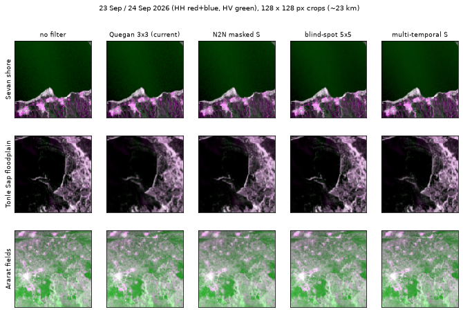
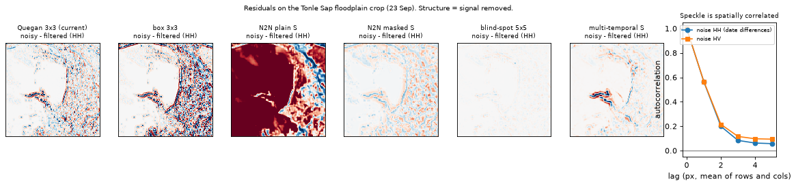
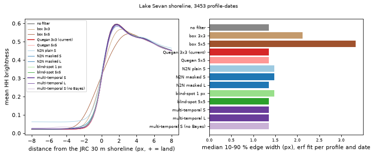
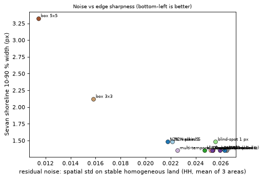
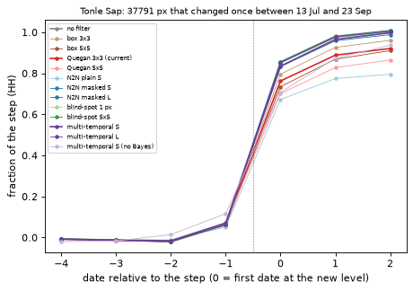
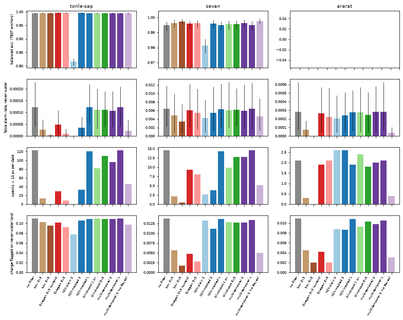
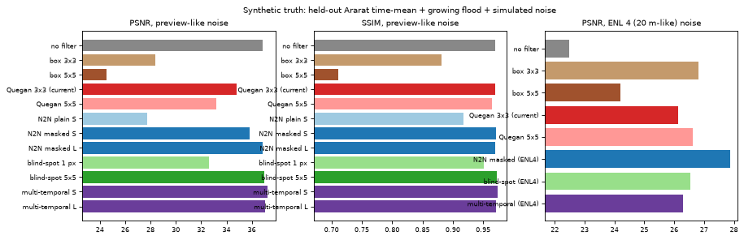
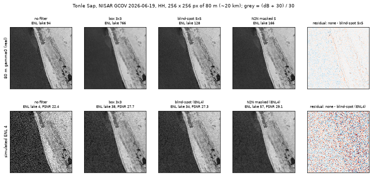

# Learning to remove speckle without ever seeing a clean image

Code: `scripts/detect/despeckle.py` · tests: `tests/test_despeckle.py` · numbers: `docs/eda/despeckle/results.json` ·
figures: `docs/eda/despeckle/*.png` · weights: `data/processed/models/despeckle_*.pt` · written Sat 14 Nov 2026, 15:10

    .venv/bin/python -m scripts.detect.despeckle noise                                   # noise model, ~1 min
    .venv/bin/python -m scripts.detect.despeckle train --variant multitemporal --size S  # ~10 min on the M5 GPU
    .venv/bin/python -m scripts.detect.despeckle evaluate --areas tonle-sap --no-final   # ~8 min
    .venv/bin/python -m scripts.detect.despeckle evaluate --areas sevan ararat           # ~5 min, + synthetic, figures
    .venv/bin/python -m scripts.detect.despeckle calibrated                              # 80 m gamma0 glimpse, 10 s
    .venv/bin/python -m scripts.detect.despeckle predict --area tonle-sap --variant multitemporal_S
    .venv/bin/python -m pytest tests/test_despeckle.py                                   # 6 tests, ~2 s

## Verdict (short)

**Keep the current filter (Quegan multi-temporal, 3×3) in the pipeline.** None of the learned filters improves water
detection beyond the bootstrap noise: on the held-out TEST anchors the best learned filter scores balanced accuracy
0.9951 at Tonle Sap and 0.9963 at Lake Sevan against 0.9957 and 0.9958 for the current filter (95 % intervals are
±0.003). The learned filters do exactly what they were built to do: they never move an edge and keep 97–100 % of a real
flood step on its date, where the current filter keeps 89 %, but on our 180 m previews they remove only a small part
of the noise (equivalent number of looks gained ×1.1–1.5, against ×2.5–3.1 for the current filter), because the previews
are already heavily averaged and the noise that is left is spatially correlated. On calibrated 80 m data, and even
more at 20 m (ENL ≈ 4), the learned filters start to pay off (below); that is where to use them next.

## 1. The idea in plain words

Radar images are grainy ("speckle"). A filter averages neighbouring pixels to remove the grain, but averaging also
blurs shorelines and smears floods into the dates before they happened. A neural network could do better: if we had
clean images to train it on. We don't. The trick: speckle is different on every satellite pass, the ground mostly is not.
So two passes are two noisy looks at the same ground, and a network trained to predict one look from the other can only
learn the part they share, the ground, not the noise (Noise2Noise, Lehtinen et al. 2018). Where the ground *really*
changed (a flood), "predict date B from date A" would teach the network to erase floods, so each variant has a guard:

| variant | what it sees | guard against real change |
|---|---|---|
| `n2n` | one date, predicts another date | none (control: shows what goes wrong) |
| `n2n_masked` | one date, predicts another | low frequencies of the target replaced by the input's + loss weighted by a no-change probability (SAR2SAR-style) |
| `blindspot` (1 px or 5×5) | **only the same date**, but never the pixel itself (or the 5×5 around it) | no second date used at all (Laine et al. 2019 "high-quality self-supervised") |
| `multitemporal` | the target date with a 5×5 blind spot + all other dates through learned attention (a learned Quegan filter) | the target date's own pixel is hidden; the network learns from the data when other dates are trustworthy |

`blindspot` and `multitemporal` predict a mean and an uncertainty; the output is then the Bayesian combination of that
prediction with the observed pixel, using the measured noise level (`despeckle_noise.json`). `multitemporal_S_blind`
in the tables is the same network *without* that last step (the prediction alone).

Training data: 12 areas (all but the held-out Ararat), only their training columns (the TEST strips that `tune.py`
scores are never seen), random 64–96 px patches with rotations/flips. The data are preview brightness 0..1, where
speckle is roughly additive and level-independent (`docs/eda/stats-change.md`).

### Trained models

| model | parameters | iterations | training time (M5 GPU) | file |
|---|---|---|---|---|
| `n2n_S` | 124,738 | 4,000 | 174 s | 0.5 MB |
| `n2n_masked_S` | 124,738 | 4,000 | 216 s | 0.5 MB |
| `n2n_masked_L` | 1,117,634 | 1,400 | 285 s | 4.5 MB |
| `blindspot_S_s1` (1 px hidden) | 85,060 | 2,000 | 317 s | 0.35 MB |
| `blindspot_S_s3` (5×5 hidden) | 85,060 | 2,000 | 301 s | 0.35 MB |
| `multitemporal_S` | 120,648 | 2,000 | 586 s | 0.5 MB |
| `multitemporal_L` | 476,808 | 1,000 | 380 s | 1.9 MB |
| `*_enl4` (n2n_masked_S, blindspot_S_s1, multitemporal_S trained with extra 4-look speckle, for the simulation) | as above | 2,500 / 1,500 / 1,000 | 270 / 220 / 293 s | 0.35–0.5 MB |

## 2. What the noise looks like

Measured from consecutive-date differences on stable ground (11 training areas): **noise std ≈ 0.012–0.018 in
brightness** (≈ 0.4–0.5 dB at the assumed 30 dB stretch), nearly constant with level: a little lower than the
0.02–0.05 quoted earlier, which included real date-to-date change.

**The noise is spatially correlated.** Autocorrelation of the noise: lag 1 px = **0.56**, lag 2 = 0.20, lag 3 = 0.08
(HH and HV alike; 0.44–0.68 at lag 1 depending on the area). The previews are resampled from finer data, so each
pixel's noise is shared with its neighbours. Consequences:

- A 1-pixel blind-spot network can see the noise of its target through the neighbours, so it partly learns to
  *reproduce* noise. Measured: `blindspot_S_s1` worsens the synthetic test (PSNR 32.6 vs 36.9 without any filter,
  flood-edge PSNR 20.1 vs 38.9), its residual has a lag-1 autocorrelation of −0.46 (it removes a checkerboard-like
  pattern, not the noise), and on calibrated 80 m data (white noise) it *adds* noise (lake ENL 94 → 49).
- Hiding a 5×5 square (`blindspot_S_s3`, and the target date inside `multitemporal`) fixes that: synthetic PSNR 37.0.
- Correlated noise is also why boxcar averaging gains less than its nominal ×9 looks: box 3×3 gives ×2.6–3.1.

## 3. Results on the real previews

Areas: Tonle Sap (floodplain), Lake Sevan (lake + mountains), Ararat (never seen in training). All regions below are
chosen from the **raw** stack on even dates, scored on odd dates, so the selection does not favour any filter.

### 3.1 Noise, edges, radiometry, change

| filter | ENL gain HH (TS / Sevan / Ararat) | Sevan shoreline 10–90 % width (px) | radiometric bias (TS, HH) | residual edge/flat energy (TS) | change kept on its date (TS) | step leaked to the date before (TS) |
|---|---|---|---|---|---|---|
| no filter | 1.00 / 1.00 / 1.00 | 1.35 | 0 | – | 1.00 | 0.066 (baseline) |
| box 3×3 | 3.13 / 2.59 / 2.87 | **2.12** | 0.0000 | 5.0 | 0.93 | 0.058 |
| box 5×5 | 9.15 / 5.76 / 7.92 | **3.33** | 0.0000 | 5.9 | 0.86 | 0.048 |
| **Quegan 3×3 (current)** | 3.12 / 2.50 / 2.79 | 1.35 | −0.0016 | 2.9 | **0.89** | 0.053 |
| Quegan 5×5 | 9.00 / 4.70 / 7.15 | 1.35 | −0.0017 | 2.8 | 0.79 | 0.041 |
| N2N plain S | 1.96 / 1.29 / 1.24 | 1.48 | **−0.0112** | 0.5 | 0.80 | 0.054 |
| N2N masked S | 1.79 / 1.50 / 1.55 | 1.48 | 0.0000 | 2.1 | 0.97 | 0.064 |
| N2N masked L | 1.01 / 1.01 / 1.01 | 1.35 | −0.0001 | 2.1 | 1.00 | 0.066 |
| blind-spot 1 px | 1.16 / 0.97 / 1.15 | 1.48 | −0.0001 | 1.8 | 0.99 | 0.066 |
| blind-spot 5×5 | 1.11 / 1.16 / 1.21 | 1.35 | 0.0000 | 1.7 | 1.00 | 0.065 |
| multi-temporal S | 1.36 / 1.45 / 1.50 | 1.35 | 0.0000 | 2.6 | 0.97 | 0.074 |
| multi-temporal L | 1.51 / 1.02 / 1.13 | 1.35 | −0.0001 | 0.9 | 1.00 | 0.066 |
| multi-temporal S, no Bayes step | 4.33 / 3.18 / 3.53 | 1.35 | +0.0008 | 2.3 | **0.76** | **0.113** |

How to read it:
- *ENL gain* = (noise of the raw image / noise after filtering)², noise = temporal std of the 9×9 high-pass image on
  stable homogeneous pixels (8,696 at Tonle Sap; Sevan's lake interior is too wind-variable to qualify, so 253 px
  there). Bigger = more noise removed.
- *Shoreline width*: erf fit to 3,453 profile-dates across the Lake Sevan shore, profiles placed from the 30 m JRC
  shoreline; the raw edge is already only 1.35 px wide (10–90 %). The fitted position moves by ≤ 0.1 px for every filter
  except the boxcars (−0.3 and −0.5 px towards the water); water/land levels each side change by ≤ 0.002, except plain
  N2N, which raises the water level from 0.023 to 0.063 (it brightens water).
- *Bias*: mean (filtered − raw) over the whole footprint; all ≤ 0.002 except plain N2N (−0.011 at Tonle Sap, +0.010 at
  Sevan): it learns a date-average and so shifts every date towards the mean.
- *Change*: 37,791 Tonle Sap pixels (1,234 km²) that changed once between 13 Jul and 23 Sep (single-step fit, step
  ≥ 0.25). "Kept" = filtered jump on the change date / raw jump. "Leaked" = share of the step already visible on the date
  before; the raw image itself shows 0.066 (partial flooding), so only the excess over 0.066 is leakage.
  See `temporal_leakage.png`.

**Residuals** (`residuals.png`, raw − filtered on a Tonle Sap floodplain crop): the box and Quegan residuals show field
boundaries and river channels: they eat a little real structure at edges. Plain N2N's residual is a solid colour (bias)
plus the lake outline. N2N-masked shows faint field edges. The 5×5 blind-spot residual is almost blank (it removes very
little). Multi-temporal S shows one river channel that it partly smooths. No learned filter's residual has a lake
outline.







### 3.2 Downstream detection: the result that matters

The existing detector (`ops.run_pipeline`, preview knobs) was run on each filter's output with its own filter switched
off (`box=1, quegan=False`; the classic filters use their own knob settings), terrain mask applied
(`terrain.cached_water_possible`). Anchors: `tune.py` held-out TEST strips; intervals: 300-draw block bootstrap.

| filter | Tonle Sap balanced acc. [95 %] | TS recall perm. | TS false alarm never-water | Sevan balanced acc. [95 %] | Sevan false alarm | Ararat false alarm | specks < 10 px / date (TS / SV / AR) |
|---|---|---|---|---|---|---|---|
| no filter | 0.9945 [0.9913, 0.9967] | 0.9890 | 0.012 % | 0.9950 [0.9916, 0.9972] | 0.64 % | 0.028 % | 123 / 15 / 2.1 |
| box 3×3 | 0.9950 [0.9915, 0.9977] | 0.9901 | 0.003 % | 0.9964 [0.9936, 0.9986] | 0.48 % | 0.007 % | 13 / 2.1 / 0.3 |
| box 5×5 | 0.9950 [0.9912, 0.9978] | 0.9899 | 0.000 % | 0.9973 [0.9951, 0.9990] | 0.34 % | 0.000 % | 0.7 / 0.4 / 0 |
| **Quegan 3×3 (current)** | 0.9957 [0.9923, 0.9978] | 0.9915 | 0.005 % | 0.9958 [0.9925, 0.9980] | 0.61 % | 0.026 % | 29 / 9.3 / 1.9 |
| Quegan 5×5 | 0.9966 [0.9941, 0.9985] | 0.9932 | 0.001 % | 0.9962 [0.9929, 0.9984] | 0.55 % | 0.022 % | 8.5 / 8.0 / 2.1 |
| N2N plain S | **0.8160** [0.8032, 0.8279] | 0.6320 | 0.000 % | 0.9811 [0.9765, 0.9858] | 0.43 % | 0.020 % | 0 / 2.7 / 2.6 |
| N2N masked S | 0.9954 [0.9926, 0.9978] | 0.9909 | 0.004 % | 0.9960 [0.9931, 0.9983] | 0.55 % | 0.024 % | 33 / 3.8 / 2.6 |
| N2N masked L | 0.9944 [0.9908, 0.9967] | 0.9889 | 0.012 % | 0.9950 [0.9918, 0.9974] | 0.63 % | 0.027 % | 120 / 14 / 1.9 |
| blind-spot 1 px | 0.9950 [0.9915, 0.9973] | 0.9901 | 0.011 % | 0.9954 [0.9919, 0.9978] | 0.61 % | 0.028 % | 82 / 9.8 / 2.4 |
| blind-spot 5×5 | 0.9949 [0.9915, 0.9972] | 0.9900 | 0.011 % | 0.9955 [0.9925, 0.9979] | 0.61 % | 0.024 % | 110 / 13 / 1.8 |
| multi-temporal S | 0.9951 [0.9913, 0.9977] | 0.9904 | 0.011 % | 0.9963 [0.9934, 0.9985] | 0.59 % | 0.028 % | 96 / 13 / 2.0 |
| multi-temporal L | 0.9945 [0.9912, 0.9968] | 0.9890 | 0.012 % | 0.9950 [0.9915, 0.9976] | 0.64 % | 0.028 % | 123 / 15 / 2.1 |
| multi-temporal S, no Bayes | 0.9953 [0.9912, 0.9980] | 0.9906 | 0.002 % | 0.9977 [0.9956, 0.9993] | 0.45 % | 0.004 % | 46 / 5.2 / 0.4 |

| filter | Sevan area error vs 1,242 km² (mean of 8 calm dates) | Sevan windy dates (31 Aug, 12 Sep) km² | Sevan calm date-to-date jitter km² | false water on slopes km²/date (SV / AR) | change flagged on never-water land (TS / SV / AR) | Sevan shoreline error, hard mask (per-date / calm-median map) | Sevan shoreline error, sub-pixel f = 0.5 |
|---|---|---|---|---|---|---|---|
| no filter | 0.92 % | 1,196 / 1,146 | 12.4 | 32 / 17 | 10.9 % / 1.4 % / 1.1 % | 90 / 82 m | 71 / 66 m |
| box 3×3 | 1.96 % | 1,177 / 1,127 | 10.5 | 18 / 11 | 10.3 % / 0.6 % / 0.4 % | **134 / 135 m** | 83 / 80 m |
| box 5×5 | 4.00 % | 1,148 / 1,107 | 8.3 | 8.7 / 6.9 | 9.5 % / 0.2 % / 0.2 % | **216 / 220 m** | 103 / 106 m |
| **Quegan 3×3 (current)** | 0.70 % | 1,211 / 1,176 | 9.2 | 28 / 17 | 10.1 % / 0.5 % / 0.4 % | 88 / 84 m | 66 / 64 m |
| Quegan 5×5 | 0.64 % | 1,214 / 1,182 | 9.0 | 25 / 16 | 9.2 % / 0.3 % / 0.2 % | 88 / 85 m | 66 / 64 m |
| N2N plain S | 3.80 % | 1,021 / 1,070 | 25.8 | 3.4 / 8.6 | 7.7 % / 1.3 % / 0.9 % | 113 / 103 m | 73 / 66 m |
| N2N masked S | 0.81 % | 1,193 / 1,141 | 10.2 | 21 / 14 | 10.5 % / 1.1 % / 0.9 % | 89 / 83 m | 67 / 63 m |
| N2N masked L | 0.91 % | 1,195 / 1,144 | 12.3 | 32 / 16 | 10.9 % / 1.4 % / 1.1 % | 91 / 82 m | 71 / 65 m |
| blind-spot 1 px | 0.93 % | 1,194 / 1,148 | 11.3 | 30 / 15 | 11.0 % / 1.3 % / 0.9 % | 97 / 89 m | 73 / 68 m |
| blind-spot 5×5 | 0.85 % | 1,198 / 1,149 | 10.6 | 30 / 16 | 10.9 % / 1.3 % / 1.0 % | 90 / 81 m | 70 / 64 m |
| multi-temporal S | 0.79 % | 1,208 / 1,176 | 9.5 | 29 / 16 | 10.9 % / 1.3 % / 1.0 % | 88 / 81 m | 68 / 64 m |
| multi-temporal L | 0.92 % | 1,196 / 1,145 | 12.3 | 32 / 17 | 11.0 % / 1.3 % / 1.0 % | 90 / 82 m | 71 / 66 m |
| multi-temporal S, no Bayes | **0.57 %** | **1,222 / 1,198** | 8.4 | 19 / 11 | 9.7 % / 0.5 % / 0.3 % | 87 / 84 m | 65 / 64 m |

(Shoreline error: median distance to the JRC 30 m shoreline (occurrence ≥ 90 %), computed exactly as
`scripts/detect/subpixel.py`, from each filter's own pipeline output. The current filter reproduces the published 84 m
staircase / 63–68 m sub-pixel line.)

What this says:
- **No learned filter beats the current one on detection.** All differences among the reasonable filters
  (Quegan, N2N masked, blind-spot, multi-temporal) are 0.0005–0.001 in balanced accuracy, well inside the ±0.003
  intervals. Plain N2N is clearly harmful (it erases 37 % of Tonle Sap's permanent water: change-blind averaging).
- **Specks** are where the learned (Bayes) filters are worse than the current filter: they remove too little noise,
  so the detector leaves 96–110 tiny water specks per date at Tonle Sap against 29.
- **Shoreline location** does not improve with any filter: 88–90 m (hard) and 66–71 m (sub-pixel) for every
  edge-preserving filter; the boxcars make it much worse (134 / 216 m). The shoreline error is limited by the 180 m
  pixel and the 30 m reference, not by noise.
- The one interesting signal is `multi-temporal S, no Bayes`: best Sevan area (0.57 %), the windy dates recover
  25–50 km², fewest false alarms on slopes. But it gets this by borrowing from other dates: on Tonle Sap it keeps only
  76 % of a real flood step on its date and leaks 11 % of it into the date before (current filter: 89 % / 5 %). For a
  flood product that is the wrong trade.



### 3.3 Synthetic truth (held-out Ararat)

Clean truth = the 10-date mean of Ararat (never seen in training) + a synthetic flood that grows from date 5 on (with
an island); noise = the measured level, measured spatial correlation, clipped and 8-bit quantised like a preview.

| filter | PSNR (dB) | SSIM | PSNR at the flood edge | flood step kept |
|---|---|---|---|---|
| no filter | 36.85 | 0.970 | **38.90** | 1.00 |
| box 3×3 | 28.39 | 0.881 | 21.04 | 0.98 |
| box 5×5 | 24.53 | 0.711 | 18.46 | 0.94 |
| **Quegan 3×3 (current)** | 34.80 | 0.970 | 22.62 | 0.97 |
| Quegan 5×5 | 33.23 | 0.965 | 20.26 | 0.92 |
| N2N plain S | 27.76 | 0.918 | 23.12 | 0.77 |
| N2N masked S | 35.84 | 0.971 | 36.37 | 1.00 |
| N2N masked L | 36.87 | 0.970 | 38.84 | 1.00 |
| blind-spot 1 px | 32.64 | 0.951 | 20.09 | 0.99 |
| blind-spot 5×5 | 36.97 | 0.972 | 37.93 | 1.00 |
| **multi-temporal S** | **37.22** | **0.975** | 28.25 | 0.99 |
| multi-temporal L | 37.04 | 0.971 | 38.65 | 1.00 |

At this noise level (~0.45 dB, already multilooked) every classic filter is *worse* than no filter against the truth,
because the truth has real fine texture that averaging destroys. The learned multi-temporal and 5×5 blind-spot filters
are the only ones better than no filter (+0.1–0.4 dB): a real but tiny gain, which is the honest summary of this whole
study on previews.



## 4. Where it starts to matter: calibrated data and strong speckle

Calibrated NISAR GCOV gamma-naught at 80 m (Tonle Sap, 19 Jun 2026, the only date on disk at 15:05), mapped to the
preview-like scale (dB + 30) / 30 and filtered with the **preview-trained** single-date weights (no retraining),
768 × 768 px crop with a 42 % lake share, 556 shore profiles from the lake outline:

| filter | lake ENL (HH, 7×7) | land ENL (HV) | lake std (dB) | shore width 10–90 % (px) | bias (dB) |
|---|---|---|---|---|---|
| no filter | 94 | 6.5 | 0.45 | 1.77 | 0 |
| box 3×3 | 766 | 17.6 | 0.16 | **3.04** | 0.00 |
| box 5×5 | 2,241 | 34.0 | 0.09 | **4.36** | 0.00 |
| N2N masked S | 166 | 7.9 | 0.34 | 2.12 | −0.02 |
| blind-spot 1 px | 49 (worse) | 6.2 | 0.61 | 1.94 | +0.04 |
| **blind-spot 5×5** | 128 | 7.1 | 0.38 | 1.94 | −0.01 |

**Simulated 4-look speckle** (20 m-like; the 80 m image is the truth, white 4-look log-speckle added), with the
`*_enl4` weights:

| filter | PSNR vs truth (dB) | lake ENL | shore width (px) |
|---|---|---|---|
| no filter | 22.4 | 4.0 | 1.77 |
| box 3×3 | 27.7 | 38 | 3.04 |
| box 5×5 | 27.0 | 133 | 4.36 |
| **N2N masked S (ENL 4)** | **29.1** | 57 | 2.78 |
| blind-spot 1 px (ENL 4) | 27.3 | 34 | 2.32 |
| blind-spot 5×5 (preview weights, not retrained) | 22.7 | 4.4 | 1.94 |

On the real 80 m image the 5×5 blind-spot gains ENL 94 → 128 with no edge loss (box 3×3 gains far more noise reduction
but widens the shoreline from 1.8 to 3.0 px). With strong speckle the learned N2N-masked filter beats the boxcar by
+1.5 dB PSNR with a sharper edge (2.8 vs 3.0 px): the regime where a learned filter is worth its cost. A filter trained
on preview-strength noise does nothing on 4-look data (last row): **weights must be trained at the noise level they
will meet.** Only one calibrated date existed, so the multi-temporal variant could not be tried on calibrated data.



## 5. Decision and integration

**Decision: keep `quegan_filter` 3×3 for the preview pipeline.** A learned filter costs 6–90 s per area on the GPU,
adds a 0.35–2 MB weight file, and does not improve any downstream number beyond noise; it would make specks worse.

If the lead wants to try one anyway (e.g. on calibrated 20–80 m data once several dates exist, retrained there), the
change is two lines in `scripts/detect/run.py` around line 236: no change to `ops.py` is needed:

```python
from scripts.detect import despeckle
x = despeckle.denoise(x, valid_det, variant="multitemporal_S", dates=dates)        # [T,2,H,W], same units
out = ops.run_pipeline(x, valid_det, source, dev=dev, water_ok=water_ok,
                       kn={**ops.KNOBS[source], "box": 1, "quegan": False})        # built-in filter off
```

`denoise(x, valid, variant, dates)` accepts any saved model name (`multitemporal_S`, `n2n_masked_S`, `blindspot_S_s3`,
…) or a classic filter (`none`, `box3`, `box5`, `quegan3`); invalid pixels stay 0, pixels outside the eroded common
footprint keep their input value, so `run_pipeline`'s footprint is unchanged. The models expect preview brightness
(0..1); for gamma0 pass (dB + 30) / 30 and convert back. `predict --area X` writes
`data/processed/X/despeckle/x.pt`.

## 6. Limitations

- Previews are uncalibrated display images (assumed ~30 dB stretch); the noise model and all brightness numbers are in
  that scale. The preview noise (~0.45 dB, correlated) is far weaker than raw speckle, so this is a test of a learned
  filter in its least favourable setting.
- Training budget was 3–10 minutes per model on a shared laptop (1,000–4,000 iterations). The validation loss of the
  multi-temporal and blind-spot models was still falling; longer training might add noise reduction but would not
  change the conclusion that the detector is not noise-limited.
- The Bayesian step relies on the measured noise table; if the noise is under-estimated (correlated noise lowers the
  difference-based estimate), the posterior trusts the observation too much: one reason the Bayes variants remove so
  little noise. The no-Bayes variant shows the other extreme. A tuned blend between them was not tried.
- Noise-reduction regions: only 253 stable homogeneous HH pixels (8 HV) at Lake Sevan: wind makes the lake too
  variable, so Sevan's ENL figures are less certain than Tonle Sap's (8,696 px).
- Change preservation is measured on pixels chosen by a single-step fit to the raw image, which slightly favours the
  raw image; leakage is quoted relative to the raw value (0.066).
- Synthetic truth is a time-mean of Ararat, which itself still carries ~1/√10 of the noise; flood shape is synthetic.
- Calibrated glimpse: one date, one crop, preview-trained weights applied out of domain; the "truth" of the 4-look
  simulation is the 80 m image (ENL ≈ 94, not noise-free); simulated noise is white whereas real 20 m speckle may be
  correlated by resampling.
- Shoreline-location scores use the 1984–2021 JRC shoreline, which differs from 2026 at river mouths and the flat
  south-east shore; this caps all filters equally.
