# EDA findings: NISAR preview stacks (Tonle Sap, Lake Sevan, Ararat Valley)

Everything here is regenerated by `.venv/bin/python -m scripts.detect.eda` (about 25 seconds). Every number comes from `docs/eda/stats.json`, which the script writes. All maths is in PyTorch.

**Read this first.** The images are 8-bit *display brightness* (0 to 1), not calibrated radar backscatter. How brightness maps to real backscatter is unknown. So **patterns and timing are trustworthy, absolute levels and areas are not.** HH and HV are the two radar polarisations; in plain terms, HH reacts to smooth surfaces and water-and-trunk "double bounce", HV reacts to leafy, rough volume (forest, crops).

> **Update, 14 Nov 10:55.** The misalignment between dates described below (up to 6.9 pixels in Armenia) is now corrected inside the shared loader `scripts/detect/stack.py`: every date is shifted onto the first one, leaving less than 0.1 pixel. The shift figures quoted in the text are the raw previews before that fix; the quality-check figure now shows the small remainder.

## Summary

Tonle Sap shows a clear, believable flood signal: the open-water-like area grows from about 4,770 km2 (19 June) to about 7,980 km2 (17 October), with the biggest single jump (+2,550 km2) between 11 and 23 September. The exact area depends on a threshold choice (plus or minus 20 % in the threshold moves it by roughly a quarter to a third), but the direction and the timing do not. Lake Sevan can be measured very well: with a flood-fill the calm-date lake area is 1,231 to 1,238 km2 against the true 1,242 km2, and the apparent shrinkage on 31 August and 12 September is wind. The Armenia frame has two real problems: the dates are **not lined up** (up to 6.9 pixels, about 1.3 km, on 31 August), and the 6 October HV channel is off. Radiometric drift between dates is small for Tonle Sap and Ararat (a few percent), so dates need no normalisation if you work with changes of 0.10 or more, but they do need registration in Armenia.

## 1. Brightness per date, and is there drift? (Figures 1 and 2)

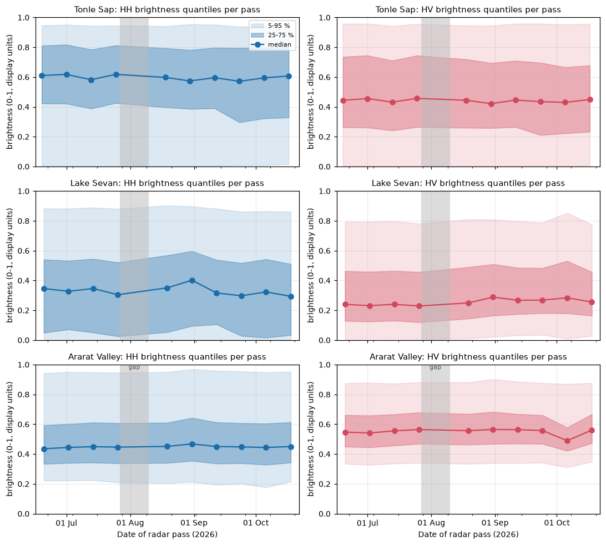
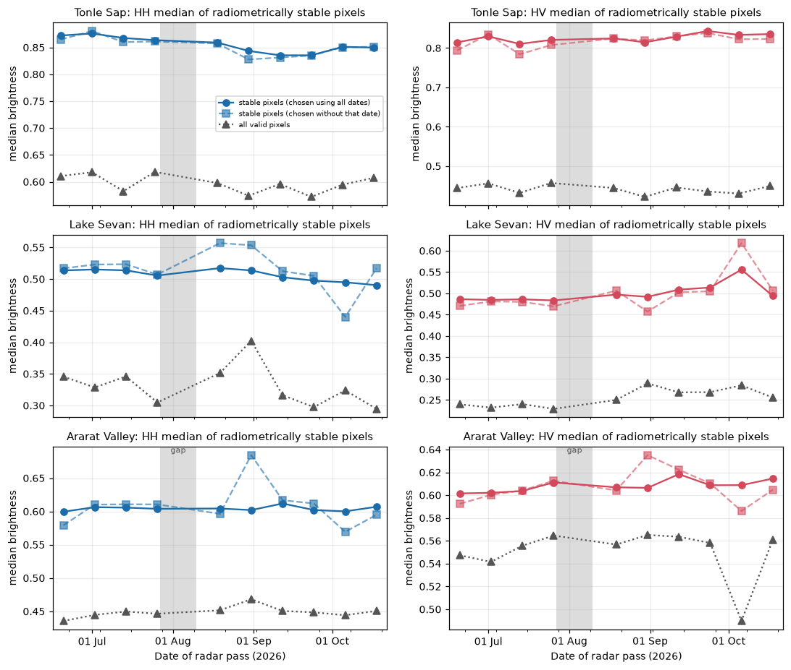

**What we did.** For each area we took mid-to-bright pixels (between the median and the 95th percentile of brightness) and kept the 5 % with the lowest change over time. These "stable" pixels (Tonle Sap 25,304 px, Sevan 2,990, Ararat 2,494) should not change, so any movement of their median across dates is either real or a per-image stretch. Dates were first re-aligned (see section 8). We also repeated the selection leaving each date out, to avoid fooling ourselves.

**Numbers** (max minus min of the stable-pixel median, in brightness units, and as a % of the mean):

| Area | HH | HV |
|---|---|---|
| Tonle Sap | 0.045 (5.2 %) | 0.032 (3.9 %) |
| Sevan | 0.024 (5.1 %) | 0.081 (16.9 %), mostly the 6 Oct value of 0.540 vs 0.46 to 0.50 on the other dates |
| Ararat | 0.010 (1.8 %) | 0.019 (3.2 %) |

Per-date gain and offset against the median image are 0.94 to 1.03 and at most 0.07 for Tonle Sap (early June to July HH is the largest, gain 0.94 and offset 0.07 on 1 July). The Tonle Sap HH stable median falls smoothly from 0.876 (1 July) to 0.831 (23 Sept) and then partly recovers, which looks like a real seasonal change (vegetation or soil moisture) rather than random per-image stretching. The leave-one-date-out version gives a range of 0.056 (HH) for Tonle Sap, similar.

**So what.** There is no sign of large random per-image stretching in Tonle Sap or Ararat. A flood or harvest change is 0.10 to 0.5 in brightness, 2 to 10 times bigger than the drift. You can difference dates without normalising, **except** Armenia 6 October HV (section 7). If you want to be safe, subtract the per-date median offset of stable pixels (the script computes it; offsets in the flooded-vegetation stats are at most 0.03 in HH).

## 2. Which places move most (Figure 3)

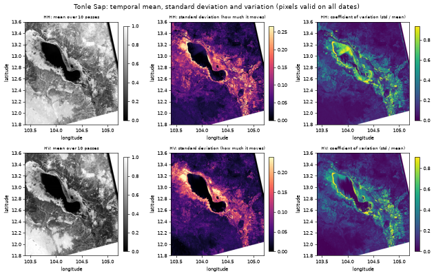
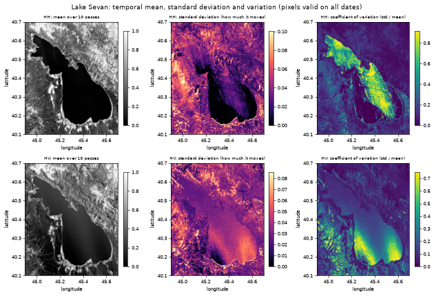
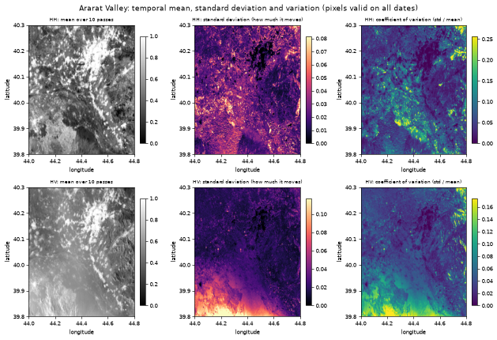

Maps use dates re-aligned to the first date. The mean standard deviation over time is 0.079 (HH) and 0.064 (HV) at Tonle Sap, 0.068 and 0.064 at Sevan, 0.080 and 0.058 at Ararat. About 26 % of Tonle Sap pixels have an HH standard deviation above 0.10, 21 % at Sevan, 27 % at Ararat.

At Tonle Sap the bright movement is a band hugging the lake shore and the Mekong-side floodplain (north-west, south-west and south-east of the lake), with the lake interior and the dry uplands quiet. Standard deviation is highest in the middle two row-quarters (HH 0.090 and 0.084) and lowest at the north and south edges (0.057 and 0.054).

At Ararat, HV temporal standard deviation rises smoothly toward the south edge of the box: 0.020, 0.019, 0.024 and **0.057** for the four row quarters from north to south. A smooth ramp like this is not what fields and ponds look like (they are patchy), so it points to a geometry or instrument effect at the south of the frame. At Sevan, HH variation is highest in the westernmost quarter (0.052 vs 0.029 to 0.035 elsewhere).

**So what.** Mask or down-weight the south edge of the Ararat box for HV change detection. For Tonle Sap, change detection effort should focus on the shore band.

## 3. HH versus HV clusters at Tonle Sap (Figure 4)

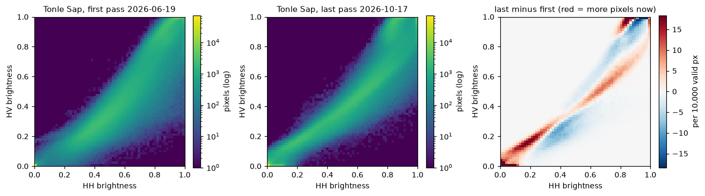

Pixels lie along one broad diagonal band: dark in both channels at the bottom left (open water), a wide middle (crops, shrub, wet soil), and a bright cluster at the top right (forest and urban, partly saturated near white). Rough share of valid pixels in simple boxes (the boxes are my choice and only indicative):

| | 19 June | 17 October |
|---|---|---|
| dark in both (HH<0.15 and HV<0.15) | 7.5 % | 13.3 % |
| HH-dominant bright (HH minus HV > 0.20, HH > 0.5) | 14.4 % | 11.1 % |
| bright in both | 40.0 % | 39.1 % |
| mid-brightness | 38.2 % | 36.6 % |

The difference panel shows mass moving into the dark corner and into a band slightly below the diagonal (HV lower relative to HH) at mid brightness. Mean HH minus HV over the whole image fell from 0.105 to 0.089.

**So what.** The main movement is "land becomes dark water-like", about 5.8 percentage points of the valid area (roughly 2,100 to 2,200 km2, from this box count). The clusters overlap strongly, so a single pair of thresholds is a rough proxy, not a classification.

## 4. Open-water proxy and area (Figure 5)

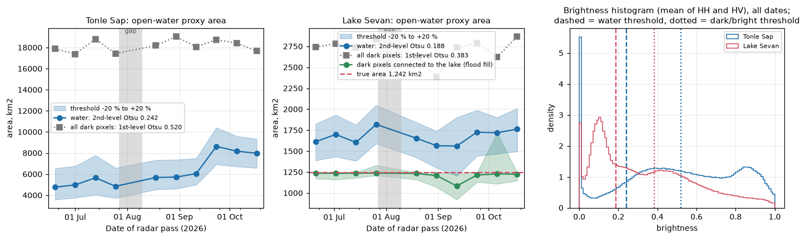

**Method.** Otsu's method on the mean of HH and HV, pooled over all dates, implemented in torch. The first Otsu split (0.520 at Tonle Sap, 0.383 at Sevan) separates "dark" from "bright", but the dark class is far too large to be water: it is a flat 17,400 to 19,100 km2 at Tonle Sap and 2,330 to 2,850 km2 at Sevan, with no trend. So I applied Otsu a second time inside the dark class. That gives the water threshold: **0.242 at Tonle Sap and 0.188 at Sevan** (per-date versions differ by only 0.01 to 0.02, 0.229 to 0.252 at Tonle Sap and 0.175 to 0.204 at Sevan). Areas use pixels valid on all dates.

**Tonle Sap water-like area (km2), threshold 0.242, with the minus 20 % to plus 20 % range:**

| | 19 Jun | 1 Jul | 13 Jul | 25 Jul | 18 Aug | 30 Aug | 11 Sep | 23 Sep | 5 Oct | 17 Oct |
|---|---|---|---|---|---|---|---|---|---|---|
| area | 4,770 | 5,008 | 5,655 | 4,865 | 5,787 | 5,751 | 6,088 | 8,639 | 8,187 | 7,983 |
| low (0.8x) | 3,589 | 3,784 | 4,044 | 3,748 | 4,638 | 4,634 | 5,036 | 6,948 | 6,730 | 6,585 |
| high (1.2x) | 6,551 | 6,788 | 7,786 | 6,595 | 7,457 | 7,397 | 7,532 | 10,428 | 9,616 | 9,340 |

Check against hypothesis (a): the area is roughly flat through July (4,770 to 5,655, with a bump on 13 July that goes back down on 25 July, so treat it as noise or a wind or rain effect), rises modestly in August to mid-September (5,750 to 6,090), then jumps by 2,552 km2 (+42 %) between 11 and 23 September. The mid-to-late September jump is confirmed. "Grows slowly until late July then faster" is only partly true: it is flat until late July, steps up between 25 July and 18 August (across the instrument gap, so we cannot say when), then is slow until mid-September. The 11 to 23 September step stays the largest under the plus and minus 20 % thresholds (+1,912 to +2,896 km2).

**Lake Sevan (true area 1,242 km2).** Counting every pixel below 0.188 gives 1,534 to 1,814 km2 (1.2 to 1.5 times too big) and the first-level class gives about 2,700 km2 (2.2 times too big) because dark land (mountain shadow, smooth bare ground) is also dark. Requiring the dark pixels to be **connected to the lake** (flood fill from mid-lake) gives:

| | 20 Jun | 2 Jul | 14 Jul | 26 Jul | 19 Aug | 31 Aug | 12 Sep | 24 Sep | 6 Oct | 18 Oct |
|---|---|---|---|---|---|---|---|---|---|---|
| connected lake km2 | 1,237 | 1,233 | 1,232 | 1,238 | 1,231 | 1,208 | **1,084** | 1,214 | 1,228 | 1,221 |

That is within 0.4 % of 1,242 km2 on calm dates. The 12 September value is 12.7 % lower, which would look like shrinkage but is wind (next section). The real lake rose about 0.6 m, which is a negligible area change, so every drop here is an artefact. Caveat: the +20 % threshold leaks into the surroundings on 26 July (1,332) and 6 October (1,712), so the flood fill is not safe at a loose threshold; the 0.8x value is 921 to 1,210.

**So what.** Use the second-level threshold (about 0.24 for the Tonle Sap mean brightness), never report absolute km2 without the plus and minus 20 % band, and use connected-component filtering (flood fill from a known water seed) rather than a plain threshold.

## 5. Lake Sevan surface brightness: wind (Figure 6)

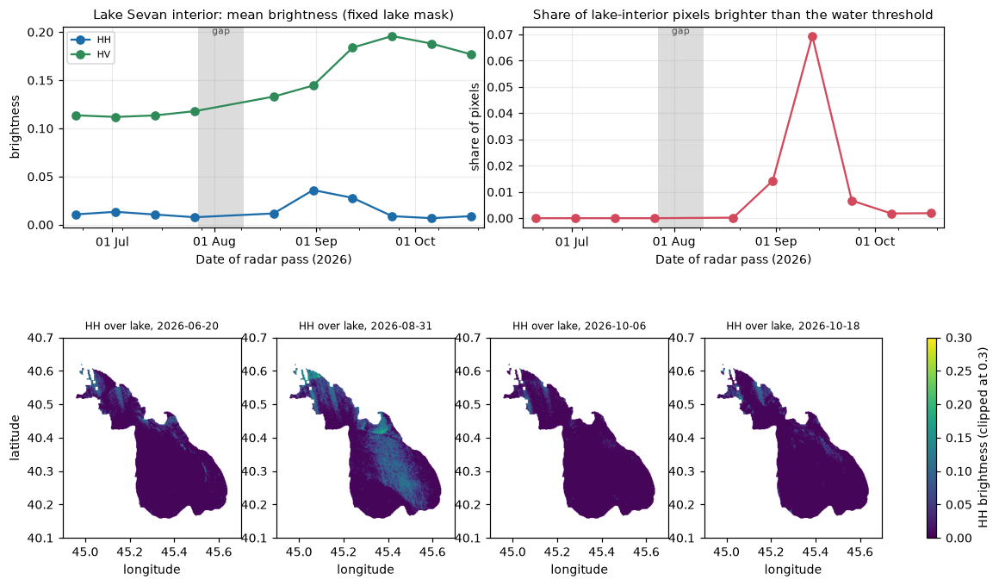

Inside a fixed lake mask (1,093 km2, shore pixels removed), the mean HH brightness is 0.007 to 0.013 on the calm dates, but **0.040 on 31 August and 0.028 on 12 September** (3 to 4 times higher). The share of lake pixels brighter than the water threshold goes from 0 % to 2.2 % on 31 Aug and **7.0 % on 12 Sept**. The 90th percentile of lake HH is 0.098 and 0.105 on those two dates against 0.007 to 0.042 elsewhere. The map shows wind streaks over the central and northern lake on 31 August. By 24 September, 6 October and 18 October the lake is dark again (HH 0.007 to 0.009).

This partly contradicts hypothesis (c): the roughened-water events are **31 August and 12 September**, not "September to October". October passes are calm in HH.

**A separate, unexplained effect:** lake HV rises steadily from 0.112 (20 June) to 0.198 (24 September) and stays at 0.176 to 0.187 in October, even when HH is at its minimum. Wind cannot explain that (HH would rise too). Land HV also drifts up slightly. It may be a noise-floor or stretch change in HV; we cannot tell with previews.

Another quality note: in Sevan 20 % of HH pixels sit at the lowest display level (1/255, shown as 0.0039), so HH cannot tell calm water from other very dark things, and it saturates before the lake gets any darker.

**So what.** Flag 31 August and 12 September for the Armenia lake. Never treat a water-area drop on those dates as real. HV of calm water is not a stable reference over the season.

## 6. Flooded-vegetation proxy at Tonle Sap (Figure 7)

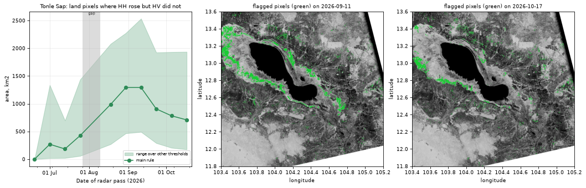

Rule: land (not water-like on 19 June, 31,960 km2) where HH rose by more than 0.10 compared with the first date (3 by 3 mean, after removing the per-date offset of stable pixels) while HV rose by less than 0.05. Area per date (km2): 0, 270, 180, 422, 1,119, 1,402, **1,614** (11 Sept), 1,160, 942, 873.

The map shows the flagged pixels mostly along the north-west, south-west and south-east shore fringe of the lake and along the river channels, which is where flooded forest and shrub should be. That is encouraging. The area rises to 11 September and then falls, because many of those pixels turn dark (become open water or flooded fields) and no longer count, which matches the water jump of 11 to 23 September.

Uncertainty is large. Other thresholds give a peak between 623 km2 (HH rise > 0.15) and 3,136 km2 (HH rise > 0.07). The pairs 1 July and 13 July should show nothing, but flag 270 and 180 km2, so a noise floor of about 200 km2 applies. Only about 2.7 % of the land is flagged on the last date.

**Contradiction to hypothesis (b).** Following the pixels that were forest-like on 19 June (HH and HV both between 0.5 and 0.95, 401,495 px): the mean HH minus HV rises only slightly, from 0.060 to 0.077 (peak 0.083 on 5 Oct), and that is because **HV falls more (0.724 to 0.654) than HH (0.785 to 0.731)**, not because HH rises. The share of these pixels that are clearly HH-dominant (HH minus HV above 0.2) actually fell, from 8.8 % to 7.0 %. Meanwhile the share that turned dark in both channels (below 0.25) goes from 0 % to 4.1 %. Over the whole image the HH-dominant share also fell (14.4 % to 11.1 %). So the ring does *not* clearly shift to HH-dominant; the dominant change is that everything gets darker. The spot time series agree: at the Prek Toal point both HH (0.60 to 0.33) and HV (0.59 to 0.27) fall.

**So what.** A simple "HH up, HV flat" rule finds a plausible fringe but is only a weak, threshold-dependent proxy; do not claim flooded-forest area numbers from it. Treat it as a "where to look" layer.

## 7. Named spots, and the Armenia checks (Figures 8 and 9)

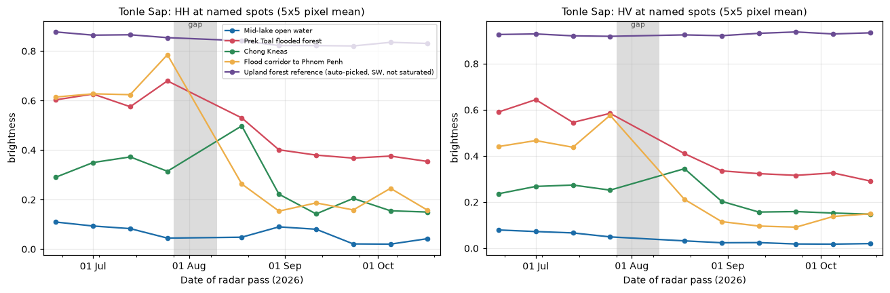
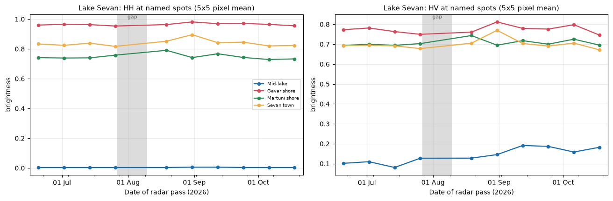
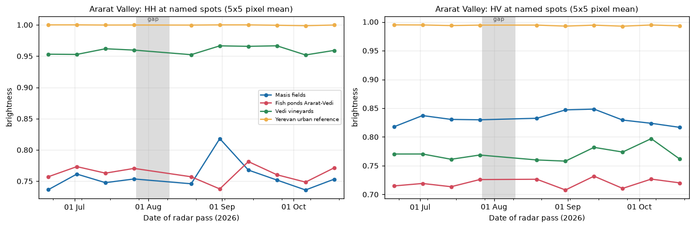

**Tonle Sap spots** (5 by 5 pixel mean; all windows fully valid; the upland reference was auto-picked at 104.01 E, 12.04 N as the most stable bright window in the south-west quarter, skipping pixels pinned near white):
- Mid-lake (104.1, 12.8): HH 0.11 to 0.15 in June and early July, 0.07 to 0.09 in July to early September, then 0.013 to 0.014 on 23 September and 5 October (0.057 on 17 October). It gets darker, not brighter.
- Flood corridor (104.85, 12.0): HH 0.61 to 0.63 until 13 July, **0.80 on 25 July** (HV 0.44 to 0.58), then **0.24 on 18 August** (HV 0.18) and 0.14 to 0.25 after. It brightens just before the gap and is dark water-like after it. The flooding happened inside the 24-day window, which the data cannot resolve.
- Chong Kneas (103.84, 13.27): HH 0.29 to 0.37, 0.46 on 18 August, then 0.15 to 0.21.
- Prek Toal (103.7, 13.1): both channels fall, see section 6.
- Upland forest: HH 0.91 to 0.85 (slow drift), HV 0.90 to 0.93, a good stable reference.

**Sevan and Ararat spots.** Mid-lake Sevan HH is at the floor (0.0039) on 8 of 10 dates and 0.020, 0.007 on 31 Aug and 12 Sep. Ararat fields and ponds swing a lot (fish ponds HH 0.28 to 0.76), but note the 31 August value (0.28) sits on the misregistered date; see below.

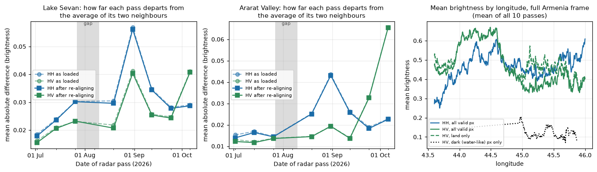

### (d) 6 October in Armenia: confirmed, and it is an HV problem

After re-aligning dates, the mean absolute departure of 6 October from the average of its two neighbours is, for HV, **0.041 at Sevan and 0.065 at Ararat**, against 0.017 to 0.039 (the 0.039 is 31 August) and 0.011 to 0.032 (the 0.032 is 24 September, whose neighbour is 6 October) on other dates. HH on 6 October is normal (0.029 and 0.024). The sign is opposite in the two boxes: the mean HV change is **+0.028 at Sevan (land +0.044)** and **minus 0.056 at Ararat**. The HV of 6 October against the neighbours' mean has slope 1.11 at Sevan and 0.85 at Ararat (HH: 1.02 and 1.00), so it is not a simple gain change; it is a spatially varying change. Across the whole Armenia frame the HV in the western third drops to 0.518 on 6 October (0.54 to 0.58 on other dates) while the eastern third rises to 0.430 (0.375 to 0.394 on other dates): **the east-west HV gradient flattens on that date**. Land cover cannot change like that in 12 days, so this is an instrument or processing difference, not the ground.

### (e) The HV gradient in the Armenia frame: partly confirmed

Mean HV in the western third of the full extent is 0.54 to 0.58, in the eastern third 0.375 to 0.394, on every date except 6 October (ratio about 1.5). By longitude (0.2 degree bins, mean over dates): HV is 0.43 in the bin starting at 43.6 E, 0.62 to 0.64 in the bins starting 44.0 to 44.4 E, 0.50 at 44.6 E, 0.35 at 45.0 E, and 0.37 to 0.41 in the bins from 45.2 E to 46 E. A small part of that is terrain and crops (the valley at 44.0 to 44.6 E is bright in HV), so we cannot prove an instrument cause from the previews alone. Two things point toward an instrument or geometry effect: it is present on all dates with almost the same size, and it flattens on 6 October (above). The smooth southern ramp of HV variability at Ararat (section 2) fits the same story. This is plausible but unproven; calibrated gamma-naught data with the incidence angle would settle it.

### 31 August is the other odd date

On 31 August Armenia is shifted about 5.5 to 6.9 pixels (section 8), the lake is wind-roughened, and land is brighter (Sevan land HH +0.040 against the neighbours, Ararat +0.021). Even after re-aligning, its departure is the largest of any date in HH (0.055 at Sevan, 0.044 at Ararat).

## 8. Data-quality problems (Figure 10)

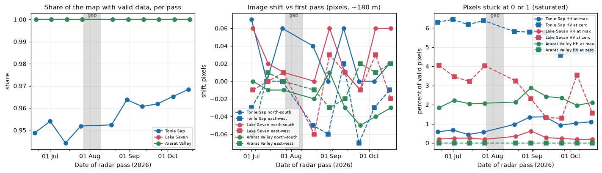

1. **Misregistration in Armenia (the most important quality finding).** Estimated shift against the first date by FFT correlation, north-south, in pixels (about 184 m each): Sevan 1.06, 1.75, 1.02, 0.66, **5.49**, 2.04, 2.92, 0.19, 0.50 for 2 Jul to 18 Oct; Ararat the same pattern, up to **6.91** on 31 August (about 1.3 km) and 3.71 on 24 September. East-west shifts are small (at most 0.69). Tonle Sap is fine: at most 0.53 pixel. A plain shift fixes it: after shifting, the residual is 0.07 pixel or less in all three areas. Before re-aligning, the mean difference between neighbouring dates in Armenia was inflated by 2 to 3 times (for example, Ararat 31 Aug HH 0.147 raw vs 0.044 re-aligned). Per-pixel differencing, spot time series and tiny objects (the fish ponds) are unreliable in Armenia unless the dates are re-aligned first. I did not change `stack.py` (the register code is `align_stack` in `eda.py`); a possible cause (not verified) is the corner-fit georeferencing in the loader, which assumes each pass fills its footprint the same way.
2. **Edge artefact at Tonle Sap.** Within 8 pixels of the swath edge, mean brightness is about half the interior (HH 0.31 and 0.30 vs 0.576 interior; HV 0.23 and 0.22 vs 0.48). That is about 11,700 pixels, 1 % of the area. Valid share varies between 94.4 % and 96.9 % over dates (rotated footprints), so use the common mask. Armenia boxes are fully valid, no edge.
3. **Saturation.** (first and last pass) Tonle Sap: 3.6 to 6.4 % of HH and 4.8 to 6.3 % of HV valid pixels at the floor (0.0039), 0.6 to 1.1 % of HH and 0.9 to 1.2 % of HV at the ceiling. Sevan: 20 to 21 % of HH at the floor. Ararat: 1.8 to 2.4 % of HH at the ceiling (the urban area of Yerevan reads about 1.0 on every date). Saturated pixels cannot show change in that channel.
4. **Only 10 dates and a gap.** The 12-day cadence implies one pass (about 6 August) is missing in the instrument gap; 25 July to 18 August is a 24-day step, so the flood onset at Tonle Sap cannot be timed.
5. **Previews are display-scaled 8-bit,** so quantisation steps are 0.0039; small differences below about 0.02 are not meaningful.

## What not to trust

- Any area in km2 as a physical number. Brightness thresholds are not backscatter thresholds; calibrated data will move the water threshold, the Sevan connected-area match (1,237 vs 1,242 may be luck), and the flooded-vegetation area.
- The flooded-vegetation area (±100 % depending on thresholds) and any claim about flooded forest. The HH-up-HV-flat idea was not supported by the forest-ring numbers (section 6).
- Absolute HV on Armenian dates: it has a frame gradient, a steady rise over the lake, and the 6 October anomaly. Calibration and incidence-angle correction may remove these.
- Anything fine-scale in Armenia before re-alignment.
- Fish ponds and small fields: fields are smaller than the roughly 180 m pixel.
- Timing of events inside the 25 July to 18 August gap.
- The statement that the 2026 flood was late and weak: we only see 10 dates of one year. We have no earlier year to compare with.

## Recommendations for the detection method

1. **Water threshold.** Start from a two-level Otsu on mean(HH, HV): about 0.24 for Tonle Sap and 0.19 for Sevan (preview units). Re-run Otsu per area when calibrated data arrive. Always report a minus 20 % / plus 20 % band.
2. **Keep only water connected to a known water body** (flood fill from a seed). This turned Sevan from 1.2 to 1.5 times too large into within 1 % of the truth on calm dates.
3. **Normalise dates?** Not for Tonle Sap and Ararat if you use changes of 0.10 or more (drift 0.01 to 0.05). If you want a safeguard, subtract the per-date median offset measured on stable pixels (dense forest or urban areas that are not saturated).
4. **Register the Armenia dates first** (translation only; shift estimated by FFT correlation on the mean brightness). This is required before any per-pixel differencing there. Tonle Sap needs at most a 0.5 pixel correction and can skip it.
5. **Flag or drop dates.** Armenia: drop or down-weight **31 August** (shift, wind, brighter land) and **12 September** for lake-extent work; flag **6 October HV** (do not use HV from that date, HH is fine). Tonle Sap: treat **13 July** (+650 km2 bump) and the **25 July** pre-gap brightening as noisy.
6. **Use HH-based features for lake extent, HV carefully.** HH is at the floor on calm Sevan water, which makes it a clean water signal; Sevan HV rises with time and is not.
7. **Mask edges**: erode the valid mask by about 8 pixels at Tonle Sap; use the pixels valid on all dates; mask the south edge of the Ararat box for HV change.
8. **Flood detection at Tonle Sap.** Detect on the water-like area step between 11 and 23 September and on "fell below the water threshold since the first date" (that is robust); use the HH-rise rule only as a weak secondary layer. Because the flood is hidden inside the 25 July to 18 August gap, say so on the slide rather than claiming an onset date.
9. **Do not claim Sevan shrinkage.** Wind explains every dip (31 Aug, 12 Sep); require a drop to persist on calm dates.
