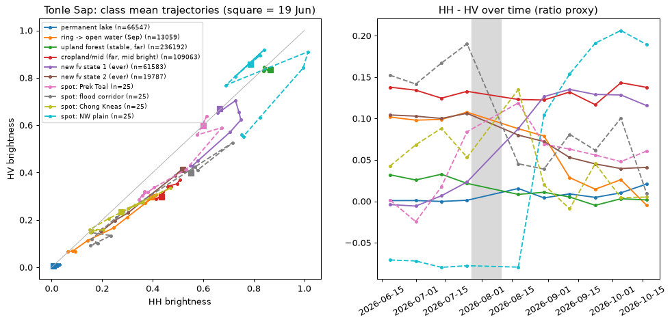
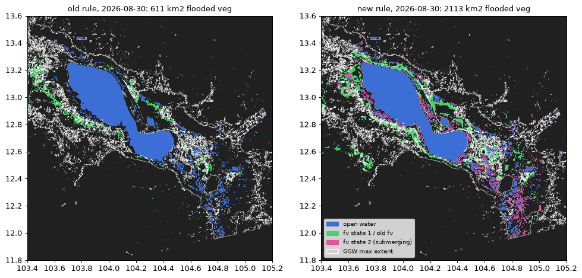
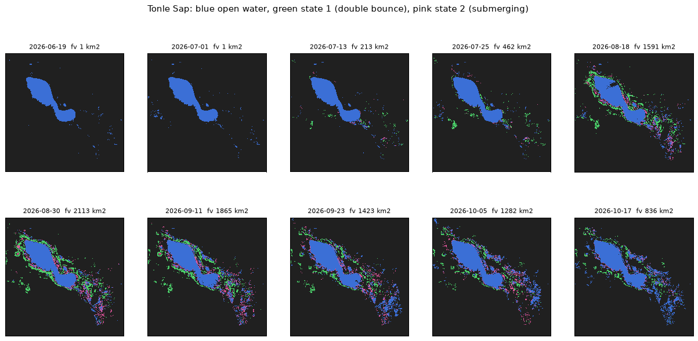
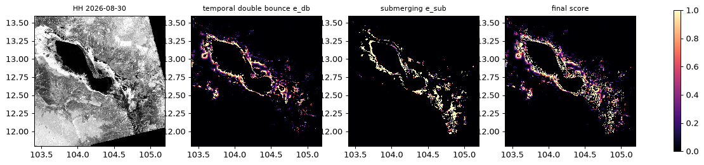
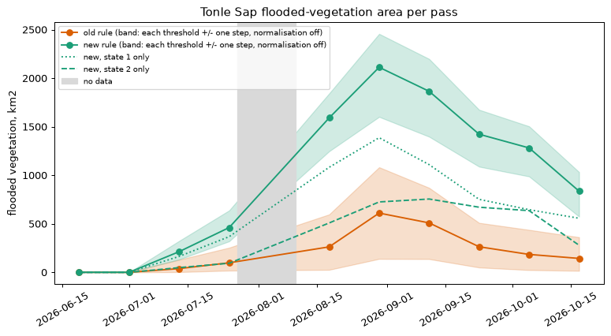
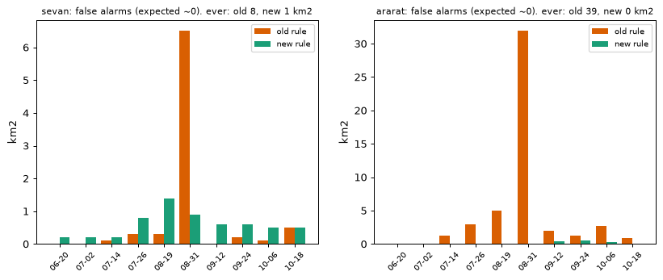

# Flooded vegetation, rebuilt (v2)

Code: `scripts/detect/floodveg.py` · tests: `tests/test_floodveg.py` · figures: `docs/eda/floodveg/` ·
numbers: `docs/eda/floodveg/results.json` · products: `data/processed/<area>/floodveg/products.pt`.

```
.venv/bin/python -m scripts.detect.floodveg              # products for all three areas
# checks, sensitivity, figures -- one area and one pipeline per process (memory):
.venv/bin/python -m scripts.detect.floodveg --report-nonorm tonle-sap   # normalisation-off run, cached
.venv/bin/python -m scripts.detect.floodveg --report tonle-sap          # Tonle Sap takes ~5 min
```

## 1. The physics in plain words

An L-band radar pulse (24 cm) passes through leaves and small branches. Over dry forest it bounces around
inside the canopy and comes back in both polarisations: HH and HV are both bright ("volume scattering").
When water stands under the trees, the ground becomes a mirror: the pulse hits the water, then a trunk
(or a trunk then the water), and returns straight to the satellite. This "double bounce" keeps the
polarisation, so **HH gets brighter relative to HV**. Open water is a mirror with nothing standing on it,
so the pulse goes away and both channels are **dark**. Optical satellites (Landsat) and short-wave radar
(Sentinel-1, 5.6 cm) do not get through a closed canopy, so this is something only L-band (NISAR) shows.

The difference HH − HV of our display brightness is used as a ratio proxy (the preview brightness is
log-like, so a difference behaves roughly like a ratio). It is not a calibrated dB ratio.

## 2. What the data actually showed (Tonle Sap, 10 dates, 19 Jun – 17 Oct 2026)

All numbers below are from the same speckle-filtered, normalised stack that `ops.run_pipeline` produces
(Figure `01_trajectories_tonle-sap.png`).



**Class means (HH / HV / HH−HV):**

| zone | 19 Jun | late Sep–Oct | what happens |
|---|---|---|---|
| permanent lake (66,547 px) | 0.01 / 0.01 / 0.00 | 0.02 / 0.01 / 0.01 | dark all season |
| ring that becomes open water on 23 Sep (3,854 px) | 0.39 / 0.29 / 0.10 | 0.07→0.05 / 0.06 / 0.00 | HH and HV **fall together** over 2–3 passes, then water |
| ring that becomes open water on 5 Oct (6,320 px) | 0.38 / 0.23 / 0.15 | 0.07 / 0.06 / 0.01 | the pass before: 0.17 / 0.09 (already half-way down) |
| stable upland forest, > 30 px from water | 0.86 / 0.83 / 0.04 | 0.84 / 0.84 / 0.01 | flat |
| Prek Toal 5×5 (103.7 E 13.1 N) | 0.60 / 0.60 / 0.00 | 0.35 / 0.29 / 0.06 | both fall; open water appears in 25–36 % of the 11×11 window from 30 Aug |
| NW plain (103.79 E 12.82 N) | 0.79 / 0.86 / −0.07 | 0.75 / 0.55 / **+0.20** | HH saturates (~1.0) on 30 Aug and 11 Sep, then stays bright while HV drops: **HH−HV +0.27** |
| flood corridor (104.85 E 12.0 N) | 0.55 / 0.40 | 0.72 / 0.53 on 25 Jul, then 0.16 / 0.10 | one bright pass before the gap, then water |

**Five findings that decided the design:**

1. **"HH up, HV flat" is rare.** In the 1–2 px band around any open water, 58 % of land pixels have *both*
   channels falling by > 0.08 (early → late season), 0.4 % match "HH up > 0.08, HV within ±0.05". The old
   rule's pixels sit 6–30 px from water, mostly on the two passes where HH saturates near white (30 Aug,
   11 Sep).
2. **HH−HV rising is common and tied to the flood.** Centred rise of HH−HV over the early reference
   above 3 noise-sigma: 14–20 % of land 1–10 px from water after mid-August at Tonle Sap; 0.1–1.5 % in
   the same band at Sevan and Ararat (except Ararat 6 Oct, the known HV anomaly date: 5 %). This is the
   double-bounce signature in our data: HV (volume) is lost, HH stays bright.
3. **The "dry → double bounce → open water" sequence is NOT seen at 12-day / 180 m sampling.** Of the
   pixels that turn into open water from 25 Jul on, only 0.4–4 % have HH−HV up by > 0.1 on the pass
   before; 36–87 % are already darker by > 0.1 in HH. The water edge advances through a pixel faster than
   we sample, or the pixel goes through a mixed "part water" state. The textbook fingerprint is
   physically right but not observable here; we do not use it as a requirement.
4. **Absolute double bounce (to catch vegetation already flooded on 19 June) is not separable.** HH−HV
   high, HH bright is common on dry land (cropland/settlement/slopes: 178k px with HH−HV > 0.15 far from
   water). Restricted to pixels touching open water, only 1–25 km² exceed even the 80th–98th percentile of
   dry land at the same HV: the lake edge pixels are mixed with water and darker. The evidence is kept
   (on the water edge only) but it contributes almost nothing; vegetation flooded before 19 June that stays
   unchanged is **mostly invisible to us**.
5. **Submerging canopy and "part open water in the pixel" look the same.** Both = both channels fall,
   next to water. We call this state 2 and say plainly that at 180 m we cannot tell which it is.

## 3. The new rule

Entry point: `detect_flooded_veg(L, valid, water, kn=None, terrain=None)` on the `L`, `valid`, `water`
that `ops.run_pipeline` returns. Knobs: `FV_KNOBS` in `floodveg.py`.

**Step 0: self-calibration on "null land".** Null land on date *t* = valid, not water, more than 20 px
(3.6 km) from open water on any date. Reference = mean of the first 2 dates. For each pixel and date:
ΔHH, ΔHV, ΔD with D = HH − HV. From each we subtract the **median over null land on that date**
(so a per-date brightness offset cancels), and σ_t = 1.4826 · MAD(ΔD over null land) is the noise floor
(0.011 on the reference dates, 0.02–0.045 later at Tonle Sap).

**Evidence** (each a soft 0..1 score, `sig(x) = 1/(1+exp(−x/0.02))`):

* `e_db` (state 1, double bounce appearing): `sig(ΔD_c − max(0.08, 3σ_t)) · sig(ΔHH_c + 0.10) · sig(HH − 0.30)`
: HH−HV rose clearly above noise, HH did not fall by more than 0.10, and the pixel is not dark.
* `e_abs` (state 1, also on date 0): `sig(D − Q95_t(D | HV bin) − 0.02) · sig(HH − 0.30)` and the pixel is
  within 2 px of open water on that date; not "built-up" (D above the null 95th percentile on ≥ 90 % of
  dates with temporal std < 0.04, more than 2 px from any water).
* `e_sub` (state 2, submerging toward open water): `sig(min(−ΔHH_c, −ΔHV_c) − 0.10)` and the pixel touches
  open water now (≤ 1 px) or becomes open water on a later date.

**Context:** weight 1 within 10 px (1.8 km) of open water on any date, `exp(−(d−10)/5)` to 30 px, 0 beyond.
Optional `terrain["water_possible"]` (flat, low-lying; from `scripts/detect/terrain.py`) multiplies it.
The CLI uses it whenever `data/processed/<area>/terrain.pt` matches the grid (`--no-terrain` to switch off),
and also passes it to `ops.run_pipeline(water_ok=...)` for the open-water masks.

**Score and decision:** `fv_score = context · max(e_db, e_abs, e_sub)`, 0 on open water and on the
permanent lake (water on ≥ 90 % of dates). A pixel is flooded vegetation on date *t* if `fv_score ≥ 0.5`
**and** it is flagged on ≥ 2 consecutive passes (kills one-date artefacts such as Ararat 6 Oct HV),
then 8-connected specks < 4 px are removed. `fv_state` = 1 where the double-bounce evidence is the larger,
2 where the submerging evidence is. `first_fv_date` = first flagged pass (−1 none).

The rule was tuned by looking at Tonle Sap trajectories and the noise statistics, with Sevan/Ararat used
only as a check afterwards. GSW was used only for the checks in section 4.

## 4. Before / after

All numbers: `docs/eda/floodveg/results.json`. Both rules run on the same stack with the terrain
open-water mask (`ops.run_pipeline(..., water_ok=terrain)`); the new rule also uses `water_possible` as context.






**Tonle Sap area per pass (km²)**

| pass | old | new | new state 1 (double bounce) | new state 2 (submerging) | old, norm off | new, norm off |
|---|---|---|---|---|---|---|
| 19 Jun | 1 | 1 | 1 | 0 | 1 | 1 |
| 01 Jul | 0 | 1 | 1 | 0 | 1 | 1 |
| 13 Jul | 39 | 213 | 164 | 49 | 35 | 208 |
| 25 Jul | 99 | 462 | 368 | 94 | 102 | 465 |
| 18 Aug | 263 | 1,591 | 1,082 | 509 | 224 | 1,581 |
| 30 Aug | **611** | **2,113** | 1,387 | 725 | 421 | 2,072 |
| 11 Sep | 509 | 1,865 | 1,110 | 755 | 302 | 1,759 |
| 23 Sep | 264 | 1,423 | 752 | 671 | 180 | 1,350 |
| 05 Oct | 185 | 1,282 | 646 | 636 | 166 | 1,233 |
| 17 Oct | 144 | 836 | 557 | 279 | 131 | 789 |
| ever flagged | 1,461 | 3,174 | 2,011 | 1,250 | | |
| class (≥ 2 passes) | 492 | 3,145 | | | | |

**Threshold sensitivity (Tonle Sap peak area, km², one knob moved at a time)**

| rule | knob | low | default | high | max/min |
|---|---|---|---|---|---|
| old | `fv_hh_rise` 0.12 / 0.15 / 0.20 | 1,083 | 611 | 139 | **7.8** |
| old | `fv_hv_rise_max` 0.04 / 0.06 / 0.08 | 432 | 611 | 795 | 1.8 |
| new | `db_rise_min` 0.06 / 0.08 / 0.10 | 2,113 | 2,113 | 2,113 | 1.0 (the 3σ term dominates) |
| new | `db_k_sigma` 2.5 / 3 / 3.5 | 2,388 | 2,113 | 1,855 | 1.29 |
| new | `sub_drop` 0.08 / 0.10 / 0.12 | 2,185 | 2,113 | 2,042 | 1.07 |
| new | `near_px` 5 / 10 / 15 | 1,602 | 2,113 | 2,457 | **1.53** (largest: the spatial context) |
| new | `score_thr` 0.4 / 0.5 / 0.6 | 2,347 | 2,113 | 1,896 | 1.24 |

**Normalisation on/off** (largest relative change on any pass with > 20 km²): old **41 %** at Tonle
Sap (11 Sep: 509 vs 302), 11 % at Ararat; new **5.7 %** at Tonle Sap, 0 % in Armenia.

**Armenian false alarms (km², should be ~0)**

| area | old, peak pass | old, ever | new, peak pass | new, ever | new without terrain mask, ever |
|---|---|---|---|---|---|
| Sevan | 6.5 (31 Aug) | 7.9 | 1.4 | 1.4 | 3.0 |
| Ararat | 31.9 (31 Aug) | 38.9 | 0.5 | 0.5 | 2.4 |



**Reference check: JRC Global Surface Water maximum extent 1984–2021 (Tonle Sap)**

| layer | km² | inside max extent | within 1 px | within 3 px | median occurrence |
|---|---|---|---|---|---|
| old, ever | 1,461 | 39.6 % | 58.6 % | 76.4 % | 0.4 % |
| old, class | 492 | 27.6 % | 47.8 % | 69.9 % | 0.1 % |
| old, peak (30 Aug) | 611 | 37.5 % | 60.7 % | 83.6 % | 0.4 % |
| **new, ever** | 3,174 | **77.0 %** | **88.0 %** | 94.5 % | 9.1 % |
| new, peak (30 Aug) | 2,113 | 77.5 % | 89.5 % | 95.8 % | 9.1 % |
| new, state 1 ever | 2,011 | 65.5 % | 81.5 % | 91.5 % | 4.0 % |
| new, state 2 ever | 1,250 | 97.2 % | 99.2 % | 99.7 % | 22.5 % |

(The "within 1 px of reference water" in `validation.md` used any extent > 0; here it is a
≥ 50 %-covered extent pixel dilated by one pixel, so the old-rule numbers differ slightly.)

**Time consistency (Tonle Sap).** Median distance from the permanent lake of pixels flagged for the
first time: 36 / 28 px (Jul), 26 px (18 Aug), 31 (30 Aug), 36 (11 Sep), 41 (23 Sep), 48 px (5 Oct): the
newly flooded vegetation front moves **outward** through September, as does the newly opened water
(4 → 22 → 28 → 38 px). Of the 71,232 pixels (2,326 km²) that become open water from 13 Jul on, **31 %**
were flagged as flooded vegetation on an earlier pass (old rule: 0.6 %): the "vegetation floods, then
becomes open water" sequence does appear, mostly via state 2.

**Known places.** Prek Toal 11×11 window: 68 % ever flagged (first 25 Jul), old rule 0 %. Flood
corridor (104.85 E 12.0 N): 56 % (old 0 %). Chong Kneas: 30 % (old 0 %). The old rule's largest block on
the north-west plain (103.79 E 12.82 N, HH saturating on 30 Aug/11 Sep, then HV dropping) is **not**
flagged by the new rule: it lies more than 30 px (5.4 km) from any open water. It could be real flooded
shrub/rice too far from open water, or a harvest; we cannot tell.

## 5. What is supported and what is not

**Supported by evidence**
* The new layer sits where flooding happens: 77 % inside and 88 % within one pixel of the Landsat
  maximum water extent (old: 40 % / 59 %), median historical occurrence 9 % (old 0.4 %), i.e. land that is
  occasionally water: what a seasonally flooded fringe should look like.
* It is near zero where there is no flooded forest (Armenia: ≤ 1.4 km² on any pass, vs 39 km² old).
* It is stable: the largest one-step threshold change moves the peak by 1.5× (spatial context) and
  1.07–1.3× for the radar thresholds, vs 7.8× for the old rule; normalisation changes it by < 6 % vs 41 %.
* It finds Prek Toal, the best-known flooded forest, which the old rule missed completely.
* It reproduces the expected sequence: flooded vegetation appears first, open water follows, and the
  front moves outward from the lake.

**Not supported / not claimed**
* That 2,113 km² is the true flooded-vegetation area. It depends on the 10 px context (1,602–2,457 km²
  for 5–15 px) and we have no ground truth. Report it as "about 1,600–2,500 km² at the 30 August peak".
* That state 1 is forest. Flooded forest, shrub, reeds and flooded rice all double-bounce.
* That state 2 is vegetation at all: it may be a pixel partly covered by open water at the moving edge.
  Its 97 % inside-extent share shows it is in the flood zone, nothing more. If you want a conservative
  layer, use state 1 only (peak 1,387 km², 82 % within 1 px).
* The textbook "HH up, HV flat" picture and the "bright, then dark" fingerprint: not observed at our
  resolution and sampling (section 2).

**Recommendation.** Replace `ops.flooded_veg_masks` with `detect_flooded_veg` for the flooded-vegetation
layer and class:

```python
from scripts.detect.floodveg import detect_flooded_veg
fvp = detect_flooded_veg(r["L"], r["valid"], r["water"], terrain={"water_possible": ok})  # terrain optional
r["flooded_veg"] = fvp["flooded_veg"]   # then ops.classify(..., fvp["flooded_veg"], ...)
```
Show state 1 and state 2 in different colours, and label the area as a range.

## 6. Limits

* **No ground truth.** Nothing here measures accuracy. GSW (Landsat 1984–2021) cannot see water under a
  canopy, so "near the maximum water extent" is a plausibility test, not a validation.
* **180 m pixels, uncalibrated display brightness.** HH−HV of display brightness is only a ratio proxy;
  thresholds will have to be re-derived on calibrated gamma0 (the null-land self-calibration should carry
  over, the 0.08 / 0.10 floors will not). Saturation near white on 30 Aug / 11 Sep clips HH.
* **Cannot separate flooded forest from flooded shrub, reeds or flooded rice.** All give double bounce.
  Flooded rice fields near the lake are probably part of state 1.
* **Cannot see fully submerged vegetation** (it is open water to the radar), and **cannot see vegetation
  already flooded on 19 June whose signal does not change** (the absolute evidence fires on < 10 km²).
* **State 2 is ambiguous:** submerging canopy and a pixel partly covered by open water look the same.
* **Other causes of HH−HV rising** (harvest removing HV volume while HH stays bright, soil moisture) are
  only suppressed by the "near open water" context, not excluded.
* **Timing:** 12-day passes and a 24-day gap (27 Jul – 10 Aug); the bright-then-dark sequence the textbook
  predicts happens faster than we sample.
* One season of one year; the 2026 flood may be atypical.
