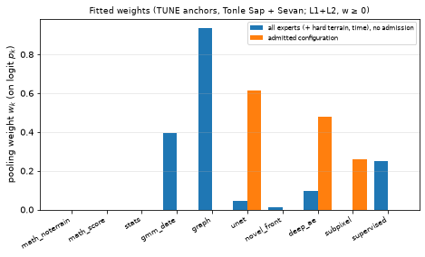
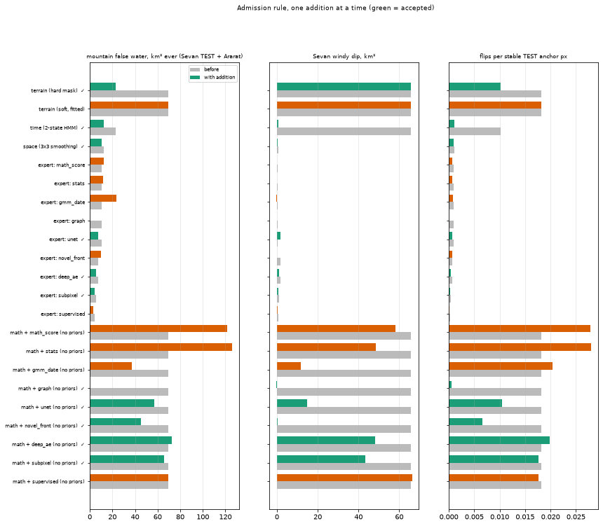
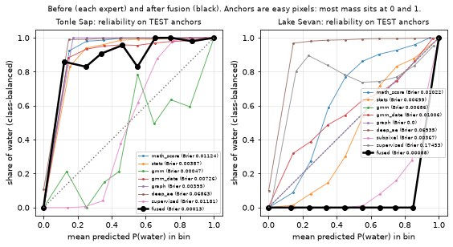
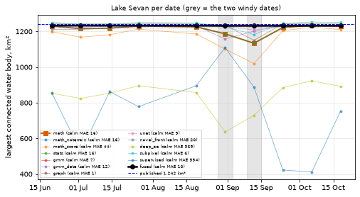
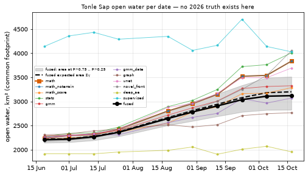

# Fusion layer: one probability of water from many detectors

Code: [`scripts/detect/fusion.py`](../../scripts/detect/fusion.py) · tests: [`tests/test_fusion.py`](../../tests/test_fusion.py) (9 tests) ·
scoreboard: [scoreboard.md](scoreboard.md) ([`scripts/detect/scoreboard.py`](../../scripts/detect/scoreboard.py)) ·
numbers: [`fusion/results.json`](fusion/results.json) (sections `fusion` and `scoreboard`) ·
products: `data/processed/<area>/fusion/products.pt` · design: [ARCHITECTURE.md](../ARCHITECTURE.md), sections 3 and 5.

```
.venv/bin/python -m scripts.detect.fusion          # fit, admission rule, products for all three areas (~5 min CPU)
.venv/bin/python -m scripts.detect.scoreboard      # then the scoreboard, which now includes the fused row (~2.5 min)
.venv/bin/python -m scripts.detect.fusion sevan    # products for one area with the configuration already admitted
```

The first run per area also runs the math detector on CPU once (Tonle Sap 215 s, about 2 GB peak). The reduced arrays are cached in `$FUSION_CACHE`, or the system temp folder if that is not set. Each cached array is keyed on its source file's modification time. Detectors come from the `REGISTRY` in `scoreboard.py`, one line each. A new or rebuilt product is picked up on the next run, and a missing one is skipped.

## In one paragraph

We combined ten water detectors and three kinds of prior knowledge (terrain, time and space) into one probability of water per pixel and date. The weights were fitted only on pixels whose state the 38-year Landsat record makes certain, and only on the tuning strips. We then applied the admission rule from ARCHITECTURE.md mechanically: we started from the plain math detector and added one module at a time, and kept a module only if it improved a named weakness on untouched TEST data without lowering accuracy. Four things were admitted: the hard terrain mask, a two-state Markov chain over dates, 3 × 3 spatial smoothing, and three experts (the U-Net, the deep autoencoder and the sub-pixel fraction). On everything the rule measures, the fused result beats the math detector with the terrain mask:

- Balanced accuracy at Tonle Sap rises from 99.57 % to 99.98 %, and the 95 % intervals do not overlap.
- At Sevan the windy-date dip falls from 66 km² to 1 km², and the calm-date error from 16 km² to 10 km².
- False water far from any recorded water falls from 39 km² to 9 km² at Sevan and from 2.6 km² to 0.4 km² at Ararat.
- Date-to-date flips on stable pixels fall 40-fold.

**But it shrinks the Tonle Sap flood.** On 17 October the fused area is 3,120 km² against the math detector's 3,837 km² (−19 %), and the tuning study already called 3,837 km² a lower bound. The rank agreement with the long-term record in the floodplain also drops from ρ = 0.50 to 0.33. The rule does not measure this, because no 2026 truth exists for the floodplain. The cause is the Markov chain. It learns from tune-strip pixels that almost never change, so its land→water probability is only 0.0013 per 12 days at Tonle Sap (8 × 10⁻⁶ at Sevan). A pixel that floods late in the season, with only one or two dates left as evidence, is therefore pulled back to land.

**Verdict for the app.** Show the fused probability for lakes and for Armenia (Sevan, Ararat), and as the confidence layer everywhere. Keep the math detector with the terrain mask for the Tonle Sap flood extent and its headline area.

## 1. Symbols and formulas

| Symbol | Meaning |
|---|---|
| $i$, $t$ | pixel, date ($t = 1..10$, 20 Jun – 18 Oct 2026) |
| $p_k(i,t)$ | expert $k$'s probability that pixel $i$ is open water on date $t$ |
| $m_k(i,t) \in \{0,1\}$ | a hard-mask expert's verdict |
| $\varepsilon$ | $10^{-3}$, the clip for probabilities |
| $\pi_{\text{terrain}}(i)$ | `water_possible` from [terrain.md](terrain.md) (slope, radar shadow, height above the local low) |
| $q_t(i)$ | fused per-date probability, before time and space |
| $\gamma_t(i)$ | fused probability after the Markov chain (what the app reads) |

**Step 1 — each expert becomes a log-odds feature.**

- **Probabilistic experts** keep their own probability: $f_k = \operatorname{logit}\big(\operatorname{clip}(p_k, \varepsilon, 1-\varepsilon)\big)$.
- **Hard-mask experts** (math detector, U-Net, flood-order) use a two-value mapping estimated on the TUNE anchors, with equal class weights and Laplace smoothing:

$$
f_k = \begin{cases}\operatorname{logit} P(\text{water}\mid m_k = 1) = \operatorname{logit}\dfrac{\text{TPR}}{\text{TPR}+\text{FPR}} & m_k = 1\\[2mm]
\operatorname{logit} P(\text{water}\mid m_k = 0) = \operatorname{logit}\dfrac{1-\text{TPR}}{(1-\text{TPR})+(1-\text{FPR})} & m_k = 0\end{cases}
$$

  For the math detector this gives $+3.8$ and $-3.0$.
- **The math HH score** is the distance to the hysteresis threshold, in units of half the threshold gap: $p = \sigma\big((0.09 - \text{HH})/0.03\big)$.

**Step 2 — log-linear pooling** (the weighted product of ARCHITECTURE.md written in log-odds):

$$
\operatorname{logit} q_t(i) = b + \sum_k w_k\, f_k(i,t) \;-\; c\,\big[\pi_{\text{terrain}}(i) = 0\big], \qquad w_k \ge 0,\; c \ge 0 .
$$

Two terrain variants were tested:

- **hard:** $q_t(i) = \varepsilon$ wherever water is impossible;
- **soft:** the $c$ term above, with $c$ fitted.

**How the weights were fitted.** The weights are fitted by a class-balanced logistic regression with an L1 + L2 penalty ($10^{-3}$ each) and projected Adam (800 steps, $w \ge 0$). The fit uses TUNE-split anchor pixel-dates of Tonle Sap and Lake Sevan: up to 120,000 permanent-water and 120,000 never-water pixel-dates per area. Each (area, class) cell gets equal weight. Ararat has no tune strip.

Because the classes are balanced, $q/(1-q)$ is a likelihood ratio. That is exactly what the Markov chain in step 3 needs as evidence.

**Missing experts.** An expert can exist in one area and not another (Ararat has no U-Net, no deep autoencoder and no sub-pixel product). Setting it to "no evidence" would be wrong, because the bias $b$ was fitted with the expert present: in a first version this created 1,392 km² of false water in Ararat. So each area gets its own refit on exactly the experts it has (`params["sub"][area]`).

**Step 3 — time.** A two-state chain (water / not water) runs per pixel over the ten dates, with emissions $(q_t, 1 - q_t)$.

- The start probabilities $\pi$ and the transition matrix $A$ are fitted by Baum–Welch on 30,000 random TUNE-strip pixels per area, with a weak diagonal Dirichlet prior.
- The 24-day gap from 27 July to 10 August is one unobserved slot, so that step uses $A^2$ exactly.
- Smoothing is forward–backward in log space, in chunks of 200,000 pixels. It uses `gmm.fit_hmm`, `gmm.forward_backward` and `gmm._expand`, which are tested in `tests/test_gmm.py`.

$$
\gamma_t(i) = P\big(S_t = \text{water}\mid q_1(i), \dots, q_T(i)\big).
$$

Fitted per 12-day step (rows: from water, from land):

- Tonle Sap: $A = \begin{pmatrix}0.99916 & 0.00084\\ 0.00127 & 0.99873\end{pmatrix}$.
- Sevan (fitted on Sevan alone): $\begin{pmatrix}0.99937 & 0.00063\\ 0.0000083 & 0.99999\end{pmatrix}$.
- Ararat (refit with the math expert only): $\begin{pmatrix}0.99940 & 0.00060\\ 0.00166 & 0.99834\end{pmatrix}$.

**Step 4 — space.** A masked 3 × 3 mean of $\gamma$ inside the footprint.

**Products.**

- `water` $= \gamma > 0.5$.
- Expected area $= \sum_i \gamma_t(i)\, a_i$.
- Band = the area at $\gamma > 0.75$ and at $\gamma > 0.25$.

## 2. Which experts were offered, and what they share

The math detector, the math HH score, `stats`, the per-date GMM, the graph random walker, the U-Net v2, the flood-order monotone mask (`novel_front`), the deep autoencoder + GMM, the sub-pixel fraction and the supervised network. The GMM+HMM product (`gmm`) is scored but not offered, so time is not counted twice. The temporal transformer has no per-date map: it predicts only the outage days, so it is skipped.

**Several experts are copies.** The U-Net was trained on the math detector's masks, and the flood-order product, `stats` and the sub-pixel fraction all start from them. Last-date IoU between pairs of them:

- Sevan: math – flood-order 0.996, math – GMM 0.977, math – graph 0.971, math – sub-pixel 0.971.
- Tonle Sap: math – stats 0.957, math – flood-order 0.947.

Only `supervised` learned from independent labels (JRC, at eight other places), and it disagrees most (IoU 0.40–0.49 with the fused map).

## 3. Fitted weights



**With every expert offered** (hard terrain and time, no admission rule): graph 0.94, GMM per date 0.39, supervised 0.25, deep autoencoder 0.10, U-Net 0.05, flood-order 0.01. The math mask, the math score, `stats` and the sub-pixel fraction all get **0**. The penalty gives no credit to near-copies of an expert already in the model, and the graph absorbs the math detector's information.

**In the admitted configuration:**

- Sevan: U-Net 0.62, deep autoencoder 0.48, sub-pixel 0.26, math 0.00, $b = 2.84$. Fitted on Sevan alone, because the sub-pixel product exists only there.
- Tonle Sap: U-Net 0.74, deep autoencoder 0.42, math 0.11, $b = 1.95$.
- Ararat: math 0.98, $b = 0.03$.

## 4. Admission table

The rule was declared in code (`fusion.RULE`) before any TEST number was read. An addition is admitted only if all three conditions hold:

1. Balanced accuracy on the TEST anchors drops by no more than 0.1 percentage point in any TEST area (in Ararat, which has no permanent water, specificity is used instead).
2. At least one named weakness improves:
   - mountain false water (km² ever, on the Sevan TEST strip plus Ararat) by ≥ 10 % **and** ≥ 1 km²;
   - the Sevan windy-date |dip| by ≥ 10 km²;
   - flips per stable TEST anchor pixel by ≥ 10 % **and** ≥ 0.005.
3. It runs in under 10 minutes per area. Every candidate took under 3 s per area once cached.

Flooded-vegetation stability is not measured, because the model has two states. Additions are tried greedily in a fixed order: priors first, then experts in registry order. If both terrain variants pass, the validation strips choose between them.

"Before → after" is relative to the configuration accepted so far. **Guard** columns are monitored but are not part of the rule.

| Addition | Accepted | Δ bal. acc. (pp) TS / Sevan / Ararat | Mountain false water km² | Sevan windy dip km² | Flips per stable px | Guard: TS rank ρ | Guard: TS 17 Oct km² |
|---|---|---|---|---|---|---|---|
| *base: math alone* | – | 99.57 / 99.36 / 99.44 | 69.7 | 65.7 | 0.0182 | 0.497 | 3,837 |
| terrain, hard mask | **yes** | 0 / +0.22 / +0.54 | 69.7 → 22.9 | 65.7 → 65.7 | 0.0182 → 0.0102 | 0.497 → 0.497 | 3,837 → 3,837 |
| terrain, soft (fitted $c$ = 2.6) | no (no change at threshold 0.5) | 0 / 0 / 0 | 69.7 → 69.7 | – | unchanged | – | – |
| time, 2-state Markov chain | **yes** | +0.41 / +0.14 / +0.01 | 22.9 → 12.6 | 65.7 → **0.8** | 0.0102 → 0.0011 | 0.497 → **0.392** | 3,837 → **3,482** |
| space, 3 × 3 smoothing | **yes** | 0 / +0.04 / +0.01 | 12.6 → 10.6 | 0.8 → 0.4 | 0.0011 → 0.0009 | 0.392 → 0.388 | 3,482 → 3,451 |
| math HH score | no | 0 / −0.05 / −0.05 | 10.6 → 12.2 | 0.4 → 0.0 | 0.0009 → 0.0007 | 0.385 | 3,431 |
| stats | no | +0.01 / −0.04 / −0.06 | 10.6 → 12.0 | 0.4 → −0.1 | 0.0009 → 0.0006 | 0.382 | 3,410 |
| GMM per date | no | −0.02 / **−0.66** / +0.01 | 10.6 → 23.7 | – | – | 0.347 | 3,182 |
| graph random walker | no (**Tonle Sap −0.28 pp**) | −0.28 / +0.24 / +0.01 | 10.6 → 0.0 | 0.4 → 0.0 | 0.0009 → 0.00001 | 0.246 | 2,684 |
| U-Net v2 | **yes** | 0 / +0.07 / 0 | 10.6 → 7.4 | 0.4 → 1.8 | 0.0009 → 0.0006 | 0.382 | 3,394 |
| flood-order monotone | no | 0 / −0.05 / 0 | 7.4 → 9.7 | – | – | 0.387 | 3,486 |
| deep autoencoder + GMM | **yes** (barely: −1.7 km²) | 0 / +0.02 / 0 | 7.4 → 5.7 | 1.8 → 1.2 | 0.0006 → 0.0004 | 0.382 → **0.334** | 3,394 → **3,120** |
| sub-pixel fraction (Sevan only) | **yes** (barely: −1.7 km²) | 0 / +0.03 / 0 | 5.7 → 4.0 | 1.2 → 0.7 | 0.0004 → 0.0002 | 0.334 | 3,120 |
| supervised (JRC labels) | no (−0.98 km², below the 1 km² bar) | +0.01 / +0.02 / 0 | 4.0 → 3.1 | 0.7 → 0.5 | 0.0002 → 0.0001 | 0.300 | 2,963 |

**Each expert added to the plain math detector alone** (no priors), for reference (`marginal_vs_math_alone` in the JSON):

- **Graph:** mountain false water 69.7 → 0 km², Sevan dip 65.7 → −0.4 km², flips 0.018 → 0.0005, and accuracy up in all three areas. It is the strongest single addition.
- **Flood-order:** dip → 0.4 km², false water → 45 km².
- **U-Net:** dip → 15 km², false water → 57 km².
- **GMM per date:** dip → 12 km², but Sevan accuracy −0.55 pp.
- **Math score and stats:** each roughly doubles the false water.
- **Deep autoencoder, sub-pixel and supervised:** little effect on their own.



**Where the rule is weaker than it looks.**

- **Tiny admissions.** The deep autoencoder and the sub-pixel fraction were admitted on 1.7 km² of mountain false water each. On its own the deep autoencoder is a poor detector: balanced accuracy 92 % and a 369 km² error at Sevan. Most of its admitted weight is redundancy with the U-Net.
- **The floodplain is invisible to the rule.** The rule never looks at the Tonle Sap floodplain, and that is where the time prior and the deep autoencoder do their damage (the guard columns).
- **The rule cannot pick between the terrain variants.** The soft terrain prior changed nothing at the 0.5 threshold. Its penalty $c = 2.6$ in log-odds is smaller than the math expert's +3.8, so it never reverses a math "water" call.

## 5. Fused result against the math detector

TEST strip, block-bootstrap 95 % intervals in brackets. Full table: [scoreboard.md](scoreboard.md).

| | Math + terrain | **Fused** |
|---|---|---|
| Tonle Sap, balanced accuracy | 99.57 % [99.27, 99.80] | **99.98 % [99.95, 99.999]** |
| Tonle Sap, recall permanent water / false-alarm rate | 99.15 % / 0.005 % | 99.97 % / 0.001 % |
| Tonle Sap, Brier score (balanced) / AUC | – (hard mask) | 0.00013 / 1.000 |
| Tonle Sap, flips on permanent water | 0.139 per pixel | 0.002 |
| Tonle Sap, open water 20 Jun → 17 Oct (no truth) | 2,234 → 3,837 km² | 2,207 → 3,120 km² (expected 3,200; band 2,827–3,515) |
| Tonle Sap, rank ρ (occurrence vs number of water dates, ambiguous zone) | **0.497** | 0.334 |
| Tonle Sap, late water inside the historical maximum extent | 97.95 % | 99.62 % |
| Sevan, balanced accuracy | 99.58 % [99.28, 99.77] | **99.89 % [99.71, 99.99]** |
| Sevan, largest body: calm-date error / windy dip | 16 / 66 km² | **10 / 0.7 km²** (1,239–1,240 km² on every date) |
| Sevan, false water far from the record, whole area / TEST strip | 39.1 / 20.3 km² | **9.3 / 3.6 km²** |
| Sevan, flips per stable pixel | 0.036 | 0.0009 |
| Ararat, specificity / false water far from the record | 99.974 % / 2.6 km² | 99.987 % / 0.4 km² |
| Cost per area | run_pipeline: Tonle Sap 215 s CPU (first time) | + 2–3 s once the experts exist |

  

**Calibration.** The fused probability is better calibrated on the TEST anchors than every single expert: balanced Brier score 0.00088 at Sevan against 0.0037–0.17 for the probabilistic experts, and 0.00013 at Tonle Sap against 0.0005–0.069. The anchors are easy pixels, so this mostly says the fused map is confident and right where the answer is obvious.

## 6. Verdict: what the app should show

1. **Lakes and Armenia (Sevan, Ararat): the fused `p_water` and `water`.** It fixes the windy-date dip, removes almost all mountain false water and almost all flicker, and gives calibrated probabilities. Every gain is measured on TEST and passed the rule.
2. **Tonle Sap flood extent and its headline area: keep the math detector with the terrain mask** (2,234 → 3,837 km²). Show the fused probability only as a confidence layer. The fused map loses about 700 km² of late-season flood. Three independent lines agree that this is a property of persistence models and not a correction:
   - its rank agreement with the 38-year record drops;
   - the GMM+HMM ([gmm.md](gmm.md)) and the random walker ([graph.md](graph.md)) show the same loss;
   - [tuning.md](tuning.md) calls 3,837 km² a lower bound.
3. **If the fused product must be a single answer everywhere,** the time prior must first be re-estimated so it allows flooding: fit $A$ on the floodplain (the ambiguous zone of the tune strip), or use a fixed physically motivated prior. It must then go through the rule again with the floodplain guard added. That was not done here, because it would be one more look at TEST.

**Integration:**

```python
d = torch.load(f"data/processed/{area}/fusion/products.pt", weights_only=False)
d["p_water"]            # [T,H,W] float16
d["water"]              # [T,H,W] bool, threshold 0.5
d["water_km2"]          # thresholded area per date
d["water_km2_expected"]
d["water_km2_lo"], d["water_km2_hi"]
d["dates"], d["bounds"], d["km2_per_px"], d["valid"]
```

To recompute one area with the admitted configuration: `from scripts.detect.fusion import fuse; fuse(area)`.

## 7. Limits

- **Anchors are easy pixels.** They are permanent water and never-water land, away from shorelines. Every detector scores 99 %+ on them, and the rule's accuracy condition can hardly fail. The hard cases (flooding fields, shorelines, flooded vegetation) are not in the anchors.
- **The floodplain has no truth.** Every Tonle Sap number except the anchors is a consistency check, not an accuracy. The rule, as written in ARCHITECTURE.md, does not protect the floodplain; the guard columns show what it misses.
- **The experts share labels.** The U-Net, the flood-order product, `stats` and the sub-pixel fraction all derive from the math detector's masks. Their "agreement" is not independent confirmation. Only `supervised` (JRC labels at other places) is independent, and it is not admitted.
- **The TEST strip has been seen before.** Tuning looked at it three times ([tuning.md](tuning.md)). Here it was read once per candidate addition (about 25 configurations, greedily), so the greedy path itself is selected on TEST. The deep-autoencoder and sub-pixel admissions, at 1.7 km² each, are within what that selection could produce by chance.
- **Sevan is not independent.** The lake spans the tune strip. The math threshold was originally tuned on Sevan. In the final configuration the Sevan weights were fitted on Sevan's tune strip alone, because the sub-pixel product exists only there.
- **Weights for Ararat come from elsewhere.** Ararat has no tune strip; its model is fitted on Tonle Sap and Sevan.
- **The model has two states.** Flooded vegetation is not fused, so the stability criterion for flooded vegetation was not measured. The three-state extension was not built.
- **One season, previews only.** One season of uncalibrated 8-bit preview images at about 180 m. Weights, two-value mappings and the transition matrix must be re-fitted on calibrated data; the code does this unchanged.
- **The greedy order is a choice.** Priors were added before experts. The marginal table shows that the graph alone would have done most of what the priors do. It was rejected only because, once time and terrain were in, it cut the Tonle Sap balanced accuracy by 0.28 pp (and the flood area to 2,684 km²).
- **The uncertainty band is not a confidence interval.** The fused area band (area at $\gamma > 0.75$ to $\gamma > 0.25$) shows how sharp the probabilities are. A sticky Markov chain makes it narrow.
