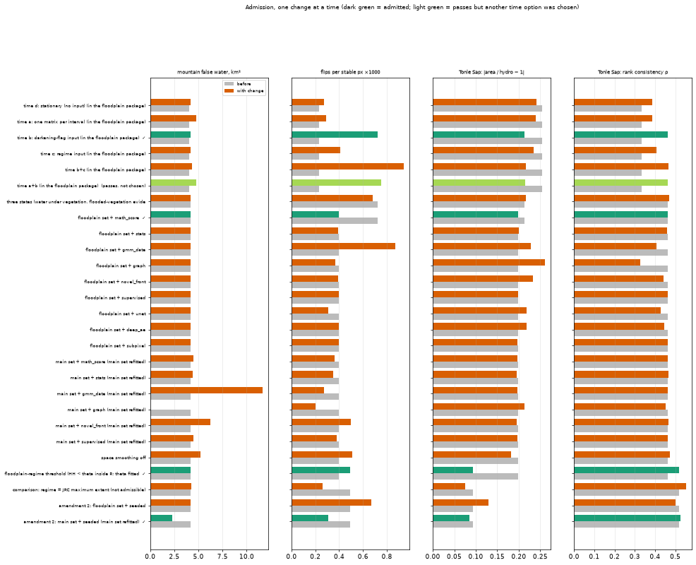
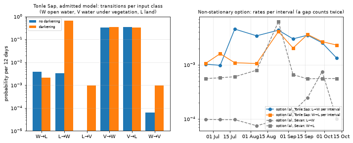
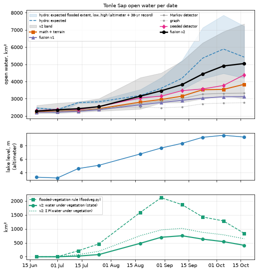
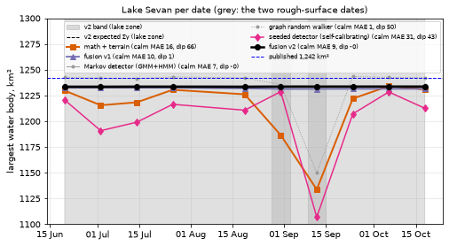
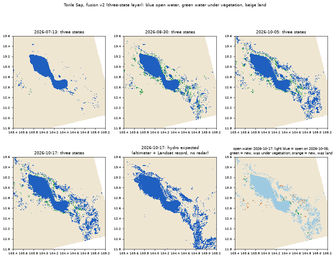
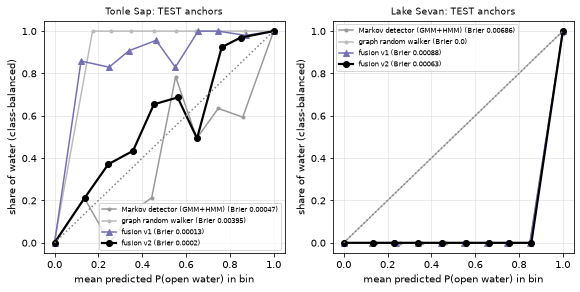
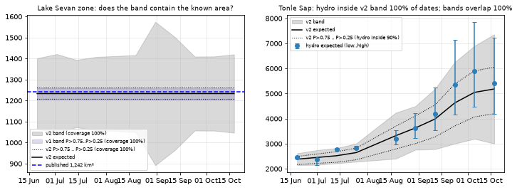
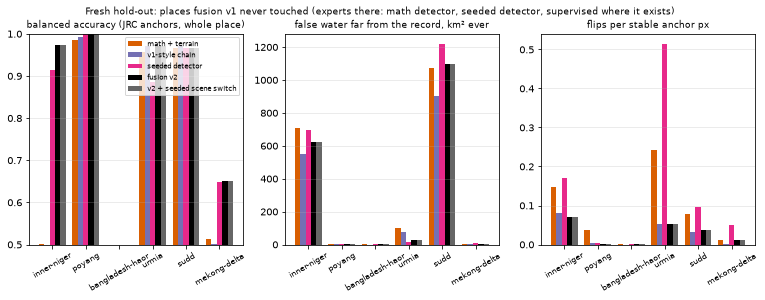

# Fusion v2: one fused detector that follows a flood

Code: [`scripts/detect/fusion2.py`](../../scripts/detect/fusion2.py) · tests: [`tests/test_fusion2.py`](../../tests/test_fusion2.py) (10 tests) ·
numbers: [`fusion2/results.json`](fusion2/results.json) (section `fusion2`) · products: `data/processed/<area>/fusion2/products.pt` ·
builds on [fusion.md](fusion.md) (v1), [hydro.md](hydro.md) (independent floodplain reference), [crossscene.md](crossscene.md) (seeded detector).
Written 14 Nov 2026, 15:10 (Yerevan time).

```
.venv/bin/python -m scripts.detect.fusion2 --admission   # admission rule, one change at a time (~4 min CPU)
.venv/bin/python -m scripts.detect.fusion2 --amend2      # amendment 2 (seeded detector offered) + table, products, hold-out, figures
.venv/bin/python -m scripts.detect.fusion2 --amend3      # amendment 3 (scene switch) + table, products, hold-out (all 15 places), figures
.venv/bin/python -m scripts.detect.fusion2 --final       # table, products, hold-out, figures with the admitted configuration
.venv/bin/python -m scripts.detect.fusion2 sevan         # products for one place with the admitted configuration (~2-20 s)
.venv/bin/python -m scripts.detect.fusion2 --figures     # figures from results.json
```

Reduced inputs are cached in `$FUSION_CACHE` (default: system temp folder), keyed on each source file's modification time, as in v1. CPU only, one area in memory at a time; Tonle Sap peaks at about 2 GB.

## In one paragraph

Fusion v1 was our best map for lakes and mountains but it **ate the Tonle Sap flood**: on 17 October it said 3,120 km² where the strict math detector says 3,837 km² (itself too low) and the independent lake-level estimate says 5,421 km² (range 4,198–7,222). Fusion v2 keeps v1's pooling of experts, and changes three things: (1) the time model now **knows when a pixel darkens**: the chance of land turning into water is 0.3 % per 12 days normally but 65 % in an interval where the radar brightness drops into the water range; (2) inside a **floodplain zone found without any reference** (flat, low, and changing over the season) the strict threshold is relaxed from 0.12 to 0.19; (3) the **self-calibrating seeded detector** joins the experts. A third state, *water under vegetation*, is computed as a separate layer. Result: Tonle Sap 17 October = **5,046 km²** (inside the independent band on 7 of 10 dates, against 1 of 10 for v1 and for the math detector), mean area error against the independent estimate 8.5 % (v1 25 %, math 20 %), and Lake Sevan and Ararat at least as good as v1 (Sevan largest body 1,233 km² on every date, calm error 8.6 km², rough-date dip 0.1 km²; mountain false water 9.7 → 6.3 km²). On the 13 other places, v2 has the best balanced accuracy on 5 of the 8 that have anchors and is within 0.6 pp of the best on the other 3.

**Verdict: yes, the app can switch every area to `fusion2`** (section 9 gives the exact change). Caveats in section 10: v2's floodplain gain is in *area*, much less in *location* (pixel precision against the independent map falls to 0.76 in October), and the "water under vegetation" layer is about a third the size of the existing rule and is not validated.

## 1. What was wrong with v1

| Problem in v1 | Evidence | Fix in v2 |
|---|---|---|
| Time model far too sticky | learned land→water 0.0013 per 12 days at Tonle Sap; a pixel that floods in the last two dates is pulled back to land | transitions depend on a darkening flag (section 2.3) |
| Admission measured only lakes and mountains | the rule never saw that the flood shrank 19 % | floodplain criteria + "no flood eaten" guard (section 3) |
| One global threshold | 0.12 is right for Sevan, too strict on the floodplain; 0.20 everywhere breaks Sevan (1,467 km²) and triples Armenian false water | looser threshold only inside a reference-free floodplain regime (section 2.4) |
| Two states | flooded forest/rice is "land" until it opens up | third state, water under vegetation (section 2.2) |
| Band from the model only | - | band and its coverage checked against Sevan's known area and the hydro estimate (section 7) |

## 2. The model

### 2.1 Symbols

| Symbol | Meaning |
|---|---|
| $i$, $t$ | pixel, date ($t = 1..10$, 19/20 Jun – 17/18 Oct 2026) |
| $q_t(i)$ | per-date pooled probability of open water (v1 log-linear pooling of experts with the hard terrain mask, weights fitted on TUNE anchors) |
| $v_t(i)\in[0,1]$ | flooded-vegetation score from `floodveg.py` (HH double bounce) |
| $r_t(i)$ | $0.05 + 0.90\, v_t(i)$: evidence for "under vegetation" against "land" |
| $S_t(i)$ | hidden state: $W$ open water, $V$ water under vegetation, $L$ land |
| $\text{HH}_t(i)$ | HH preview brightness |
| $\mathcal R$ | reference-free floodplain regime (section 2.4) |
| $d_t(i)\in\{0,1\}$ | darkening flag for the interval $t \to t+1$ |
| $A^{(k)}$ | $3\times 3$ transition matrix for input class $k$ (rows = from) |
| $\gamma_t(i,s)$ | posterior $P(S_t = s \mid \text{all dates})$: what the app reads |

### 2.2 Emissions (three states)

Because v1's pooling is class-balanced, $q/(1-q)$ is a likelihood ratio *open water : not open water*. The flooded-vegetation score splits "not open water" into $V$ and $L$:

$$
b_t(i) = \Big( q_t(1-r_t),\;\; (1-q_t)\,r_t,\;\; (1-q_t)(1-r_t) \Big) \quad \text{for } (W, V, L).
$$

The **admitted model uses two states** ($r_t \equiv 0.02$, so $V$ is off): adding the third state lowered the area agreement with the hydro estimate and was rejected by the rule (section 3). The three-state model with the *same* configuration is still run and saved as a separate layer (`p_state`, `state`, `fv_km2`), see section 6.

### 2.3 Time: an input-output Markov chain

The state sequence of every pixel is a Markov chain whose transition matrix depends on an observed input class $k_t(i)$:

$$
P\big(S_{t+1}=s' \mid S_t=s,\; k_t(i)=k\big) = A^{(k)}_{s s'},\qquad
\gamma_t(i,s) = P\big(S_t=s \mid b_1(i),\dots,b_T(i),\, k_1(i),\dots,k_{T-1}(i)\big).
$$

Four options were tried for $k$ (section 4): (a) one matrix per interval (time-varying), (b) the darkening flag, (c) inside/outside the regime $\mathcal R$, (d) none (one less sticky matrix). **Option (b) won.** The flag needs no reference:

$$
d_t(i) = \big[\text{HH}_{t+1}(i) - \text{HH}_t(i) < -0.03\big]\;\wedge\;\big[\text{HH}_{t+1}(i) < 0.12\big]\;\wedge\;\big[i \in \mathcal R\big]
$$

(the brightness falls, and falls into the water range of the strict detector, inside the floodplain regime).

- $\pi$ and $A^{(k)}$ are fitted by Baum–Welch on 40,000 random TUNE-strip pixels per area (Ararat: whole area), unsupervised, with 2 pseudo-counts per cell and partial pooling $A^{(k)} \leftarrow 0.7\,A^{(k)}_{\text{MLE}} + 0.3\,A_{\text{pooled}}$.
- The 24-day outage (27 Jul – 10 Aug) is one phantom step, so that interval uses $A^{(k)}A^{(k)}$.
- Learned at Tonle Sap (three-state layer, per 12 days): without darkening $L\to W = 0.0025$, $W\to L = 0.0027$, $V\to V = 0.90$; **with darkening $L\to W = 0.65$, $V\to W = 0.70$**. The two-state admitted model: $L\to W$ 0.0033 / 0.654. Compare v1: 0.0013 for everything.

### 2.4 Floodplain regime and the relaxed threshold

$$
\mathcal R = \{\, i : \text{slope}(i) < 1^\circ,\; \text{height above local low}(i) < 5\ \text{m},\; \text{terrain allows water},\; \operatorname{IQR}_t \text{HH}_t(i) > 0.08 \,\}
$$

No Landsat record, no hydro map: only the DEM and the radar series itself. Tonle Sap: 12,055 km² (33 % of the footprint); Sevan and Ararat: 0 km².

Inside $\mathcal R$ the pooled probability is replaced by a **floodplain expert set** (math detector + math HH score) whose math mask uses $\text{HH} < \theta$ instead of 0.12, and whose score is $\sigma\big((0.75\theta - \text{HH})/(0.25\theta)\big)$:

$$
q_t(i) = \begin{cases} q^{\text{fp}}_t(i;\theta) & i \in \mathcal R \\ q^{\text{main}}_t(i) & \text{otherwise.}\end{cases}
$$

$\theta = 0.19$ was chosen on the Tonle Sap **TUNE strip only**, as the value at which the summed water area there matches the hydro expected area (weak supervision from the altimeter + 38-year record). The TEST strip and the other areas were never used for $\theta$.

**Scene switches (reference-free).** The regime is switched off for a whole scene when (i) it covers < 5 % of the footprint, or (ii) the seeded detector chose *lake mode* for that scene, or found no water (amendment 3).

### 2.5 Experts and space

Main set (refitted with the seeded detector, amendment 2): weights math detector 0.00, U-Net 0.54, deep autoencoder 0.39, sub-pixel 0.11, **seeded 0.37** (Ararat refit on what it has: sub-pixel 0.50, seeded 0.53). Then a masked 3 × 3 mean of the state posteriors, as in v1.

**Products** (`fusion2/products.pt`): `water` $=\gamma(W) > 0.5$ [T,H,W]; `p_water`; `p_state` [T,3,H,W] and `state` (argmax; 0 open water, 1 under vegetation, 2 land) from the three-state layer; `water_km2`, `water_km2_expected` $=\sum_i \gamma_t(i,W)\,a_i$, `water_km2_lo/hi`, `fv_km2`, `dates`, `valid`, `regime`, weights and matrices.

## 3. The admission rule and the decisions

Declared before the TEST strip was looked at (`RULE2` in the code). A change is admitted only if **all** of these hold:

- **Lakes and mountains keep the v1 gains** (bar = v1 product): TEST balanced accuracy (Ararat: specificity) does not drop by more than 0.1 pp in any area; mountain false water (Sevan + Ararat TEST) rises by at most max(1 km², 10 %); Sevan rough-date dip ≤ 5 km²; Sevan calm error ≤ v1 + 5 km²; flips per stable TEST pixel ≤ 0.005.
- **Floodplain does not degrade** (against the configuration accepted so far): Spearman with the altimeter −0.02 at most; rank consistency in the ambiguous zone −0.01; mean |area / hydro − 1| +0.01; IoU with the hydro map on the TEST strip −0.005; dates inside the hydro band not fewer.
- **"No flood eaten" guard (hard):** on every date the area is ≥ 98 % of the strict detector's confident core (pixels the math detector calls water on that date *and every later date*).
- **At least one named improvement** in either terrain, and ≤ 600 s per area.

| # | Change offered (in declared order) | Decision | Why |
|---|---|---|---|
| 1 | time (d) stationary, less sticky | reject | guard fails (keeps 89.5 % of the core) |
| 1 | time (a) one matrix per interval | reject | guard fails (89.4 %) |
| 1 | **time (b) darkening flag** | **admit** | guard passes; hydro error 0.254 → 0.214; rank consistency 0.33 → 0.46 |
| 1 | time (c) regime as input | reject | guard fails (90.3 %) |
| 1 | time (b+c) | reject | guard fails; Sevan accuracy −0.1 pp |
| 1 | time (a+b) | passes, not chosen | b has lower hydro error and fewer flips |
| 2 | three states | reject | TEST-strip IoU with the hydro map −0.006 (tolerance 0.005) (kept as a separate layer) |
| 3 | floodplain set + math HH score | **admit** | flips, hydro IoU |
| 3 | floodplain set + stats / gmm_date / graph / novel_front / supervised / unet / deep_ae / subpixel | reject all | no improvement, or rank/hydro/guard worse (`supervised`: no gain, so its low-water excess never entered) |
| 4 | main set + each other expert | reject all | `gmm_date`, `novel_front`: mountain false water up; `graph`: floodplain worse |
| 5 | space smoothing off | reject | mountain false water up |
| 6 | **relaxed threshold θ = 0.19 inside $\mathcal R$** | **admit** | hydro error 0.198 → 0.093, in-band dates 1 → 7, IoU 0.501 → 0.513, rank 0.46 → 0.52 |
| 7 | regime = JRC maximum extent (comparison only) | never admissible | uses the validation reference; would give hydro error 0.076 |
| A1 | *amendment 1:* a capability addition with no metric of its own (three states) may enter if nothing degrades | - | written after the first run; the three-state step still failed the hydro test, so it stays a separate layer |
| A2 | **amendment 2:** main set + seeded detector | **admit** | mountain false water (TEST) 4.2 → 2.3 km²; flips −37 %; Sevan calm error 10.0 → 8.6 km² |
| A2 | amendment 2: floodplain set + seeded | reject | hydro error 0.093 → 0.130, rank consistency down |
| A3 | **amendment 3:** scene switch from the seeded detector's own mode | adopted | identical on the three study areas; on lake-mode places it removes false floodplain water (Lake Chad far-from-record water 62 → 0.09 km²). Decided *after* seeing those places, see section 8 |



*Figure 1. Each change, before (grey) and after (colour). Dark green = admitted.*

## 4. Which time model won, and why

All six options inside the same floodplain package (two states, relaxed threshold not yet added):

| time option | Tonle Sap 17 Oct, km² | guard (worst area / core) | hydro error | IoU (TEST) | rank ρ | flips ×10⁻³ | admitted |
|---|---|---|---|---|---|---|---|
| (d) stationary | 3,434 | 0.895 ✗ | 0.241 | 0.480 | 0.387 | 0.27 | no |
| (a) per interval | 3,428 | 0.894 ✗ | 0.239 | 0.481 | 0.387 | 0.29 | no |
| **(b) darkening flag** | **3,957** | **1.031 ✓** | **0.214** | **0.485** | **0.464** | 0.72 | **yes** |
| (c) regime input | 3,464 | 0.903 ✗ | 0.235 | 0.479 | 0.406 | 0.41 | no |
| (b+c) | 3,723 | 0.970 ✗ | 0.216 | 0.474 | 0.468 | 0.94 | no |
| (a+b) | 3,901 | 1.017 ✓ | 0.214 | 0.484 | 0.463 | 0.75 | passes |
| *the same without the floodplain expert set* | | | | | | | |
| (d) / (a) / (b) / (c) | 3,190 / 3,166 / 3,600 / 3,244 | all ✗ | 0.24–0.25 | | 0.34–0.41 | | no |

**Why (b):** a less sticky prior alone (d) or a different matrix per date (a) learns its rates from pixels that mostly never change, so it stays nearly as sticky as v1 and still eats late flooding. Making the transition depend on *evidence of change in that pixel* lets the chain stay calm for stable pixels (mountain flips stay at 0.0005 per pixel) and jump where the radar darkens. The time model alone is not enough: without the floodplain expert set no option passes the guard.



*Figure 2. Left: Tonle Sap transitions per 12 days, without and with darkening. Right: option (a)'s per-interval rates: never far above v1's.*

## 5. The comparison table

Bootstrap = 95 % block bootstrap over spatial blocks of the TEST strip (as in tune.py). "Far water" = pixels called water at least once that the 38-year record never saw as water, far from any recorded water (whole area). "Flips" = water/land switches per stable TEST anchor pixel over the season.

### 5.1 Lakes and mountains

| | math + terrain | Markov detector | graph detector | seeded detector | fusion v1 | **fusion v2** |
|---|---|---|---|---|---|---|
| Tonle Sap balanced accuracy | 99.57 % [99.27, 99.80] | 99.95 % [99.92, 99.98] | 99.58 % [98.89, 99.96] | 99.74 % [99.54, 99.91] | 99.98 % [99.96, 100] | **99.97 % [99.95, 99.99]** |
| Sevan balanced accuracy | 99.58 % [99.28, 99.77] | 99.30 % [98.70, 99.80] | 100 % [100, 100] | 99.94 % [99.89, 99.98] | 99.89 % [99.74, 99.99] | **99.92 % [99.80, 100]** |
| Ararat specificity | 99.974 % | 100 % | 100 % | 100 % | 99.987 % | **99.990 %** |
| Sevan largest body, calm-date error (km², published 1,242) | 16.1 | 6.7 | 0.6 | 31.3 | 10.0 | **8.6** |
| Sevan dip on rough dates 31 Aug / 12 Sep (km²) | 65.7 | 0.0 | 49.7 | 42.9 | 0.7 | **−0.1** |
| Far water ever, Sevan (km²) | 39.1 | 23.0 | 0 | 0 | 9.3 | **6.0** |
| Far water ever, Ararat (km²) | 2.65 | 0 | 0 | 0 | 0.41 | **0.31** |
| Flips per stable pixel, Tonle Sap / Sevan / Ararat (×10⁻³) | 6.8 / 35.6 / 1.7 | 1.9 / 0.07 / 0 | 1.8 / 0 / 0 | 5.5 / 6.8 / 0 | 0.13 / 0.88 / 0.03 | **0.54 / 0.00 / 0.01** |

The graph detector is perfect on Sevan's anchors but loses 92 km² of lake on 12 September and is the worst on the floodplain (below); the Markov detector's lake never moves (1,235 km² every date) but it puts 23 km² of water in the mountains.

### 5.2 Floodplain (Tonle Sap)

| | math + terrain | Markov | graph | seeded | fusion v1 | **fusion v2** |
|---|---|---|---|---|---|---|
| 17 Oct open water (km²): hydro 5,421 (4,198–7,222) | 3,837 | 3,326 | 2,766 | 4,388 | 3,120 | **5,046** |
| Spearman with the altimeter level (10 dates) | 0.976 | 0.976 | 0.964 | 0.952 | 0.976 | **0.976** |
| Pearson with the altimeter level | 0.959 | 0.979 | 0.931 | 0.934 | 0.990 | 0.952 |
| Rank consistency in the ambiguous zone (TEST, ρ [95 %]) | 0.497 [0.472, 0.517] | 0.362 | 0.340 | 0.534 [0.509, 0.553] | 0.334 [0.306, 0.360] | **0.527 [0.502, 0.548]** |
| Late-season water inside the historical maximum extent | 98.0 % | 99.4 % | 99.6 % | 97.4 % | 99.6 % | 97.0 % |
| Far water ever (km²) | 13.8 | 12.4 | 0 | 30.0 | 0.65 | 18.8 |
| Area vs hydro: mean \|area / expected − 1\| | 0.201 | 0.225 | 0.280 | 0.155 | 0.254 | **0.085** |
| Dates inside the hydro band (of 10) | 1 | 1 | 1 | 3 | 1 | **7** |
| Pixel IoU with the hydro map, mean of dates (whole domain / TEST strip) | 0.692 / 0.481 | 0.689 / 0.458 | 0.698 / 0.445 | 0.696 / 0.494 | 0.699 / 0.474 | **0.707 / 0.520** |
| 17 Oct precision / recall against the hydro map | 0.86 / 0.61 | 0.89 / 0.55 | 0.97 / 0.50 | 0.82 / 0.67 | 0.93 / 0.54 | 0.76 / **0.71** |
| "No flood eaten" guard (worst area / confident core) | 1.00 ✓ | 0.87 ✗ | 0.72 ✗ | 1.13 ✓ | 0.81 ✗ | **1.12 ✓** |
| Water under vegetation, peak (km²) | - | - | - | - | - | 751 (11 Sep) |

### 5.3 Tonle Sap per date

| date | hydro expected (low–high) | math + terrain | fusion v1 | seeded | **fusion v2** | v2 / expected | v2 in band | v2 under vegetation |
|---|---|---|---|---|---|---|---|---|
| 19 Jun | 2,458 (2,415–2,496) | 2,234 | 2,207 | 2,301 | 2,281 | 0.93 | - | 0 |
| 1 Jul | 2,361 (2,137–2,425) | 2,297 | 2,219 | 2,385 | 2,355 | 1.00 | ✓ | 0 |
| 13 Jul | 2,772 (2,729–2,826) | 2,310 | 2,268 | 2,370 | 2,418 | 0.87 | - | 24 |
| 25 Jul | 2,822 (2,766–2,908) | 2,421 | 2,359 | 2,540 | 2,537 | 0.90 | - | 78 |
| 18 Aug | 3,189 (2,969–3,541) | 2,803 | 2,646 | 3,051 | 3,152 | 0.99 | ✓ | 483 |
| 30 Aug | 3,609 (3,216–4,231) | 2,954 | 2,782 | 3,146 | 3,461 | 0.96 | ✓ | 697 |
| 11 Sep | 4,185 (3,533–5,233) | 3,147 | 2,908 | 3,468 | 3,818 | 0.91 | ✓ | 751 |
| 23 Sep | 5,360 (4,163–7,134) | 3,522 | 3,038 | 3,568 | 4,436 | 0.83 | ✓ | 630 |
| 5 Oct | 5,888 (4,473–7,859) | 3,541 | 3,109 | 3,770 | 4,904 | 0.83 | ✓ | 541 |
| 17 Oct | 5,421 (4,198–7,222) | 3,837 | 3,120 | 4,388 | 5,046 | 0.93 | ✓ | 410 |

v2 does **not** flood early: on the June–July dates it is 0–13 % *below* the hydro estimate (the three misses are all on the low side, 6–11 % below the band's lower edge). Altimeter correlation: Spearman 0.976 (the same as math and v1), Pearson 0.952.



*Figure 3. Tonle Sap. Top: open water per date against the hydro band. Middle: lake level. Bottom: water under vegetation, v2 state vs the rebuilt rule.*



*Figure 4. Lake Sevan largest water body per date; grey = the two rough-surface dates.*

## 6. Three states: water under vegetation

| date | 19 Jun | 1 Jul | 13 Jul | 25 Jul | 18 Aug | 30 Aug | 11 Sep | 23 Sep | 5 Oct | 17 Oct |
|---|---|---|---|---|---|---|---|---|---|---|
| rebuilt rule (`floodveg.py`), km² | 1 | 1 | 213 | 462 | 1,591 | **2,113** | 1,865 | 1,423 | 1,282 | 836 |
| v2 state = under vegetation, km² | 0 | 0 | 24 | 78 | 483 | 697 | **751** | 630 | 541 | 410 |
| v2 expected $\sum_i \gamma_t(i,V)\,a_i$, km² | 0 | 5 | 77 | 196 | 757 | 961 | **1,014** | 873 | 785 | 645 |

- **Shape:** the same rise-and-fall as the rule, but the v2 layer is about one third of the rule's size and peaks 12 days later (11 Sep vs 30 Aug).
- **Early-July rise:** present but weak (24 km² on 13 Jul, 78 km² on 25 Jul, against 213 and 462 for the rule). The model asks for evidence on several dates before it believes a new state.
- **Vegetation opening into open water:** the model learned that, once a pixel is under vegetation, an interval with darkening sends it to open water with probability 0.70. From 5 to 17 Oct, 209 km² became open water; **91 km² (43 %) of it had been "under vegetation"** on 5 Oct and 119 km² had been land. Only 49 % of that new open water lies inside the hydro expected map for 17 Oct (hydro.md measured 73 % for the math detector's growth).
- **Is it right?** We have no independent map of flooded vegetation, so this layer is not validated. Only 10–24 % of v2's vegetation pixels fall inside the hydro *open-water* map, which is what you would expect for water hidden under canopy.



*Figure 5. Tonle Sap three-state maps (13 Jul, 30 Aug, 5 Oct, 17 Oct), the hydro map for 17 Oct, and where the 17 Oct open water came from.*

## 7. Calibration and the uncertainty band

**Calibration** (class-balanced Brier score on TEST anchor pixel-dates, lower is better): Tonle Sap v2 0.00020 (v1 0.00013, Markov 0.00047, graph 0.0040); Sevan v2 0.00063 (v1 0.00088). The anchors are the easy pixels (permanent water, never water), so this says only that v2 is confident and right where things are clear. The reliability curve at Tonle Sap (figure 6) is close to the diagonal; v1's mid-range probabilities were under-confident.

**Two bands are saved:**

1. `water_km2_lo/hi`, a deliberately wide envelope: three half-widths in quadrature, the statistical study's threshold interval, the spread of the experts' areas, and half a pixel along every shoreline.
2. The probability band: area at $\gamma(W) > 0.75$ to area at $\gamma(W) > 0.25$ (as in v1; `p_band` in results.json).

| | wide envelope | probability band |
|---|---|---|
| Sevan lake zone: contains the published 1,242 km² | 10 / 10 dates, but ±160–340 km² wide (not useful) | **10 / 10, 1,206–1,260 km²** |
| Tonle Sap: contains the hydro expected area | 10 / 10, ±10–42 % wide | **9 / 10** (misses 13 Jul, low) |

**Recommendation:** show the probability band. The wide envelope is mostly the threshold term and the expert spread, which are large on wind dates at Sevan and on the late floodplain; it always covers, but tells the user little. Both coverage checks use the very references they are compared with, so they are in-sample, not proof.

 

*Figures 6–7. Reliability on TEST anchors; band coverage at Sevan and Tonle Sap.*

## 8. Fresh hold-out: places v1 never touched

Thirteen places outside the three study areas. Experts there: the math detector, the math HH score, the seeded detector, and `supervised` where it exists (no U-Net etc.). Anchors: JRC record over the whole place. "v1-style" = the v1 recipe (sticky 2-state chain, no regime, no darkening) on the same experts.

| place (seeded mode) | math | v1-style | seeded | **v2** | far water ever, km² math / v1-style / seeded / v2 | flips ×10⁻³ math / v2 |
|---|---|---|---|---|---|---|
| Inner Niger (flood) | 50.1 % | 48.0 % | 91.3 % | **97.3 %** | 705 / 548 / 695 / 621 | 147 / 71 |
| Poyang (lake) | 98.5 % | 99.2 % | 99.9 % | **99.9 %** | 0.3 / 0.1 / 0.5 / 0.4 | 37 / 0.7 |
| Urmia (lake) | 95.7 % | 97.2 % | 88.6 % | **97.0 %** | 99 / 78 / 15 / 29 | 243 / 52 |
| Sudd (flood) | 96.6 % | 97.2 % | 96.6 % | 96.7 % | 1,073 / 904 / 1,219 / 1,097 | 78 / 37 |
| Mekong delta (flood) | 51.3 % | 50.0 % | 64.9 % | **65.1 %** | 1.5 / 1.0 / 9.1 / 5.1 | 10 / 11 |
| Bangladesh haor (flood) | spec 99.999 % | 100 % | 99.987 % | 99.997 % | 0.06 / 0 / 0.78 / 0.12 | 0.12 / 0.22 |
| Lake Chad (lake) | 50.3 % | 50.0 % | 99.1 % | **99.3 %** | 13.6 / 3.6 / 0.03 / 0.09 | 19 / 1.0 |
| Nile delta (lake) | 50.0 % | 50.0 % | **71.7 %** | 71.4 % | 0 / 0 / 0 / 0 | 0 / 0.2 |
| Pantanal (lake) | 50.0 % | 50.0 % | 99.97 % | **99.98 %** | 0.2 / 0 / 5.4 / 1.8 | 0.04 / 0.13 |
| Okavango / Rondônia / Sindh (no anchors) | - | - | - | - | 0 / 0 / 0 / 0; 38 / 38 / 173 / 47; 12 / 9 / 0 / 0 | |

(Balanced accuracy unless noted; numbers are with the final configuration. The six first places were the declared hold-out; the last six were added in this run.)

What it shows, honestly:

- **Before the seeded detector joined (amendments 2–3), v2 on the six declared places was no better than the v1 recipe**: balanced accuracy Inner Niger 47.9 %, Poyang 99.3 %, Urmia 97.2 %, Sudd 96.9 %, Mekong 49.9 % (v1-style: 48.0 / 99.2 / 97.2 / 97.2 / 50.0). The big jumps (Inner Niger, Lake Chad, Pantanal, Mekong) come from the seeded detector, whose three structural knobs were chosen on **all 15 places, these included** (crossscene.md; leave-one-scene-out gave the same knobs for 13 of 15). So these places are fresh for fusion v2's own fitting, but **not fully fresh for the seeded detector**.
- v2 is the best on 5 of the 8 places with anchors and within 0.6 pp of the best on the others (Urmia, Sudd: the v1 recipe; Nile delta: the seeded detector), and it removes the seeded detector's flicker (Urmia flips 514 → 52 ×10⁻³) and its false water (Rondônia 173 → 47 km²).
- **Amendment 3** (scene switch) was decided after looking at these places, so they no longer count as a hold-out for that one decision: without it, Lake Chad had 62 km² of far water (now 0.09) and Poyang 0.97 ×10⁻³ flips (now 0.72); with it, Urmia's accuracy is 97.0 % instead of 97.6 % and its flips 52 instead of 24 ×10⁻³, while its false water falls 39 → 29 km².
- Sudd (1,000+ km² "far water" for every detector) and Mekong (65 %) remain hard: the Sudd's swamp is not in the Landsat record as water, and the Mekong's permanent water is mostly rivers narrower than our 180 m pixels.



*Figure 8. Fresh hold-out (first six places).*

## 9. Verdict and the exact switch

**Can the app switch every area to `fusion2`? Yes.** On the three study areas v2 meets the v1 bar for lakes and mountains (and slightly improves it), and it is the only fused product that passes the "no flood eaten" guard and lands inside the independent floodplain band on most dates. On the 13 other places it is the best detector on 5 of the 8 with anchors and within 0.6 pp of the best on the rest. The automatic, reference-free per-terrain behaviour is *inside* fusion2 (regime map + the two scene switches), so no per-area choice is needed: lakes and mountains behave like v1, floodplains get the relaxed threshold and the darkening-aware time model.

`fusion2/products.pt` now exists for all 15 places with a crossscene input (not for `demo`). Change in `scripts/detect/run.py`, lines 238–248 and after the flooded-vegetation block (~line 257):

```python
    water_src = "math"
    fv2 = None
    src = cfg.get("water_source")
    if src in ("fusion", "fusion2"):  # fused, time-smoothed water map (fusion2: floodplain-aware)
        fp = ROOT / "data/processed" / area / src / "products.pt"
        fz = torch.load(fp, map_location="cpu", weights_only=False) if fp.exists() else None
        if fz is not None and tuple(fz["water"].shape) == tuple(out["water"].shape) and list(fz["dates"]) == list(dates):
            wdev = out["water"].device
            out["water"] = fz["water"].to(wdev) & out["valid"]
            out["wind_suspect"] = torch.zeros_like(out["water"])
            out["classes"] = ops.classify(out["water"], out["flooded_veg"], out["valid"], out["change_date"], out["knobs"])
            water_src = src
            if src == "fusion2" and cfg.get("fv_source") == "fusion2":   # optional three-state layer
                fv2 = (fz["state"] == 1).to(wdev) & out["valid"] & ~out["water"]
        else:
            print(f"  {src} water map missing or on another grid: run scripts.detect.{src} first; using the math detector")
    ...
    # after the `if source == "preview":` flooded-vegetation block:
    if fv2 is not None:
        out["flooded_veg"] = fv2
        out["classes"] = ops.classify(out["water"], out["flooded_veg"], out["valid"], out["change_date"], out["knobs"])
```

and in every `areas/<id>/area.json`: `"water_source": "fusion2"`. Keep the flooded-vegetation rule as the default (`fv_source` unset); `"fv_source": "fusion2"` swaps in the three-state layer: we do not recommend that for the demo, because the layer is unvalidated and a third of the rule's size. For an area-uncertainty display use `p_water`: area at `p_water > 0.75` to area at `p_water > 0.25`. If the grid or dates of an area change, rerun `python -m scripts.detect.fusion2 <id>` (2–20 s; Tonle Sap needs its experts first).

## 10. Limits

1. **Area better, location only a little better.** On the floodplain v2 fixes the total, but on 17 Oct only 76 % of its water lies inside the hydro map (v1 93 %, math 86 %) and only 49 % of its newest water. IoU rises just 0.48 → 0.52. The relaxed threshold also catches dark, wet, non-flooded surfaces. Far-from-record water at Tonle Sap is 18.8 km² (v1 0.65) and late-season water inside the historical maximum falls to 97.0 %.
2. **The floodplain evaluation shares its source with one fitted number.** θ = 0.19 was fitted to the hydro estimate on the TUNE strip; the area error and in-band count are measured on the whole Tonle Sap, so they are partly in-sample. Only the TEST-strip IoU (0.520), the altimeter correlation and the rank consistency are clean. And the hydro map is "water Landsat can see", not total inundation.
3. **One floodplain.** Every floodplain criterion comes from Tonle Sap; the darkening thresholds (0.03, 0.12) and the regime rule (1°, 5 m, IQR 0.08) were set by hand, not tuned on other floodplains.
4. **Fresh hold-out is not perfectly fresh** (section 8): the seeded detector's knobs saw those places, and amendment 3 was decided after seeing them. The clean, pre-amendment result is "no better than v1 on new places".
5. **Three amendments after first results.** Amendment 1 (capability additions) changed nothing in the end; amendment 2 used the same rule; amendment 3 is a judgement call. All are logged in results.json.
6. **Water under vegetation is unvalidated** (no reference), smaller than the rule, and only exists where `floodveg` products exist (Tonle Sap, Sevan, Ararat): 0 km² everywhere else.
7. **Uncalibrated preview images at ~180 m.** Shorelines, rivers and canals below a pixel are invisible (Mekong); the TEST anchors used for accuracy and calibration are the easy pixels, so the 99.9 % figures overstate accuracy in mixed or changing areas.
8. **Altimeter correlation cannot separate methods**: with 10 dates, math, v1 and v2 all score Spearman 0.976.
9. Running fusion2 needs the expert products of an area for the full model; on places without them (12 of 15) it is a three-expert model (math, HH score, seeded, plus supervised where present).
