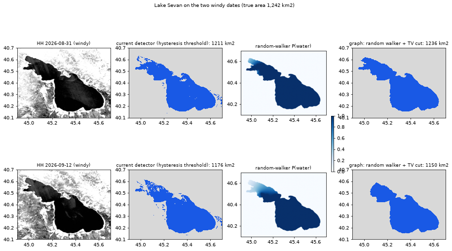
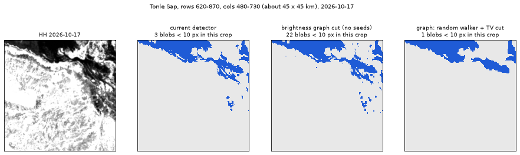
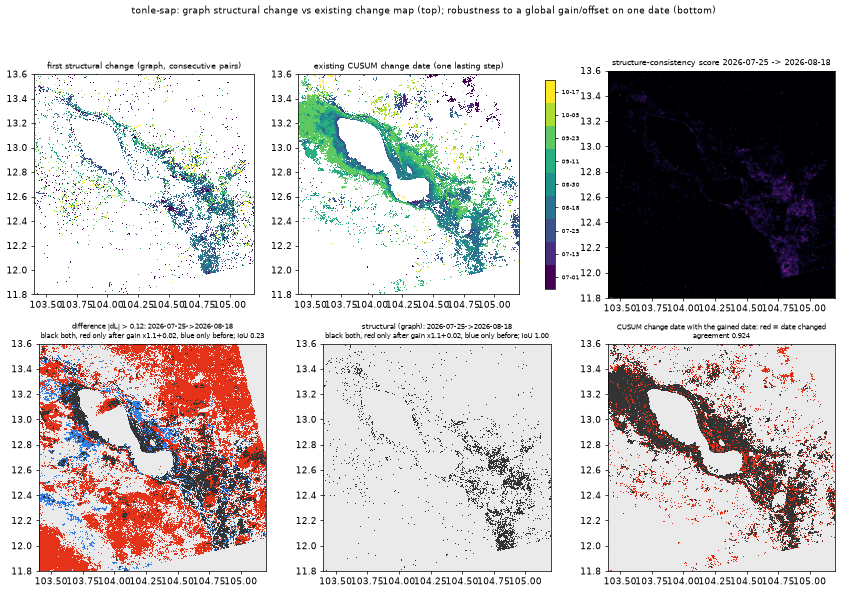
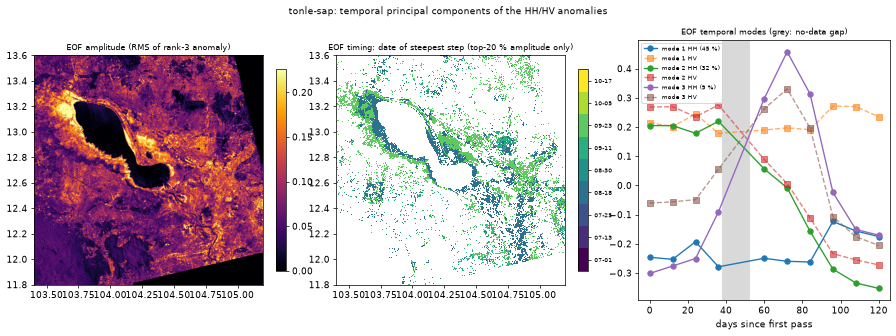
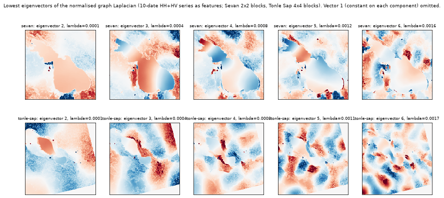
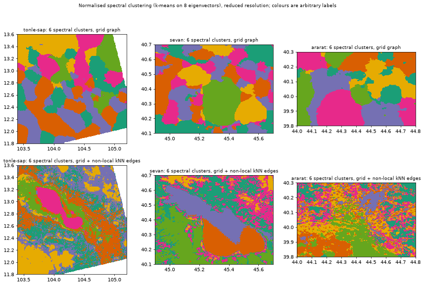
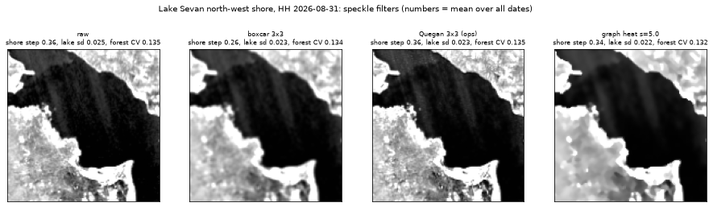

# Graph-based and spectral detection on the pixel grid

Code: [`scripts/detect/graphdet.py`](../../scripts/detect/graphdet.py) · tests: [`tests/test_graphdet.py`](../../tests/test_graphdet.py) · numbers: [`graph/results.json`](graph/results.json) · products: `data/processed/<area>/graph/products.pt`

```
.venv/bin/python -m scripts.detect.graphdet            # all three areas (about 20 minutes on the M5 while seven other jobs shared it; Tonle Sap is 16 of them)
.venv/bin/python -m pytest tests/test_graphdet.py -q   # 8 tests
```

The current detector ([`docs/DETECTION.md`](../DETECTION.md)) decides every pixel almost on its own: a pixel is water if it is dark enough and touches other dark pixels. This note tries the other family of ideas: treat the image as a **graph** whose nodes are pixels and whose edges link neighbouring pixels that look alike, and let the decision for one pixel depend on its neighbours through that graph. "Spectral" appears twice: the eigenvectors of the graph (spectral graph theory) and the frequencies of each pixel's time series (spectral analysis in time).

Everything below is measured with the project's usual yardsticks: Lake Sevan's published area (1,242 km²), and the independent JRC Global Surface Water maps (Landsat 1984–2021; loader reused from [`validate.py`](../../scripts/detect/validate.py); used only to measure, never to choose a parameter).

## 1. The pixel graph

**In plain words.** Every valid pixel is a node. Each pixel is linked to its 8 neighbours. A link is strong when the two pixels look alike and weak when they look different, so a shoreline is a line of weak links and the inside of a lake is a mesh of strong ones.

**Formula.** For neighbouring pixels $i$ and $j$ with feature vectors $f_i, f_j$:

$$w_{ij} = \exp\left(-\frac{\lVert f_i - f_j\rVert^2}{2\sigma^2}\right)$$

and $w_{ij} = 0$ if either pixel is invalid. The degree is $d_i = \sum_j w_{ij}$ and the graph Laplacian is $L = D - W$ ($D$ = diagonal of degrees, $W$ = matrix of weights), i.e. $(Lx)_i = d_i x_i - \sum_j w_{ij} x_j$.

**Features.** For the water maps of date $t$: $f_i = [\mathrm{HH}_t, \mathrm{HV}_t, \beta\,\widetilde{\mathrm{HH}}, \beta\,\widetilde{\mathrm{HV}}]$, where the tilde means the pixel's median over the ten dates (the "season look") and $\beta = 1$. The season part is what makes a wind-roughened patch of lake still look like lake: on the windy date it differs from calm water, but its season median is the same dark value. For the spectral methods the feature is the whole ten-date HH+HV series (20 numbers).

**σ.** Chosen from the data: σ = median distance between neighbouring pixels' features (0.068 at Sevan, 0.073 at Tonle Sap). Sensitivity is in section 6.

**How it is stored.** Never as a big matrix for the full images: the 8 weights are 8 image-shaped tensors, and $Lx$ is computed with shifted copies of $x$ (`grid_weights`, `laplacian_apply`). An explicit sparse matrix is built only for the reduced-resolution spectral step (at most about 75,000 nodes) and for the tests.

**Non-local edges** (optional, spectral step only): each node is also linked to its 5 most similar nodes among 64 randomly drawn nodes anywhere in the image (`nonlocal_knn_edges`). What they buy: two separate pieces of the same surface (two basins of a lake, two forests) can end up in the same cluster. What they cost: noise, because the random sample is small.

## 2. Seeded graph segmentation of water

### 2a. Random walker (label propagation)

**In plain words.** First mark only the pixels we are sure about: *water seeds* (very dark in both channels, and part of a dark patch of at least 300 pixels, about 10 km²) and *land seeds* (clearly bright on this date **and** in the season median). Everything else is unknown. Then imagine a random walker starting at an unknown pixel and stepping to neighbours, preferring strong links. The probability that it reaches a water seed before a land seed is the pixel's water probability. A rough patch in the middle of a lake is surrounded by water seeds, so the walker almost always ends in water, however bright the patch is. A dark patch on a hillside with no water seed in it is surrounded by land, so it ends in land.

**Formula** (Grady 2006). With seeded nodes $l$ (values $x_l = 1$ for water, 0 for land) and unknown nodes $u$, solve the Dirichlet problem

$$L_{uu}\, x_u = -L_{ul}\, x_l$$

for $x_u \in [0,1]$. Solved by conjugate gradients with a Jacobi (diagonal) preconditioner, matrix-free on the grid, all dates at once; converged to relative residual below $10^{-4}$ in 150–200 iterations. Unknown pixels with no path to any seed keep $x = 0$ (land). Test: equals a direct dense solve on a small grid to $10^{-6}$.

A variant with a prior (Grady 2005; `rw_prior_gamma`), $(L_{uu} + \gamma I)x_u = -L_{ul}x_l + \gamma\pi_u$ with $\pi$ = share of dates the pixel is strictly dark, was tried and is **off** by default (section 6).

### 2b. Binary graph cut, relaxed

**In plain words.** Choose water/land for every pixel to balance two costs: each pixel's own evidence, and a penalty for every strong link that the boundary cuts. This favours short, clean shorelines and removes specks.

**Formula.**

$$E(x) = \sum_i D_i(x_i) + \lambda \sum_{(i,j)} (w_{ij} + \epsilon)\,[x_i \neq x_j], \quad x_i \in \{0,1\}$$

Exact max-flow is awkward in PyTorch, so we solve the **total-variation (continuous max-flow) relaxation**

$$\min_{u \in [0,1]^N} \sum_i c_i u_i + \lambda \sum_{(i,j)} (w_{ij}+\epsilon)\,\lvert u_i - u_j\rvert, \qquad c_i = D_i(1) - D_i(0),$$

which is convex; by the coarea formula, thresholding its minimiser at any level in (0,1) gives a global minimiser of the binary energy (Chan, Esedoglu and Nikolova 2006). It is solved with the Chambolle–Pock primal–dual algorithm on the 4-neighbour edges (300 iterations, `tv_segment`). λ = 0.25, ε = 0.1 (so a cut is never free).

Two unaries are used:
* **"graph" (the recommended product):** $c_i = 1 - 2\,p_i$ with $p_i$ the random-walker probability, seeds fixed. Result = `water_graph`.
* **"brightness graph cut" (no seeds):** $c_i = \mathrm{clip}((\mathrm{HH}_i - 0.12)/0.06, -1, 1)$, i.e. the current detector's threshold as a soft cost, plus the pairwise term. This isolates what the pairwise smoothing alone does.

Check of the relaxation on real data: the thresholded TV solution has lower energy than the current detector's mask under the same energy on every run (`tv_energy_check` in results.json), and in a unit test lower than the pointwise threshold.

### 2c. Three classes (water / flooded vegetation / land)

The random walker extends to $K$ labels by solving $K-1$ systems (one per label, the others' seeds set to 0) and taking the most probable label. Flooded-vegetation seeds: HH rise over the mean of the first two dates > 0.20 with HV rise < 0.03, on a pixel that was not dark at the start and is a stable-bright land seed otherwise. Stored as `p3_rw` / `fv_rw`.

## 3. Spectral methods on the graph

**Normalised Laplacian.** $L_{sym} = I - D^{-1/2} W D^{-1/2}$. Its eigenvectors with the smallest eigenvalues vary slowly along strong links and jump across weak ones, so they outline the image's big homogeneous regions.

**Eigenvectors.** Our own Lanczos iteration with full re-orthogonalisation (300 steps, float64, CPU because MPS has no float64 and partial sparse support; `lanczos_smallest`). Test: the 4 smallest eigenpairs on a 156-node graph match `scipy.sparse.linalg.eigsh` to $10^{-8}$ (vectors up to sign). On the real images, with 300 steps, the Ritz residuals $\lVert L_{sym}v - \theta v\rVert$ are 2e-4 to 3e-3: usable for clustering, not converged to machine precision.

**Reduced resolution.** Sevan and Ararat at 2×2 blocks (about 33,000 and 27,000 nodes), Tonle Sap at 4×4 blocks (about 75,000 nodes); only blocks valid on all dates.

**Spectral clustering** (Ng, Jordan and Weiss 2002): rows of the 8 smallest eigenvectors, normalised to unit length, then k-means with 6 clusters (`models.kmeans`). **Fiedler cut** (Shi and Malik 2000): $y = D^{-1/2}v_2$ swept over 64 thresholds, keeping the one with the smallest normalised cut $\mathrm{Ncut}(A,B) = \mathrm{cut}(A,B)/\mathrm{vol}(A) + \mathrm{cut}(A,B)/\mathrm{vol}(B)$; the darker side is called water.

**Graph low-pass filter** (graph signal processing). $y = e^{-sL_{rw}}x$ with $L_{rw} = I - D^{-1}W$, applied to the raw HH brightness, as a Chebyshev polynomial of order 20 (`heat_filter`). The weights come from a guide (the 3×3 boxcar of the date and the ten-date mean), so the filter averages within a surface and not across a shoreline. Compared with the raw image, the 3×3 boxcar and the Quegan filter that the pipeline uses.

## 4. Graph-based change detection (structure consistency)

**In plain words.** At date A, find for every pixel the 10 pixels in its 21×21 neighbourhood that look most like it ("its look-alikes"). If nothing changed at that pixel, its look-alikes still look like it at date B. If they do not, the pixel changed. Because the test only asks *who looks like whom*, a global brightening or darkening of a whole date does not matter. This matters for uncalibrated previews.

**Formula.** $N_A(i)$ = the $k = 10$ most similar pixels to $i$ at date A within a 21×21 window (stride 2, 120 candidates), similarity on $f = (\mathrm{HH}, \mathrm{HV})$.

$$r_{A\to B}(i) = \frac{1}{k}\sum_{j \in N_A(i)} \frac{\lVert f_B(i) - f_B(j)\rVert}{s_B}, \qquad r_{B\to A}(i) = \frac{1}{k}\sum_{j \in N_B(i)} \frac{\lVert f_A(i) - f_A(j)\rVert}{s_A}$$

$$\mathrm{change}(i) = \tfrac12\left(r_{A\to B}(i) + r_{B\to A}(i)\right)$$

with $s_X$ = the median over pixels of the mean distance from a pixel to all pixels of its window in image $X$. A score of 0 means the look-alikes still look alike; 1 means they are now as different as arbitrary neighbours. Under $f_B \to g f_B + o$ the offset cancels in the differences and the gain cancels between numerator and $s_B$, exactly (test). Threshold: median + 4 × 1.4826 × MAD of all scores (0.90 at Sevan, 0.79 at Tonle Sap; Otsu was tried first and flagged half the land because the score has one mode and a long tail). Computed for consecutive date pairs (`change_graph`) and turned into the first date of structural change per pixel (`first_struct_change`).

## 5. Temporal spectral analysis

**What cannot be done.** A constant plus an annual harmonic cannot be fitted: the ten passes cover 120 days, a third of a year, so an annual cycle and a linear trend are indistinguishable. The resolvable periods with 12-day (and one 24-day) spacing over 120 days are roughly 120, 60, 40 and 30 days.

**Least-squares periodogram.** For each period $P$, fit $y(t) = a + b\cos(2\pi t/P) + c\sin(2\pi t/P)$ to each pixel's HH series by least squares (one pseudo-inverse for all pixels, uneven dates handled exactly) and store the amplitude $\sqrt{b^2+c^2}$ (`amp_ls`), plus a linear trend per 100 days (`trend_per_100d`).

**EOF / PCA of the space–time matrix.** Rows = pixels, columns = the 20 values (HH and HV on ten dates) minus the pixel's own mean. SVD of a random 200,000-pixel subsample gives the temporal modes; every pixel is projected on the first three. Amplitude = RMS of the rank-3 anomaly ("how much this place changes"), timing = the date of the steepest step of the rank-3 series ("when").

## 6. Results against the current detector

"Current" is `ops.run_pipeline` **with** the new terrain mask (`terrain.cached_water_possible`; available for Sevan and Ararat, not for Tonle Sap, so there the two rows are identical). "No terrain" is the same detector without it. "Graph" is the random walker followed by the TV cut (`water_graph`); "RW" is the random walker alone (p > 0.5); "brightness cut" is the seedless graph cut. "Graph + terrain" = graph AND the terrain mask. All JRC numbers use `validate.py`'s definitions: permanent = water on ≥ 90 % of dates; a reference pixel is water if ≥ 50 % of it is; "far" = more than 3 px from any water JRC has ever mapped.

### 6.1 Lake Sevan, area per pass (km²; published 1,242)

| Date | Current (terrain) | No terrain | Graph | Graph, largest body | Brightness cut |
|---|---|---|---|---|---|
| 20 Jun | 1,239.0 | 1,245.3 | 1,242.6 | 1,242.6 | 1,254.3 |
| 2 Jul | 1,226.9 | 1,235.0 | 1,241.8 | 1,241.8 | 1,246.6 |
| 14 Jul | 1,228.3 | 1,234.8 | 1,241.3 | 1,241.3 | 1,242.4 |
| 26 Jul | 1,252.8 | 1,283.8 | 1,243.0 | 1,243.0 | 1,297.8 |
| 19 Aug | 1,240.6 | 1,260.6 | 1,242.0 | 1,242.0 | 1,275.7 |
| **31 Aug (windy)** | 1,210.5 | 1,236.1 | **1,235.6** | 1,235.6 | 1,248.0 |
| **12 Sep (windy)** | **1,176.4** | 1,197.1 | 1,149.8 | 1,149.8 | 1,220.6 |
| 24 Sep | 1,244.8 | 1,279.2 | 1,243.4 | 1,243.4 | 1,293.9 |
| 6 Oct | 1,251.6 | 1,329.1 | 1,242.5 | 1,242.5 | 1,340.9 |
| 18 Oct | 1,255.2 | 1,304.0 | 1,242.3 | 1,242.3 | 1,315.8 |

The current detector's largest connected body is 1,133.8–1,234.1 km² (the rest of its area is separate pieces); the graph's water is always one body. On the eight calm dates the graph gives 1,241.3–1,243.4 km² (within 0.1 % of the published area; note that the published area was also what the current threshold was tuned on, while none of the graph's parameters were chosen with it). Windy dates: on **31 August the graph recovers the roughened lake** (1,235.6 vs 1,210.5 km² current with terrain mask). On **12 September it does worse** (1,149.8 vs 1,176.4): the roughened part is the long north-west bay, which touches land on three sides; the random walker's probability fades along the bay from 1 to 0 ([`graph/sevan_windy.png`](graph/sevan_windy.png)). A season prior in the random walker (2a) raises 12 September to 1,204–1,206 km² but lowers 31 August to 1,213–1,219 and the calm dates by up to 25 km², so it is off by default.



### 6.2 False water in Armenia (km² more than 3 px from any JRC water)

| | Sevan, late season (any of last 3 dates) | Sevan, worst single date | Ararat, late season | Ararat, worst single date | Ararat water, range per date |
|---|---|---|---|---|---|
| Current, no terrain | 121.7 | 92.6 | 28.6 | 27.8 | 10.0–30.6 |
| Current, terrain mask | 31.6 | 22.4 | 2.4 | 2.4 | 0.5–3.8 |
| Brightness graph cut | 132.6 | 102.7 | 52.6 | 51.7 | 14.8–62.8 |
| **Graph** | **0.0** | **0.0** | **0.0** | **0.0** | 0.0 |
| Graph + terrain | 0.0 | 0.0 | 0.0 | 0.0 | 0.0 |

**Graph vs terrain mask.** Both attack the same false positives (dark dry land) from different sides. The terrain mask uses elevation data to say *where water cannot be*; it removed 74 % (Sevan) and 92 % (Ararat) of the far false water here. The graph uses no elevation at all and removes **all** of it, because a dark hillside contains no large strict-dark seed and is surrounded by land seeds, so no random walk from it reaches water. The price is the same in both areas: the graph finds *nothing* in the Ararat valley, including the real fish ponds and reservoirs (35.9 km² maximum extent in JRC), which are smaller than our 180 m pixels and were missed by every method. Adding the terrain mask to the graph changes nothing on these dates. The seedless brightness cut is *worse* than the current detector here: smoothing makes dark patches bigger and rounder, it does not ask whether they connect to water.

### 6.3 Tonle Sap open water per pass (km²)

| Date | Current | Graph | RW only | Brightness cut |
|---|---|---|---|---|
| 19 Jun | 2,234.0 | 2,308.1 | 2,307.7 | 2,258.2 |
| 1 Jul | 2,297.0 | 2,329.9 | 2,329.9 | 2,319.4 |
| 13 Jul | 2,310.0 | 2,391.2 | 2,389.7 | 2,333.3 |
| 25 Jul | 2,421.4 | 2,424.4 | 2,424.2 | 2,447.6 |
| 18 Aug | 2,802.5 | 2,517.2 | 2,517.1 | 2,869.7 |
| 30 Aug | 2,954.2 | 2,471.1 | 2,470.8 | 3,000.2 |
| 11 Sep | 3,147.4 | 2,517.9 | 2,517.6 | 3,229.9 |
| 23 Sep | 3,522.4 | 2,706.1 | 2,706.1 | 3,651.2 |
| 5 Oct | 3,541.0 | 2,745.6 | 2,745.6 | 3,695.1 |
| 17 Oct | 3,836.7 | 2,766.5 | 2,766.3 | 3,975.8 |

**The graph misses most of the flood.** It grows only 1.2 × (2,308 → 2,767 km²) where the current detector grows 1.7 ×. Reason: flood water on the plain is darkish (HH about 0.06–0.12) rather than at the display floor, so it rarely contains a strict-dark seed patch of ≥ 300 px; and its season median is bright (it was dry land for half the season), so its links to the lake are weak. Seed size alone moves 17 October from 2,425 (≥ 1,000 px) to 3,056 km² (≥ 100 px), so this is a choice, not a measurement. Of the water the graph does keep, 99.6 % lies inside the JRC maximum extent (current 97.9 %).

### 6.4 JRC metrics (permanent water = water on ≥ 90 % of dates)

| Area | Method | IoU / P / R vs occ ≥ 75 % | IoU / P / R vs occ ≥ 90 % | IoU vs seasonality 12 | late-season water inside JRC max extent |
|---|---|---|---|---|---|
| Sevan | current (terrain) | 0.945 / 0.991 / 0.953 | 0.945 / 0.988 / 0.956 | 0.942 | 97.2 % |
| Sevan | no terrain | 0.942 / 0.987 / 0.953 | 0.942 / 0.984 / 0.956 | 0.939 | 90.7 % |
| Sevan | **graph** | **0.976 / 0.994 / 0.982** | **0.975 / 0.990 / 0.985** | **0.977** | **99.9 %** |
| Sevan | brightness cut | 0.947 / 0.984 / 0.961 | 0.947 / 0.981 / 0.964 | 0.944 | 89.9 % |
| Tonle Sap | current | 0.837 / 0.994 / 0.842 | 0.634 / 0.685 / 0.896 | 0.897 | 97.9 % |
| Tonle Sap | **graph** | **0.882** / 0.990 / 0.890 | 0.623 / 0.660 / 0.917 | 0.872 | **99.6 %** |
| Tonle Sap | brightness cut | 0.842 / 0.992 / 0.848 | 0.636 / 0.683 / 0.902 | 0.901 | 97.7 % |

Rank correlation (Spearman) between JRC occurrence and the number of dates called water, in the ambiguous floodplain (JRC occurrence between 0 and 75 %, inside the maximum extent): Tonle Sap current 0.322, graph 0.241, brightness cut 0.326; Sevan 0.225 / 0.221 / 0.220. The graph ranks the floodplain *worse* at Tonle Sap, consistent with it missing flood water.

### 6.5 Boundary quality

| Area | Method | disagreement with JRC (occ ≥ 90 %) within 1 px of a shoreline | blobs < 10 px per date (mean) |
|---|---|---|---|
| Sevan | current (terrain) | 68.5 % | 9.3 |
| Sevan | graph | 81.1 % | **0.0** |
| Sevan | brightness cut | 65.2 % | 61.6 |
| Tonle Sap | current | 34.9 % | 29.1 |
| Tonle Sap | graph | 32.1 % | **0.0** |
| Tonle Sap | brightness cut | 33.7 % | 208.0 |
| Ararat | current (terrain) | – | 1.9 |
| Ararat | graph | – | 0.0 |

At Sevan, a larger share of the graph's (smaller) disagreement sits on the shoreline: what is left is mostly the one-pixel question of where a 180 m pixel's shore is. The graph leaves **no specks at all**; the seedless cut leaves many more than the current detector (the brightness cut with λ = 0.25 smooths edges but cannot remove a dark speck whose own evidence is strong, and the contrast-sensitive weights make cutting around it cheap).



### 6.6 Robustness

| Test | Area | Current: IoU with unperturbed / area change | Graph: IoU / area change |
|---|---|---|---|
| gain × 1.1 on 19 Aug (applied to L after the pipeline) | Sevan | 0.990 / −12.4 km² | 0.999 / −0.9 km² |
| gain × 0.9 on 19 Aug | Sevan | 0.990 / +12.4 km² | 0.999 / +1.7 km² |
| gain × 1.1 on 18 Aug | Tonle Sap | 0.962 / −107.3 km² | 0.985 / −37.8 km² |
| gain × 0.9 on 18 Aug | Tonle Sap | 0.954 / +134.3 km² | 0.998 / +6.1 km² |
| 4-look gamma speckle on the raw input, full pipeline re-run, all dates | Sevan | 0.971; 14.7 small blobs per date | 0.987; 0 blobs |
| same | Ararat | 0.309 (of 0.5–3.8 km²) | – (0 km² both times) |

The pipeline's own normalisation would remove most of a real gain before either detector sees it; these tests apply the gain after it, to test the detectors themselves.

### 6.7 Change detectors

| | Sevan | Tonle Sap | Ararat |
|---|---|---|---|
| Structural: km² flagged per date pair | 43–112 | 560–2,177 | 114–201 |
| Difference (\|ΔL\| > 0.12): km² per pair | 20–690 | 1,883–7,246 | 0.6–649 |
| False-change rate, stable lake interior: structural / difference | 0.0 / 0.0 | 0.0002 / 0.0008 | – |
| False-change rate, stable bright upland (forest proxy): structural / difference | 0.0115 / 0.0048 | 0.0002 / 0.0003 | 0.091 / 0.075 |
| CUSUM change pixels also flagged at some pair: structural / difference | 7.8 % / 49.6 % | 24.5 % / 90.4 % | 18.9 % / 43.7 % |
| Where both flag: first structural change = CUSUM date (exact / ±1) | 0.33 / 0.50 | 0.44 / 0.67 | 0.57 / 0.64 |
| same for the difference detector | 0.63 / 0.92 | 0.40 / 0.57 | 0.82 / 0.83 |

**Gain robustness** (date B multiplied by 1.1 and shifted by +0.02, the pair before it):

| Area, pair | Structural: km² before → after, IoU | Difference: km² before → after, IoU | CUSUM: km² before → after, date agreement |
|---|---|---|---|
| Sevan, 26 Jul → 19 Aug | 43.7 → 43.7, **1.00** | 119.9 → 1,585.2, 0.08 | 39.3 → 39.8, 0.994 |
| Tonle Sap, 25 Jul → 18 Aug | 2,177.3 → 2,177.3, **1.00** | 6,584.0 → 18,390.2, 0.23 | 8,950.4 → 8,274.5, 0.924 |
| Ararat, 26 Jul → 19 Aug | 118.0 → 118.0, **1.00** | 4.3 → 1,085.2, 0.002 | 16.9 → 15.9, 0.996 |

The structural score changed by at most 0.01 (Tonle Sap, float32 rounding at the frame edge); the plain difference detector flags up to 2.8 × more of Tonle Sap; the CUSUM change date (used by the app) moves on 7.6 % of Tonle Sap pixels.

**Flood wave.** At Tonle Sap the structural detector's biggest pair is 25 July → 18 August (2,177 km², concentrated on the south-east river plain: [`graph/change_maps.png`](graph/change_maps.png)), matching the known spread from the south-east after the outage. But per pixel it catches only a quarter of the CUSUM change area: it flags *transient* structure breaks, misses areas that change together (a whole field flooding uniformly keeps its look-alikes), and its first-change date matches CUSUM on only 44 % of shared pixels. The temporal EOF timing (6.8) recovers the wave more clearly.



(The score panel's colour scale was too wide in this render; the code now uses 0–1.2.)

### 6.8 Temporal spectral analysis

At Tonle Sap the first three EOFs explain 45 %, 32 % and 9 % of the anomaly variance. Mode 1 is the HH–HV contrast (constant in time), mode 2 is a steady drop of both channels after mid-August (the flood), mode 3 is a bump peaking on 30 August (a transient, plausibly flooded vegetation turning bright then submerged). **EOF timing** (date of the steepest step in the rank-3 series), for the 20 % of pixels with the largest amplitude, puts 2,733 km² on 18 August (south-east plain) and 3,629 km² on 23 September (lake ring), which is the flood wave the current change-point map shows; where both are defined it matches the CUSUM date on 53 % of pixels exactly and 91 % within one date. At Sevan (87 % of variance in mode 1, i.e. almost nothing changes) and Ararat it matches poorly (40 % and 26 % within one date): there is little real change to time. Least-squares periodogram amplitudes fall with frequency (Tonle Sap mean HH amplitude 0.065, 0.040, 0.026, 0.023 at 120, 60, 40, 30 days): the season is a trend plus steps, not an oscillation.



### 6.9 Spectral clustering, Fiedler cut, graph filter

The Laplacian eigenvectors (Lanczos, 300 steps; Ritz residuals ≤ 3.6e-3) and the 6 spectral clusters follow **geography more than land cover**: they cut the image into large compact regions, e.g. Sevan's lake splits into its two basins. Only one Sevan cluster is clearly water (98 % of it is permanent water, mean JRC occurrence 97 %). The Fiedler (normalised-cut) bipartition does not separate water from land at all: at Sevan it splits off 4,385 km² (IoU 0.28 with JRC water), at Tonle Sap a 931 km² region with no water in it (IoU 0.0005). Non-local kNN edges make the clusters follow brightness classes instead (the whole lake becomes one or two clusters) but also make them speckled.





Graph heat filter vs the pipeline's filters (raw HH brightness; shoreline step = mean HH just outside minus just inside the JRC shoreline, divided by the land–water contrast; higher = sharper; numbers averaged over the ten dates):

| Filter | Sevan shore step | Sevan lake-interior SD | Sevan upland CV | Tonle Sap shore step | Tonle Sap lake SD | Tonle Sap upland CV |
|---|---|---|---|---|---|---|
| raw | 0.359 | 0.0247 | 0.135 | 0.095 | 0.0258 | 0.051 |
| boxcar 3×3 | 0.263 | 0.0234 | 0.134 | 0.082 | 0.0245 | 0.046 |
| Quegan 3×3 (pipeline) | 0.360 | 0.0229 | 0.135 | 0.093 | 0.0235 | 0.050 |
| graph heat, s = 2 | 0.341 | 0.0230 | 0.133 | 0.092 | 0.0244 | 0.045 |
| graph heat, s = 5 | 0.335 | 0.0223 | 0.132 | 0.090 | 0.0237 | 0.044 |

The graph filter keeps the shoreline almost as sharp as Quegan and much sharper than the boxcar, and smooths the upland slightly more, but the differences are a few per cent: the 180 m previews are already heavily averaged, so there is little speckle left to remove.



### 6.10 Run time and memory (Apple M5, MPS for grid operations, CPU float64 for Lanczos; seven other jobs running)

| Step | Sevan (362×367) | Ararat (302×367) | Tonle Sap (1105×1078) |
|---|---|---|---|
| load + current pipeline | 9.5 s | 2.9 s | 99 s |
| `refine_water` (weights, seeds, random walker 2- and 3-class, TV cut; 10 dates) | 4.6 s | 3.2 s | 97 s |
| brightness graph cut | 2.0 s | 0.8 s | 28 s |
| spectral embedding (Lanczos, reduced res.) | 4.9 s | 1.9 s | 6.4 s |
| structural change (9 pairs) | 6.7 s | 7.5 s | 71 s |
| EOF + periodogram | 0.1 s | 0.2 s | 1.3 s |
| whole run incl. evaluation, sensitivity, figures | about 3 min | about 2 min | 16.5 min |
| peak resident memory of the process | 0.97 GB | 0.94 GB | 2.4 GB |

## 7. Sensitivity of the graph water map

Two dates per area, all else default (km²):

| Change | Sevan 31 Aug | Sevan 12 Sep | Tonle Sap 19 Jun | Tonle Sap 17 Oct |
|---|---|---|---|---|
| default | 1,235.6 | 1,149.8 | 2,308.1 | 2,766.5 |
| σ × 0.5 | 1,242.9 | 1,240.9 | 2,328.2 | 2,799.1 |
| σ × 2 | 1,207.6 | 1,085.0 | 2,293.9 | 2,598.0 |
| seed patch ≥ 100 px | 1,234.0 | 1,200.0 | 2,332.7 | 3,056.2 |
| seed patch ≥ 1,000 px | 1,230.7 | 1,147.0 | 2,275.4 | 2,424.5 |
| date features only (β = 0) | 1,229.9 | 1,147.3 | 2,266.3 | 2,753.8 |
| λ = 1.0 | 1,234.3 | 1,147.2 | 2,310.3 | 2,767.6 |
| land seed HH > 0.15 | 1,212.5 | 1,123.3 | 2,245.2 | 2,654.1 |
| season prior γ = 0.01 | 1,219.2 | 1,203.6 | 2,322.3 | 2,755.5 |
| season prior γ = 0.05 | 1,213.0 | 1,205.3 | 2,327.0 | 2,744.4 |

σ × 0.5 fixes 12 September (1,240.9 km²) but this was found by looking at the result, so it is not adopted without an independent check. λ barely matters: the random-walker probabilities are already nearly 0 or 1, so the TV cut adds almost nothing to the random walker (rows "RW" and "graph" in 6.3 differ by < 2 km²). The seed patch size is the knob that matters for the flood.

## 8. Recommendations

| Method | Verdict | Why |
|---|---|---|
| Random walker + TV cut for **lakes / permanent water** | **Adopt** as the lake layer and for Armenia | Sevan calm dates within 0.1 % of 1,242 km², one body, zero specks, **zero** far false water in Armenia without any elevation data, best JRC IoU (0.976 Sevan, 0.882 Tonle Sap at occ ≥ 75 %), more robust to gain and speckle. Integration: `graphdet.refine_water(r["L"], r["valid"], r["water"])`. |
| Random walker for **flood extent** (Tonle Sap after August) | **Do not adopt** as is | Misses about 1,000 km² of the October flood that the current detector and JRC support; would need weaker water seeds (and then reintroduces false water). Keep the current detector for flood area, or use `p_water_rw` only as a confidence layer. |
| Windy dates | Mixed | 31 Aug recovered; 12 Sep worse than current (the bay). Keep the current wind flag. |
| Brightness graph cut (no seeds) | **Drop** | Smooths but adds specks and false water; the seeds are what helps. |
| 3-class random walker (flooded vegetation) | **Drop** for now | Its strict seeds find 0–7 km² per date against 0.4–611 km² from the current rule; flooded vegetation stays fragile either way. |
| Structure-consistency change | **Keep as analysis** (gain-robust cross-check) | Exactly invariant to a global gain/offset (the plain difference is not), very low false change on the stable lake; but it misses uniform changes and agrees with CUSUM dates on only about half the pixels. Useful as a check when calibration between dates is in doubt. |
| EOF amplitude/timing | **Keep as analysis**; good for the story | Recovers the Tonle Sap flood wave (south-east 18 Aug, lake ring 23 Sep), 91 % within one date of CUSUM. |
| Spectral clustering / Fiedler cut | **Drop** as a detector | Partitions by geography, not water; Fiedler cut finds no water. Nice explanatory figure only. |
| Graph heat filter | **Drop** (no gain) | Within a few per cent of the Quegan filter on these already-averaged previews; reconsider for full-resolution data. |

## 9. Limits (blunt)

* **Previews, not radar measurements.** 8-bit display brightness, uncalibrated, about 180 m. Every brightness number here (seed levels 0.06 and 0.20) is in display units and will not transfer to calibrated data.
* **Seeds and σ are still choices.** The graph moves the decision from "is this pixel below 0.12?" to "which pixels are surely water/land, and how alike must neighbours be?". Seed patch size changes the October Tonle Sap area by ±25 %. σ × 0.5 would fix Sevan 12 Sep; not adopted because that was found on the evaluation data.
* **No ground truth for 2026.** Sevan's area and JRC 1984–2021 are the only anchors; JRC says where water has been, not where it was on a given 2026 date.
* **The graph cannot find water it has no seed for**: small ponds (Ararat), isolated new flood patches, and water whose season median is bright (new floods) get weak links to the lake. That is the same property that removes false water.
* **The random walker ignores each unknown pixel's own brightness** except through its links (by design, no prior); the season prior variant trades one windy date against the others.
* **The TV cut adds almost nothing** after the random walker here; the relaxation is exact for the binary energy only in exact arithmetic and after convergence (300 iterations; we checked that its energy is below that of the current mask, not that it is the global minimum).
* **Spectral work is at reduced resolution** (2×2 blocks for Sevan/Ararat, 4×4 for Tonle Sap, about 69,000 nodes), Lanczos without restarts (residuals up to 3.6e-3), non-local edges from a random sample of 64 candidates per node; eigenvectors are for illustration.
* **Structural change** depends on k, window and threshold (median + 4 MAD flags about 1 % of each pair by construction); it is blind to changes that affect a whole neighbourhood uniformly.
* **Gain and speckle tests are synthetic**; the gain is applied after the pipeline's normalisation. The speckle test was run on Sevan and Ararat only (memory and time); Tonle Sap's sensitivity uses two dates.
* **Terrain mask** exists for Sevan and Ararat only; at Tonle Sap "current" means without it.
* One figure panel (structure-consistency score in `change_maps.png`) was rendered with a too-wide colour scale; the numbers are unaffected.

## 10. Reproduce and integrate

```python
from scripts.detect import ops, graphdet
from scripts.detect.terrain import cached_water_possible
r = ops.run_pipeline(st.x, st.valid, "preview", water_ok=cached_water_possible(area, st.valid.shape[1:]))
g = graphdet.refine_water(r["L"], r["valid"], r["water"])   # processes dates in chunks of 5
g["water"]      # [T,H,W] bool   graph water (random walker + TV cut)
g["p_water"]    # [T,H,W] float  random-walker probability
g["added"], g["removed"]   # vs the current detector
```

Products in `data/processed/<area>/graph/products.pt`: `dates`, `bounds`, `km2_per_px`, `p_water_rw` [T,H,W] float16, `water_graph` [T,H,W] bool, `water_km2` [T], `p3_rw`, `fv_rw`, `water_brightness_cut`, `spectral_clusters` [H,W] uint8 (0 = invalid), `spectral_clusters_nonlocal`, `fiedler_water`, `eigvecs` [6,h,w] float16 at block resolution (`eig_block`), `eigvals`, `change_graph` [T-1,H,W] float16, `change_threshold`, `first_struct_change` [H,W] int16 (-1 none), `amp`, `timing` (int16, -1 invalid), `eof_modes`, `amp_ls` [4,H,W], `trend_per_100d`, `knobs`.

