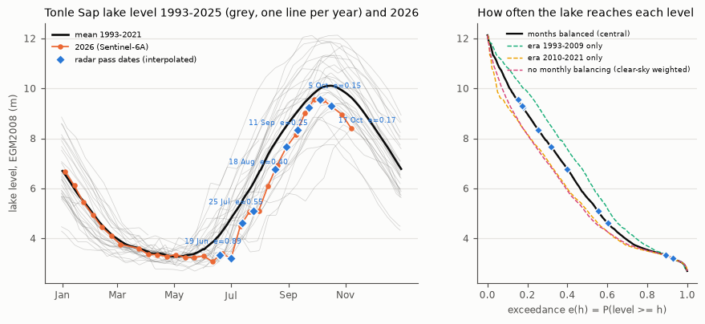
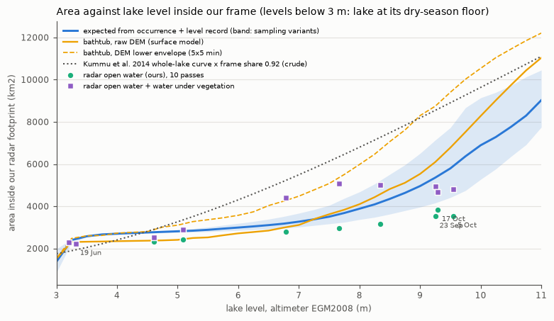
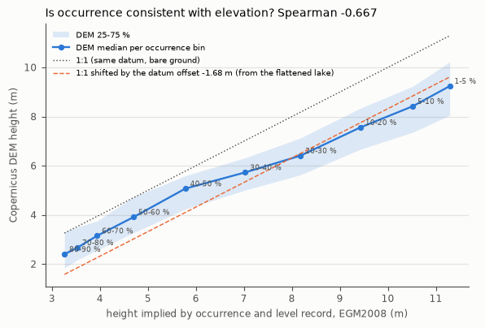
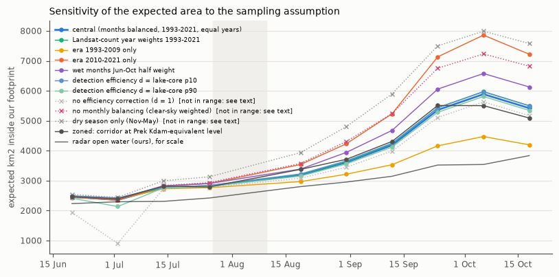
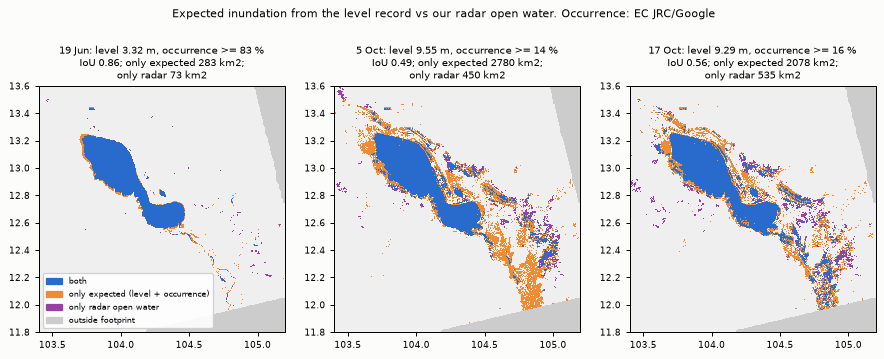
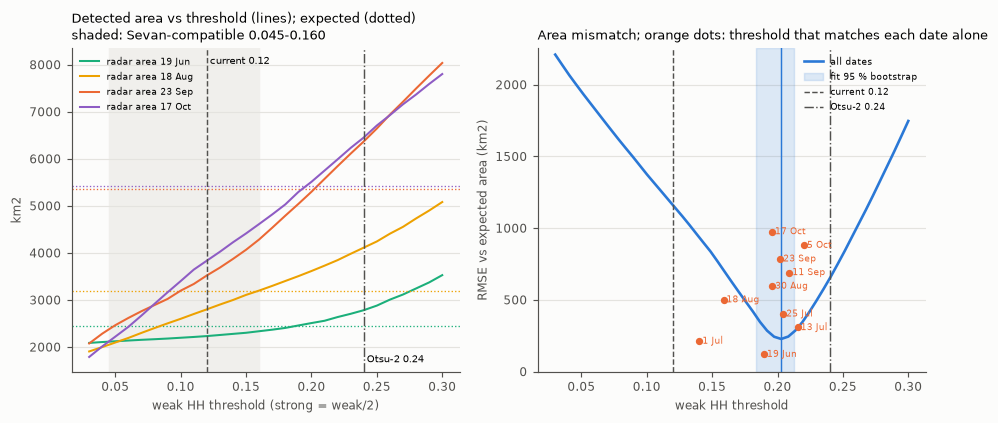
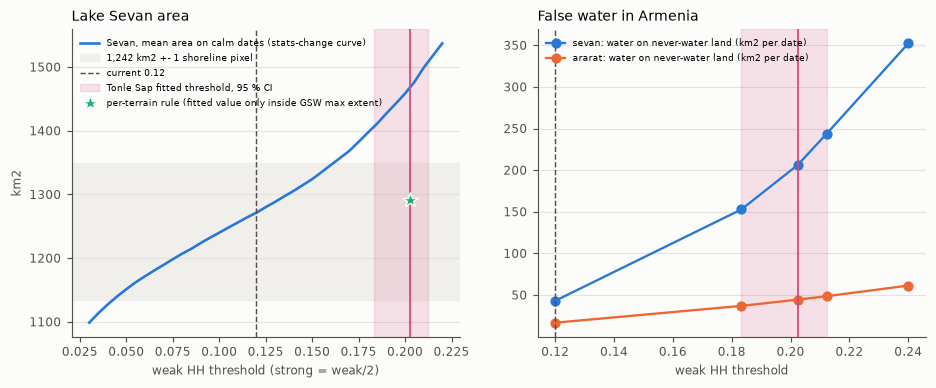

# How much of the Tonle Sap was under water? An independent estimate from lake level

Code: `scripts/detect/hydro.py` · tests: `tests/test_hydro.py` · numbers: [`hydro/results.json`](hydro/results.json) ·
products: `data/processed/tonle-sap/hydro/products.pt` · figures: `docs/eda/hydro/*.png`

    .venv/bin/python -m scripts.detect.hydro tonle-sap     # about 25 s on CPU, reads only cached inputs
    .venv/bin/python -m pytest tests/test_hydro.py          # 6 synthetic tests, about 2 s

Every number below comes from `results.json`. Areas are inside our common radar footprint (36,036 km²),
unless the text says otherwise.

## Bottom line

* **Our open-water area is a lower bound on every date.** An estimate built without any radar puts the
  Landsat-visible flooded area at 1.03–1.66 × our detector's figure, and the gap grows through the season.
  On **17 Oct** the estimate is **5,421 km² (plausible range 4,198–7,222)** against our **3,837 km²**: a
  shortfall of about 1,585 km², or × 1.41 (× 1.09 to × 1.88 across the range).
* **The independent estimate rises and falls with the lake. Ours keeps rising.** Between 5 and 17 Oct the
  lake fell 0.26 m and the expected area fell 466 km², while our open water grew. 73 % of the open water
  that "appeared" after 5 Oct was **already inside the expected flooded area on 5 Oct**. So the late growth
  is our detector catching up with water that was already there (vegetation drowning or dying back and
  turning radar-dark). It is not new flooding.
* **Fitted floodplain threshold.** With strong = weak/2, a weak HH threshold of **0.202 (95 % bootstrap
  0.183–0.212)** makes the detected area match the expected area. On held-out dates and held-out halves of
  the frame the area error falls by a factor of 1.3–5 compared with today's 0.12. The fitted threshold lies
  **above** the Sevan-compatible interval 0.045–0.160 and **below** the second-level Otsu 0.24.
* **One threshold cannot serve both places.** At 0.202 Lake Sevan comes out at 1,467 km² (it should be
  1,242 ± 107). False water on never-wet Armenian land rises from 43 to 206 km²/date around Sevan and from
  17 to 45 km²/date in the Ararat valley. A **per-terrain rule** works: use 0.202 only inside the 1984–2021
  maximum water extent and 0.12 elsewhere. That gives Tonle Sap 5,511 km² on 17 Oct, keeps Sevan at
  1,291 km², and adds no false water on never-wet land.
* **Headline (17 Oct, inside our frame):** open water **about 5,400 km² (4,200–7,200)**. Of this, 3,837 km²
  is measured directly by the radar at its strict threshold; the rest is inferred from the lake level and
  the Landsat record. Counting water under flooded forest, **total inundation was about 6,600–8,900 km²**.

## 1. The idea in plain words

Every pixel of the floodplain has a long-term **water occurrence** $o$: the share of 1984–2021 Landsat
observations in which it was water (JRC Global Surface Water). Low ground near the lake is wet most of the
time, so its $o$ is high; high ground is rarely wet. To first order, occurrence is just a stand-in for height.

The lake level record tells us how often the lake stands at or above any level $h$. If a pixel at height $z$
is wet whenever the lake is above $z$ (the "bathtub" assumption), then its occurrence is simply how often the
lake reaches $z$. On a 2026 date we know the level $h_t$ from satellite altimetry. The pixels that should be
flooded are those with $z \le h_t$, which is the same as $o \ge$ (how often the lake reaches $h_t$). This
gives an **expected flood map for each radar date that uses no radar data at all**.

### Formulas

* $H$: lake level (altimeter, EGM2008 m), sampled daily from the 1993–2021 record.
* Exceedance probability (equal weight for each calendar month $m$, years pooled within a month, exactly as
  JRC builds occurrence):

$$e(h) = \sum_{m=1}^{12} w_m \, P(H \ge h \mid \text{month } m), \qquad \sum_m w_m = 1 .$$

* Optical detection efficiency $d$: even the permanent lake is not labelled water in every clear Landsat
  scene. Turbid water, sun glint, cloud shadow and mixed pixels all cause misses. The 865 km² core of the
  permanent lake has a median occurrence of 92.9 %, so we take $d = 0.929$ (10th–90th percentile
  0.908–0.950). A pixel that is wet a fraction $e$ of the time then shows $o = 100\,d\,e$.
* Expected flooded set on date $t$ (on our ~180 m grid, using the 30 m occurrence pixels inside each cell):

$$\text{threshold } o_t = 100\, d\, e(h_t), \qquad f_t(\text{cell}) = \frac{\#\{30\,\text{m pixels with } o \ge o_t\}}{\#\{\text{valid 30 m pixels}\}},$$

$$A^{\text{exp}}_t = \sum_\text{cells} f_t \cdot a_\text{cell}, \qquad \text{map}_t = \{f_t \ge 0.5\}.$$

  Here $a_\text{cell}$ = 0.03266 km². Areas use the fractions; maps and IoU use the majority rule.
* With biased sampling (if wet months were under-observed, weights $w_m$ not equal), the same formula holds
  with those $w_m$ used in $e$. We test several weightings in §4.

*Left: lake level for every year 1993–2025 (grey), the 1993–2021 mean, and 2026 with the ten radar dates.
"e" is the exceedance of each pass level. Right: the exceedance curve $e(h)$ under the central assumption
and three alternatives.*

## 2. Data

| Data | Use | Source / attribution |
|---|---|---|
| JRC Global Surface Water v1.4, 1984–2021: occurrence (30 m), maximum extent | occurrence $o$, permanent lake, maximum extent | Pekel, Cottam, Gorelick, Belward (2016) *Nature* 540:418–422. **Source: EC JRC/Google.** Cached clips `data/external/gsw/tonle-sap_*.tif` |
| JRC GSW Data Users Guide v2 (2021) | how occurrence is computed: water detections and valid observations are pooled per calendar month over all years, and the 12 monthly values are averaged, "to normalise against seasonal variation in the number of valid observations" | `storage.googleapis.com/global-surface-water/downloads_ancillary/DataUsersGuidev2021.pdf` (accessed 14 Nov 2026) |
| G-REALM Tonle Sap target 000319, 10-day radar altimetry 1992–2026 (TOPEX/Poseidon, Jason-1, -2, -3, Sentinel-6A MF) | level record and 2026 levels | NASA GSFC Global Water Monitor / USDA FAS, Birkett et al. `earth.gsfc.nasa.gov/gwm/timeseries/lake000319.10d.2.txt`. 994 records merged into 924 (overlapping missions averaged within 3 days) |
| MRC daily water level, Prek Kdam (Tonle Sap River), 2026 plus 13 listed years (Jun–Oct only) | state of the river corridor | © Mekong River Commission, `ffw.mrcmekong.org` |
| Copernicus DEM GLO-90 on our grid (`terrain.pt`) | bathtub; elevation check | © DLR e.V. 2010–2014 and © Airbus Defence and Space GmbH 2014–2018, provided under COPERNICUS by the European Union and ESA |
| Published area–level curve | hypsometry check | Kummu et al. (2014) *Hydrological Processes* 28:1722–1733, as printed in Chua et al. (2022) *HESS* 26:609–625, Eq. 18: $A = -5.5701H^3 + 137.40H^2 + 470.29H + 1680.2$ (km², $H$ = Kampong Luong level, m) |
| Radar products: `math` (ours), `floodveg`, `gmm`, `graph`, `fusion`, `supervised`, `subpixel` | what we judge | this repo |

The altimetry and gauge files were already downloaded by `validate_2026.py`; their parsers are reused by
import. No new downloads were needed.

## 3. Does the method pass its own checks?

### (a) The frame and the published area–level curve

* **How much of the lake system is in our frame.** JRC's 1984–2021 maximum water extent covers 12,118 km² in
  our 1.8° box, and only 91 km² of that lies on the box edges. So the box holds essentially the whole lake
  system as Landsat saw it, consistent with the published 10,000–16,000 km² peak. **92.1 %** of that maximum
  extent (11,157 km²) lies inside our radar footprint.
* **Datum link.** Kummu's curve uses the Kampong Luong gauge. We link the altimeter to it by matching annual
  extremes: altimeter minus Kampong Luong is 2.47 and 2.95 m in 1996–2009 and 2.54 and 2.35 m in 2010–2019
  (minima and maxima respectively), mean **2.58 m**. The 0.6 m spread between these four numbers is itself a
  warning about this link.

| altimeter level (m) | expected (Landsat-visible), central [variant range] | bathtub raw DEM | bathtub DEM lower envelope | Kummu × 0.921 |
|---|---|---|---|---|
| 3.5 | 2,578 [2,541–2,611] | 2,320 | 2,600 | 2,050 |
| 5.0 | 2,814 [2,760–2,894] | 2,408 | 3,104 | 3,265 |
| 7.0 | 3,270 [3,020–3,671] | 3,113 | 4,478 | 5,493 |
| 8.0 | 3,884 [3,371–4,681] | 4,098 | 5,979 | 6,797 |
| 9.0 | 4,958 [3,962–6,506] | 5,533 | 8,298 | 8,188 |
| 9.5 | 5,795 [4,415–7,728] | 6,779 | 9,403 | 8,905 |
| 10.0 | 6,892 [5,275–9,139] | 8,279 | 10,537 | 9,633 |

**Verdict: partly passed.**

* At low water the occurrence method agrees with the published curve to within about 25 % (2,578 vs
  2,050 km² at 3.5 m).
* At high water it reaches only about 55–65 % of the published curve. Over 3.2–9.6 m its slope is 433 km²
  per m inside the frame, against 1,140 km² per m for Kummu × frame share. Over the whole box the ratio to
  Kummu runs from 0.58 to 1.19.
* The shortfall is what we expected. Landsat cannot see water under the flooded forest that rings the lake,
  so occurrence under forest is too low, and **the expected set measures "Landsat-visible" water (close to
  open water), not all inundation.**
* The bathtub on the DEM's lower envelope tracks the published curve at high water (9,403 vs 8,905 km² at
  9.5 m). We therefore use it, together with Kummu, as the estimate of **total** inundation.

Kummu × frame share is crude: it assumes the frame holds the same share of the flooded area at every level.

### (b) Is occurrence consistent with elevation?

The test area is the floodplain (8,942 km²): the domain without the permanent lake and without the DEM's
flattened lake surface, and with 1 % ≤ occurrence < 90 %.

* **Spearman between occurrence and DEM height: −0.667.**
* The median DEM height falls steadily from 9.24 m (occurrence 1–5 %) to 2.40 m (80–90 %), with no
  reversal.
* Against the height that the level record implies for each occurrence bin, the DEM medians follow
  DEM ≈ 0.817 × implied − 0.07 m. The DEM sits 0.9–2.1 m below the implied height. That gap matches the
  datum offset of −1.68 m found independently from the flattened lake (§5). The slope below 1 is what treetops on
  higher (less often flooded) ground and DEM smoothing would produce.

**Verdict: passed.** Ordering pixels by occurrence is ordering them by height.

### (c) Stability of the exceedance curve

* **Leaving out each 5-year block of 1993–2021** moves the occurrence threshold by at most 5.4 percentage
  points. The 17 Oct expected area then ranges from 4,953 to 5,887 km² (central 5,421).
* **The altimeter error** (±0.05 m) changes areas by at most ±134 km² (5 Oct).
* **Era is the largest single factor.** The lake ran about 1 m lower in 2010–2019 than before (Chua et al.
  2022). Using only 1993–2009 levels gives 4,198 km² on 17 Oct; using only 2010–2021 gives 7,222 km². JRC
  occurrence mixes both eras, and weights the recent one somewhat more because more Landsat satellites were
  flying then. Weighting years by the number of Landsat sensors gives 5,501 km².

### (d) Synthetic tests (`tests/test_hydro.py`)

On a synthetic bowl-shaped basin with a multi-year level series:

* occurrence "observed" daily reproduces the height order (rank correlation > 0.98), and equals
  $100\,e(z)$ to within 1 percentage point;
* the mapping recovers the true flooded set (> 99 % of pixels) at three levels;
* with dry-season-only observation, the naive mapping misses more than 30 % of the flooded pixels, and the
  sampling-weighted version recovers > 98 %;
* the bathtub keeps a pit behind a ridge dry;
* the calibration recovers a known threshold to within 0.003.

## 4. Sensitivity to the sampling assumption

| variant | 17 Oct expected km² | in the plausible range? |
|---|---|---|
| **central**: months balanced (JRC design), 1993–2021, equal years, $d$ = 0.929 | **5,421** | yes |
| Landsat-count year weights | 5,501 | yes |
| era 1993–2009 only | 4,198 | yes (low end) |
| era 2010–2021 only | 7,222 | yes (high end) |
| wet months Jun–Oct at half weight (some wet months unobserved) | 6,129 | yes |
| $d$ = 0.908 / 0.950 | 5,503 / 5,346 | yes |
| zoned: corridor at the Prek Kdam-equivalent level (§6) | 5,093 | yes |
| no efficiency correction ($d$ = 1) | 5,171 | no: puts the low-water lake below the permanent lake (908 km² on 1 Jul) |
| no monthly balancing, clear-sky weighting (assumed cloud climatology) | 6,823 | no: JRC does balance months |
| dry season only (Nov–May) | 7,580 | no: extreme bound |

* **Sampling bias barely matters here.** JRC averages monthly occurrences, so wet-season scarcity is
  largely corrected by design. Even if every wet month counted half, 17 Oct would rise by only 13 %.
* **What matters is the choice of era** (above) **and the detection efficiency at low water.** With $d$ = 1
  the method breaks on 1 Jul. That is why $d$ is part of the method rather than one of the variants.
* The clear-sky weights (Jan 0.70 … Jul–Sep 0.10 … Dec 0.65) are an assumed, illustrative climatology. They
  are not measured.

## 5. Idea 2: the bathtub (a cruder cross-check)

Flood every pixel whose DEM height is below the level and that connects to the permanent lake through such
pixels (8-connected flood fill from the largest occurrence ≥ 90 % component).

* **Datum.** The DEM (Copernicus, EGM2008) flattens the lake at **1.50 m**. The altimeter's
  "EGM2008" column reads a mean annual minimum of **3.18 m** in 2011–2015, the TanDEM-X years. We
  therefore add **−1.68 m** to the altimeter level. The DEM just outside the low-water lake (a 3–7 pixel
  ring) has a median of 3.66 m, which is treetop-biased (flooded forest) and not used.
* **Uncertainty.** We perturbed the level by ±0.5 m. We added four realisations of correlated DEM noise
  (sd 1.2 m, about 1 km correlation, roughly the GLO-90 relative accuracy). We also replaced the DEM by its
  5 × 5 minimum (a "lower envelope" that partly removes canopy height).

| date | raw DEM | lower envelope | range of all variants |
|---|---|---|---|
| 19 Jun | 2,309 | 2,485 | 1,521–2,629 |
| 18 Aug | 2,999 | 4,287 | 2,786–4,803 |
| 5 Oct | 6,938 | 9,496 | 5,615–10,622 |
| 17 Oct | 6,160 | 8,916 | 5,162–10,095 |

The bathtub is very sensitive. The floodplain is so flat that 0.5 m of level moves the 17 Oct area by
about 1,000–1,500 km², and the DEM is a surface model whose trees keep forest dry. The raw-DEM bathtub sits
close to the occurrence estimate. The lower envelope sits close to Kummu × share, which is the total-inundation
curve. Take it as a bracket, not a measurement.

## 6. River corridor vs lake basin

The south-east river plain (lon > 104.5°, lat < 12.5°; 4,440 km² of the domain) follows the Tonle Sap River
and the Mekong more than the lake. The water surface is not level between the two: the river is higher on
the rising limb and lower once it falls.

We estimate the corridor's state from the Prek Kdam gauge:

* We take the gauge's percentile on the same calendar day (±5 days) among its 13 listed years. For example,
  0.21 on 17 Oct: the river was low.
* We convert that percentile into the lake level that sits at the same percentile of the altimeter record on
  those days and years (8.45 m on 17 Oct, against the lake's own 9.29 m).
* That level drives the occurrence mapping in the corridor only.

In October Prek Kdam stood at the 21st–31st percentile while the lake stood at the 41st–56th. So the corridor
was drier than the lake level alone suggests: 740 instead of 1,068 km² on 17 Oct. In August–September it was the
other way round. The zoned total for 17 Oct is 5,093 km². It is included in the plausible range.

## 7. Judging the detectors

*Blue = both; orange = expected only; purple = radar open water only. The km² in the titles come from the
majority-rule maps.*

Area (km²), IoU with the expected map, and the share of the expected map that each detector finds:

| detector | 19 Jun | 18 Aug | 5 Oct | 17 Oct |
|---|---|---|---|---|
| **expected (central)** | **2,458** | **3,189** | **5,888** | **5,421** |
| ours, open water (0.06/0.12) | 2,234 · 0.86 · 0.88 | 2,803 · 0.72 · 0.79 | 3,541 · 0.49 · 0.53 | 3,837 · 0.56 · 0.61 |
| ours + water under vegetation | 2,235 · 0.86 · 0.88 | 4,393 · 0.55 · 0.85 | 4,823 · 0.50 · 0.61 | 4,673 · 0.53 · 0.65 |
| gmm | 2,289 · 0.85 · 0.89 | 2,717 · 0.76 · 0.81 | 3,311 · 0.49 · 0.52 | 3,326 · 0.52 · 0.55 |
| graph | 2,308 · 0.89 · 0.92 | 2,517 · 0.78 · 0.79 | 2,746 · 0.44 · 0.45 | 2,767 · 0.49 · 0.50 |
| fusion | 2,207 · 0.88 · 0.89 | 2,646 · 0.76 · 0.80 | 3,109 · 0.49 · 0.50 | 3,120 · 0.51 · 0.54 |
| supervised | 7,123 · 0.31 · 0.92 | 7,246 · 0.36 · 0.87 | 8,238 · 0.39 · 0.68 | 7,708 · 0.40 · 0.69 |
| subpixel (fraction ≥ 0.5) | 2,341 · 0.86 · 0.91 | 3,087 · 0.72 · 0.83 | 3,866 · 0.51 · 0.56 | 4,281 · 0.58 · 0.66 |
| ours at the fitted threshold 0.202 | 2,523 · 0.80 · 0.90 | 3,643 · 0.67 · 0.87 | 5,464 · 0.56 · 0.69 | 5,565 · 0.59 · 0.76 |

* **At low water every open-water detector agrees with the level-based map** (IoU 0.85–0.89). This is a
  check on both.
* **From late August on, all of the open-water detectors fall behind the expected area**, and the more
  conservative ones (graph, fusion) fall furthest. Most of what they miss is orange in the maps: the
  south-east plain and the ring of floodplain around the lake.
* "Supervised" covers most of the expected area but is two to three times too large at low water (7,123 km²
  on 19 Jun), so its IoU is about 0.3–0.4. It is not a usable floodplain map here.

**Is our open water a lower bound?** Yes. The ratio of expected to ours is 1.10 (19 Jun), 1.03 (1 Jul),
1.20, 1.17, 1.14, 1.22, 1.33, 1.52, **1.66 (5 Oct)** and 1.41 (17 Oct). Under the lowest plausible variant
every date except 1 Jul (0.93) stays above 1.

### Why does our open water keep growing after the lake peaked?

From 5 to 17 Oct:

* the lake fell 0.26 m, and the expected area fell by 466 km²;
* our open water gained 726 km² of new pixels and lost 430 km².

Of the 726 km² gained:

* **528 km² (73 %) were already inside the expected flooded area on 5 Oct**;
* 288 km² were flagged as water under vegetation on 5 Oct;
* their median long-term occurrence is 24 %, so they are mid-floodplain, not new land;
* 52 % lie in the south-east river corridor, where the gauge was falling.

**Most likely explanation:** the water was already there. Vegetation standing in it drowned, was cut or
died back, and the surface turned radar-dark. Our detector **caught up** with the flood rather than seeing
new flooding.

The two other candidates fit the evidence worse:

* *A lag between lake and plain:* the corridor was falling faster than the lake, so this does not fit.
* *A threshold artefact:* by itself it would not concentrate the new pixels inside the already-flooded area.

## 8. Calibrating the floodplain threshold

We recomputed our detector (same filtering and normalisation as `tune.py`, which is checked against
`ops.run_pipeline`; HV < 0.35; specks < 4 px removed) for weak thresholds 0.03–0.30 in two families:

* **ratio:** strong = weak/2, as in the stats-change uncertainty study;
* **fixed:** strong = 0.06.

For each family we found the threshold that minimises the squared area error against the expected area.

*Orange dots: the threshold that matches each date alone. Their height is only for legibility.*

| | ratio family (strong = weak/2) | fixed strong 0.06 |
|---|---|---|
| fit on all 10 dates | **0.202** | 0.218 |
| 95 % bootstrap (1,000 resamples of dates × 20 × 20 px blocks) | **0.183–0.212** (sd 0.0075) | 0.195–0.233 |
| per-date best match | 0.140 (1 Jul) – 0.220 (5 Oct) | – |
| fit to the low / high end of the expected range | 0.155 / 0.259 | – |

Held-out tests (ratio family; RMSE of the area on the test part, fitted vs today's 0.12):

| split | fitted | test RMSE fitted | test RMSE old 0.12 |
|---|---|---|---|
| fit even dates, test odd | 0.209 | 231 km² | 1,139 km² |
| fit odd dates, test even | 0.198 | 312 | 1,183 |
| fit first 5 dates, test last 5 | 0.175 | 681 | 1,606 |
| fit last 5, test first 5 | 0.206 | 265 | 340 |
| fit west half of the frame, test east | 0.205 | 194 | 668 |
| fit east half, test west | 0.196 | 147 | 468 |

* The fit transfers across dates and across the frame.
* Fitting on the low-water dates alone gives a looser match (0.175): at low water the area hardly depends on
  the threshold.

**What the fitted threshold implies (km²)**, with the bootstrap range: 19 Jun 2,522 · 18 Aug 3,644 ·
23 Sep 5,366 · 5 Oct 5,458 · **17 Oct 5,569 (5,119–5,806)**.

**The fit matches area, not location.** The mean IoU against the expected map is almost flat in the
threshold. It peaks at 0.15 with 0.698, against 0.692 at 0.12. On 17 Oct the fitted detector has IoU 0.59
(0.56 at 0.12), and only 73 % of its water lies inside the expected map. The extra water partly lands in
other places. Area totals become right; pixel-level maps improve only a little.

**Where 0.202 sits:**

* above today's 0.12;
* above the whole Sevan-compatible interval 0.045–0.160;
* below the second-level Otsu ≈ 0.24.

It is in line with the tuning study's "extended" setting (weak 0.253) and its upper range (3,800–5,900 km²
on 17 Oct).

### Check elsewhere: Lake Sevan and Armenian false water

| weak threshold | Sevan, calm-date mean km² (target 1,242 ± 107) | Sevan false water on never-wet land, km²/date | Ararat valley false water, km²/date |
|---|---|---|---|
| 0.12 (today) | 1,272 | 43 | 17 |
| 0.183 (fit CI low) | 1,407 | 153 | 37 |
| **0.202 (fit)** | **1,467** | **206** | **45** |
| 0.212 (fit CI high) | 1,508 | 244 | 49 |
| 0.24 (Otsu-2) | 1,630 | 352 | 61 |
| **per-terrain rule** | **1,291** | **43** | **17** |

* **No single threshold works for both the tropical floodplain and the mountain lake.** Every value in the
  fit's confidence interval pushes Sevan outside its tolerance and multiplies the false water around it.
  This repeats the tuning study's finding that transfer works only from Sevan to Tonle Sap.
* **Proposed rule (per terrain):** use the fitted weak threshold, with strong = weak/2, only inside the GSW
  1984–2021 maximum water extent, and keep 0.06/0.12 elsewhere. In code:
  `water = water(0.06, 0.12) OR (water(0.101, 0.202) AND ever_water_1984_2021)`.
* **What the rule gives:**
  * Tonle Sap: 2,490 km² on 19 Jun and 5,511 km² on 17 Oct.
  * Sevan: 1,291 km², inside its tolerance.
  * False water on never-wet land: unchanged. This holds by construction, because those pixels lie outside
    the maximum extent.
  * At Tonle Sap, only 8–153 km² per date of the fitted water falls outside the maximum extent anyway.
* **What the rule cannot do:** it cannot map flooding of land that was never wet in 1984–2021. A
  record-breaking flood would be under-mapped there.
* **Recommendation:** keep 0.06/0.12 for the product, and report the per-terrain rule's Tonle Sap areas as
  the calibrated alternative. The thresholds are in preview display units and will not carry over to
  calibrated γ⁰ data. The procedure will.

## 9. A defensible range for the headline (17 Oct 2026, inside our frame)

| quantity | value (km²) | measured or inferred |
|---|---|---|
| radar open water, strict threshold | 3,837 | **measured**; a lower bound |
| radar open water + water under vegetation | 4,673 | measured; under-vegetation layer has its own uncertainty |
| expected Landsat-visible flooded area, level + occurrence | **5,421 (4,198–7,222)** | **inferred** from altimetry + 1984–2021 record, no radar |
| radar open water at the fitted floodplain threshold | 5,569 (5,119–5,806) | measured with a threshold calibrated on the inferred area |
| union of radar open water, radar water under vegetation, expected set | 6,564 | measured + inferred: a lower bound for total inundation |
| Kummu et al. (2014) curve × frame share, datum offsets 2.35–2.95 m | 8,070–8,931 | published relation, crude transfer |
| bathtub, raw DEM / lower envelope (all variants) | 6,160 / 8,916 (5,162–10,095) | inferred from DEM + level |

Earlier statistical estimates were 3,455 km² (5–95 %: 1,967–4,769) from the threshold interval, and 3,800 to
5,900 km² from the tuning study. The independent estimate agrees with the tuning study's upper half and lies
above the statistical interval. That interval was centred on Sevan-compatible thresholds that are too strict
for the floodplain.

**Recommended headline sentence:**

> "On 17 October 2026 about 5,400 km² of open water lay within our radar frame over the Tonle Sap floodplain
> (plausible range 4,200–7,200 km²). The radar measures at least 3,800 km² directly; the rest is inferred
> from NASA/USDA satellite altimetry of the lake level and 38 years of Landsat water history. Including water
> hidden under flooded forest, about 6,600–8,900 km² was inundated."

## 10. Assumptions, and where they fail

| assumption | how it can fail | how much it matters here |
|---|---|---|
| occurrence orders pixels by height (bathtub) | rain-fed paddies fill independently of the lake; dykes, polders and reservoirs hold water above or below lake level | DEM check passes (Spearman −0.667); paddies would inflate the expected set in the dry season and in the corridor |
| one water level for the whole floodplain | backwater and river slope: the corridor differs from the lake | zoned variant: −328 km² on 17 Oct, +189 km² on 18 Aug |
| occurrence sees all water | **Landsat cannot see water under vegetation**; flooded forest is under-counted | the expected set is "Landsat-visible" water, not total inundation; it reaches only ~55–65 % of the published curve at high water |
| sampling balanced over months | wet-month scenes scarcer and drier-biased | small; JRC balances months by design (wet months at half weight: +13 %) |
| level climate stationary | lake ~1 m lower in 2010–2019; land-use change since 1984 | the largest factor: 4,198 vs 7,222 km² on 17 Oct (era-only variants) |
| detection efficiency the same everywhere | turbidity and mixed pixels differ between lake and floodplain | $d$ from 0.908 to 0.950 changes 17 Oct by −75 / +82 km²; without it the low-water dates break |
| altimeter is the lake | one ground track at 12.52° N; 10-day sampling; inter-mission biases | ±0.05 m → ≤ ±134 km² |
| 30 m occurrence → 180 m cells | cell membership by pixel centre | negligible for areas; maps use the majority rule |

## 11. Limits

* **No 2026 truth.** The expected set is a model output, not ground truth. It agrees with the radar at low
  water and with the DEM ordering. But it inherits Landsat's blindness under forest and the record's era mix.
* **The Kummu comparison is approximate.** The curve was transcribed from a citing paper (Chua et al. 2022),
  not checked against the original. The link from altimeter to Kampong Luong (2.58 m) is fitted from annual
  extremes and its four estimates spread over 0.6 m. The frame share 0.921 assumes the same share at every
  level.
* **Altimeter datum.** G-REALM's "EGM2008" heights sit about 1.7 m above the DEM's EGM2008 lake surface.
  We do not know which is closer to the truth. Only the bathtub uses the absolute value; the occurrence
  method uses only ranks of the level.
* **The bathtub is a bracket**, dominated by the DEM's treetops and metre-level noise on a floodplain with
  less than 1 m of relief per 10 km.
* **The calibration matches areas, not pixels** (IoU almost flat in the threshold). It is fitted to the
  central variant. Fitting to the low or high end of the range gives 0.155 or 0.259.
* **The threshold numbers are in preview display units** (uncalibrated brightness) and will not carry over
  to calibrated γ⁰.
* **The per-terrain rule needs an "ever-wet" map** and cannot see floods beyond the 1984–2021 maximum.
* **The corridor treatment is coarse.** It uses 13 gauge years (Jun–Oct only), a percentile mapping and a
  rectangular zone.
* **No second site.** A repeat at Poyang Lake or the Inner Niger Delta was not done in the time available.
  The method is generic (`exceedance`, `expected_extent` and `bathtub` take any level series, occurrence
  and DEM), but each site needs a G-REALM series id and its own checks.

## Files

* `scripts/detect/hydro.py` provides `daily_series`, `exceedance`, `level_for_exceedance`,
  `occ_hist_on_grid` / `OccHist`, `expected_extent`, `bathtub` and `calibrate_threshold`; `run(area)` is the
  CLI entry.
* `tests/test_hydro.py`: six synthetic tests.
* `data/processed/tonle-sap/hydro/products.pt` contains:
  * `expected`, `expected_lo`, `expected_hi`: [10, 1105, 1078] bool;
  * `expected_km2` (with `_lo` and `_hi`);
  * `bathtub` (raw DEM) and `bathtub_km2` (with `_lo` and `_hi`);
  * `level_m_egm2008`, `exceedance`, `occ_threshold_percent`;
  * `fitted_weak_threshold` (with `_ci`);
  * `domain`, `dates`, `bounds`, `km2_per_px`.
* `docs/eda/hydro/results.json` holds every number above. `docs/eda/hydro/fig1…fig8` are the figures.
