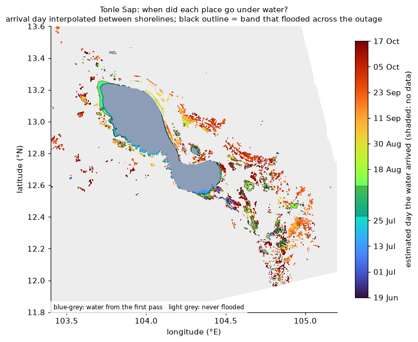
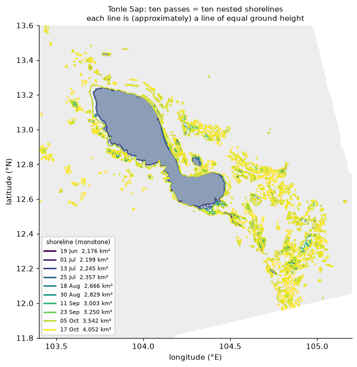
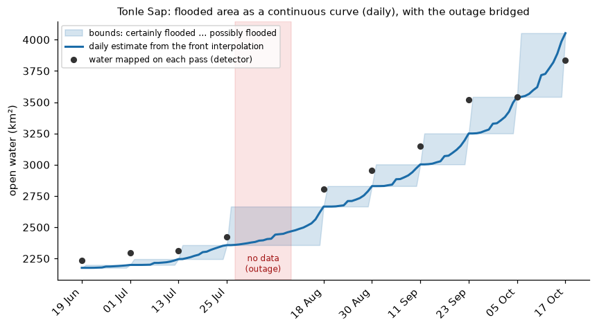
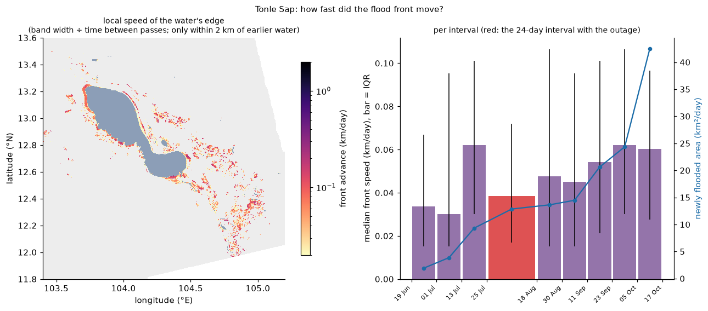
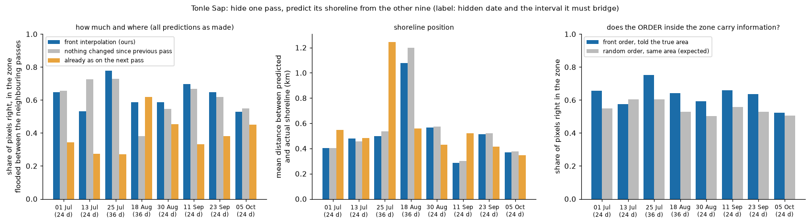
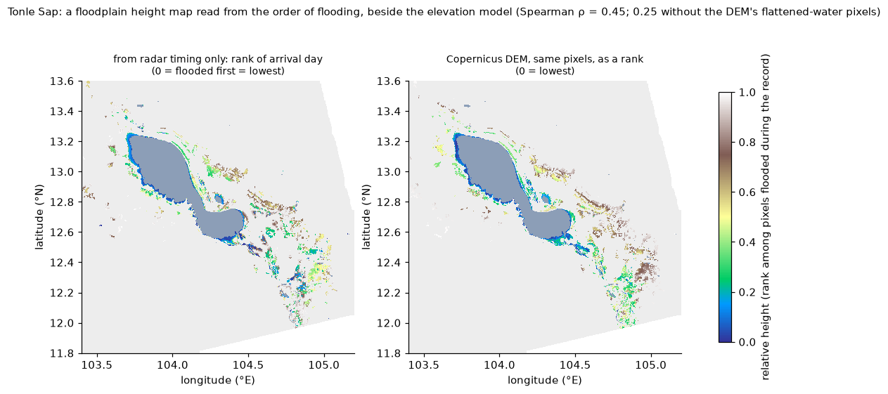
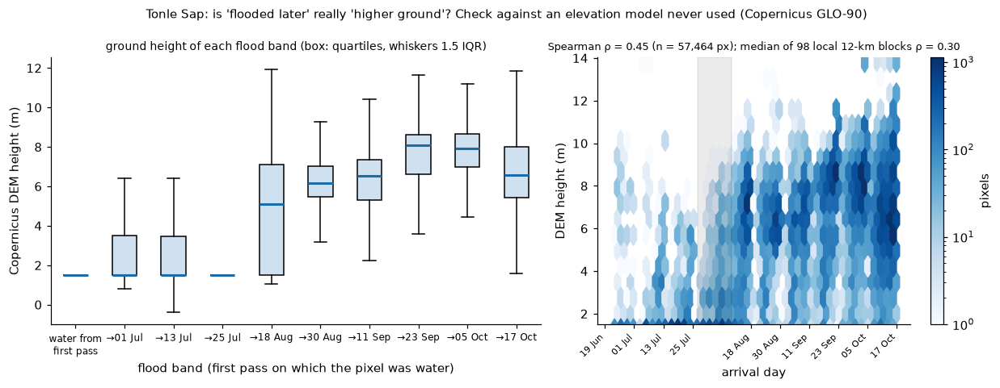
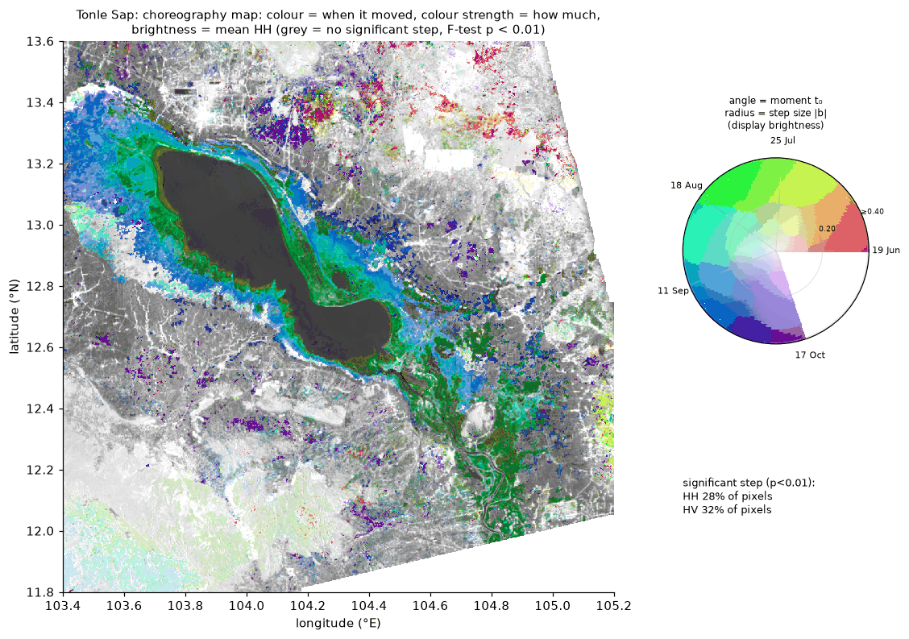
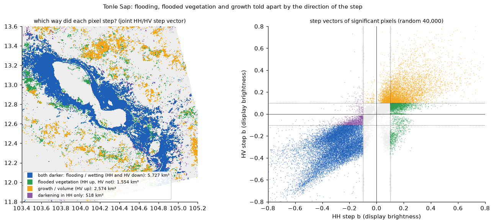
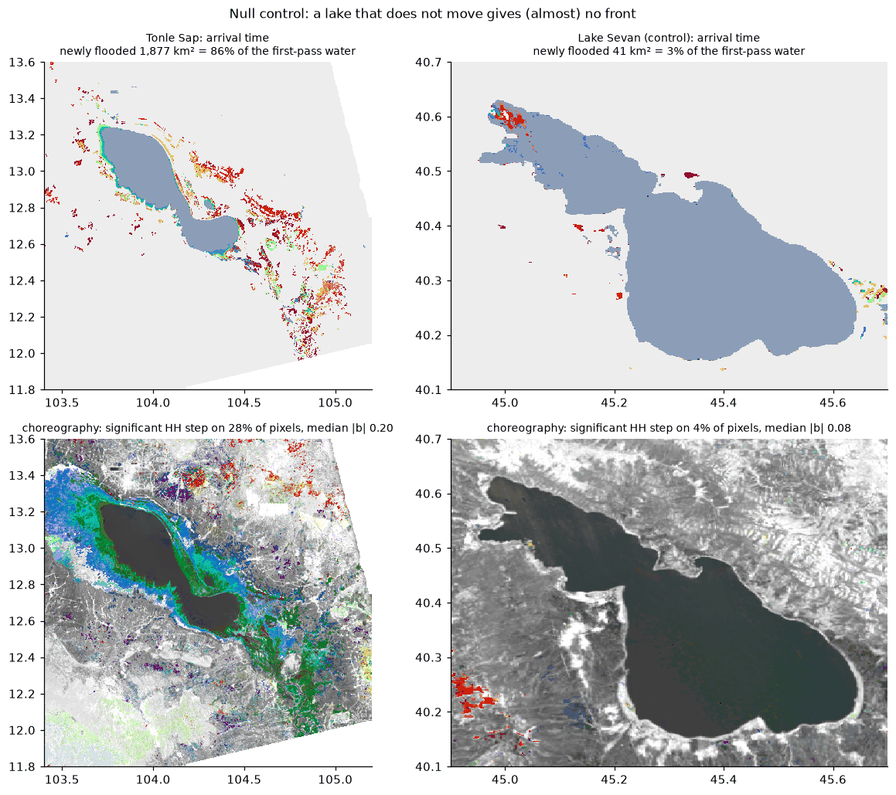

# The flood as a moving front, and the choreography of every pixel

Code: [`scripts/detect/novel.py`](../../scripts/detect/novel.py) · tests: [`tests/test_novel.py`](../../tests/test_novel.py) · figures and the raw numbers (`<area>_summary.json`): [`docs/eda/novel/`](novel/) · products: `data/processed/<area>/novel/products.pt`.

Reproduce (one area at a time; about 3–7 min for Tonle Sap on an M-series Mac):

```bash
.venv/bin/python -m scripts.detect.novel tonle-sap
.venv/bin/python -m scripts.detect.novel sevan        # null control
.venv/bin/python -m pytest -q tests/test_novel.py
```

Every number below is copied from `docs/eda/novel/tonle-sap_summary.json` or `sevan_summary.json`, which the script writes.

## The idea in three sentences

1. A rising flood draws a new shoreline on every radar pass, and the shoreline of standing water is roughly a line of equal ground height. Ten passes therefore give ten nested contour lines.
2. From these lines we estimate, for every pixel, the **day** the water arrived (not only the 12-day pass), including inside the 24-day instrument outage, and we test that estimate by hiding real passes.
3. The order in which places flooded is read as a **relative height map of the floodplain** made from radar timing alone, and we check it against an elevation model and a 38-year water record that the method never sees.

Idea B (section B) adds a per-pixel "dance" description: when each pixel's brightness moved, by how much, how abruptly and in which direction, painted as one colour image.

---

## Results at a glance (Tonle Sap, 19 June – 17 October 2026)

| What | Number |
|---|---|
| Land that first went under water during the record (open water, monotone) | **1,877 km²**, on top of 2,176 km² of water on the first pass |
| Floodplain band that flooded across the outage (between the 25 Jul and 18 Aug passes) | **309 km²**. Interpolated arrival: median **14 Aug**, 10–90 % range 1–17 Aug. Every pixel is only known to lie between 25 Jul and 18 Aug (±12 days). |
| Leave-one-date-out: share of pixels right in the zone that changed between the two neighbouring passes | front **0.63**, "nothing changed" 0.61, "already like the next pass" 0.39. Front best on 4 of 8 dates. |
| Leave-one-date-out: absolute area error of the hidden pass | front **82 km²**, "nothing changed" 161 km², "already like the next pass" 178 km² |
| Order of flooding vs Copernicus DEM (never used) | Spearman ρ = **0.45** (57,464 px). Only **0.25** after removing the pixels the DEM sets to a flat 1.5 m water level. Median in local 12-km blocks: 0.30. |
| Order of flooding vs JRC 1984–2021 water occurrence (never used) | ρ = **−0.47** (flooded earlier means more often water in the long-term record) |
| Lake Sevan null control | 41 km² "newly flooded" (3 % of the lake), 93 % of it within 2 km of the shore. HH step on 4 % of pixels (Tonle Sap: 28 %). |

The first three rows are estimates with honest error bars. The DEM row is a moderate, not strong, agreement (section A4).

---

## A. The flood as a moving front

Input: the per-pass open-water masks $W_t$ of the operational detector ([`ops.run_pipeline`](../../scripts/detect/ops.py), with the terrain mask `water_ok` from [`terrain.py`](../../scripts/detect/terrain.py)). That is $T = 10$ passes on days $t_1 < \dots < t_{10}$ (day of year). Only pixels imaged on all ten dates are used (36,036 km²).

### A1. A monotone "first date under water"

A rising flood only adds water. The masks do not quite behave that way: wind, speckle and threshold flicker make pixels blink. For each pixel with 0/1 series $w_1,\dots,w_T$ we fit the best non-decreasing series, i.e. a single step at index $k$ ($k = 1$: water from the first pass; $k = T+1$: never water). The step minimises the number of disagreeing dates:

$$k^\* = \arg\min_k \Big[\ \sum_{t<k} w_t \;+\; \sum_{t\ge k} (1-w_t)\ \Big].$$

For binary data this is exactly the least-squares isotonic regression (the pool-adjacent-violators solution, thresholded at ½). Ties go to the **later** step: a pixel counts as flooded only once the evidence for water from then on is at least as strong as the evidence against. The tie rule matters (see A4 and Limits). The staircase $S_k = \{k^\* \le k\}$ is nested by construction.

**Monotonicity is often violated.** 51,071 pixels (4.6 % of the area) disagree with their own best step on at least one date: 37,744 on one date, 10,796 on two, 2,531 on three or more. Among the pixels that flooded during the record, 44 % have at least one disagreeing date. The monotone areas run from 2,176 km² (19 Jun) to 4,052 km² (17 Oct). The detector's per-pass areas run from 2,234 to 3,837 km². The monotone staircase is higher in October because it keeps pixels flooded once they have flooded, while the 17 Oct mask lost some of them.

### A2. Continuous arrival day between two shorelines

A pixel with $k^\* = k$ flooded in $(t_{k-1}, t_k]$. Let $d_{\text{prev}}$ be its Euclidean distance to the earlier water $S_{k-1}$ and $d_{\text{next}}$ its distance to the land still dry at $t_k$ (outside $S_k$). We assume the front moved at a steady rate across the band:

$$\hat t = t_{k-1} + (t_k - t_{k-1})\,\frac{d_{\text{prev}}}{d_{\text{prev}} + d_{\text{next}}}, \qquad \hat t \in [t_{k-1},\,t_k].$$

This is shape-based interpolation (Raya & Udupa 1990) with time in place of the slice position. The interval $[t_{k-1}, t_k]$ is stored as `arrival_lo`/`arrival_hi` and is the honest uncertainty. Distances come from an exact Euclidean distance transform written in PyTorch: two cumulative-max scans along rows, then an exact minimum over rows, checked against SciPy to $10^{-3}$ px in the tests.

Derived products:

* **daily flooded area**: $A(t) = |S_1| + \#\{\hat t \le t\}$, bounded below by "certainly flooded" ($t_k \le t$) and above by "possibly flooded" ($t_{k-1} < t$);
* **front speed**: $v = (d_{\text{prev}} + d_{\text{next}} - 1)\,\Delta x / (t_k - t_{k-1})$ with $\Delta x = 0.181$ km, i.e. the width of the band through the pixel divided by the time. It is computed only where the new water lies within 2 km of the earlier water, so that a real front exists. 75 % of the newly flooded area does (Sevan: 93 %). The rest are isolated patches (rain-filled paddies, or false positives) that a front model cannot describe.







Newly flooded area and front speed per interval:

| Interval | Days | New water (km²) | km²/day | Front speed, median (IQR), km/day |
|---|---|---|---|---|
| 19 Jun → 1 Jul | 12 | 23 | 1.9 | 0.034 (0.015–0.067) |
| 1 Jul → 13 Jul | 12 | 46 | 3.9 | 0.030 (0.015–0.095) |
| 13 Jul → 25 Jul | 12 | 112 | 9.3 | 0.062 (0.030–0.101) |
| **25 Jul → 18 Aug (outage)** | **24** | **309** | **12.9** | **0.038 (0.017–0.072)** |
| 18 Aug → 30 Aug | 12 | 164 | 13.6 | 0.048 (0.015–0.106) |
| 30 Aug → 11 Sep | 12 | 174 | 14.5 | 0.045 (0.015–0.095) |
| 11 Sep → 23 Sep | 12 | 247 | 20.6 | 0.054 (0.021–0.101) |
| 23 Sep → 5 Oct | 12 | 292 | 24.4 | 0.062 (0.030–0.106) |
| 5 Oct → 17 Oct | 12 | 510 | 42.5 | 0.060 (0.028–0.097) |



**Reading.** The growth rate of the flooded area rises smoothly through the season, from 1.9 to 42.5 km²/day. The outage interval (12.9 km²/day) sits between its neighbours (9.3 and 13.6). There is **no sign of a sudden surge hidden in the outage**. The steepest daily growth is 96 km²/day, on 11 Oct. The typical edge speed is a few tens of metres per day (0.03–0.06 km/day medians), i.e. 0.4–0.7 km per 12-day step. That is 2–4 pixels, so speed differences between intervals are within the IQR and should not be over-read.

### A3. Seeing through the outage, and testing it by hiding real passes

The 309 km² that flooded between the 25 Jul and 18 Aug passes get interpolated arrival days with median 14 Aug (quartiles 6–16 Aug, 10–90 %: 1–17 Aug). 35 % of these days fall inside the outage itself (27 Jul–10 Aug). The honest statement is: **each of these pixels flooded between 25 Jul and 18 Aug; the front model places most of them in the second half of that window**.

Is that interpolation worth anything? We test it where the truth is known. We hide each interior pass $k$ in turn (8 passes), rebuild everything from the other nine, and predict the hidden pass's water. Two hidden passes, **25 Jul and 18 Aug, force the method to bridge 36 days**: an even longer gap than the real outage.

* **Truth.** The hidden pass's water in the full-record monotone staircase (the lasting water). With the raw detector mask the conclusions are the same; numbers are in `loo_raw`.
* **Baselines.** "Nothing changed since the previous pass" and "already as on the next pass", both built from the same nine passes.
* **Zone.** The pixels that are dry on the previous pass and wet on the next one, the only place the three predictions differ (60–650 km² per test).

| Hidden pass (gap bridged) | Zone km² | Truly wet in zone | Accuracy in zone: front / previous / next | Shoreline distance km: front / prev / next | Area error km²: front / prev / next |
|---|---|---|---|---|---|
| 1 Jul (24 d) | 60 | 0.34 | **0.65** / 0.66 / 0.34 | 0.40 / 0.40 / 0.55 | +2 / −19 / +42 |
| 13 Jul (24 d) | 150 | 0.27 | 0.53 / **0.73** / 0.27 | 0.48 / 0.46 / 0.48 | +18 / −46 / +104 |
| 25 Jul (36 d) | 402 | 0.27 | **0.78** / 0.73 / 0.27 | 0.50 / 0.53 / 1.25 | −37 / −102 / +300 |
| 18 Aug (36 d) | 423 | 0.62 | 0.59 / 0.38 / **0.62** | 1.08 / 1.20 / 0.56 | −193 / −311 / +112 |
| 30 Aug (24 d) | 281 | 0.45 | **0.59** / 0.55 / 0.45 | 0.56 / 0.58 / 0.43 | −121 / −180 / +102 |
| 11 Sep (24 d) | 358 | 0.33 | **0.70** / 0.67 / 0.33 | 0.29 / 0.30 / 0.52 | −115 / −189 / +169 |
| 23 Sep (24 d) | 386 | 0.38 | **0.65** / 0.62 / 0.38 | 0.51 / 0.52 / 0.42 | −128 / −215 / +171 |
| 5 Oct (24 d) | 650 | 0.45 | 0.53 / **0.55** / 0.45 | 0.37 / 0.38 / 0.35 | −44 / −223 / +426 |
| **mean** | | 0.39 | **0.63** / 0.61 / 0.39 | **0.52** / 0.55 / 0.57 | \|82\| / \|161\| / \|178\| |

A second test asks whether the **order** inside the zone (closer to the old shore = earlier) carries information, separately from how much water there is. We tell the front method the true area of the hidden pass and fill the zone in its predicted order. It gets 0.63 right on average, against 0.55 expected from a random order with the same area. The front order beats random on 7 of 8 dates.



**What this shows, honestly.**

* The front interpolation is the **best of the three at the amount of water**: mean absolute area error 82 km², against 161 and 178 km². It is never the worst on any date.
* **Where** the water arrives is only modestly predictable. The ordering skill is 0.63 against 0.55 for random, and on accuracy alone the front beats "nothing changed" on just 4 of 8 dates.
* The front is biased **early**. On average only 39 % of the zone was really wet at the hidden date, against the 50 % that a steady front implies. The flood accelerates through the season (table above), so within an interval more water arrives in the second half.
* For the outage band this means the **real arrival days are probably later than the interpolated ones**. This is one more reason to quote the 25 Jul – 18 Aug interval, not the interpolated day, as the result.

### A4. A floodplain height map from the order of flooding, checked against data we never used

If the water surface were level, every shoreline would be a contour, and **earlier flooded = lower ground**. The relative height map is the rank of the arrival day among all pixels that flooded during the record:

$$h_{\text{rel}}(x) = \frac{\operatorname{rank}\,\hat t(x) - 1}{N - 1} \in [0, 1].$$

With gauge water levels $z(t_k)$ on the pass dates (for example the Kampong Luong gauge on the lake), the same arrival field becomes metres: $h(x) = z(\hat t(x))$, by linear interpolation in time. `height_from_order(arrival_day, mask, levels_m=..., dates=...)` already accepts these levels. **This is the obvious next step; we did not have the 2026 gauge data.**

**Validation.** Two independent references were never used to build anything here:

1. **The Copernicus DEM GLO-90** (from the shared `terrain.pt` cache; © DLR e.V. 2010–2014 and © Airbus Defence and Space GmbH 2014–2018, provided under COPERNICUS by the European Union and ESA), averaged onto our grid. Over the 57,464 pixels that flooded during the record, **Spearman ρ(arrival, DEM) = 0.45**, and ρ(pass index, DEM) = 0.41. The DEM sets water bodies to a constant 1.5 m, and much of the early-flooded fringe lies inside that flattened area. **Without those pixels, ρ falls to 0.25** (50,235 px). This is the number to quote as the conservative one. Within local 12-km blocks (to remove the large-scale tilt of the plain) the median ρ is 0.30, positive in 73 % of 98 blocks.
2. **The JRC Global Surface Water occurrence 1984–2021** (Pekel et al. 2016): ρ(arrival, occurrence) = **−0.47**. Places that flooded earlier in 2026 are the places that were water more often over 38 years.

DEM median per flood band (m):

| water on 1st pass | →1 Jul | →13 Jul | →25 Jul | →18 Aug | →30 Aug | →11 Sep | →23 Sep | →5 Oct | →17 Oct |
|---|---|---|---|---|---|---|---|---|---|
| 1.5 | 1.5 | 1.5 | 1.5 | 5.1 | 6.2 | 6.5 | 8.1 | 7.9 | 6.6 |

The band medians rise in 5 of 8 steps. Ground that never flooded but lies within 1.8 km of flooded ground has a median of 8.0 m, against 6.5 m for ground that flooded during the record. The two last bands break the pattern. 5–17 Oct adds 510 km², much of it isolated patches far from the lake (paddies filled by rain, or detector noise) that a "rising lake" model does not describe.





**Sensitivity to the tie rule (A1).** We reran with ties sent to the *earliest* step (`--ties early`, written to `tonle-sap_ties-early_summary.json`).

| | late ties (default) | early ties |
|---|---|---|
| newly flooded during the record | 1,877 km² | 2,128 km² |
| monotone water on 17 Oct (detector: 3,837 km²) | 4,052 km² | 4,314 km² |
| ρ(arrival, DEM) | 0.45 | 0.52 |
| ρ(arrival, DEM) without the flattened water | 0.25 | 0.38 |
| ρ(arrival, JRC occurrence) | −0.47 | −0.52 |
| band medians rising | 5 of 8 steps | 6 of 8 |
| leave-one-out accuracy in zone, front / "nothing changed" | 0.63 / 0.61 | 0.63 / 0.64 |
| leave-one-out absolute area error, front / "nothing changed" | 82 / 161 km² | 76 / 174 km² |
| outage band | 309 km², median 14 Aug | 338 km², median 14 Aug |

To be transparent about the order of events: the early-tie version was run first. We then switched the default to "late" because its October areas lie closer to the detector's per-pass areas. The switch *lowers* the DEM agreement, so we did not pick the rule that flatters the result. The agreement with the DEM is real but moderate, and it moves by about 0.1 in ρ with a modelling choice of this kind.

**Why the agreement is only moderate (and why that was expected).**

* **Range.** The whole flood occupies a few metres of DEM height (band medians 5–8 m), which is close to the DEM's vertical noise over flat vegetated land.
* **Surface model.** GLO-90 is a surface model (radar, X-band, 2011–2015). Over flooded forest and shrubland it measures canopy tops, not the ground.
* **The water surface is not level.** The Tonle Sap river and the lake slope, and backwater effects add more.
* **Open water only.** Our shorelines see open water. Flooded forest (bright in L-band) is missed, so the true waterline lies further out.
* **Pixel size.** 180 m pixels; a one-pixel error in a shoreline is a 12-day error in arrival for slow fronts.
* **Not all new water comes from the lake.** Rain-fed paddies and local ponds fill from above, not from the lake front.

---

## B. Choreography: amplitude, moment, tempo and direction of every pixel

For each pixel and each channel $c \in \{\text{HH}, \text{HV}\}$ we fit to the filtered series $L_c(t)$ (display brightness 0–1, *not* dB: the previews are uncalibrated):

$$L_c(t) = a + \frac{b}{1 + e^{-(t - t_0)/\tau}} .$$

The parameters are read as follows:

* **moment** $t_0$: the day of the steepest change;
* **tempo** $\tau$: in days, abrupt (small) or gradual (large);
* **size and direction** $b$: negative = went dark (water), positive = went bright (double bounce or growth);
* **amplitude**: the robust range $q_{90} - q_{10}$ of the series.

**Fitting.** We use variable projection. For any $(t_0, \tau)$ the best $(a, b)$ is a closed-form weighted least-squares solution. We search $t_0$ on a 2-day grid with $\tau \in \{1.5, 3, 6, 12, 24\}$ days for all 2.4 million pixel-channels at once. Adam (150 steps) then refines $t_0$ and $\log\tau$, and the refinement is kept only if it lowers the residual. Unequal steps and the outage need no special treatment because the model is continuous in $t$.

**Significance.** The step model (4 parameters) is compared with a constant (1 parameter) by an F-test, $F = \frac{(\text{RSS}_0 - \text{RSS}_1)/3}{\text{RSS}_1/(n-4)}$, at $p < 0.01$ ($F_{3,6} > 9.78$).

**A profile interval for $t_0$.** It contains all $t_0$ whose best residual is within the 1-σ F-threshold of the minimum. It shows where the data cannot locate the step.

**Results (Tonle Sap).**

* A significant step is found in HH on 28 % and in HV on 32 % of pixels. BIC prefers the step on 67 % (HH) and 71 % (HV).
* The median significant step is |b| = 0.20 (HH) and 0.20 (HV), against date-to-date drift of about 0.04.
* The fitted HH moment agrees with the detector's CUSUM change date (ρ = 0.95) and less well with the front arrival day: ρ = 0.55, median difference 19 days. The brightness often starts to fall (wet soil, flooded vegetation) before the pixel passes the open-water threshold.

**The outage.** 2,611 km² have an HH step with $t_0$ between 25 Jul and 18 Aug, but the median width of their $t_0$ profile interval is **16 days**. **The continuous model does place these changes "inside the outage", but the data cannot say where inside it.** Any $t_0$ in the window fits about equally well. The tests show the same on synthetic data. A sharper estimate needs the front argument (A3), which uses the neighbours in space, not just the pixel's own time series.

**Composite.** In the choreography image:

* **hue** = $t_0$, for the channel with the larger step;
* **saturation** = $|b|$, saturating at 0.40;
* **value** = mean HH;
* pixels whose step is not significant are grey.

The ring structure of the flood is the main picture: green (August) on the inner plain, blue (September) on the outer ring.



**Step vectors.** The joint (HH, HV) step tells processes apart (threshold |b| = 0.10):

| Class | Rule | km² |
|---|---|---|
| both darker: flooding / wetting | $b_{HH} < -0.1,\ b_{HV} < -0.1$ | 5,727 |
| flooded vegetation (double bounce) | $b_{HH} > 0.1,\ b_{HV} \le 0.1$ | 1,554 |
| growth / volume | $b_{HV} > 0.1$ | 2,574 |
| darkening in HH only | $b_{HH} < -0.1,\ b_{HV} \ge -0.1$ | 518 |

"Both darker" (5,727 km²) is much larger than the 1,877 km² of new open water. It includes wetting soil, paddies and partly flooded vegetation that darken without crossing the water threshold. These classes are interpretations of the sign pattern, not validated land-cover classes.



---

## Null control: Lake Sevan

A deep mountain lake with a stable level should give no front and no choreography.

* **Front.** 41 km² "newly flooded" during the record, 3 % of the 1,220 km² of first-pass water. 93 % of it lies within 2 km of the shore (wind and shoreline flicker; the late-season false positives noted in the validation report are mostly removed by the terrain mask). The largest daily growth is 2.4 km²/day, against 96 at Tonle Sap.
* **Leave-one-date-out.** No method has anything to predict: the front is 0.52 accurate in the zone, the baselines 0.46 and 0.54.
* **Choreography.** A significant HH step on 3.6 % of pixels, with median |b| = 0.08 (Tonle Sap: 28 % and 0.20). The red patch in the south-west is a real change on land, outside the lake.
* **Failure in HV.** HV gives a significant step on 26 % of pixels. That is the known anomalous 6 October HV pass in Armenia (DETECTION.md 6.7), which the step model mistakes for a late step. **HV choreography in Armenia is not trustworthy.**



---

## Prior art: what already exists

We searched the literature on the web before writing any claim. We read abstracts and summaries, not every full text, and some items we could not find (they are marked as such). **Absence from our search is not proof that something is new.**

| Topic | What exists (nearest work) | What it means for us |
|---|---|---|
| Shorelines as height contours (the "waterline method") | Mason and co-workers built intertidal DEMs from ERS SAR waterlines at known tide heights (Mason & Davenport 1996; Mason, Scott & Dance 2010, Morecambe Bay 1991–2007, [centaur.reading.ac.uk/4726](https://centaur.reading.ac.uk/4726/)). Bishop-Taylor, Sagar, Lymburner & Beaman 2019 did it for all of Australia from 30 years of Landsat plus a tide model (NIDEM, *Estuarine, Coastal and Shelf Science* 223:115–128, [doi:10.1016/j.ecss.2019.03.006](https://doi.org/10.1016/j.ecss.2019.03.006)). | **Our key idea, that a shoreline is a height contour, is about 30 years old.** The waterline method uses known water levels (tides). We have no levels, only the order of the shorelines. |
| Flood edge + DEM → water depth or a corrected DEM | FwDET: Cohen et al. 2018, *JAWRA* 54(4):847–858, [doi:10.1111/1752-1688.12609](https://doi.org/10.1111/1752-1688.12609). Mason et al. 2016 used SAR flood edges as near-contours to correct a TanDEM-X DEM ([eprints.whiterose.ac.uk/101154](https://eprints.whiterose.ac.uk/id/eprint/101154/)). Shastry & Durand 2019 assimilated a **sequence** of flood maps to improve floodplain topography (*Front. Earth Sci.*, [doi:10.3389/feart.2018.00243](https://doi.org/10.3389/feart.2018.00243)). A 2020 *GRL* follow-up applied it to the real Logone floodplain ([doi:10.1029/2020GL088759](https://doi.org/10.1029/2020GL088759)). | **Shastry & Durand is the closest work to our height-from-order idea.** They use a DEM prior and a hydraulic model. We use neither: our map is a rank, not metres. |
| Topography or bathymetry from inundation frequency or occurrence | Gap-filling of Landsat water maps by inundation frequency ([HESS preprint hess-2020-198](https://hess.copernicus.org/preprints/hess-2020-198/hess-2020-198.pdf)). Tonle Sap flood-pulse studies use a bathymetry model (Chen et al. 2021, *Hydrological Processes*; we did not check how that model was built). We did not find a Tonle Sap bathymetry built directly from JRC occurrence. | Using **frequency** as a height proxy is known. Using the **timing within one season** is the variant we use. |
| Inundation timing and duration from SAR | Arnesen et al. 2013, ALOS/PALSAR ScanSAR over the Amazon floodplain, flood extent against gauge level (*RSE* 130:51–61, [doi:10.1016/j.rse.2012.10.035](https://doi.org/10.1016/j.rse.2012.10.035)). Sentinel-1 Mekong Delta flood mapping (Tran et al. 2022, *Remote Sensing* 14:5721). Cambodian floodplain flood-duration trends from a water-level model (HAL hal-03694112). EGU 2026 abstracts on Sentinel-1 at Tonle Sap. | Mapping **which pass** first saw water is routine. We found no paper that maps a sub-interval arrival **day** between SAR shorelines, but we did not search exhaustively. |
| Interpolating between two outlines by distance | Shape-based interpolation: Raya & Udupa 1990, *IEEE TMI* 9(1):32–42, [doi:10.1109/42.52980](https://doi.org/10.1109/42.52980) (signed distance maps of binary slices, interpolated). Herman et al. 1992: not checked. Eikonal and level-set contour interpolation: not searched. | **Our formula $t = t_k + \Delta t\, d_k/(d_k+d_{k+1})$ is shape-based interpolation with time in place of the slice position.** It is not new. |
| Filling gaps in flood time series | Bangira et al. 2021 (Sentinel-1 flood series used to fill gaps in Landsat-8). DLR study on how revisit gaps inflate flood-duration uncertainty ([elib.dlr.de/134179](https://elib.dlr.de/134179/1/remotesensing-12-00643.pdf)). | Gap-filling is known. We found no paper that interpolates the shoreline of a missing SAR acquisition and scores it by leave-one-date-out, but our search was limited. |
| Logistic fits to satellite time series | TIMESAT (Jönsson & Eklundh 2004, *Computers & Geosciences* 30:833–845) fits double-logistic curves for phenology. Sentinel-1 rice-calendar work in the Mekong (Phung et al. 2020, *J. Appl. Remote Sens.* 14:014518; we did not check whether it fits a logistic). | **Idea B's per-pixel logistic step is a standard model.** Fitting it on the GPU to NISAR HH/HV is engineering, not science. |
| Colour = time composites | REACTIV (Colin Koeniguer & Nicolas): HSV with hue = date of maximum, saturation = coefficient of variation, value = amplitude; extended in [arXiv:2307.07892](https://arxiv.org/pdf/2307.07892). Hansen et al. 2013 "year of forest loss" maps (*Science* 342:850–853). Omnibus change-date maps ([nd.readthedocs.io](https://nd.readthedocs.io/en/dev/change/omnibus.html)). | **Our choreography map is a REACTIV-style composite.** The difference is that the hue comes from a fitted step time, with a significance test, instead of the date of the maximum. |
| NISAR floods | We found no peer-reviewed NISAR flood paper. NASA OPERA plans DSWx-NI, a 12-day L-band surface-water product ([OPERA workshop slides](https://d2pn8kiwq2w21t.cloudfront.net/documents/5th_OPERA_workshop_DSWx-NI_update.pdf)). There is ARSET 2026 training material and an EGU26 abstract by Hübinger et al. on L-band inundation. | First-season NISAR analyses are only now appearing. |

### What we claim and what we do not

> **(i) An application of known methods to new data.** We run per-pixel first-inundation dating, shape-based interpolation, logistic step fits and an HSV timing composite on the first NISAR L-band season (2026) over Tonle Sap. As far as we found, no published work does this yet, which is unsurprising for a satellite launched in July 2025.
>
> **(ii) A new combination, to our knowledge.** Our chain is: an exact isotonic (monotone) first-flood date, then distance interpolation of a **day** of arrival between consecutive SAR shorelines, then an honest interval and a leave-one-date-out skill test against naive baselines. That test is what lets us put a number on a flood onset hidden by an instrument outage.
>
> **(iii) Possibly new, but we cannot rule out prior work.** We read the **order** of flooding within one season, with no water levels, no DEM and no hydraulic model, as a relative floodplain height map. We validate it against a DEM and a 38-year water record that it never sees. It is the waterline method with "time" standing in for "tide height", and Shastry & Durand (2019) is the nearest relative. We say "to our knowledge", never "first".
>
> **(iv) Definitely not new.** Shorelines as height contours (waterline method, 1990s). Distance-based interpolation between outlines (Raya & Udupa 1990). Logistic curve fitting of satellite series (TIMESAT and many others). Hue-equals-time colour composites (REACTIV, Hansen loss-year).

**Suggested pitch wording (honest):**
*"Ten NISAR passes give ten shorelines. Building on the classic waterline method, we read the order in which the Tonle Sap floodplain went under water as a height map made from radar timing alone. It agrees with the Copernicus elevation model (rank correlation ρ = RHO) and with 38 years of Landsat water history (ρ = −0.47), neither of which it ever sees. The same front lets us date the flood day by day, including inside the 24-day outage, and we show by hiding real passes how much that estimate can be trusted."*

Avoid: "we invented a new method", "first ever", "we measured the floodplain height in metres", "we know when the flood started inside the outage".

---

## Limits (all of them we know of)

1. **Inputs.** Uncalibrated preview brightness at 180 m; thresholds tuned on the same data; no 2026 ground truth. Every error of the water detector (wind, missed flooded forest, dark dry land) propagates into the front.
2. **Monotonicity is violated often.** 44 % of the pixels that flooded during the record blink at least once. The isotonic fit hides this, and the tie rule changes the DEM agreement (A4).
3. **The front model assumes a steady front.** The hidden-pass test shows it is biased early (39 % vs 50 %) and only modestly better than random at ordering pixels. The day-level arrival is a model estimate; the bracketing interval is the measurement.
4. **The outage cannot be filled with data.** The arrival days inside it come from geometry, not from observations, and the per-pixel logistic fit cannot locate a step inside it (profile width 16 days).
5. **The height map is relative, and it is only as good as a "level water surface" assumption.** Agreement with the DEM is moderate: ρ = 0.45, or 0.25 without the DEM's flattened water. The DEM itself is a 2011–2015 surface model with metre-level noise over a flood range of a few metres.
6. **Not all new water comes from a front.** About 25 % of newly flooded area lies more than 2 km from earlier water.
7. **One season, one floodplain.** There is no repeat year to test stability. Sevan is a control for "no change", not for "a different flood".
8. **Prior-art search.** It covered abstracts found on the web, not a systematic review.

## What a multi-year NISAR series would make possible

NISAR sees every seasonally flooded wetland on Earth every 12 days, through cloud and at night, in L-band, which also sees under forest canopy. Over several seasons, the same chain would do three things:

* **Average away noise.** Each year's flood order gives a new noisy ranking of the same ground.
* **Turn order into metres.** Wherever a gauge or a SWOT water-surface elevation exists for the pass dates, `height_from_order` with `levels_m` converts the order of flooding into heights.
* **Map change in the floodplain itself** (sediment, dikes, new paddies) as a change in its flooding order from year to year.

That is a **floodplain height map of every seasonally flooded wetland, refreshed every 12 days**, built from timing alone, where no lidar exists. Our one-season result says this is plausible but not yet accurate. The validation numbers above are the baseline that such a product would have to beat.

## References (found in our search; links as found)

* Mason, D.C., Davenport, I.J. (1996). Shoreline extraction from ERS-1 SAR for intertidal DEMs (venue not verified).
* Mason, D.C., Scott, T.R., Dance, S.L. (2010). Remote sensing of intertidal morphological change in Morecambe Bay, U.K., between 1991 and 2007. https://centaur.reading.ac.uk/4726/
* Bishop-Taylor, R., Sagar, S., Lymburner, L., Beaman, R.J. (2019). Between the tides: modelling the elevation of Australia's exposed intertidal zone at continental scale. *Estuarine, Coastal and Shelf Science* 223:115–128. doi:10.1016/j.ecss.2019.03.006
* Cohen, S. et al. (2018). Estimating floodwater depths from flood inundation maps and topography. *JAWRA* 54(4):847–858. doi:10.1111/1752-1688.12609
* Mason, D.C. et al. (2016). Improving urban/floodplain DEMs using SAR waterlines (TanDEM-X). https://eprints.whiterose.ac.uk/id/eprint/101154/
* Shastry, A., Durand, M. (2019). Utilizing flood inundation observations to obtain floodplain topography in data-scarce regions. *Front. Earth Sci.* doi:10.3389/feart.2018.00243. Follow-up: *GRL* (2020) doi:10.1029/2020GL088759
* Arnesen, A.S. et al. (2013). Monitoring flood extent in the lower Amazon River floodplain using ALOS/PALSAR ScanSAR images. *RSE* 130:51–61. doi:10.1016/j.rse.2012.10.035
* Raya, S.P., Udupa, J.K. (1990). Shape-based interpolation of multidimensional objects. *IEEE TMI* 9(1):32–42. doi:10.1109/42.52980
* Jönsson, P., Eklundh, L. (2004). TIMESAT, a program for analyzing time-series of satellite sensor data. *Computers & Geosciences* 30(8):833–845.
* Colin Koeniguer, E., Nicolas, J.-M. REACTIV change-visualisation (HSV) and its GLR extension: arXiv:2307.07892.
* Hansen, M.C. et al. (2013). High-resolution global maps of 21st-century forest cover change. *Science* 342:850–853. doi:10.1126/science.1244693
* Pekel, J.-F., Cottam, A., Gorelick, N., Belward, A.S. (2016). High-resolution mapping of global surface water and its long-term changes. *Nature* 540:418–422.
* NASA OPERA DSWx-NI update (2026): https://d2pn8kiwq2w21t.cloudfront.net/documents/5th_OPERA_workshop_DSWx-NI_update.pdf
