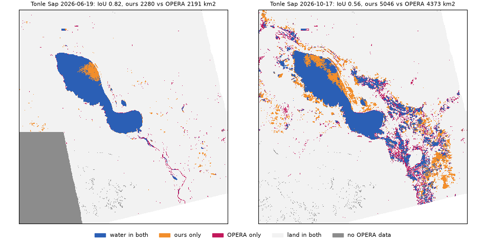
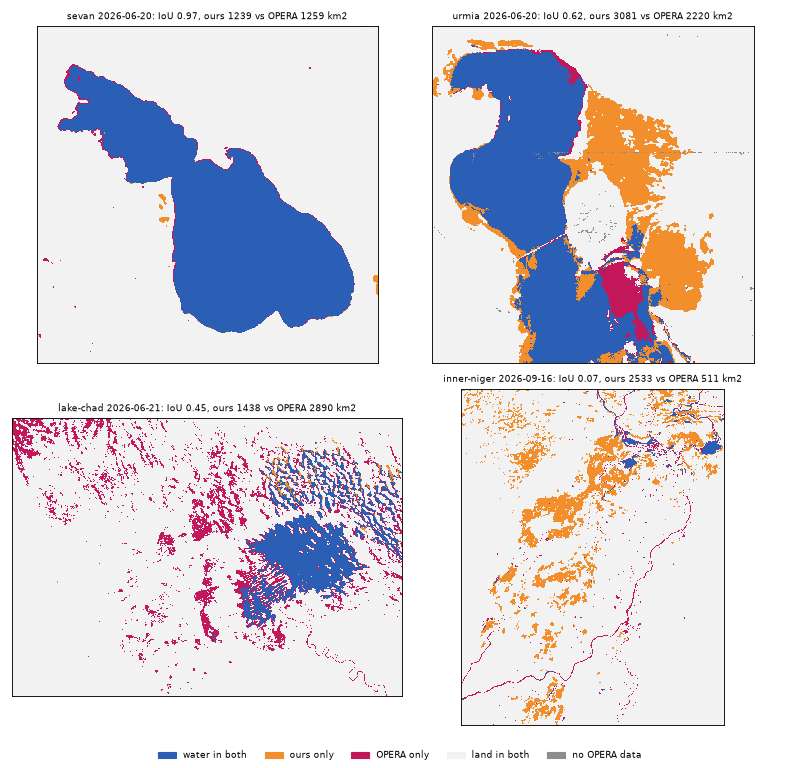
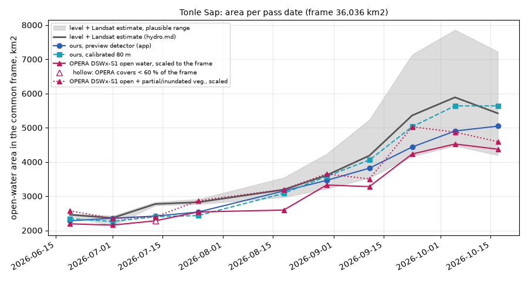
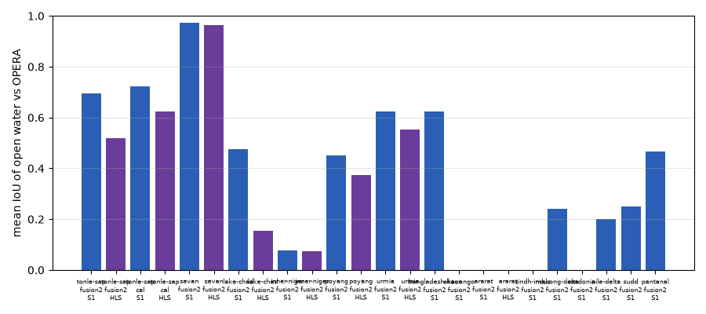

# Our water maps against NASA's operational OPERA surface-water product

State of Saturday 14 November 2026, late evening. Code: `scripts/detect/opera.py` · tests: `tests/test_opera.py` ·
every number: [`opera/results.json`](opera/results.json) · what exists in NASA's archive: [`opera/catalogue.json`](opera/catalogue.json) ·
figures: `docs/eda/opera/*.png`. Our maps are compared here with another satellite product. **This is agreement
between two products, not accuracy against the truth.**

    .venv/bin/python -m scripts.detect.opera catalogue   # CMR search (no login): catalogue.json, plan.json
    .venv/bin/python -m scripts.detect.opera queue       # which 30 m tiles to fetch (data/raw/opera/queue.txt)
    .venv/bin/python -m scripts.detect.opera compare     # mosaic, resample to our grid, metrics -> results.json
    .venv/bin/python -m scripts.detect.opera report      # summary tables and figures
    .venv/bin/python -m pytest tests/test_opera.py       # 10 synthetic tests, under 1 s

## Bottom line

* **Where the scene is mostly open water we agree well; in vegetated wetlands we do not.** Sevan: IoU **0.97**,
  99 % of pixels agree (10 place-dates). Tonle Sap: IoU **0.70** (preview detector) and **0.72** (calibrated 80 m),
  96 % of pixels agree (10 dates each), but IoU falls from 0.83–0.89 in June–July to **0.56–0.65 from mid-August**, when
  the flood spreads into the forest.
* **Over everything we compared, the agreement is modest.** 101 place-dates at 15 places (preview detector, DSWx-S1,
  open water): 93.8 % of pixels agree (95 % interval 92.5–94.9), but most pixels are dry land; balanced accuracy is
  0.72 and the mean IoU is **0.38** (0.32–0.44). Pooled over all place-dates the IoU is 0.51. At the six priority
  places (44 place-dates) it is 92 % agreement and mean IoU 0.63.
* **We look bad in specific places** (section 5): Inner Niger delta (IoU 0.08, we call 4 × the water OPERA does),
  Lake Chad (we find about half of the water OPERA maps, IoU 0.48), Mekong delta, Nile delta and Pantanal (we miss
  narrow or vegetated water), Okavango and Sindh-Indus (our maps hold no open water at all while OPERA maps 20–200 km²),
  and the dry lake bed east of Lake Urmia (we call water what OPERA calls land).
* **Tonle Sap total area.** On 17 Oct our preview map has **5,046 km²** in the common frame, OPERA DSWx-S1 has
  **4,373 km²** (scaled to the frame, 4,593 km² with partial/inundated vegetation), and the independent level-based
  estimate of `hydro.md` is **5,421 km² (4,198–7,222)**. Both products are below it, ours less so: ours is closer on
  9 of 10 dates and tied on one (section 4). That is not evidence that ours is "better": the hydro estimate shares
  its Landsat source with our tuning labels, and both radar products miss water under forest.

## 1. What OPERA DSWx is, and what existed

OPERA (Observational Products for End-Users from Remote Sensing Analysis, NASA JPL) produces Dynamic Surface-water
Extent (DSWx) on the 30 m MGRS tile grid. Searched in NASA's CMR on 14 Nov 2026 (`catalogue.json`):

| collection | sensor | what we found for mid-June to late October 2026 |
|---|---|---|
| `OPERA_L3_DSWX-S1_V1` v1.0 | Sentinel-1 C-band radar (VV/VH) | exists, all priority places; **used** (the natural comparison for the monsoon dates) |
| `OPERA_L3_DSWX-HLS_V1` v1.0 (files say v1.1) | Harmonized Landsat/Sentinel-2 optical | exists, all places; **used**, but cloud-limited |
| NISAR-based DSWx (`DSWX-NI`) | NISAR L-band | **not in CMR**: no collection of that name; keyword searches for NISAR water/DSWx find only `NISAR_WATERMASK` (an ancillary mask) and NISAR soil moisture. So no like-for-like L-band comparison was possible |

Granules in the search window (±7 days around our first and last pass), tiles, and passes with at least one OPERA
granule within ±6 days:

| place | DSWx-S1 granules / tiles / passes covered | DSWx-HLS granules / tiles / passes covered |
|---|---|---|
| tonle-sap | 671 / 12 / 10 of 10 | 730 / 12 / 10 of 10 |
| sevan | 194 / 4 / 10 of 10 | 459 / 4 / 10 of 10 |
| lake-chad | 118 / 6 / 10 of 10 | 543 / 6 / 10 of 10 |
| inner-niger | 64 / 9 / **4 of 8** | 680 / 9 / 8 of 8 |
| poyang | 37 / 6 / **3 of 7** (first S1 granule 13 Sep) | 281 / 6 / 7 of 7 |
| urmia | 256 / 4 / 9 of 9 | 429 / 4 / 9 of 9 |

So DSWx-S1 has gaps (Inner Niger, Poyang, part of Sindh-Indus and Rondonia) that DSWx-HLS does not, but HLS is blind
under cloud.

**Class codes** (read from the files; the colour table is the only legend they carry, and the product specification
names are quoted from the spec as we know it, not read from the files):

| layer | code | meaning used here | seen in files |
|---|---|---|---|
| WTR, S1 | 0 | not water | yes |
| | 1 | **open water** | yes |
| | 2 | partial surface water (colour: light blue) | **never occurs** in the tiles we read |
| | 3 | inundated vegetation (colour: green) | yes (about 1/3 as many pixels as open water) |
| | 250, 251 | masked (HAND / layover-shadow; counted as no data) | yes |
| | 252–255 | other masks / fill (no data) | 255 yes |
| WTR, HLS | 0 | not water | yes |
| | 1 | **open water** | yes |
| | 2 | partial surface water | yes |
| | 3, 4 | reserved (no data) | no |
| | 252 | snow/ice (no data) | yes |
| | 253 | cloud / cloud shadow (no data) | yes (most of the pixels) |
| | 254, 255 | ocean mask, fill (no data) | 255 yes |

"Open water" in the tables is code 1. "**+part**" counts codes 1, 2, 3 for S1 and 1, 2 for HLS. Any code we did not list is
treated as no data, never as land. S1 file metadata: Sentinel-1 RTC input, JRC water occurrence, HAND and GLAD
land cover as ancillary data, inundated-vegetation mapping switched on.

## 2. Method

1. **Our maps.** Preview-based fused detector `data/processed/<area>/fusion2/products.pt` (the app's; lon/lat grid
   from `bounds`, about 180 m at Tonle Sap and 30–100 m elsewhere) and, for Tonle Sap, the calibrated 80 m detector
   `data/processed/tonle-sap-cal/det/water.pt` (UTM 48N grid from `grid.json`; valid = finite calibrated HH).
2. **OPERA tiles.** For each pass date and each MGRS tile, up to three granules within **±6 days** of the pass, nearest
   in time first, are **composited pixel by pixel**: the nearest valid pixel wins (a pixel that is masked in the nearest
   acquisition is filled from the next). The mean absolute time difference of the pixels used is reported (0.5 days
   at Tonle Sap, up to 3.5 days at the other places because S1 revisits a track only every 12 days).
3. **Resampling.** 30 m masks (open, open + partial, valid) are averaged onto our grid with GDAL area averaging
   (rasterio `reproject`, `Resampling.average`). A coarse cell is **water if at least 50 % of its valid 30 m pixels
   are water**; the fraction is kept for a soft IoU. A cell counts as compared only if at least 50 % of its footprint
   holds valid OPERA pixels and our map is valid there. Place-dates where OPERA covers less than 30 % of our valid
   area are left out of the means (listed in `results.json`).
4. **Metrics** with OPERA as the reference: agreement, balanced accuracy, precision, recall, IoU, areas in the same
   cells, area ratio ours/OPERA, soft IoU. The **95 % intervals are block bootstrap** over spatial blocks of about
   5 km (200 draws) for each place-date; over place-dates the interval is a bootstrap over place-dates (2000 draws,
   equal weight). Place summaries are means over dates (and pooled IoU in `results.json`).
5. **Download.** The files needed an Earthdata login that exists only on the team server; WTR GeoTIFFs (about 0.2 MB each,
   1,504 files, 400 MB) were fetched there with the account's `~/.netrc` (never read or copied) and copied to the Mac.
   Only the `WTR` layer was fetched. HLS tiles with more than 70 % cloud according to the metadata were skipped.

## 3. Results

Mean over the place-dates used. "OPERA cover" is the share of our valid area that OPERA covers with valid pixels.
Areas are inside the same compared cells.

**DSWx-S1 (Sentinel-1 C-band radar)** (open water only; `+part` = open + partial/inundated-vegetation classes)

| place | ours | place-dates | OPERA cover | mean &#124;dt&#124; d | agreement | bal. acc. | precision | recall | IoU (95 % block CI) | IoU +part | area ours / OPERA | area +part |
|---|---|---|---|---|---|---|---|---|---|---|---|---|
| tonle-sap | preview (app) | 10 | 83 % | 0.5 | 96 % | 0.91 | 0.78 | 0.85 | 0.70 (0.65–0.73) | 0.67 | 1.09 | 0.98 |
| tonle-sap | calibrated 80 m | 10 | 83 % | 0.5 | 96 % | 0.92 | 0.80 | 0.87 | 0.72 (0.69–0.76) | 0.68 | 1.10 | 0.97 |
| sevan | preview (app) | 10 | 91 % | 2.8 | 99 % | 0.99 | 0.99 | 0.98 | 0.97 (0.96–0.98) | 0.97 | 0.98 | 0.98 |
| lake-chad | preview (app) | 10 | 83 % | 3.3 | 89 % | 0.74 | 0.97 | 0.48 | 0.48 (0.42–0.53) | 0.42 | 0.50 | 0.44 |
| inner-niger | preview (app) | 4 | 100 % | 2.8 | 89 % | 0.64 | 0.09 | 0.37 | 0.08 (0.06–0.10) | 0.20 | 4.20 | 0.42 |
| poyang | preview (app) | 3 | 100 % | 2.7 | 88 % | 0.85 | 0.50 | 0.82 | 0.45 (0.41–0.49) | 0.62 | 1.67 | 1.14 |
| urmia | preview (app) | 7/9 | 68 % | 2.6 | 85 % | 0.87 | 0.67 | 0.91 | 0.63 (0.55–0.70) | 0.59 | 1.36 | 1.18 |
| bangladesh-haor | preview (app) | 7 | 70 % | 2.4 | 82 % | 0.84 | 0.68 | 0.89 | 0.62 (0.58–0.66) | 0.62 | 1.34 | 1.31 |
| okavango | preview (app) | 9 | 88 % | 3.5 | 100 % | 0.50 | – | 0.00 | 0.00 (0.00–0.00) | 0.00 | 0.00 | 0.00 |
| ararat | preview (app) | 10 | 100 % | 2.7 | 100 % | 0.50 | 0.00 | 0.00 | 0.00 (0.00–0.00) | 0.00 | 0.05 | 0.02 |
| sindh-indus | preview (app) | 5/6 | 98 % | 1.4 | 99 % | 0.50 | – | 0.00 | 0.00 (0.00–0.00) | 0.00 | 0.00 | 0.00 |
| mekong-delta | preview (app) | 10 | 99 % | 1.8 | 92 % | 0.64 | 0.49 | 0.31 | 0.24 (0.20–0.28) | 0.24 | 0.62 | 0.58 |
| rondonia | preview (app) | 2 | 69 % | 0.6 | 99 % | 0.50 | 0.00 | 0.00 | 0.00 (0.00–0.00) | 0.00 | 2.16 | 1.78 |
| nile-delta | preview (app) | 3/9 | 81 % | 1.4 | 96 % | 0.60 | 0.99 | 0.20 | 0.20 (0.08–0.32) | 0.15 | 0.20 | 0.15 |
| sudd | preview (app) | 7/8 | 97 % | 0.8 | 92 % | 0.75 | 0.31 | 0.57 | 0.25 (0.21–0.29) | 0.34 | 1.83 | 0.51 |
| pantanal | preview (app) | 4/8 | 86 % | 1.5 | 99 % | 0.77 | 0.78 | 0.54 | 0.47 (0.28–0.61) | 0.14 | 0.74 | 0.20 |

**DSWx-HLS (optical, cloud-limited)** (open water only; `+part` = open + partial/inundated-vegetation classes)

| place | ours | place-dates | OPERA cover | mean &#124;dt&#124; d | agreement | bal. acc. | precision | recall | IoU (95 % block CI) | IoU +part | area ours / OPERA | area +part |
|---|---|---|---|---|---|---|---|---|---|---|---|---|
| tonle-sap | preview (app) | 4/10 | 50 % | 1.4 | 95 % | 0.83 | 0.70 | 0.67 | 0.52 (0.45–0.59) | 0.33 | 1.16 | 0.42 |
| tonle-sap | calibrated 80 m | 4/10 | 49 % | 1.4 | 95 % | 0.83 | 0.85 | 0.68 | 0.62 (0.54–0.68) | 0.33 | 0.79 | 0.35 |
| sevan | preview (app) | 3/10 | 71 % | 0.6 | 99 % | 0.98 | 0.99 | 0.97 | 0.97 (0.95–0.98) | 0.96 | 0.98 | 0.97 |
| lake-chad | preview (app) | 8/10 | 48 % | 0.7 | 96 % | 0.58 | 0.52 | 0.16 | 0.16 (0.12–0.19) | 0.12 | 0.17 | 0.13 |
| inner-niger | preview (app) | 4/8 | 64 % | 0.7 | 90 % | 0.77 | 0.08 | 0.64 | 0.07 (0.05–0.10) | 0.29 | 9.67 | 2.47 |
| poyang | preview (app) | 2/6 | 70 % | 0.4 | 86 % | 0.81 | 0.44 | 0.73 | 0.38 (0.33–0.42) | 0.41 | 1.71 | 1.28 |
| urmia | preview (app) | 9 | 70 % | 0.6 | 82 % | 0.83 | 0.61 | 0.85 | 0.55 (0.47–0.63) | 0.55 | 1.42 | 1.40 |
| ararat | preview (app) | 7/10 | 73 % | 0.5 | 100 % | 0.50 | 0.00 | 0.00 | 0.00 (0.00–0.00) | 0.00 | 0.03 | 0.01 |

**Overall** (equal weight per place-date; intervals bootstrap over place-dates):

| ours | OPERA | n | agreement | balanced acc. | precision | recall | mean IoU | pooled IoU |
|---|---|---|---|---|---|---|---|---|
| preview, all 15 places | DSWx-S1 open | 101 | 93.8 % (92.5–94.9) | 0.72 | 0.60 | 0.49 | **0.38** (0.32–0.44) | 0.51 |
| preview, all 15 places | DSWx-S1 +part | 101 | 91.4 % (90.0–92.7) | 0.70 | 0.67 | 0.44 | 0.37 (0.32–0.44) | 0.44 |
| preview, six priority places | DSWx-S1 open | 44 | 92.3 % | 0.85 | 0.77 | 0.76 | 0.63 | |
| preview, Tonle Sap + Sevan | DSWx-S1 open | 20 | 97.5 % | 0.95 | 0.89 | 0.91 | **0.84** | |
| calibrated 80 m, Tonle Sap | DSWx-S1 open | 10 | 96.1 % (94.5–97.7) | 0.92 | 0.80 | 0.87 | 0.72 (0.64–0.81) | 0.67 |
| preview, places with HLS | DSWx-HLS open | 37 | 92.2 % (89.8–94.7) | 0.72 | 0.47 | 0.50 | 0.33 (0.23–0.44) | 0.50 |
| calibrated 80 m, Tonle Sap | DSWx-HLS open | 4 | 95.5 % | 0.83 | 0.85 | 0.68 | 0.62 | |

Agreement is flattered by dry land (most cells are land in both), so read balanced accuracy and IoU. Counting OPERA's
partial/inundated-vegetation classes as water lowers the area ratio (OPERA has more "water") but does not raise the mean
IoU: those pixels are mostly not where our open water is.

### Figures

*Fig. 1. Tonle Sap, first (19 Jun) and last (17 Oct) pass, preview detector against DSWx-S1 open water. Blue: both;
orange: ours only; magenta: OPERA only; light grey: land in both; dark grey: no OPERA data; white: outside our frame.*

*Fig. 2. Best to worst: Sevan, Urmia, Lake Chad and Inner Niger (date with the best OPERA coverage).*

*Fig. 3. Tonle Sap area per pass date: ours (preview, calibrated), OPERA DSWx-S1 scaled to the frame, and the level-based
estimate of `hydro.md` with its range. See section 4 for how OPERA is scaled.*

*Fig. 4. Mean IoU of open water per place, detector and OPERA product.*

## 4. Tonle Sap through the season, and the independent estimate

DSWx-S1 over Tonle Sap, preview detector (compared cells only; "scaled" = OPERA's area in the cells it covers times
(our area in the whole frame / our area in those cells), which assumes the covered part is representative and is
unreliable when OPERA covers less than about 60 % of the frame, marked ✱):

| pass | OPERA cover | mean &#124;dt&#124; d | IoU | precision | recall | ours km² | OPERA km² (same cells) | ours in frame | OPERA scaled | hydro central (range) |
|---|---|---|---|---|---|---|---|---|---|---|
| 19 Jun | 88 % | 0.85 | 0.83 | 0.89 | 0.92 | 2,280 | 2,191 | 2,281 | 2,192 | 2,458 (2,415–2,496) |
| 1 Jul | 61 % | 0.43 | 0.87 | 0.89 | 0.97 | 2,206 | 2,018 | 2,355 | 2,155 | 2,361 (2,137–2,425) |
| 13 Jul | 43 % ✱ | 0.70 | 0.89 | 0.92 | 0.97 | 1,634 | 1,540 | 2,418 | 2,280 | 2,772 (2,729–2,827) |
| 25 Jul | 79 % | 0.44 | 0.85 | 0.92 | 0.92 | 2,449 | 2,451 | 2,537 | 2,539 | 2,822 (2,766–2,909) |
| 18 Aug | 88 % | 0.64 | 0.58 | 0.67 | 0.81 | 3,150 | 2,593 | 3,152 | 2,594 | 3,189 (2,969–3,541) |
| 30 Aug | 92 % | 0.78 | 0.65 | 0.77 | 0.80 | 3,415 | 3,282 | 3,461 | 3,326 | 3,609 (3,216–4,231) |
| 11 Sep | 79 % | 0.44 | 0.59 | 0.69 | 0.80 | 3,737 | 3,211 | 3,818 | 3,280 | 4,185 (3,533–5,233) |
| 23 Sep | 100 % | 0.35 | 0.58 | 0.72 | 0.75 | 4,436 | 4,233 | 4,436 | 4,233 | 5,360 (4,163–7,134) |
| 5 Oct | 100 % | 0.35 | 0.58 | 0.70 | 0.76 | 4,904 | 4,523 | 4,904 | 4,523 | 5,888 (4,473–7,858) |
| 17 Oct | 100 % | 0.35 | 0.56 | 0.67 | 0.77 | 5,046 | 4,373 | 5,046 | 4,373 | 5,421 (4,198–7,222) |

* **Early dates (permanent lake, little flooded forest):** IoU 0.83–0.89, areas within 9 % of each other, the time
  difference under one day. This is good agreement between two independent radars.
* **Late dates:** IoU about 0.56–0.65 although the time difference is only 0.35 days, so timing does not explain it.
  Our area is 4–21 % larger than OPERA's in the same cells, yet precision (0.67–0.77) and recall (0.75–0.81) are both
  low: the two maps put the water in different places (Fig. 1, right).
* **Against the level-based estimate:** ours is closer to the central estimate on 9 of 10 dates (OPERA is closer by
  2 km² on 25 Jul). On 17 Oct ours is 375 km² (7 %) below it and OPERA 1,048 km² (19 %) below; over 23 Sep–17 Oct ours
  is 7–17 % below, OPERA 19–23 % below. Ours lies inside the plausible range on 7 of 10 dates, OPERA on 5 of 10
  (both fall below it on 19 Jun, 13 Jul and 25 Jul, when the range is narrow). Neither radar product reaches the
  central estimate from late August, which says that both miss water the Landsat-based method counts (water under
  forest, shallow flooded grass).
  **Caveats:** the estimate uses the same Landsat history (JRC) that tuned our detector, so it is not independent of
  us in the way it is of OPERA; the "OPERA scaled" series rests on the part of the frame S1 covers; and the figure
  for 17 Oct in `hydro.md` (3,837 km²) is from an earlier run of the detector, the current `products.pt` gives 5,046 km²
  in the same frame. We do not claim that ours is better, only that OPERA is no closer to the estimate than we are.
* **HLS over Tonle Sap** is usable on 4 of 10 dates (19 Jun, 1 Jul, 30 Aug, 17 Oct; cloud), IoU 0.52 (0.62 for the calibrated
  detector). On 17 Oct HLS maps 5,431 km² in the 42 % of the frame it can see against our 3,286 km² in the same cells
  (IoU 0.55): the optical product sees much more open water than we do, which fits the hydro finding that our map is a
  lower bound. Cloud-free cells are not a random sample, so this is indicative only.

## 5. Per-place notes: where we agree and where we look bad

The diagnostics are in `results.json` (`diagnostics` per place-date): share of the disagreement that lies within 1 or
2 cells of a water edge, and what OPERA says under cells that only we call water.

* **Sevan (IoU 0.97, 10 dates).** A big permanent lake, the easy case. It says our water edge is placed within a cell of
  OPERA's, even with time differences up to 3 days. It tells nothing about floodplain performance.
* **Tonle Sap.** See section 4. In Fig. 1 (right) the orange (ours only) is a ring around the lake and the flooded forest
  to the south-east, while the magenta (OPERA only) is thin and scattered along channels and small ponds. 89 % of the
  disagreement is within 2 cells of an edge, and 75–82 % of our-only cells have **no** open water in OPERA at all.
  The pattern fits two explanations that the data cannot separate: L-band sees dark (flooded) ground under sparse
  canopy that C-band does not, and our 180 m cells miss narrow channels that OPERA's 30 m pixels catch. Counting
  OPERA's inundated-vegetation class as water brings the area into line (ratio 0.98) but not the IoU (0.67), so
  OPERA's inundated vegetation is not the same pixels as our open water either.
* **Lake Chad (IoU 0.48, precision 0.97, recall 0.48). We miss about half of the water OPERA maps** (1,490 vs 2,860 km²
  on 19 Oct). The OPERA-only patches are large and in the west and north (Fig. 2), 80 % of them isolated from our water.
  DSWx-HLS, a different sensor, finds even more water than we do (ours/HLS area 0.17, IoU 0.16 on 8 dates). Two
  independent OPERA products agreeing with each other against us points at our under-detection (shallow water among
  vegetation, small interdune ponds at 100 m), not a C-band artefact. We do not explain this away.
* **Inner Niger (IoU 0.08; 4 dates, DSWx-S1 does not exist for the other four).** Precision 0.09: we call 2,533 km²
  of open water on 16 Sep where OPERA S1 has 507 km² (4 × more) and OPERA HLS 290 km² (9 × more); 98 % of our-only cells
  are completely dry in OPERA. Counting OPERA's inundated vegetation gives 5,262 km² (IoU 0.26 only). Large orange
  blobs on the floodplain (Fig. 2) are probably our false water (dark wet soil, grass or crop) or water under
  vegetation that we label open. **Do not quote Inner Niger as an open-water success.**
* **Poyang (IoU 0.45, 3 dates, Sep-Oct only), Urmia (0.63), Bangladesh Haor (0.62).** Recall is high (0.8–0.9), precision low
  (0.5–0.7): ours is 1.3–1.7 × OPERA's open water. At Poyang ours-only is the mudflat and shore fringe (IoU 0.62 with
  inundated vegetation counted). At Urmia the large orange area east of the lake is the exposed, wet, salty lake bed:
  **false water on dark ground, our error**. A magenta block in the south of the lake is water in OPERA only and
  looks like a mapping difference over islands/shoals, unresolved.
* **Mekong delta (IoU 0.24), Nile delta (0.20, precision 0.99), Pantanal (0.47), Sudd (0.25).** We miss narrow
  channels, canals, fish ponds and small floodplain water (recall 0.2–0.5 where precision is high); at the Sudd we also
  over-call (precision 0.31).
* **Okavango, Sindh-Indus, Ararat, Rondonia (IoU 0.00).** Our maps hold essentially no open water (0 km² at Okavango and
  Sindh-Indus, 0.3 km² at Ararat) while OPERA finds 20–200 km². This is a real omission by our detector (or by the
  parameters of these areas), not a disagreement between equals.
* **DSWx-HLS** agreement mirrors DSWx-S1 where cloud allows (Sevan 0.97, Urmia 0.55, Poyang 0.38, Inner Niger 0.07,
  Lake Chad 0.16). Its sample is limited to the cloud-free pixels, so its numbers are less representative than those of DSWx-S1.

## 6. Limits

* **Two products, not the truth.** OPERA DSWx has its own errors: C-band VV/VH loses water under canopy and rough
  water, it has masks (HAND, layover/shadow) that remove real water, and it uses ancillary data (JRC occurrence
  with inundated-vegetation mapping tied to a land-cover map). HLS needs clear sky.
* **L-band against C-band.** NISAR L-band penetrates canopy and Sentinel-1 does not, so some disagreement in vegetated
  floodplains is expected and is not proof of error by either side. A NISAR-based DSWx would be the fair comparison;
  none exists in CMR.
* **Resolution.** OPERA 30 m against our 30–180 m cells: narrow channels and small ponds are lost on our side, and
  the 50 % rule trades omissions for commissions. 35–95 % of the disagreement (depending on place) lies within two cells of a water edge.
* **Time difference.** Up to ±6 days, a mean of 0.5 days at Tonle Sap but 2–3.5 days elsewhere; a moving flood edge
  partly accounts for the lower numbers at Lake Chad, Poyang and Urmia. Not tested.
* **Coverage.** DSWx-S1 covers on average 83 % of our frame at Tonle Sap and has holes where the swath or the tile is
  missing; the scaled areas assume the covered part is representative.
* **Compositing.** Up to three granules per tile are merged pixel by pixel; the day of a pixel can differ from that of
  its neighbour.
* The partial-water classes of S1 are named from colour tables and spec knowledge, not from labels in the files.
* Not done: HLS for the nine "other" places; the calibrated detector at any place other than Tonle Sap (there are also
  `sevan-cal` and `ararat-cal` data); a per-pixel analysis of water under forest; comparison with an independent
  hydro estimate anywhere but Tonle Sap.

## 7. What we may say, and must not say

**May say**

* "Our open-water maps agree with NASA's operational OPERA DSWx-S1 (Sentinel-1) product at **94 % of pixels, mean IoU
  0.38 (balanced accuracy 0.72), across 101 place-dates at 15 places**; at the two large open-water lakes, Tonle
  Sap and Sevan, at **97.5 % (IoU 0.84) across 20 place-dates**."
* "At Tonle Sap our preview map and the calibrated 80 m map reach IoU 0.70 and 0.72 against OPERA over the season, and
  0.83–0.89 while the lake is in its banks."
* "Our Tonle Sap area is 7–17 % below the level-based estimate over 23 Sep–17 Oct; OPERA DSWx-S1's is 19–23 % below it.
  Both radar products are below the estimate."
* "Where we disagree we show where, and we find places where our detector is clearly worse than OPERA (Lake Chad,
  Inner Niger, Mekong, Okavango, Sindh-Indus)."

**Must not say**

* That our maps are "better than", "more accurate than" or "validated against" OPERA, or that OPERA is the truth.
* That we compared with a NISAR water product (there is none) or that disagreement shows L-band is better.
* A single agreement number without N, the place list and the IoU next to it: 94 % agreement is mostly dry land.
* That the Tonle Sap numbers hold at other places: Inner Niger is IoU 0.08, Okavango and Sindh-Indus 0.00.
* Anything for DSWx-HLS on monsoon dates without the cloud caveat (4 of 10 usable at Tonle Sap).

## Reproducing

`data/raw/opera/plan.json` lists every granule chosen (URLs only, no credentials) and `queue.txt` the files to fetch.
The fetch itself needs Earthdata credentials and ran on the team server; the compare step reads `data/raw/opera/files/`
and caches the resampled OPERA fractions in `data/processed/<area>/opera/*.npz` (uint8 per cent).
Source: OPERA DSWx-S1 and DSWx-HLS, NASA JPL / OPERA project, distributed by PO.DAAC (collections
`OPERA_L3_DSWX-S1_V1`, `OPERA_L3_DSWX-HLS_V1`; cite as the collection pages ask).
