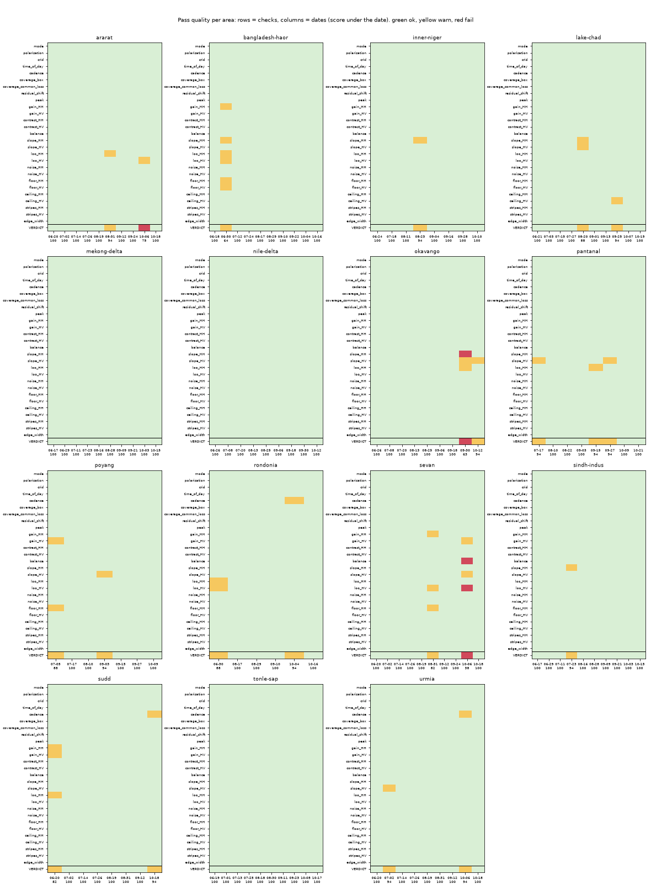
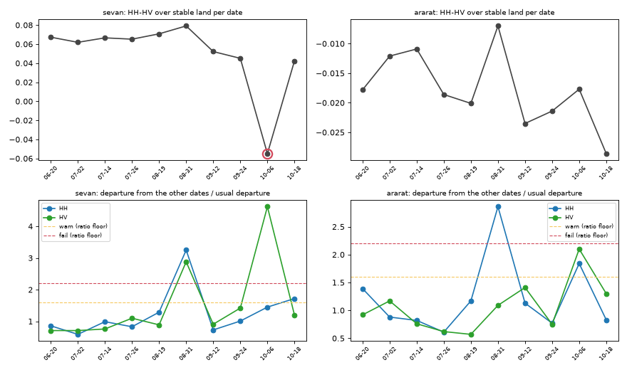
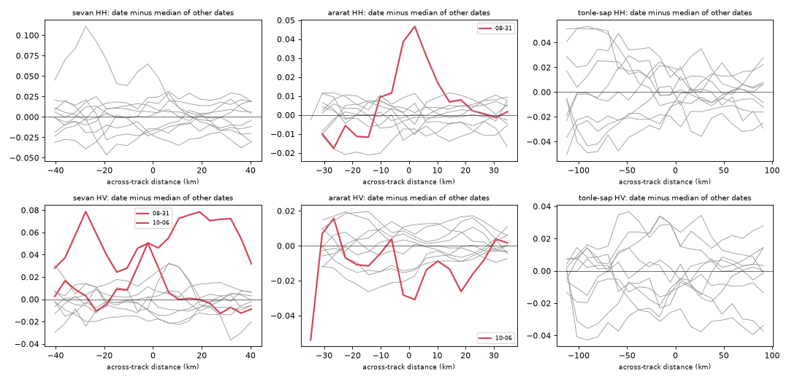
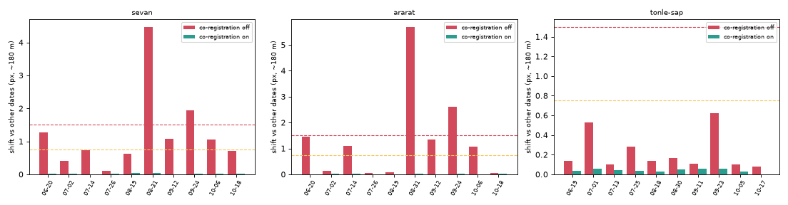
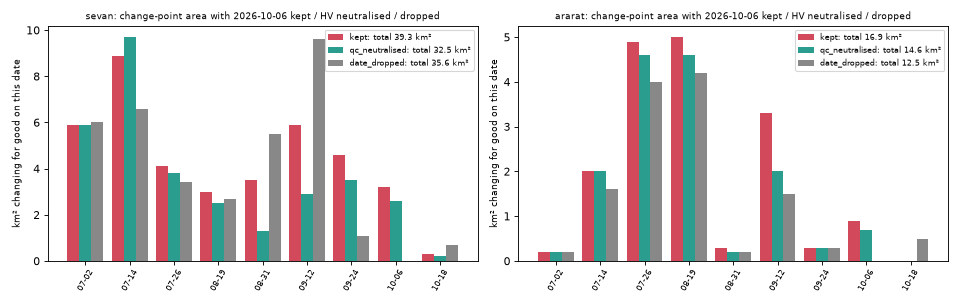

# Automatic quality control of every radar pass

`scripts/detect/qc.py` scores every pass of every area and flags the bad ones, so the detector can leave them out and the app can show a caution. Nobody has to look at 150 images.

```
.venv/bin/python -m scripts.detect.qc                  # every area that has previews -> data/processed/<area>/qc.json
.venv/bin/python -m scripts.detect.qc sevan ararat     # some areas
.venv/bin/python -m scripts.detect.qc --no-align sevan # co-registration off (diagnostic, writes nothing)
.venv/bin/python -m scripts.detect.qc --report         # all areas + verification runs + figures + docs/eda/qc/results.json
```

CPU only, one area at a time, about 5–40 s per area (Tonle Sap is the largest, about 3.5 GB peak). Tests: `.venv/bin/python -m pytest tests/test_qc.py`.

## Summary

* **15 areas with previews checked (134 passes).** 3 pass-channels are excluded from change detection (no whole pass); 19 passes get a caution (`warn`); 112 are `ok`. (`demo` has no previews; areas still being added by another agent will be picked up on the next run.)
* **Armenia, 6 October 2026 (Sevan and Ararat): HV fails, HH is fine.** At Sevan, HV departs from the other dates 4.6× more than usual, uniformly over the frame. Channel balance HH−HV on stable land is −0.055 against a usual +0.065 (z = −12), and HV gain is +15 %. All HH checks pass. Ararat, a crop of the same acquisition, sees a weaker departure on its own (HV 2.1×, widespread, a warning), and becomes `fail` through the same-acquisition rule.
* **Armenia, 31 August: caution only, not excluded.** Sevan: HH on stable land +11 %, the lake far less often at the display floor (10.7 % of pixels against 22 %: wind roughening), HV 2.9× with an across-track gradient. Ararat: HH 2.9×, widespread. Read: a wet or wind day after the date was co-registered (the loader moved it 5.5–6.9 px). The co-registration residual is 0.03 px.
* **Tonle Sap: no false alarm.** Every date is `ok`, flood dates included. Where a third of the scene changes, the tool reports "part of the scene changed: looks like real change, not flagged".
* **Misregistration without co-registration is caught**: Sevan 31 Aug 4.5 px, Ararat 5.7 px (against the mean of the other dates; the loader measures 5.5 / 6.9 px against the first date), plus 24 Sep 1.9 / 2.6 px. After co-registration the residual is ≤ 0.05 px everywhere.
* **Excluding the bad HV pass matters.** At Ararat, HV temporal standard deviation on stable land halves (0.0250 → 0.0117). Change-point area drops 14–17 %, and at Sevan the spurious change points spread over August–September shrink (see "Why it matters").
* **New finds for the teammate adding places:** Okavango 30 Sep fails on HH; Rondônia, Sudd and Urmia each have a missing pass that is not explained by the outage or the area config. Every pass in every area is HH+HV, one mode and one processing version (P05023), so there are no mode mixtures and no HH-only passes. No burned-in marks: Poyang's two candidates turned out to be saturated bright targets, and the filter now excludes those.



*Figure 1. Every check (rows) for every date (columns) of every area; the score is under the date. Green ok, yellow warn, red fail.*

## Results per area

Only dates that are not `ok`. "F" = channels to leave out of detection, "W" = caution. Scores are 0–100.

| Area | Date | Verdict | Channel | Reason (from `qc.json`) |
|---|---|---|---|---|
| sevan | 2026-10-06 | **fail** | F: HV | HV channel 4.6× more different from the other dates than usual (uniform across the frame); HH−HV over stable land −0.055 vs usual +0.065; HV stable-land brightness +15 % while HH is normal — likely instrument or processing effect |
| sevan | 2026-08-31 | warn | W: HH, HV | HH stable-land brightness +11 %; HH 10.7 % of pixels at the display floor vs usual 22.1 % (wind on the lake); HV 2.9× (gradient) |
| ararat | 2026-10-06 | **fail** | F: HV | HV 2.1× more different than usual (widespread); HV also fails in sevan (same acquisition) and departs here too; HH is normal |
| ararat | 2026-08-31 | warn | W: HH | HH 2.9× more different than usual (widespread across the frame) |
| okavango | 2026-09-30 | **fail** | F: HH, W: HV | HH 5.1× more different than usual (widespread) and the HH across-swath brightness change +0.015 vs usual +0.086; HV across-swath change −0.018 vs usual +0.033 |
| okavango | 2026-10-12 | warn | W: HV | HV across-swath change +0.067 vs usual +0.031 |
| bangladesh-haor | 2026-06-30 | warn | W: HH, HV | HH stable land +6 %, HH across-swath change −0.342 vs −0.220, no pixel at the display floor (usual 6.8 %): looks like a wind-roughened or rain day |
| lake-chad | 2026-08-20 | warn | W: HH, HV | across-swath change −0.25 / −0.35 vs usual −0.40 / −0.56 (rain cells; see below) |
| lake-chad | 2026-09-25 | warn | W: HV | HV 4.0 % of pixels at the ceiling vs usual 5.6 % |
| inner-niger | 2026-08-23 | warn | W: HH | HH across-swath change +0.070 vs usual −0.012 |
| pantanal | 2026-09-15 | warn | W: HH | HH 3.4× more different than usual, uniform (only one indicator, so not excluded) |
| pantanal | 2026-07-17, 2026-09-27 | warn | W: HV | small across-swath changes (−0.517 / −0.508 vs −0.473) |
| poyang | 2026-07-05 | warn | W: HH, HV | HH 9.7 % at floor vs 7.4 %; HV stable land +5 % |
| poyang | 2026-09-03 | warn | W: HV | HV across-swath change −0.076 vs usual −0.274 |
| rondonia | 2026-06-30 | warn | W: HH, HV | both channels 3.5× more different than usual, uniform; the first date, then a 48-day gap (likely the dry-season change, not the instrument) |
| rondonia | 2026-10-04 | warn | — | 1 pass missing that is not in the outage or the config (2026-09-22) |
| sindh-indus | 2026-07-23 | warn | W: HH | HH across-swath change −0.160 vs −0.209 (monsoon rain cells visible in the preview) |
| sudd | 2026-06-20 | warn | W: HH, HV | HH stable land +11 %, HV +7 %, HH 3.1× widespread (first date; wet-season onset?) |
| sudd | 2026-10-18 | warn | — | 1 pass missing that is not in the outage or the config (2026-09-24); 2026-10-06 is missing too, at a 36-day step |
| urmia | 2026-07-02 | warn | W: HV | HV across-swath change −0.146 vs usual −0.300 |
| urmia | 2026-10-06 | warn | — | 1 pass missing that is not in the outage or the config (2026-09-24) |
| tonle-sap, mekong-delta, nile-delta | — | all `ok` | | Tonle Sap note: the dim swath edge is 9–10 px wide, wider than the detector's 8-px trim |

Area-level notes:

* Every area has the 27 Jul–10 Aug gap, labelled **outage** (not an error). Inner Niger 2026-07-06, Poyang 2026-08-22 and Rondônia 2026-07-12 / 07-24 were removed by `add_area.py --exclude`, and are labelled that way.
* Metadata: all passes in all areas are HH+HV, `crid` P05023, one bandwidth mode per area, start time within ±3 s. No HH-only passes or mode mixtures reached `meta.json` (`add_area.py` already filters them); the check is there for areas added by hand.
* Burned-in marks (constant blobs at fixed raw-image coordinates): **none** in any area. Poyang's two candidates were near-white (0.98) saturated targets; blobs within 5 % of the display floor or ceiling in either channel are no longer counted. The dark rectangles north of Tonle Sap's lake (raw rows ~540–560, columns ~820–980), the likely source of the "burned-in dark mark" impression, are on every date, but their values change between passes like ground does. The tool therefore treats them as ground features (probably reservoirs or ponds). This is not verified on the ground.
* Ten-date z-scores are rough. Treat every single-indicator `warn` as "look before you trust", not as a finding.

## Verification against what we already knew

| Item | Expected | Result |
|---|---|---|
| Armenia 2026-10-06, HV | flagged on HV, HH fine | **Confirmed.** Sevan: `loo_HV` ratio 4.62, z 12.1, uniform → fail; `balance` −0.055 vs +0.065, z −12.0 → fail; `gain_HV` 1.147 (z 5.7), `slope_HV` z 4.1. HH: `loo_HH` 1.45× patchy, `gain_HH` 1.001, all ok. Ararat: own evidence `loo_HV` 2.10× (z 4.2, widespread) → warn, `gain_HV` 0.958, `contrast_HV` 1.086 (below threshold); `same_pass` rule → **fail on HV**, HH ok. Figure 2. |
| Armenia 2026-08-31 | report what it says | **warn, not fail** (see the Summary). Not excluded: the date-to-date departure is real ground and weather (wet land, wind on the lake), co-registered to 0.03 px. |
| Tonle Sap flood dates | not flagged | **Confirmed**: all ten dates `ok`, scores 100. `loo_HH` z on 19 Jun / 1 Jul / 13 Jul is 3.1–4.4, but the pattern is `patchy` (the flood region), so it is reported, not flagged. |
| Misregistration with `align=False` | detected at Sevan and Ararat | **Confirmed**: 31 Aug fails at 4.47 px (Sevan, ~820 m) and 5.69 px (Ararat, ~1050 m); 24 Sep fails at 1.95 / 2.61 px; 20 Jun, 14 Jul and 12 Sep warn at 1.1–1.5 px. Tonle Sap, uncorrected, stays below 0.62 px. With co-registration on: ≤ 0.05 px everywhere. Figure 4. |
| Synthetic tests | 7 scenarios | all pass (see Tests) |



*Figure 2. Top: HH−HV over stable land per date; Sevan 6 October drops from about +0.07 to −0.055 (red circle = flagged). Bottom: how far each date departs from the other dates, relative to the usual departure; HV (green) on 6 October stands out, HH (blue) does not; 31 August is high in both (weather).*



*Figure 3. Departure from the other dates' median, averaged in 20 bins across the swath. Red = flagged dates. Sevan HV on 6 October is lifted over the whole frame, with a bump toward the far side. Ararat HV on 6 October drops toward the near (west) side. That is the east–west HV gradient flattening that the EDA described. The Tonle Sap curves are all grey.*



*Figure 4. Residual shift of each date against the mean of the other dates, with co-registration off (red) and on (green). Dashed lines: warn 0.75 px, fail 1.5 px.*

## Why it matters: Armenia with and without the 6 October HV

`ops.run_pipeline` (CPU, terrain mask applied as in `run.py`) on three versions of the stack. **Kept**: as today. **QC-neutralised**: what patch (a) does; 6 October HV is replaced by the per-pixel median of the other dates, and HH is kept. **Date dropped**: 6 October removed entirely.

| | Sevan kept | Sevan QC | Sevan dropped | Ararat kept | Ararat QC | Ararat dropped |
|---|---|---|---|---|---|---|
| HV temporal sd, stable land (no change point, never water) | 0.0267 | **0.0239 (−10 %)** | 0.0252 | 0.0250 | **0.0117 (−53 %)** | 0.0123 |
| HH temporal sd, stable land | 0.0342 | 0.0342 | 0.0343 | 0.0205 | 0.0206 | 0.0200 |
| HV normalisation gain on 6 Oct | 0.964 | 0.998 | — | 1.002 | 0.999 | — |
| Change-point area, km² | 39.3 | **32.5 (−17 %)** | 35.6 | 16.9 | **14.6 (−14 %)** | 12.5 |
| of which "changed for good" on 31 Aug / 12 Sep / 24 Sep | 3.5 / 5.9 / 4.6 | 1.3 / 2.9 / 3.5 | 5.5 / 9.6 / 1.1 | 0.3 / 3.3 / 0.3 | 0.2 / 2.0 / 0.3 | 0.2 / 1.5 / 0.3 |
| Open water on 6 Oct, km² | 1251.6 | 1251.7 | — | 3.8 | **0.6** | — |

What this shows:

* The bad HV pass was not only "one odd picture". It inflated HV variability over the whole season: at Ararat, stable land looked twice as variable as it is.
* It also moved the normalisation (Sevan 6 Oct HV gain 0.964 → 0.998) and created change points on the dates *before* it. A late jump in HV makes the CUSUM put a step in September.
* About 7 km² at Sevan and 2.3 km² at Ararat of "changed for good" disappear.
* At Ararat, 3.2 of the 3.8 km² of "open water" on 6 October disappear. Ararat has almost no real water, so this was largely false.
* Neutralising only HV keeps HH unchanged (HH sd identical), which dropping the date would not.
* Dropping the date renumbers the change dates and moves area into 12 Sep (9.6 km² at Sevan), because the CUSUM then has one fewer late point. Neutralising is the cleaner option.



*Figure 5. Change-point area by the date the pixel "changed for good", with 6 October kept (red), HV neutralised as patch (a) proposes (green), or the date dropped (grey).*

## What the tool cannot catch

* **Calibration as such.** Previews are display-stretched 8-bit images. Every radiometric check is *relative to the other dates of the same area*. If all ten passes share a bias (the HV east–west gradient across the Armenia frame is on every date), the tool sees nothing.
* **Two or more bad dates in a row** partly hide each other: the leave-one-out median, the neighbour (local) rule and the MAD all assume most dates are fine. With six to eight dates (Inner Niger, Poyang, Rondônia) everything is weaker still.
* **Weather vs instrument.** A frame-wide brightening from rain or wind and a processing change both look "uniform" or "widespread". The tool flags both and says which channel; the reason line is a hint, not a diagnosis. That is why single indicators only warn.
* **Real change that covers most of the frame** (a flood over more than half the box) can look `widespread` and get a warning. A real change that happens to be a smooth east–west gradient would look like an instrument gradient.
* **First and last dates** have only one neighbour, so the "isolated, not a trend" rule is weaker there.
* **Local artefacts.** A small RFI streak or a local defocus covering a few percent of the frame does not move medians. The stripe check catches only line-shaped streaks that stand out against the other dates, and it can only warn.
* **Burned-in marks that are pure white or black** look like saturated ground or calm water and are deliberately ignored. A mark that varies between dates would not be found either.
* **Misregistration of scenes with almost no texture** (mostly calm water): the peak-sharpness check says "unreliable", but then nothing is measured.
* **Thresholds were tuned on these 16 areas** (with the known Armenian cases in mind) and on synthetic stacks. They have not been validated on an independent set of known-bad passes, and z-scores from ten dates are rough.
* The same-acquisition rule needs both areas to have been QC'd. Run the whole set (no arguments) after adding an area.

## For the lead: proposed patches (not applied)

The QC step slots in after the previews are fetched and before detection: `fetch / add_area → qc.py → run.py → export.py`.

### (a): `scripts/detect/run.py` uses `qc.json`

What it does: failed passes are neutralised **for detection only** (normalisation, water masks, change point, classes), using `qc.apply_qc`:
a date that failed in every channel gets `valid = False`; a date that failed in one channel has that channel replaced by the per-pixel median of the other dates (it then carries no information, so it can create neither a fake step nor a fake gain), while its good channel is still used. The HH / HV image layers still show the pass as observed, and the spot time series shows a gap for the neutralised channel. Without a `qc.json` nothing changes.

```diff
--- a/scripts/detect/run.py
+++ b/scripts/detect/run.py
@@ def run(area, source="auto", dev=None):
     dates, x, valid_in, grid, km2 = load_gamma0(area) if source == "gamma0" else load_preview(area)
     dev = dev or device()
+    from scripts.detect.qc import apply_qc, load_qc
+    x_obs = x  # as observed, for the image layers
+    x, valid_det, qc_done = apply_qc(x, valid_in, dates, load_qc(area))
+    if qc_done:
+        print("  qc: left out of detection:", qc_done)
     from scripts.detect.terrain import cached_water_possible
     water_ok = cached_water_possible(area, tuple(x.shape[-2:]))
     print("  terrain mask:", "applied" if water_ok is not None else "not built for this area")
-    out = ops.run_pipeline(x, valid_in, source, dev=dev, water_ok=water_ok)
+    out = ops.run_pipeline(x, valid_det, source, dev=dev, water_ok=water_ok)
@@
     # hh, hv: filtered intensity, grey
     for c, name in enumerate(("hh", "hv")):
         lo, hi = disp["grey"][name]
         for t, d in enumerate(dates):
-            write_rgba(prod / name / f"{d}.tif", grey(L[t, c], lo, hi, valid[t]), grid)
+            img, vis = L[t, c], valid[t]
+            if name.upper() in qc_done.get(d, []):  # keep the suspect pass visible, as observed
+                vis = valid_in[t].cpu() & valid.any(0)
+                xo = torch.nan_to_num(x_obs[t:t + 1].cpu().float(), nan=0.0)
+                img = ops.to_loglike(ops.box_mean(xo, vis[None], o["knobs"]["box"]).clamp_min(1e-6), source)[0, c] * vis
+            write_rgba(prod / name / f"{d}.tif", grey(img, lo, hi, vis), grid)
@@ (timeseries.json, spot loop)
             for t in range(T):
                 m = circle & valid[t]
-                if n_c == 0 or int(m.sum()) < 0.5 * n_c:
+                if n_c == 0 or int(m.sum()) < 0.5 * n_c or name.upper() in qc_done.get(dates[t], []):
                     vals.append(None)
```

### (b): optional per-date quality in `manifest.json` (`scripts/ingest/export.py`)

Backward compatible: a new top-level key; old app code ignores it, `dates` is unchanged.

```diff
--- a/scripts/ingest/export.py
+++ b/scripts/ingest/export.py
@@ def export(area, root=ROOT):
     src_info = load(prod / "source.json")  # written by scripts/detect/run.py: says preview or gamma0
     if src_info:
         manifest.update(credits=src_info.get("credits", CREDITS), source=src_info.get("source"))
+    qc = load(root / "data/processed" / area / "qc.json")  # written by scripts/detect/qc.py
+    if qc:
+        manifest["quality"] = {p["date"]: {"quality": p["verdict"], "quality_note": p["reason"],
+                                           "channels": p["fail_channels"] or p["warn_channels"]}
+                               for p in qc["passes"] if p["date"] in all_dates}
     (pub / area / "manifest.json").write_text(json.dumps(manifest, indent=2))
```

Example result (Sevan):

```json
"quality": {
  "2026-10-06": {"quality": "fail", "quality_note": "HV channel 4.6x more different from the other dates than usual (uniform across the frame); ... while HH is normal — likely instrument or processing effect", "channels": ["HV"]},
  "2026-08-31": {"quality": "warn", "quality_note": "HH stable-land brightness +11% vs the other dates; ...", "channels": ["HH", "HV"]},
  "2026-06-20": {"quality": "ok", "quality_note": "all checks within the usual range", "channels": []}
}
```

App side (Arameh, optional): in the timeline, draw a small amber dot for `warn` and a red one for `fail` with `quality_note` as the tooltip; for `fail` with `channels: ["HV"]`, say "HV of this pass is unreliable; HH is fine".


## Tests

`tests/test_qc.py` (11 tests, about 6 s, CPU). They use synthetic ten-date stacks: field parcels plus a smooth land-cover pattern, 6-look gamma speckle, 8-bit quantisation and a 1 % per-date gain wobble. The tests cover:

* a clean stack → all `ok`, score 100;
* a 1.3× gain on HV of one date → `fail` on HV only, reason says "HH is normal";
* a 4-px shift → `residual_shift` fail (3–5 px measured), the date is excluded;
* an across-track ramp (0.8 → 1.2) → `loo` pattern `gradient`, slope check flagged;
* a flood disc growing to 30 % of the scene → every date `ok`, never `uniform` or `gradient`;
* a constant dark blob → one fixed mark, at the right position, 42 px;
* an HH-only pass, from metadata and from data alone → `missing_HV`, HV excluded;
* the metadata rules (mode, crid, outage vs config vs missing passes);
* `apply_qc`;
* the leave-one-out and local z-scores.

A sweep over 10 random seeds gave no false alarm in the clean and flood cases, apart from one seed where the synthetic gain wobble itself drew a −3 % date. The bad date was caught in every seed (the ramp sometimes only as `warn`).


## How it works

### Words used below

* **Pass / date**: one satellite overflight. Each area has 6–10.
* **Stable land**: pixels that hardly change over the season. For date *t* we pick them on the *other* dates (leave-one-date-out): inside the common footprint, 8 px away from the swath edge, not water (temporal median HH ≥ 0.12), not saturated (median of both channels between 0.03 and 0.97), and in the lowest 25 % of temporal standard deviation of the other dates in **both** channels. Then we drop the pixels whose departure on date *t* is extreme (more than 3 MAD from the median departure): this is gain-invariant, but removes the few pixels that really changed on this date only (the newest ring of a flood). Typically 8,000–12,000 pixels per date in Armenia, spread over the frame.
* **Leave-one-out median**: for each pixel, the median of the other dates. A date is compared with it, never with itself.
* **Robust z-score** of a per-date number $v_t$:
  $$z_t = \frac{v_t - \operatorname{median}_{s\ne t} v_s}{\max\left(1.4826\cdot\operatorname{MAD}_{s\ne t} v_s,\ \text{floor}\right)}$$
  MAD = median absolute deviation; 1.4826·MAD estimates the standard deviation and ignores the one odd date. The **floor** is a minimum spread in natural units, set per check (table below), so that ten nearly identical dates do not turn a tiny wobble into a huge z.
* **Isolated, not a trend.** For the radiometric checks, a date must also depart from its own neighbours in time: $z_\text{local} = (v_t - \text{mean}(v_{t-1}, v_{t+1}))/\text{scale}$, and the z used is $\operatorname{sign}(z)\min(|z|, z_\text{local})$. A smooth seasonal drift over several dates (Tonle Sap's HH−HV falls slowly from August to September) is then not a bad pass; a single jump is.
* **Verdicts**: `ok`, `warn` at |z| ≥ 4, `fail` at |z| ≥ 8. With ten dates the MAD itself is uncertain by roughly ±30 %, so **z-scores are rough**. That is why the thresholds are wide and why every z-based fail is also an effect of practical size (8 × floor).
* **Corroboration**: one radiometric indicator alone cannot exclude a channel. If only one of {gain, contrast, slope, leave-one-out, noise, balance} is at fail for a channel and none of the others even warns, it is downgraded to warn. Single indicators often turn out to be weather (rain cells on Lake Chad and in Sindh, see below).
* **Pass verdict**: `fail` if any channel fails (the channel list says which: `fail_channels`), `warn` if anything warns, else `ok`. A date-level problem (mode, coverage, misregistration, time of day) fails both channels.
* **Score** 0–100: 100 − 6 per warn − 25 per fail. Only a summary; decisions use the verdicts.

### The checks

| # | Check (key in `qc.json`) | In one sentence | Formula / value | Threshold |
|---|---|---|---|---|
| 1 | `polarisation` | Are both HH and HV there? (some tracks alternate HH-only) | from `meta.json` `polarization` | missing channel → that channel fails |
| 1 | `missing_HV` / `missing_HH` | Data-side version of the same: an HH-only preview draws HV = HH (grey) or an empty HV | share of valid pixels with \|HH−HV\| ≤ 1.5/255, or HV ≤ 1.5/255 | > 98 % → fail |
| 1 | `mode` | Same bandwidth mode as most passes of the area (20+5 vs 40+5 MHz have different resolution and noise) | `bandwidth` vs majority | different → fail (both channels) |
| 1 | `crid` | Same processing version | `crid` vs majority | different → warn |
| 1 | `time_of_day` | Taken at the usual time (a different orbit would not be) | \|start time − area median\| in s | warn ≥ 120 s, fail ≥ 1800 s |
| 1 | `cadence` | Days since the previous pass; 12 is normal. A 24-day gap whose missing pass falls in 27 Jul–10 Aug 2026 is labelled **outage** (no data exist), not an error; a pass removed in `area.json` `excluded_dates` is labelled as such | gap in days, number of missing passes | other missing passes → warn |
| 2 | `coverage_box` | How much of the area box the footprint covers on this date | share of box pixels inside the footprint | warn < 0.95 × usual, fail < 0.80 × usual |
| 2 | `coverage_common_loss` | How much this date shrinks the "imaged on every date" footprint | share of the other dates' common footprint not covered | warn ≥ 2 %, fail ≥ 10 % |
| 3 | `applied_shift` | The correction co-registration applied (rows, cols, pixels and metres) | from `Stack.shifts` | information only |
| 3 | `residual_shift` | How far the date is still off from the mean of the other dates after co-registration | FFT cross-correlation peak (same estimator as `stack._shift`, high-pass clipped at 4 MAD) | warn ≥ 0.75 px, fail ≥ 1.5 px (absolute: 1 px ≈ 180 m makes edge artefacts at every shore) |
| 3 | `peak` | Can the shift even be trusted? A weak correlation peak (scene mostly water) means no | peak-to-sidelobe ratio PSR = (peak − mean)/sd of the correlation away from the peak | warn below max(6, 0.3 × area median); a weak peak never claims a misregistration |
| 4 | `gain_HH/HV` | Is stable land brighter or darker than on the other dates? | median(date) / median(leave-one-out median) over stable land | robust z of log gain, floor 1 % |
| 4 | `contrast_HH/HV` | Is the image stretched or squeezed (bright parts darker and dark parts brighter)? | least-squares slope of date on leave-one-out median over stable land | robust z, floor 0.03 |
| 4 | `balance` | **Channel balance**: has HH−HV over stable land changed? Catches one channel moving while the other does not | median(HH − HV) over stable land | robust z, floor 0.005 brightness; attributed to the channel whose other checks depart more |
| 4 | `slope_HH/HV` | **Across-track trend**: brightness change from one side of the swath to the other (across-track axis from the footprint polygon: perpendicular to the edge closest to north-south) | least-squares slope of brightness on across-track distance × the box's across-track width | robust z, floor 0.006 brightness |
| 4 | `noise_HH/HV` | Is the image noisier than usual? | median local coefficient of variation (5 × 5) in the 20 % most homogeneous stable windows | robust z, floor 0.01, warn only |
| 4 | `floor_*`, `ceiling_*` | Share of pixels stuck at the darkest / brightest display level (they cannot show change) | share of interior pixels ≤ 1.5/255 or ≥ 253.5/255 | robust z, floor 0.3 percentage points, warn only |
| 5 | `loo_HH/HV` | **Leave-one-date-out outlier**: how far the date sits from the others' median on stable land, relative to the usual date-to-date spread | $A_t = \operatorname{median}_{\text{stable}}\lvert x_t - \tilde x_{-t}\rvert$, ratio $A_t/\operatorname{median}_s A_s$ | robust z, floor 0.15 × median A; **can only fail if the pattern is `uniform` or `gradient`** |
| 5 | `pattern` (inside `loo_*`) | **Whole frame or part of the scene?** The frame is cut into 6 × 6 blocks; in each, the median signed departure on stable land | `uniform`: median block > 3× the usual block value and ≥ 70 % of blocks agree in sign; `gradient`: a straight line in across-track distance explains ≥ 50 % of the block-to-block variance and spans > 4× the usual block value; `widespread`: ≥ 50 % of blocks depart but without one sign or line (contrast change, weather): warn at most; `patchy`: some blocks depart: **real change, never flagged**; `none` | — |
| 6 | `stripes_HH/HV` | Bright streaks along a line (radio-frequency interference) | high-pass image (minus 9 × 9 mean), averaged along every along-track and every across-track line; the largest robust z of those line means | robust z across dates, floor 1, warn only |
| 6 | `fixed_marks` (area level) | A **burned-in mark** at identical raw-image coordinates on every date | in the raw PNGs (not re-gridded), connected groups of ≥ 4 pixels whose value changes by ≤ 1 display level over **all** dates, not at the display floor or ceiling, ≥ 0.08 different from their surroundings | any → area note, mask them |
| 6 | `edge_width` | How wide the dim swath edge is | rings 1–30 px inside the footprint edge (the box edge does not count) whose median brightness is < 0.85 × the interior | warn > max(8 px, area median + 3); area note if the median exceeds the detector's 8-px edge trim |
| — | `same_pass` | Areas cut from the same track and frame share each acquisition (Sevan and Ararat): a channel that fails in one sibling is upgraded from warn to fail in the other, or flagged warn if the other crop saw nothing | uses each area's own verdict (`own` in `qc.json`), so reruns give the same answer | — |

All arithmetic is PyTorch on the CPU (`run_qc`); thresholds are the constants at the top of `qc.py` and are copied into every `qc.json` under `method`.

### What `qc.json` contains

```
{ "area", "aligned", "grid", "pixel_m", "dates", "method": {thresholds},
  "summary": { "exclude_dates": [...],            # failed in every channel: leave out of detection
               "exclude_channels": {date: [ch]},  # failed in one channel only
               "warn_dates": {date: reason}, "fixed_marks": [...], "edge_width_px": [...],
               "mode", "crid", "notes": [...] },
  "passes": [ { "date", "score", "verdict", "fail_channels", "warn_channels",
                "reason": "one line of plain English",
                "own": {...verdict before the same-frame rule...},
                "checks": { name: {"value", "unit", "threshold": {"warn","fail"}, "z", "usual",
                                   "verdict", "channel", ...} } } ] }
```
