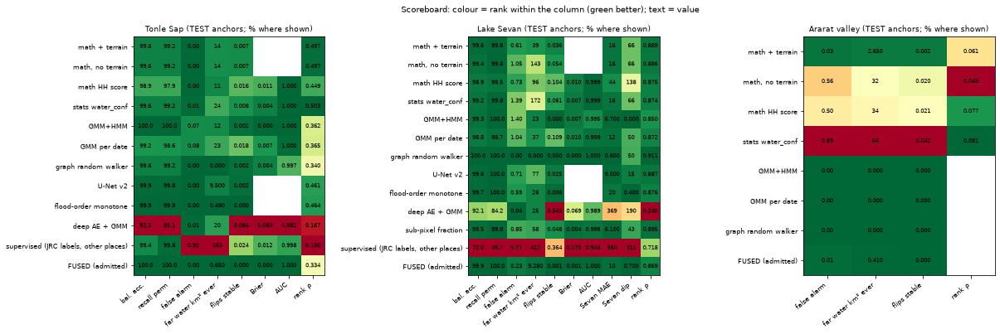
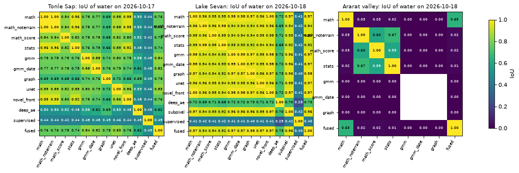
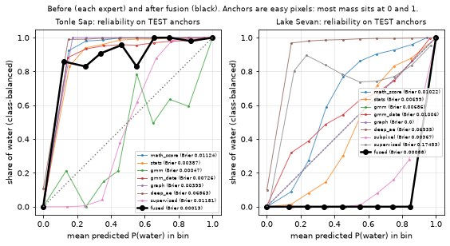
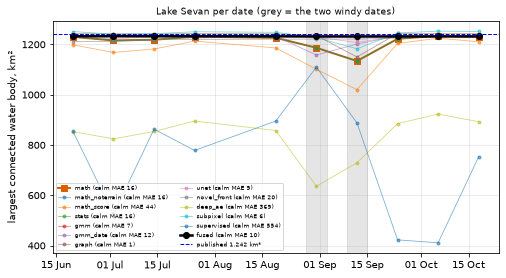
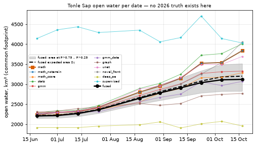
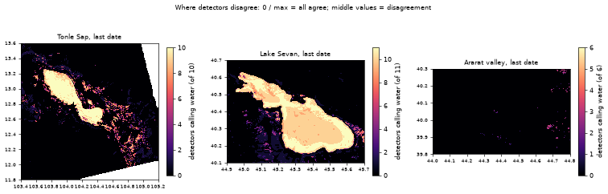

# Scoreboard: every water detector measured the same way

Generated 2026-11-14T13:10 by `.venv/bin/python -m scripts.detect.scoreboard` (code: [`scripts/detect/scoreboard.py`](../../scripts/detect/scoreboard.py); numbers: [`fusion/results.json`](fusion/results.json), section `scoreboard`). The fusion layer that uses it: [fusion.md](fusion.md).

## How every detector is measured

* **Same pixels.** The intersection of the valid footprints of all detectors available in the area (swath-edge band and partly imaged pixels already removed by the math footprint).
* **Same labels and split** as [tuning.md](tuning.md): from the JRC Global Surface Water record 1984–2021, *permanent water* (≥ 90 % occurrence and water all 12 months of 2021, minus a 2 px shoreline band), *never water* (no 30 m pixel ever water within 3 px), and *ambiguous* (everything else). Column strips tune / validation / TEST with 10 px buffers; Ararat is entirely TEST. **All anchor numbers below are on the TEST strip.** The TEST strip had already been looked at three times by the threshold tuning (tuning.md), so it is not perfectly untouched.
* **Metrics.** Recall on permanent-water pixel-dates; false-alarm rate and false km² per date on never-water pixel-dates; balanced accuracy = ½(recall + 1 − false-alarm rate); 95 % intervals from a 200× bootstrap over 20 × 20 px blocks. For probabilistic detectors: Brier score (class-balanced: mean of the two classes' Brier scores), AUC, reliability curve. *Flips* = water↔land switches per pixel over the ten dates on TEST anchors (a stable target should have 0). *Far-from-record water* = water more than 3 px from any water in 38 years of the record (the never-water label), over the whole area and on the TEST strip. Sevan: largest connected water body per date against the published 1,242 km², mean absolute error on the eight calm dates and the dip on the two windy dates (31 Aug, 12 Sep) = mean of the calm dates − mean of the windy dates. Tonle Sap has **no 2026 truth**: only open-water km², the rank correlation between long-term occurrence and number of dates called water in the ambiguous zone, and the share of late-season water inside the historical maximum extent.
* **Cost** is from the detector's notes or product file where recorded.

## Tonle Sap

Common footprint 36036 km²; TEST anchors: 8215 permanent-water px, 172434 never-water px (× 10 dates). Detectors: `math`, `math_noterrain`, `math_score`, `stats`, `gmm`, `gmm_date`, `graph`, `unet`, `novel_front`, `deep_ae`, `supervised`, `fused`.

| detector | recall perm % [95 % CI] | false alarm never % [CI] | false km²/date | bal. acc. % [CI] | Brier (bal.) | AUC | flips perm | flips never | far-from-record water km² ever (all / TEST) | rank ρ (amb., TEST) | late water inside max extent | water km² first → last | cost |
|---|---|---|---|---|---|---|---|---|---|---|---|---|---|
| **math + terrain** (`math`) | 99.15 [98.5, 99.6] | 0.005 [0.001, 0.012] | 0.27 | 99.57 [99.27, 99.80] | – | – | 0.139 | 0.0005 | 13.8 / 1.7 | 0.497 | 0.980 | 2234 → 3837 | 116.5 s (run_pipeline on CPU, this run) |
| **math, no terrain** (`math_noterrain`) | 99.15 [98.6, 99.7] | 0.005 [0.001, 0.011] | 0.27 | 99.57 [99.30, 99.83] | – | – | 0.139 | 0.0005 | 13.8 / 1.7 | 0.497 | 0.980 | 2234 → 3837 | 116.5 s (run_pipeline on CPU, this run) |
| **math HH score** (`math_score`) | 97.85 [96.7, 98.8] | 0.005 [0.001, 0.009] | 0.25 | 98.92 [98.35, 99.37] | 0.0112 | 0.9999 | 0.332 | 0.0006 | 10.9 / 1.8 | 0.449 | 0.984 | 2199 → 3286 | 116.5 s (product runtime_s) |
| **stats water_conf** (`stats`) | 99.19 [98.6, 99.6] | 0.013 [0.005, 0.023] | 0.74 | 99.59 [99.29, 99.81] | 0.0039 | 1.0000 | 0.134 | 0.0018 | 24.5 / 4.7 | 0.503 | 0.973 | 2270 → 4008 | 68.9 s (product runtime_s) |
| **GMM+HMM** (`gmm`) | 99.98 [99.9, 100.0] | 0.075 [0.029, 0.165] | 4.21 | 99.95 [99.91, 99.98] | 0.0005 | 0.9999 | 0.001 | 0.0019 | 12.4 / 11.3 | 0.362 | 0.994 | 2289 → 3326 | gmm.md: 121 s Tonle Sap, 26 s Sevan, 17 s Ararat |
| **GMM per date** (`gmm_date`) | 98.57 [97.6, 99.2] | 0.075 [0.025, 0.139] | 4.23 | 99.25 [98.79, 99.59] | 0.0073 | 0.9998 | 0.253 | 0.0066 | 23.2 / 18.8 | 0.365 | 0.989 | 2261 → 3070 | as GMM+HMM |
| **graph random walker** (`graph`) | 99.17 [97.8, 99.9] | 0.000 [0.000, 0.000] | 0.00 | 99.58 [98.88, 99.94] | 0.0040 | 0.9969 | 0.039 | 0.0000 | 0.0 / 0.0 | 0.340 | 0.996 | 2308 → 2766 | see graph.md |
| **U-Net v2** (`unet`) | 99.80 [99.6, 99.9] | 0.003 [0.000, 0.008] | 0.16 | 99.90 [99.82, 99.96] | – | – | 0.031 | 0.0002 | 9.5 / 0.8 | 0.461 | 0.981 | 2245 → 3693 | dl-notes.md: predict 16 s Tonle Sap, 4 s Sevan (train 252 s sweep) |
| **flood-order monotone** (`novel_front`) | 99.88 [99.7, 100.0] | 0.000 [0.000, 0.000] | 0.00 | 99.94 [99.83, 100.00] | – | – | 0.009 | 0.0000 | 0.5 / 0.0 | 0.464 | 0.987 | 2176 → 4052 | see novel.md |
| **deep AE + GMM** (`deep_ae`) | 85.08 [81.3, 88.6] | 0.010 [0.005, 0.017] | 0.54 | 92.53 [90.65, 94.31] | 0.0686 | 0.9815 | 1.806 | 0.0016 | 19.5 / 4.0 | 0.167 | 0.994 | 1915 → 1955 | see deep-ae notes |
| **supervised (JRC labels, other places)** (`supervised`) | 99.80 [99.6, 100.0] | 0.925 [0.554, 1.376] | 52.09 | 99.44 [99.21, 99.66] | 0.0118 | 0.9976 | 0.030 | 0.0235 | 162.8 / 88.8 | 0.150 | 0.800 | 4142 → 4030 | see supervised.md |
| **FUSED (admitted)** (`fused`) | 99.97 [99.9, 100.0] | 0.001 [0.000, 0.003] | 0.06 | 99.98 [99.95, 100.00] | 0.0001 | 1.0000 | 0.002 | 0.0000 | 0.7 / 0.2 | 0.334 | 0.996 | 2207 → 3120 | 2.4 s (product runtime_s) |

Agreement (IoU of the water masks on the last date):

| IoU | `math` | `math_noterrain` | `math_score` | `stats` | `gmm` | `gmm_date` | `graph` | `unet` | `novel_front` | `deep_ae` | `supervised` | `fused` |
|---|---|---|---|---|---|---|---|---|---|---|---|---|
| `math` | 1.00 | 1.00 | 0.84 | 0.96 | 0.78 | 0.77 | 0.69 | 0.88 | 0.95 | 0.50 | 0.44 | 0.76 |
| `math_noterrain` | 1.00 | 1.00 | 0.84 | 0.96 | 0.78 | 0.77 | 0.69 | 0.88 | 0.95 | 0.50 | 0.44 | 0.76 |
| `math_score` | 0.84 | 0.84 | 1.00 | 0.82 | 0.78 | 0.78 | 0.68 | 0.82 | 0.80 | 0.52 | 0.42 | 0.75 |
| `stats` | 0.96 | 0.96 | 0.82 | 1.00 | 0.76 | 0.75 | 0.66 | 0.85 | 0.92 | 0.48 | 0.44 | 0.74 |
| `gmm` | 0.78 | 0.78 | 0.78 | 0.76 | 1.00 | 0.88 | 0.74 | 0.80 | 0.78 | 0.58 | 0.48 | 0.84 |
| `gmm_date` | 0.77 | 0.77 | 0.78 | 0.75 | 0.88 | 1.00 | 0.76 | 0.79 | 0.74 | 0.61 | 0.48 | 0.82 |
| `graph` | 0.69 | 0.69 | 0.68 | 0.66 | 0.74 | 0.76 | 1.00 | 0.72 | 0.66 | 0.69 | 0.49 | 0.78 |
| `unet` | 0.88 | 0.88 | 0.82 | 0.85 | 0.80 | 0.79 | 0.72 | 1.00 | 0.86 | 0.53 | 0.46 | 0.83 |
| `novel_front` | 0.95 | 0.95 | 0.80 | 0.92 | 0.78 | 0.74 | 0.66 | 0.86 | 1.00 | 0.48 | 0.44 | 0.76 |
| `deep_ae` | 0.50 | 0.50 | 0.52 | 0.48 | 0.58 | 0.61 | 0.69 | 0.53 | 0.48 | 1.00 | 0.45 | 0.62 |
| `supervised` | 0.44 | 0.44 | 0.42 | 0.44 | 0.48 | 0.48 | 0.49 | 0.46 | 0.44 | 0.45 | 1.00 | 0.49 |
| `fused` | 0.76 | 0.76 | 0.75 | 0.74 | 0.84 | 0.82 | 0.78 | 0.83 | 0.76 | 0.62 | 0.49 | 1.00 |

Near-copies (IoU ≥ 0.90): `math`–`math_noterrain` 1.00; `math`–`stats` 0.96; `math_noterrain`–`stats` 0.96; `math`–`novel_front` 0.95; `math_noterrain`–`novel_front` 0.95; `stats`–`novel_front` 0.92.

## Lake Sevan

Common footprint 4499 km²; TEST anchors: 15976 permanent-water px, 37588 never-water px (× 10 dates). Detectors: `math`, `math_noterrain`, `math_score`, `stats`, `gmm`, `gmm_date`, `graph`, `unet`, `novel_front`, `deep_ae`, `subpixel`, `supervised`, `fused`.

| detector | recall perm % [95 % CI] | false alarm never % [CI] | false km²/date | bal. acc. % [CI] | Brier (bal.) | AUC | flips perm | flips never | far-from-record water km² ever (all / TEST) | largest body km² (calm MAE) | windy dip km² | water km² first → last | cost |
|---|---|---|---|---|---|---|---|---|---|---|---|---|---|
| **math + terrain** (`math`) | 99.77 [99.6, 99.9] | 0.607 [0.242, 1.128] | 7.72 | 99.58 [99.28, 99.77] | – | – | 0.043 | 0.0327 | 39.1 / 20.3 | 1134–1234 (16) | 66 | 1239 → 1255 | 8.9 s (run_pipeline on CPU, this run) |
| **math, no terrain** (`math_noterrain`) | 99.77 [99.5, 99.9] | 1.053 [0.486, 1.968] | 13.41 | 99.36 [98.94, 99.66] | – | – | 0.043 | 0.0595 | 142.9 / 37.9 | 1134–1234 (16) | 66 | 1245 → 1304 | 8.9 s (run_pipeline on CPU, this run) |
| **math HH score** (`math_score`) | 98.46 [97.6, 99.1] | 0.733 [0.311, 1.164] | 9.33 | 98.86 [98.36, 99.27] | 0.0102 | 0.9995 | 0.250 | 0.0419 | 95.5 / 26.9 | 1020–1224 (44) | 138 | 1218 → 1259 | 8.9 s (product runtime_s) |
| **stats water_conf** (`stats`) | 99.77 [99.5, 99.9] | 1.388 [0.629, 2.288] | 17.66 | 99.19 [98.76, 99.58] | 0.0070 | 0.9993 | 0.042 | 0.0694 | 172.3 / 43.8 | 1134–1234 (16) | 66 | 1257 → 1325 | 11.5 s (product runtime_s) |
| **GMM+HMM** (`gmm`) | 100.00 [100.0, 100.0] | 1.402 [0.443, 2.717] | 17.85 | 99.30 [98.64, 99.78] | 0.0069 | 0.9954 | 0.000 | 0.0001 | 23.0 / 17.9 | 1235–1235 (7) | -0 | 1261 → 1262 | gmm.md: 121 s Tonle Sap, 26 s Sevan, 17 s Ararat |
| **GMM per date** (`gmm_date`) | 98.66 [97.9, 99.2] | 1.036 [0.367, 2.139] | 13.19 | 98.81 [98.10, 99.29] | 0.0101 | 0.9987 | 0.264 | 0.0433 | 37.1 / 27.2 | 1158–1234 (12) | 50 | 1241 → 1262 | as GMM+HMM |
| **graph random walker** (`graph`) | 100.00 [100.0, 100.0] | 0.000 [0.000, 0.000] | 0.00 | 100.00 [100.00, 100.00] | 0.0000 | 1.0000 | 0.000 | 0.0000 | 0.0 / 0.0 | 1150–1243 (1) | 50 | 1243 → 1242 | see graph.md |
| **U-Net v2** (`unet`) | 100.00 [100.0, 100.0] | 0.714 [0.244, 1.342] | 9.08 | 99.64 [99.33, 99.88] | – | – | 0.000 | 0.0362 | 77.2 / 25.1 | 1208–1236 (9) | 15 | 1245 → 1275 | dl-notes.md: predict 16 s Tonle Sap, 4 s Sevan (train 252 s sweep) |
| **flood-order monotone** (`novel_front`) | 100.00 [100.0, 100.0] | 0.590 [0.131, 1.131] | 7.51 | 99.71 [99.44, 99.93] | – | – | 0.000 | 0.0092 | 25.5 / 13.8 | 1211–1233 (20) | 0 | 1220 → 1261 | see novel.md |
| **deep AE + GMM** (`deep_ae`) | 84.24 [80.7, 87.1] | 0.040 [0.016, 0.074] | 0.51 | 92.10 [90.32, 93.51] | 0.0693 | 0.9890 | 1.806 | 0.0060 | 25.5 / 3.7 | 636–923 (369) | 190 | 883 → 918 | see deep-ae notes |
| **sub-pixel fraction** (`subpixel`) | 99.80 [99.6, 99.9] | 0.854 [0.252, 1.735] | 10.87 | 99.47 [99.01, 99.80] | 0.0037 | 0.9983 | 0.036 | 0.0535 | 57.7 / 29.8 | 1182–1253 (6) | 43 | 1265 → 1290 | see subpixel.md |
| **supervised (JRC labels, other places)** (`supervised`) | 49.67 [37.9, 60.4] | 5.713 [3.778, 8.456] | 72.72 | 71.98 [65.98, 77.23] | 0.1745 | 0.9437 | 1.023 | 0.0840 | 412.3 / 95.3 | 411–1110 (554) | -311 | 1127 → 1046 | see supervised.md |
| **FUSED (admitted)** (`fused`) | 100.00 [100.0, 100.0] | 0.228 [0.021, 0.576] | 2.90 | 99.89 [99.71, 99.99] | 0.0009 | 0.9996 | 0.000 | 0.0013 | 9.3 / 3.6 | 1231–1232 (10) | 1 | 1240 → 1240 | 0.6 s (product runtime_s) |

Agreement (IoU of the water masks on the last date):

| IoU | `math` | `math_noterrain` | `math_score` | `stats` | `gmm` | `gmm_date` | `graph` | `unet` | `novel_front` | `deep_ae` | `subpixel` | `supervised` | `fused` |
|---|---|---|---|---|---|---|---|---|---|---|---|---|---|
| `math` | 1.00 | 0.96 | 0.95 | 0.95 | 0.98 | 0.98 | 0.97 | 0.96 | 1.00 | 0.72 | 0.97 | 0.41 | 0.97 |
| `math_noterrain` | 0.96 | 1.00 | 0.96 | 0.98 | 0.94 | 0.94 | 0.94 | 0.96 | 0.96 | 0.69 | 0.94 | 0.42 | 0.94 |
| `math_score` | 0.95 | 0.96 | 1.00 | 0.95 | 0.94 | 0.94 | 0.94 | 0.95 | 0.95 | 0.71 | 0.93 | 0.41 | 0.94 |
| `stats` | 0.95 | 0.98 | 0.95 | 1.00 | 0.93 | 0.93 | 0.92 | 0.94 | 0.94 | 0.68 | 0.92 | 0.42 | 0.92 |
| `gmm` | 0.98 | 0.94 | 0.94 | 0.93 | 1.00 | 0.99 | 0.97 | 0.95 | 0.98 | 0.72 | 0.96 | 0.41 | 0.97 |
| `gmm_date` | 0.98 | 0.94 | 0.94 | 0.93 | 0.99 | 1.00 | 0.97 | 0.95 | 0.98 | 0.72 | 0.96 | 0.41 | 0.97 |
| `graph` | 0.97 | 0.94 | 0.94 | 0.92 | 0.97 | 0.97 | 1.00 | 0.96 | 0.97 | 0.73 | 0.96 | 0.40 | 0.98 |
| `unet` | 0.96 | 0.96 | 0.95 | 0.94 | 0.95 | 0.95 | 0.96 | 1.00 | 0.96 | 0.71 | 0.95 | 0.41 | 0.97 |
| `novel_front` | 1.00 | 0.96 | 0.95 | 0.94 | 0.98 | 0.98 | 0.97 | 0.96 | 1.00 | 0.72 | 0.97 | 0.41 | 0.97 |
| `deep_ae` | 0.72 | 0.69 | 0.71 | 0.68 | 0.72 | 0.72 | 0.73 | 0.71 | 0.72 | 1.00 | 0.70 | 0.25 | 0.73 |
| `subpixel` | 0.97 | 0.94 | 0.93 | 0.92 | 0.96 | 0.96 | 0.96 | 0.95 | 0.97 | 0.70 | 1.00 | 0.42 | 0.96 |
| `supervised` | 0.41 | 0.42 | 0.41 | 0.42 | 0.41 | 0.41 | 0.40 | 0.41 | 0.41 | 0.25 | 0.42 | 1.00 | 0.40 |
| `fused` | 0.97 | 0.94 | 0.94 | 0.92 | 0.97 | 0.97 | 0.98 | 0.97 | 0.97 | 0.73 | 0.96 | 0.40 | 1.00 |

Near-copies (IoU ≥ 0.90): `math`–`novel_front` 1.00; `gmm`–`gmm_date` 0.99; `math_noterrain`–`stats` 0.98; `gmm_date`–`novel_front` 0.98; `gmm`–`novel_front` 0.98; `math`–`gmm_date` 0.98; `math`–`gmm` 0.98; `gmm`–`graph` 0.97; `math`–`graph` 0.97; `math`–`subpixel` 0.97; `graph`–`novel_front` 0.97; `novel_front`–`subpixel` 0.97.

## Ararat valley

Common footprint 3769 km²; TEST anchors: 0 permanent-water px, 87569 never-water px (× 10 dates). Detectors: `math`, `math_noterrain`, `math_score`, `stats`, `gmm`, `gmm_date`, `graph`, `fused`.

| detector | recall perm % [95 % CI] | false alarm never % [CI] | false km²/date | bal. acc. % [CI] | Brier (bal.) | AUC | flips perm | flips never | far-from-record water km² ever (all / TEST) | water km² first → last | cost |
|---|---|---|---|---|---|---|---|---|---|---|---|
| **math + terrain** (`math`) | – | 0.026 [0.004, 0.064] | 0.78 | – | – | – | – | 0.0017 | 2.6 / 2.6 | 1 → 0 | 2.9 s (run_pipeline on CPU, this run) |
| **math, no terrain** (`math_noterrain`) | – | 0.565 [0.268, 0.941] | 16.83 | – | – | – | – | 0.0196 | 31.7 / 31.7 | 11 → 18 | 2.9 s (run_pipeline on CPU, this run) |
| **math HH score** (`math_score`) | – | 0.495 [0.243, 0.806] | 14.75 | – | – | – | – | 0.0214 | 33.7 / 33.7 | 10 → 16 | 2.9 s (product runtime_s) |
| **stats water_conf** (`stats`) | – | 0.893 [0.483, 1.388] | 26.58 | – | – | – | – | 0.0424 | 64.1 / 64.1 | 19 → 27 | 9.1 s (product runtime_s) |
| **GMM+HMM** (`gmm`) | – | 0.000 [0.000, 0.000] | 0.00 | – | – | – | – | 0.0000 | 0.0 / 0.0 | 0 → 0 | gmm.md: 121 s Tonle Sap, 26 s Sevan, 17 s Ararat |
| **GMM per date** (`gmm_date`) | – | 0.000 [0.000, 0.000] | 0.00 | – | – | – | – | 0.0000 | 0.0 / 0.0 | 0 → 0 | as GMM+HMM |
| **graph random walker** (`graph`) | – | 0.000 [0.000, 0.000] | 0.00 | – | – | – | – | 0.0000 | 0.0 / 0.0 | 0 → 0 | see graph.md |
| **FUSED (admitted)** (`fused`) | – | 0.013 [0.000, 0.036] | 0.37 | – | – | – | – | 0.0000 | 0.4 / 0.4 | 0 → 0 | 0.5 s (product runtime_s) |

Agreement (IoU of the water masks on the last date):

| IoU | `math` | `math_noterrain` | `math_score` | `stats` | `gmm` | `gmm_date` | `graph` | `fused` |
|---|---|---|---|---|---|---|---|---|
| `math` | 1.00 | 0.03 | 0.03 | 0.02 | 0.00 | 0.00 | 0.00 | 0.65 |
| `math_noterrain` | 0.03 | 1.00 | 0.60 | 0.67 | 0.00 | 0.00 | 0.00 | 0.02 |
| `math_score` | 0.03 | 0.60 | 1.00 | 0.59 | 0.00 | 0.00 | 0.00 | 0.02 |
| `stats` | 0.02 | 0.67 | 0.59 | 1.00 | 0.00 | 0.00 | 0.00 | 0.01 |
| `gmm` | 0.00 | 0.00 | 0.00 | 0.00 | – | – | – | 0.00 |
| `gmm_date` | 0.00 | 0.00 | 0.00 | 0.00 | – | – | – | 0.00 |
| `graph` | 0.00 | 0.00 | 0.00 | 0.00 | – | – | – | 0.00 |
| `fused` | 0.65 | 0.02 | 0.02 | 0.01 | 0.00 | 0.00 | 0.00 | 1.00 |

## Figures

## What it shows

On the TEST anchors almost every detector is near the ceiling (mean balanced accuracy / Ararat specificity: `fused` 99.95 %, `graph` 99.86 %, `gmm` 99.75 %, `math` 99.71 %, `math_noterrain` 99.45 %), so anchor accuracy cannot separate them; the differences are in false water far from the record, in the windy Sevan dates and in date-to-date flips. The agreement matrix shows near-copies (last-date IoU ≥ 0.9) — most often `math–math_noterrain`, `math–stats`, `math_noterrain–stats`, `math–novel_front`, `math_noterrain–novel_front` — which is expected: several experts were trained on, or derived from, the math detector's masks. At Sevan the math detector's windy-date dip is 66 km² (calm MAE 16 km²); detectors with a smaller |dip|: `gmm` (-0), `gmm_date` (50), `graph` (50), `unet` (15), `novel_front` (0), `subpixel` (43), `fused` (1).
