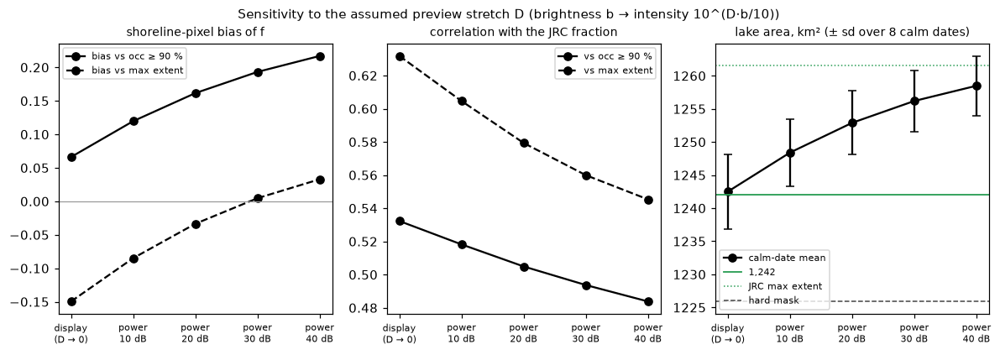
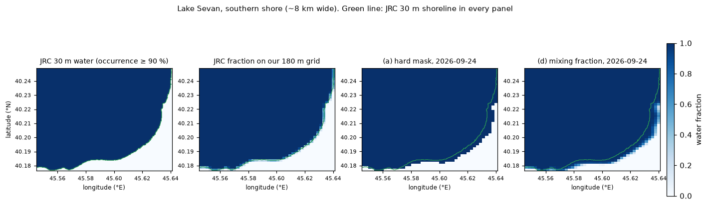
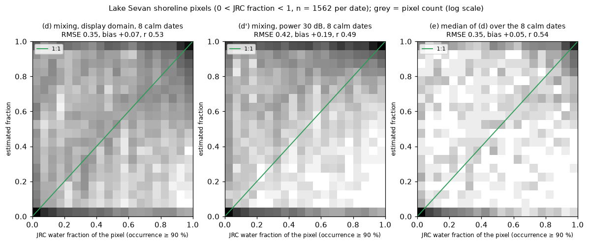
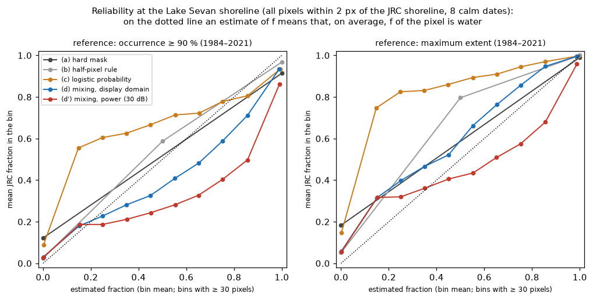
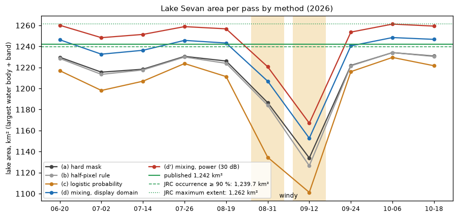
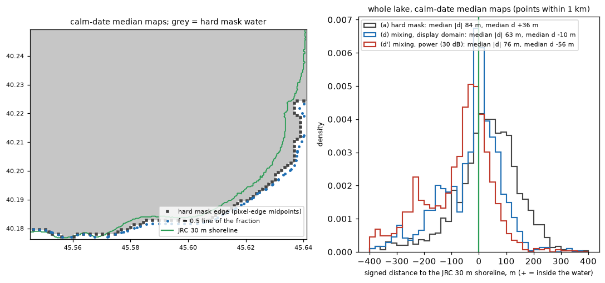
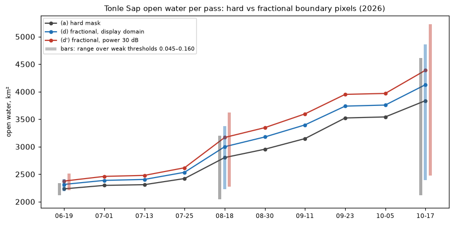

# Sub-pixel water fraction at the shoreline

Code: [`scripts/detect/subpixel.py`](../../scripts/detect/subpixel.py) · tests: [`tests/test_subpixel.py`](../../tests/test_subpixel.py) ·
numbers: [`subpixel/results.json`](subpixel/results.json) · figures: [`subpixel/`](subpixel/) ·
products: `data/processed/<area>/subpixel/products.pt`.

## In one paragraph

Our pixels are about 180 m wide, so every pixel on a shoreline is partly water and partly land. The detector
still calls each one fully water or fully land. Here each shoreline pixel instead gets a **water fraction**
between 0 and 1. The fraction comes from how dark the pixel is compared with pure water on one side and the
nearby land on the other. We checked it against 30 m Landsat water maps (JRC Global Surface Water) at Lake Sevan,
because the lake did not change in 2026. **The result:** the fraction makes the lake area estimate better. The calm-date
mean goes from −16 km² to +0.5 km² against the published 1,242 km², the date-to-date scatter goes from 6.6 to
5.6 km² (sd), and the error on the two windy dates is cut by about a fifth to a third. It also places the shoreline
better: the median distance to the 30 m shoreline is 52–63 m instead of 84–107 m. But the fraction of a *single*
pixel is still poor (RMSE about 0.35 against the 30 m truth). The ±40 m shoreline we hoped for is not reached.
**A surprise:** on our preview images the mixing works better on the display brightness itself than on
"power" with the assumed 30 dB stretch. The previews behave as if they were averaged *after* the display stretch
(details in section 3).

## 1. The idea in plain words

Take a pixel that is 40 % lake and 60 % field. The radar measures the *sum* of the echoes from both parts.
Calm water sends almost nothing back to the radar, and the field sends back its usual amount. So the pixel looks
about 60 % as bright as the field next to it, and from that we can read the water share. To do this we need
three things:

1. the brightness of pure water on that date (water end-member),
2. the brightness of the land right next to that pixel (land end-member). It is measured locally, because a
   beach, a reed bed and a ploughed field are very different,
3. the right **scale** on which echoes add up. Echo power adds up; decibels do not.

## 2. Formulas

Symbols: $b$ = preview brightness (0–1, the log-like value `L` the detector uses); $I$ = intensity (power);
$f$ = water fraction of a pixel; $I_w$, $I_l$ = water and land end-members; $D$ = the assumed dB span of the
preview stretch (30 dB in [stats-change](stats-change.md)).

**Linear mixing.** For one pixel and one channel,

$$I = f\,I_w + (1-f)\,I_l \quad\Longrightarrow\quad f = \mathrm{clip}\!\left(\frac{I_l - I}{I_l - I_w},\,0,\,1\right).$$

**Domain.** "power": $I = 10^{D\,b/10}$ (the same as `stats_change.pseudo_intensity`, with $b$ clamped at the
display floor). "display": $I = b$ (the mixing is done on the brightness itself). For calibrated γ⁰ in dB,
"power" is $I = 10^{L/10}$.

**Where.** $f$ is computed in a **band**: the pixels within 1 pixel of the detected water edge, on both sides.
Detected water outside the band gets $f=1$, and everything else gets $f=0$.

**Water end-member** $I_w$: the mean of $I$ over the detected water after it is shrunk by 2 pixels (only the
interior). It is taken locally in a 31 × 31 window, because wind roughens the lake in patches. Where fewer than
25 interior pixels fall in the window, the date's median over the whole interior is used instead. We use the
mean, not the median, because what mixes is the mean power.

**Land end-member** $I_l$: a trimmed mean (lowest and highest 20 % dropped) of $I$ over *confident land* in an
11 × 11 window. Confident land means: valid, more than 2 pixels away from any detected water (so other shoreline
pixels are excluded), and not in the permanent-water prior. If the window holds fewer than 8 such pixels, a
21 × 21 window is used. If land is less than 0.1 brightness (3 dB at a 30 dB stretch) brighter than water, the
pixel keeps its hard value.

**HH, HV and their combination.** $f$ is computed for each channel. The combination is
$f = w_{HH} f_{HH} + w_{HV} f_{HV}$ with $w_c \propto 1/\sigma_c^2$, the minimum-variance weights. Here
$\sigma_c^2$ is the mean squared error of each channel's unclipped estimate on the ring of pixels just beyond the
band, where the truth is known without any reference (1 on the water side, 0 on the land side). At Sevan this
gives $w_{HH}\approx 0.67$ in the display domain and $w_{HH}\approx 0.55$ in power.

**Sub-pixel shoreline.** This is the line $f = 0.5$, found by linear interpolation between neighbouring pixel
centres along rows and columns. For a 0/1 mask the same rule gives the midpoints of the pixel edges, which is the
hard mask's staircase. The distance to the JRC 30 m shoreline is read from a signed-distance field (m, + = inside
the water) built on the 30 m map of the largest water body.

**Lake area.** $A = s^2 \sum f$ over the largest connected water body of the date plus a 2-pixel ring around it.
This way dark land elsewhere does not count.

**Speckle filter.** The fraction uses the *unfiltered*, gain-normalised preview. The detector's band and hard
mask still come from the filtered `L`. We expected the 3 × 3 filter to smear every edge over three pixels.
In practice the Quegan filter keeps the spatial detail of the temporal mean, so a stable shoreline stays sharp:
with the filtered `L` the numbers change by ≤ 0.002 in RMSE and ≤ 0.3 km² in area (table rows "filteredL" in
`results.json`). We kept the unfiltered input because it is right in principle, and because for a moving
shoreline the filter *would* mix dates.

## 3. Why power and not decibels, and what the previews actually say

Radar echoes from the parts of a pixel add up **in power**. A pixel that is half water and half land
($I_w \ll I_l$) has $I \approx 0.5\,I_l$. That is only 3 dB darker than the land, which is 0.1 of a 30 dB
stretch, not halfway to the water level. So mixing done on decibels badly *underestimates* partial water.
The synthetic test shows this (`test_power_domain_beats_log_domain`: a scene multilooked in power, with known
fractions). There, power-domain mixing recovers the true fractions and log-domain mixing does not.

**The real previews behave the other way.** At Lake Sevan, display-domain mixing fits the 30 m truth better than
power mixing for every stretch we tried. The correlation with the reference falls steadily as $D$ grows:
display 0.53 → 10 dB 0.52 → 20 dB 0.50 → 30 dB 0.49 → 40 dB 0.48 against occurrence ≥ 90 %, and
0.63 → 0.60 → 0.58 → 0.56 → 0.55 against the maximum extent (figure below). The simplest explanation is that the
ASF browse PNG is made by stretching the full-resolution image to 8 bits and *then* shrinking it to ~180 m. If so,
the averaging that makes our mixed pixels happened in display units, and display-domain mixing is the physically
right model *for these previews*. Another sign points the same way: a pixel centred on the JRC shoreline has a
median brightness of 0.15, darker than either model predicts for $f = 0.5$. So other effects (a larger 2026
lake, geolocation) also play a part. **Decision:** `domain="auto"` uses "display" for previews and "power" for
calibrated γ⁰ (where the averaging really is in power). Both are kept in the products
(`frac` = display, `frac_power30`).



## 4. Lake Sevan: the decisive test

Truth: JRC Global Surface Water 1984–2021 at 30 m, area-weighted onto our grid
(`validate.reference_on_grid`). The **water fraction of every 180 m pixel** is computed two ways, from
occurrence ≥ 90 % and from the maximum extent. Shoreline pixels are those with a reference fraction strictly
between 0 and 1, within ~0.9 km of the main lake: 1,562 (occurrence) and 1,685 (extent) per date. Dates:
8 calm ones; 31 Aug and 12 Sep (windy) are shown separately.



### 4.1 Per-pixel fraction (8 calm dates pooled; "median" = the median map over the 8 calm dates)

| method | RMSE (occ ≥ 90) | bias | r | RMSE (max extent) | bias | r |
|---|---|---|---|---|---|---|
| (a) hard mask (detector) | 0.474 | −0.106 | 0.42 | 0.514 | −0.364 | 0.43 |
| (b) half-pixel rule | **0.340** | −0.034 | 0.39 | 0.347 | −0.179 | 0.54 |
| (c) logistic probability (`water_conf`) | 0.431 | −0.108 | 0.46 | 0.486 | −0.362 | 0.49 |
| (d) mixing, display, HH | 0.354 | +0.064 | 0.53 | 0.330 | −0.152 | 0.63 |
| (d) mixing, display, HV | 0.372 | +0.068 | 0.50 | 0.341 | −0.147 | 0.61 |
| (d) mixing, display, HH+HV | 0.354 | +0.066 | 0.53 | **0.329** | −0.150 | **0.63** |
| (d') mixing, power 30 dB, HH | 0.426 | +0.214 | 0.49 | 0.373 | +0.027 | 0.56 |
| (d') mixing, power 30 dB, HV | 0.425 | +0.168 | 0.45 | 0.378 | −0.018 | 0.53 |
| (d') mixing, power 30 dB, HH+HV | 0.416 | +0.193 | 0.49 | 0.365 | **+0.005** | 0.56 |
| (e) median of (d) over calm dates | 0.348 | +0.054 | **0.54** | 0.328 | −0.164 | **0.65** |
| (e') median of (d') over calm dates | 0.410 | +0.183 | 0.50 | 0.362 | −0.009 | 0.57 |

* The **best channel is HH**. HV alone is a little worse; the combination is equal to HH or slightly better.
* The mixing fraction beats the hard mask clearly. Against the occurrence reference it is about as good as the
  half-pixel rule in RMSE, and much better in correlation (it knows *which* pixels are mostly water).
* **Every method is weak per pixel** (r ≤ 0.65). The scatter plot shows why. Many reference shoreline pixels lie
  outside our 1-pixel band (our edge is a pixel off), so they keep a hard 0 or 1. The two references also disagree
  by a whole bias step (−0.15 vs +0.07 for the same map). The 2026 lake lies between the "≥ 90 % of the time"
  lake (1,239.7 km²) and the 38-year maximum (1,262 km²), so the truth itself is uncertain at this level.





The reliability curve uses all pixels within 2 pixels of the JRC shoreline (0 and 1 included). The two
references bracket the truth. Against occurrence ≥ 90 % (the smaller lake) the display fraction lies below the
diagonal (a bit too much water). Against the maximum extent (the larger lake) it lies above (a bit too little).
The power fraction is below the diagonal for both, so it has too much water at any plausible truth. The hard
mask and the half-pixel rule have only 2–3 values, so they cannot be calibrated. The logistic "probability" is
not a fraction: anything above 0.1 already means a pixel that is 55–80 % water.

### 4.2 Lake area (largest water body + its band; km²)

| method | calm mean | error vs 1,242 | calm sd | calm range | 31 Aug (windy) | 12 Sep (windy) |
|---|---|---|---|---|---|---|
| (a) hard mask | 1,225.9 | −16.1 | 6.6 | 18.6 | 1,186.5 (−56) | 1,133.9 (−108) |
| (b) half-pixel | 1,224.9 | −17.1 | 7.1 | 20.7 | 1,184.0 (−58) | 1,126.5 (−116) |
| (c) logistic | 1,215.5 | −26.5 | 10.0 | 31.4 | 1,134.5 (−108) | 1,101.2 (−141) |
| **(d) mixing, display** | **1,242.5** | **+0.5** | 5.6 | 15.8 | 1,206.9 (−35) | 1,152.7 (−89) |
| (d') mixing, power 30 dB | 1,256.2 | +14.2 | **4.6** | **13.0** | 1,220.6 (−21) | 1,167.0 (−75) |
| (e) calm median map, display | 1,244.6 | +2.6 | – | – | – | – |

The truth is 1,242 km² published, 1,239.7 km² for JRC occurrence ≥ 90 %, and 1,261.6 km² for the JRC
maximum extent in the same window. **Yes, the sub-pixel estimate reduces both the bias and the date-to-date
scatter.** The hard mask is 16 km² low on every calm date, because the edge of a dark lake is called land until a
pixel is mostly water. The fractional sum lands between the two JRC references. The scatter drops by 15 %
(display) to 30 % (power). On windy days the fraction gets back 20–35 km² of the 56–108 km² shortfall. That is
about a third, not all of it: a wind-roughened patch that the detector has dropped lies outside the band, and
wind also raises $I_w$.



### 4.3 Shoreline position (calm-date median maps, points within 1 km of the JRC shoreline)

| line | vs occ ≥ 90 %: median abs distance | median signed | mean abs | vs max extent: median abs | median signed |
|---|---|---|---|---|---|
| hard mask staircase | 84 m | +36 m (inside) | 123 m | 107 m | +102 m |
| f = 0.5, display | **63 m** | −10 m | 115 m | **52 m** | +35 m |
| f = 0.5, power 30 dB | 76 m | −56 m (outside) | 145 m | 55 m | −10 m |

Per date (mean of the 8 calm dates' medians): hard 88 m, display 68 m, power 83 m against occurrence ≥ 90 %
(110 / 55 / 58 m against the maximum extent). **So the shoreline is placed to about ±50–65 m (median) from
180 m pixels, against ±85–105 m for the staircase.**
That is roughly a third of a pixel, but not the ±40 m we hoped for. The means are larger (80–150 m) because of
places where the lake really differs from the 1984–2021 map, such as the flat south-east shore and river mouths.



### 4.4 Is the rest geolocation?

We moved the reference by fractions of a pixel (−1 to +1 pixel in steps of 0.25, rows and columns) and scored
the calm-median maps on a fixed set of 4,533 pixels (within ~1 pixel of the shoreline):

| map | RMSE at 0 | best shift (rows, cols) | RMSE at best | r at 0 → best | shoreline median abs at best |
|---|---|---|---|---|---|
| hard | 0.342 | (−0.5, −0.25) px | 0.311 | 0.75 → 0.79 | 67 m |
| display fraction | 0.278 | (−0.5, −0.25) px | 0.258 | 0.81 → 0.84 | 62 m |
| power 30 dB fraction | 0.342 | (−0.25, −0.25) px | 0.330 | 0.75 → 0.77 | 77 m |

A shift of about half a pixel north and a quarter pixel west (~100 m) improves every method by a similar small
amount. So there is a real geolocation offset of about 0.5 pixel (the previews are georeferenced from the
footprint corners). But it explains only a small part of the error (RMSE 0.278 → 0.258). The rest is resolution
and registration noise from pixel to pixel, plus the reference's epoch.

## 5. Tonle Sap

Detector as in `run.py` (terrain mask on). The fraction is display-domain HH+HV, with the same knobs as at Sevan.

| date | hard | half-pixel | fractional, display | fractional, power 30 dB | extra from partial pixels (display) | shoreline band area |
|---|---|---|---|---|---|---|
| 19 Jun | 2,234 | 2,242 | 2,315 | 2,376 | +81 | 350 |
| 1 Jul | 2,297 | 2,306 | 2,388 | 2,460 | +91 | 435 |
| 13 Jul | 2,310 | 2,319 | 2,405 | 2,479 | +95 | 431 |
| 25 Jul | 2,421 | 2,431 | 2,535 | 2,617 | +113 | 475 |
| 18 Aug | 2,803 | 2,815 | 2,999 | 3,168 | +197 | 1,000 |
| 30 Aug | 2,954 | 2,971 | 3,177 | 3,346 | +223 | 1,029 |
| 11 Sep | 3,147 | 3,161 | 3,396 | 3,597 | +249 | 1,296 |
| 23 Sep | 3,522 | 3,537 | 3,738 | 3,951 | +215 | 1,588 |
| 5 Oct | 3,541 | 3,554 | 3,757 | 3,968 | +216 | 1,587 |
| 17 Oct | 3,837 | 3,848 | 4,127 | 4,389 | +290 | 1,958 |

(km²). The partial pixels add 4–8 % (display) or 6–14 % (power). Almost all of it comes from land-side band
pixels that are partly dark (17 Oct: +452 km² on the land side, −162 km² on the water side). This fits the
[tuning](tuning.md) finding that our thresholds are a lower bound on the floodplain. But a dark wet field next to
the lake also counts as "partly water" here, and we cannot tell the two apart.



**Validation on the first date (19 Jun, low water).** We checked 21,152 pixels where the JRC occurrence ≥ 90 %
fraction is strictly between 0 and 1 near the permanent lake. All methods are equally poor:
hard RMSE 0.51 / r 0.26, half-pixel 0.49 / 0.26, logistic 0.50 / 0.26, display fraction 0.49 / 0.26,
power 0.50 / 0.25. Every method has a bias of +0.15 to +0.20: on 19 June 2026 we see more water than the
"≥ 90 % of the time" lake. The low-water lake of 2026 is not the 1984–2021 permanent lake, and the margins are
vegetated and shallow. **There is no per-pixel gain at Tonle Sap that we can show.** For the later dates no truth
exists.

**The shoreline uncertainty band** ([stats-change](stats-change.md): on 17 Oct the boundary term is 956 km²).
That term is $0.9\,P\,s$: every one of the $P/s$ edge pixels could be all water or all land. With fractional edge
pixels this ±half-pixel term is replaced by the uncertainty of the *fraction model*. On 17 Oct that is the spread
between display, power 20, power 30 and power 40 dB = **317 km²** (19 Jun 71 km² vs 167 binary; 18 Aug 204 vs
487). So the boundary term shrinks by about two thirds, *if* one of these models is right. The **threshold** term
does not shrink. Over the weak thresholds 0.045–0.160, the 5–95 % width on 17 Oct is 2,264 km² binary,
2,231 km² display-fractional and 2,489 km² power-fractional. A looser threshold adds whole dark floodplain
patches, not just shoreline pixels, and partial pixels cannot fix a definition question. The fractional area is
still uncertain by about ±1,100 km² on 17 Oct, and the threshold accounts for almost all of it.

## 6. Ararat (control, essentially no water)

Hard 0.5–3.8 km² per date; fractional 1.2–6.8 km² (display) and 1.4–7.6 km² (power). The fraction roughly
doubles the false water around the few false-positive specks. That is small in km², but it shows that partly
dark land next to a falsely detected pixel is read as partial water. The fraction cannot be better than the mask
it refines.

## 7. Verdict

* **Lake areas: adopt it for stable, open lakes.** At Sevan the fractional sum removes the hard mask's −16 km²
  bias, cuts the date-to-date scatter by 15–30 % and recovers about a third of the windy-date loss. Report the
  display-domain fractional sum as the area figure, and the hard area as a lower bound.
* **The map: show it only as a soft shoreline**, for example opacity on the edge pixels or the f = 0.5 line.
  A single pixel's fraction is not reliable (RMSE ~0.35, r ~0.5–0.65), but the f = 0.5 line is about 20–50 m
  closer to the true shoreline than the staircase.
* **Floodplains (Tonle Sap): do not quote fractional areas as better.** They add 80–290 km² of partial pixels
  that we cannot verify. They leave the dominant threshold uncertainty untouched. They shrink only the smaller
  boundary term (956 → ~317 km² on 17 Oct), and only if the model is right. If they are used, quote them as the
  upper side of the open-water range, next to the hard value.
* **Domain:** for the previews, mix in display units (better on every per-pixel measure). For calibrated GCOV,
  mix in power. Re-test this on calibrated data before relying on it.

## 8. Limits

* **Uncalibrated previews and an assumed stretch.** Power-domain fractions depend on $D$. At Sevan, going from
  20 to 40 dB moves the lake area by 6 km² (1,253 → 1,259) and the shoreline bias of $f$ by 0.06. The
  display-domain choice removes $D$ but rests on our *inference* that the browse images are averaged after
  stretching. With calibrated GCOV, use `domain="power"`.
* **The per-pixel fraction is noisy** (RMSE ~0.35). A single pixel's fraction should not be shown as an exact
  number. Sums over many pixels (areas) are what improve.
* **Band is one pixel wide.** If the detector's edge is two pixels off, the truth is not reached (scatter plot:
  the mass at 0 and 1). A wider band (2 px) changed nothing at Sevan.
* **Wind raises $I_w$.** The local water end-member follows patchy wind only partly. Pixels the detector has
  already dropped are outside the band. Windy-date areas stay 35–90 km² low.
* **Land end-member is uncertain where land is dark** (wet fields, beaches, smooth roads). Then $I_l - I_w$ is
  small, so $f$ is noisy. Below 0.1 brightness contrast the pixel keeps its hard value. Land right at the shore
  is often darker than land 3–5 pixels inland, and this biases $f$ upward.
* **Flooded vegetation is brighter than land** (double bounce). A shoreline pixel of flooded forest gives
  $I > I_l$, so $f$ is clipped to 0, and the land ring itself may be flooded forest. At Tonle Sap the fraction
  therefore says nothing about flooded forest. It only refines the *open-water* edge, and it is unreliable where
  the band runs into flooded vegetation.
* **Reference epoch.** JRC ends in 2021, and the 2026 Sevan shoreline differs from it in flat places. The two JRC
  layers bracket the truth 22 km² apart, which is larger than the improvements we are measuring.
* **Geolocation.** About half a pixel of offset (section 4.4) remains in all products.
* **Tonle Sap's later dates have no truth.** Only the first date (low water) is checked, and only against a
  long-term occurrence.

## 9. Reproduce and integrate

```bash
.venv/bin/python -m scripts.detect.subpixel            # sevan, tonle-sap, ararat (one after another, CPU)
.venv/bin/python -m scripts.detect.subpixel sevan
.venv/bin/python -m pytest tests/test_subpixel.py -q
```

```python
from scripts.detect import ops, subpixel
out = ops.run_pipeline(x, valid, "preview", water_ok=water_ok)
fr = subpixel.water_fraction(out["L"], out["valid"], out["water"], source="preview",
                             prior_water=out["prior_water"], km2_per_px=km2)
fr["frac"]           # [T,H,W] float16, 0..1 (1 inside water, 0 on land, mixing in the shoreline band)
fr["area_km2_frac"]  # [T]  vs fr["area_km2_hard"] [T]
fr["band"]           # [T,H,W] bool
```

The CLI also passes `x_frac` = the unfiltered, gain-normalised preview (as here). `domain="auto"` gives
display for previews and power for γ⁰.
