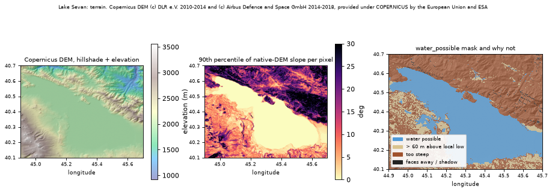
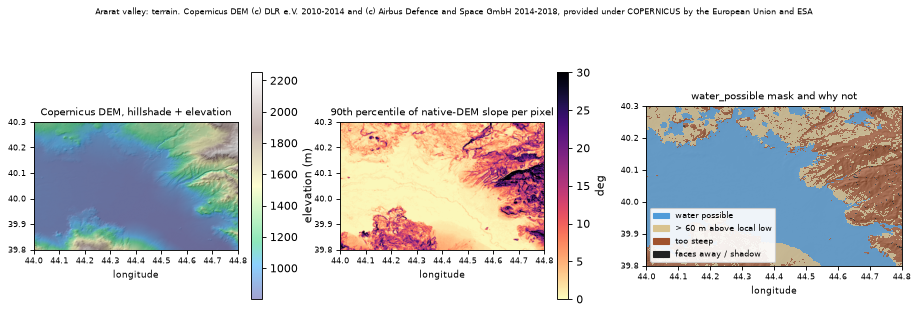
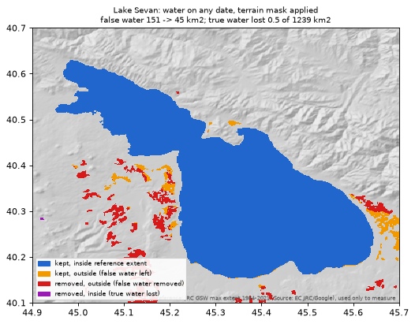
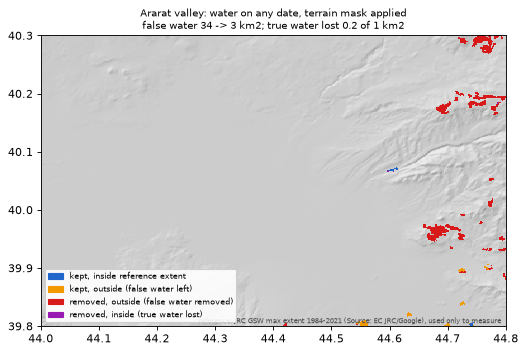
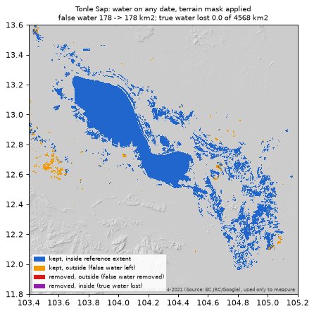
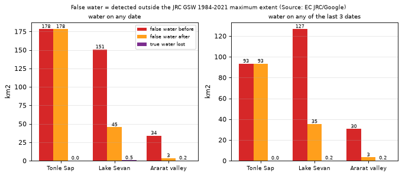

# Terrain mask: removing false "water" in the mountains

    .venv/bin/python -m scripts.detect.terrain              # build the mask for all three areas
    .venv/bin/python -m scripts.detect.terrain sevan --report   # one area, and measure the effect
    .venv/bin/python -m pytest tests/test_terrain.py -q     # synthetic-terrain tests

Code: `scripts/detect/terrain.py`. Output: `data/processed/<area>/terrain.pt` (tensors on our detection grid;
key `effect` holds the measured numbers below). Figures: `docs/eda/terrain/`.

## Why

Our detector calls a pixel open water when the radar return is very dark (`docs/eda/math-detection.md`).
That is right on flat ground, but the independent check against 38 years of Landsat
(`docs/eda/validation.md`) found ~127 km² of late-season "water" around Lake Sevan and essentially *all*
detected water in the Ararat Valley box (9–31 km² per date) where Landsat never saw water.

Water has two properties we can test without looking at any water map: **its surface is flat**, and **it
collects in local lows**. A radar also cannot see slopes that face away from it steeply enough (radar
shadow). So we built a mask `water_possible` from an elevation model only, and remove "water" outside it.
The Landsat reference (JRC Global Surface Water) is **not** used to build the mask; it is only used
afterwards to measure what the mask did.

## Data

**Copernicus DEM** (a digital surface model: tops of trees and buildings, not bare ground), public
cloud-optimised GeoTIFF tiles of 1°×1° on AWS (`copernicus-dem-30m` / `copernicus-dem-90m` buckets, no
login). The 30 m version (GLO-30) **is not published for Armenia** (tiles N39/N40 E043–E045 return
404), so Armenia uses GLO-90 (3 arc-seconds, ~70 × 93 m there). Tonle Sap also uses GLO-90 (reading
GLO-30 remotely ran at ~10 kB/s from here; Tonle Sap is flat, so 90 m loses nothing important; set
`TERRAIN_DEM=GLO-30` to try 30 m). Clips are cached in `data/external/dem/<area>_dem.tif` (~2 MB per
Armenian area, 15 MB for Tonle Sap; its nine whole 90 m tiles, ~50 MB, were fetched with curl into
`data/external/dem/tiles/`, which `fetch_dem` uses before trying the network).

> Copernicus DEM © DLR e.V. 2010–2014 and © Airbus Defence and Space GmbH 2014–2018, provided under
> COPERNICUS by the European Union and ESA.

The DEM surface is from 2011–2015 (TanDEM-X). Water bodies are flattened in it (edited to a constant
height), which helps us: a lake or reservoir surface has slope ≈ 0.

## Radar geometry

* **Look side: left.** NISAR is left-looking only (ASF NISAR docs "NISAR intro"; JPL "observation
  strategy": the mission chose left-looking for full Antarctic coverage). Confidence: high.
* **Ground heading** from the footprint polygon in `data/raw/previews/T<track>_F<frame>/meta.json`: the two
  polygon edges closest to north–south run along track. Track 85 (Sevan, Ararat, ascending): heading
  **341°** (north-north-west); track 83 (Tonle Sap): **346°**. Confidence: high (±2°; the footprint is
  a 4-corner approximation).
* **Look azimuth** (direction from the radar to the ground) = heading − 90° for a left-looking radar:
  **251°** (towards west-south-west) for Armenia, 256° for Tonle Sap. The radar sits to the
  east-north-east, so slopes that face **west-south-west** face away from it.
* **Incidence angle**: assumed to grow linearly from 33° at the near-range edge (sensor side) to 47° at the
  far edge of the ~250 km swath (≈ 40° at Sevan). This is an approximation: the true values are in the
  GCOV metadata, which we do not have for the previews.

## Formulas

Everything is computed at the DEM's native resolution first, then area-averaged onto our ~180 m grid
(exact overlap weights, same method as `validate.py`).

* **Slope** from central differences (a 3×3 `conv2d`), with the east–west pixel size corrected by
  cos(latitude): gx = ∂z/∂x_east, gy = ∂z/∂y_north, slope = atan(√(gx² + gy²)), aspect = atan2(−gx, −gy)
  (the downhill direction). Per grid pixel we keep the **mean** and the **90th percentile** of the native
  slope: a 180 m average hides a narrow steep bank, the 90th percentile does not.
* **Local incidence**: with look vector l (sensor → ground; horizontal part sin θ·(sin az, cos az),
  vertical part −cos θ) and surface normal n = (−gx, −gy, 1)/|·|,
  cos θ_loc = n·(−l) = (cos θ + sin θ·(gx sin az + gy cos az)) / √(1 + gx² + gy²).
* **Shadow**: θ_loc ≥ 90° (the face tilts away from the radar by more than the grazing angle 90° − θ),
  **or** cast shadow: marching from each point towards the sensor, terrain at horizontal distance d
  higher than z + d·cot θ blocks the ray. **Layover** (kept for information): slope rising along the look
  direction steeper than θ.
* **Relative height** (a cheap "height above nearest drainage"): elevation minus the local minimum within
  a 4 km window (max-pool of the negated DEM), smoothed by a 4 km average; computed on a grid extended
  ~5 km past the box so edges are not biased.

## Rule and thresholds

Open water is **not** possible in a pixel if

| test | threshold | why |
|---|---|---|
| steep | mean native slope > **5°** or its 90th percentile > **15°** | a water surface is flat (0° in the DEM). 5° over 180 m is a 16 m drop; 15° for 10 % of the pixel is a steep bank or hillside. |
| high | > **60 m** above the smoothed local minimum within **4 km** | water collects in lows; seasonal floods and lake-level swings are a few metres, so 60 m is a wide margin. |
| faces away / shadow | > 50 % of the pixel at local incidence > **65°**, or > **25 %** in shadow | the radar sees too little there; dry rough ground is as dark as calm water. |

**Shore guard:** "steep" and "high" are waived within 1 pixel of a flat basin (mean slope ≤ 1°, p90 ≤ 2°,
≥ 0.5 km²). A lake surface is flat in the DEM, so its 180 m shore pixels (half water, half bank) and a
reservoir held above the valley floor by a dam are kept. Shadow is never waived.

How they were chosen: from the physics above, then checked on the real lakes: Lake Sevan's water
(1,239 km² overlapping the reference) loses 0.5 km² (0.04 %), and the 2 % shore band is kept by the
guard. Variants: relative height 40 m removes 79 % of Sevan's false water instead of 70 % but cuts more
than half of the (tiny, 1 km²) real water in the Ararat box, so we kept the more conservative 60 m.
Tightening slope to 3°/10° changes little (74 %). These checks used the reference only to read off the
trade-off; no threshold was fitted pixel-by-pixel to it.

## Results

"False water" = detected water outside the JRC GSW 1984–2021 **maximum** extent (Landsat never saw
water there in 38 years). "True water lost" = detected water inside that extent that the mask removes.

### Water on any date (2026-06 to 2026-10)

| area | detected km² | false before | false after | false removed | true water | true lost |
|---|---|---|---|---|---|---|
| Lake Sevan | 1,389 → 1,284 | 150.7 | 45.3 | **70 %** | 1,238.7 | 0.5 (0.04 %) |
| Ararat valley | 34.9 → 4.1 | 34.0 | 3.4 | **90 %** | 1.0 | 0.2 |
| Tonle Sap | 4,746 → 4,746 | 178.3 | 178.3 | 0 % | 4,567.7 | 0.0 |

Late season (any of the last 3 dates, the metric of `validation.md`): Sevan 126.7 → 35.2 km² false
(72 % removed, 0.2 km² true water lost); Ararat 30.5 → 3.2 km² (90 % removed).

Does the mask keep the real lakes? Share of the reference water (Landsat) that lies inside
`water_possible`: Tonle Sap 99.99 % of the 12,087 km² maximum extent and 100 % of permanent water;
Sevan 99.9 % / 99.96 %; Ararat box 93 % of 28 km² maximum extent but only 66 % of its ~1 km² of permanent
water (small reservoirs / fish ponds on slopes or perched above the valley floor; see limits).

Tonle Sap: the mask removes nothing (the floodplain is flat and low); its 178 km² of false water is on
flat ground and needs another fix (see `validation.md`). Applying the mask there is harmless.

### Agreement scores

| area | comparison | IoU | precision | recall |
|---|---|---|---|---|
| Sevan | permanent class vs occurrence ≥ 90 % | 0.942 → 0.945 | 0.984 → 0.988 | 0.956 → 0.956 |
| Sevan | any-date water vs max extent | 0.876 → **0.946** | 0.892 → **0.965** | 0.981 → 0.980 |
| Ararat | any-date water vs max extent | 0.016 → 0.024 | 0.027 → 0.18 | 0.035 → 0.027 |
| Ararat | permanent class | 8.9 km² of "permanent water" → 0.4 km², all of it false before and after | | |
| Tonle Sap | all comparisons | unchanged (0.634 / 0.685 / 0.896 permanent vs occ ≥ 90 %) | | |

### Lake Sevan area per date (published: 1,242 km²)

Total water in the Sevan box (lake plus whatever false water remains).

| date | before km² | after km² | false before | false after |
|---|---|---|---|---|
| 2026-06-20 | 1,245.3 | 1,239.0 | 15.3 | 9.3 |
| 2026-07-02 | 1,235.0 | 1,226.9 | 19.4 | 11.7 |
| 2026-07-14 | 1,234.8 | 1,228.3 | 16.5 | 10.3 |
| 2026-07-26 | 1,283.8 | 1,252.8 | 53.1 | 22.4 |
| 2026-08-19 | 1,260.6 | 1,240.6 | 34.3 | 14.7 |
| 2026-08-31 | 1,236.1 | 1,210.5 | 43.8 | 18.3 |
| 2026-09-12 | 1,197.1 | 1,176.4 | 44.4 | 23.9 |
| 2026-09-24 | 1,279.2 | 1,244.8 | 57.6 | 23.4 |
| 2026-10-06 | 1,329.1 | 1,251.6 | 95.1 | 17.8 |
| 2026-10-18 | 1,304.0 | 1,255.2 | 73.3 | 24.7 |

The spread over the season shrinks from 1,197–1,329 km² (±5 % around 1,242) to 1,176–1,256 km². The
remaining dips (e.g. 12 Sep) are wind on the lake, not terrain (`validation.md`).

Ararat per date: 10–31 km² of water before, 0.5–3.8 km² after (all but ~0.1 km² of it false both times).

## Figures

## What it does not fix

* **Radar shadow was not the cause.** At 40° incidence a slope must face away by more than 50° to be in
  shadow; at 90 m resolution almost nothing is that steep. None of the false water was in shadow or at
  local incidence > 65°. What removed it is slope (Sevan 40 km²) and especially **height above the local
  low** (Sevan 104 km², Ararat 31 km²; pixels can have both). The false water sits on moderately sloping
  uplands well above any valley floor: probably smooth, dry, bare ground (late-season pasture, fallow
  fields) that is radar-dark, possibly helped by slopes tilted gently away from the radar.
* **Flat smooth dry ground remains.** 72 % (Sevan) and 78 % (Ararat) of the false water left has a mean
  slope below 2°. Largest remaining Sevan clusters (late season): 12.4 km² at 45.67 E 40.28 N (a flat
  high basin east of the lake), 3.3 km² at 45.20 E 40.35 N, 2.5 km² at 45.19 E 40.39 N; Ararat: 1.2 km² at
  44.55 E 39.80 N and small patches near 44.72 E 39.84–39.90 N. Terrain cannot tell a dry flat field, a
  runway or a salt flat from water; the time series (e.g. darkness that grows through the dry season) or
  optical data would have to.
* **Real water on slopes or high up is at risk**: small reservoirs in narrow valleys whose surface the
  DEM did not flatten, mountain lakes in hanging valleys above a deeper valley within 4 km, and rivers in
  steep gorges. In the Ararat box 0.2 km² of 1.0 km² real water was removed.
* **Approximations**: DEM is a 2011–2015 surface model at 90 m (GLO-30 not public for Armenia);
  our pixels are ~180 m; the look direction is exact in sign but heading and incidence come from the
  footprint corners and an assumed 33°–47° incidence range; the DEM includes trees and buildings (a
  forest edge looks like a 20 m cliff).

## For the pipeline

`scripts/detect/terrain.py`: `water_possible(area_id: str, shape: tuple[int, int] | None = None) -> torch.BoolTensor [H, W]`,
applied as `water = water & water_possible(area, water.shape[-2:]).to(water.device)` after
`ops.water_masks` (before the class step, so permanent/seasonal classes are recomputed on the cleaned
water). `terrain_mask(area)` returns all layers.
