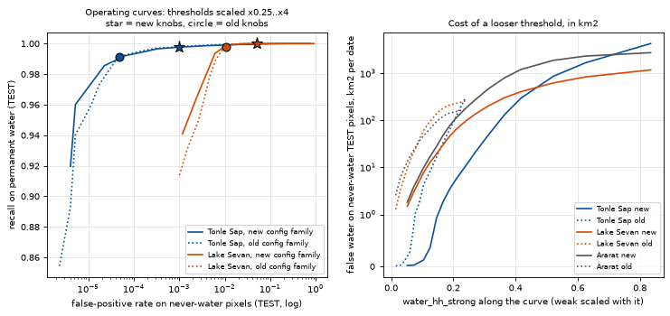
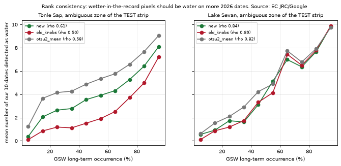
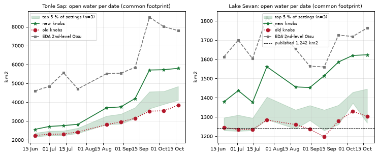

# Tuning the water thresholds against an independent reference

Code: `scripts/detect/tune.py` · tests: `tests/test_tune.py` · numbers: `docs/eda/tuning/results.json` ·
recommendation: `docs/eda/tuning/best_knobs.json` · figures: `docs/eda/tuning/*.png`.

    .venv/bin/python -m scripts.detect.tune            # 400 search evaluations + TEST, ~3.5 min
    .venv/bin/python -m scripts.detect.tune --quick    # smoke run, < 1 min
    .venv/bin/python -m pytest tests/test_tune.py

**Bottom line: keep the old knobs.** The tuned candidate failed the test we set up before looking at the
TEST data. A variant that uses the new terrain mask did better overall, but it was a little worse at Sevan,
and the terrain mask exists for Sevan only. The procedure is the lasting result, not the numbers. Re-run it
when calibrated data arrive.

## Why we did this

The water thresholds (`water_hh_strong` 0.06, `water_hh_weak` 0.12) were set so that Lake Sevan came out at
its published 1,242 km². We then used the same values everywhere else. Nothing independent checked that choice. Here we
choose the thresholds with a fixed procedure against JRC Global Surface Water (GSW). GSW is built from
Landsat optical images, 1984–2021: a different sensor and a different period from our radar. We then
report accuracy on pixels that played no part in the choice.

## 1. Targets: what an old optical map can and cannot tell us

GSW cannot tell us where the water was on a given day in 2026. It can anchor two easy groups of pixels:

| label | rule (on our ~180 m grid) | why it is safe |
|---|---|---|
| **permanent water** | ≥ 90 % of the pixel has occurrence ≥ 90 %, **and** ≥ 50 % of it was water in all 12 months of 2021. Then shrink by a **2 px shoreline band** | Water in nearly every Landsat scene for 38 years, and all of 2021: it should be water on every one of our dates (wind can still roughen it) |
| **never water** | no 30 m GSW pixel within **3 px** was ever water (occurrence 0 and outside the maximum extent) | Dry for 38 years and well away from any shore |
| **ambiguous** | everything else in the footprint | **Not labelled.** Whether the floodplain was wet in 2026 is exactly what we want to measure |

The domain is our common radar footprint (the `ops` footprint rules) where GSW is ≥ 99 % valid.

| area | strip | permanent px (km²) | never px (km²) | ambiguous px |
|---|---|---|---|---|
| Tonle Sap | tune | 13,365 (437) | 194,868 (6,364) | 286,807 |
| | val | 7,247 (237) | 37,956 (1,240) | 37,672 |
| | **test** | 8,215 (268) | 172,434 (5,632) | 322,947 |
| Sevan | tune | 9,132 | 40,761 | 8,027 |
| | val | 4,574 | 4,526 | 674 |
| | **test** | 15,976 | 37,588 | 4,356 |
| Ararat | **test** (all) | 0 | 87,569 | 23,265 |

(Tonle Sap ≈ 0.0327 km²/px; exact km² for every strip are in `results.json` → `label_sizes`.)

**The bias this creates.** Labelled pixels are the easy ones: deep, calm lake interiors and land far from
any water. A threshold can score near-perfectly on them and still be badly wrong in the floodplain, where
the hard decisions are. So all the "accuracy" numbers below are accuracy on easy pixels. To get some check
on the hard zone we add:

**(d) Rank consistency.** This uses only the ambiguous pixels. A pixel that GSW records as wet more often
(higher long-term occurrence) should be water on more of our 10 dates. We report the Spearman correlation
between occurrence and our number of water dates, plus the curve itself (`occurrence_vs_frequency.png`). It
needs no labels and tests the seasonal behaviour directly. It is not perfect: in a given year a strict
detector and a loose one can both rank pixels correctly.

## 2. Split first, then tune

If you tune and score on the same pixels, the score measures how well you memorised them. So the split was
fixed in code **before** any search (`SPLIT` in `tune.py`, written to `results.json`). It uses column strips
with **10 px buffers** between them, so neighbouring, correlated pixels do not leak across the cut:

* **Tonle Sap.** West 0–42 % = tune, 42–50 % = validation, 50–100 % = **TEST**. The lake only spans
  columns 10–60 %. A first attempt used a 60/10/30 split, which left only 18 and 49 permanent pixels in the
  validation and test strips, so we changed the split before the main runs.
* **Sevan.** West 0–45 % = tune, 45–55 % = validation, 55–100 % = **TEST**.
* **Ararat.** All of it is **TEST**. It has no permanent water, so it is a pure false-alarm test on dark
  farmland.

See `split_map.png`. The random seed is 20261114.

**Leave-one-area-out.** Tune on one area's tune strip, then test on the whole of the other area.

## 3. Search

**Objective.** J = mean over areas of the **balanced accuracy**, ½·(recall on permanent + specificity on
never), plus **0.2 × mean Spearman ρ** on ambiguous pixels. Both are counted over pixel-dates, and each
area gets equal weight. Why this choice:

* Balanced accuracy does not care that the never-water set is about 15× bigger than the permanent set.
* Averaging over areas stops Tonle Sap's size from deciding everything.
* The ρ term is the only part that looks at the floodplain. Its weight is small, so it breaks ties among
  settings that are near-perfect on the easy pixels and cannot overrule them.

**Search space.**

| knob | values searched |
|---|---|
| `water_hh_strong` | 0.02–0.22 |
| `water_hh_weak` | strong + 0–0.22 (constraint: weak ≥ strong) |
| `water_hv_max` | {0.2, 0.25, 0.3, 0.35, 0.45, off} |
| `box` | {3, 5, 7} |
| `quegan` | on / off |
| `min_blob_px` | {1, 4, 9, 16} |
| HH+HV weighted sum `hv_w` | {0, 0.25, 0.5} |
| terrain mask | on / off |

**Search method.**

1. 400 seeded evaluations: 70 % random, then 30 % local refinement around the current top 5.
2. Rank on the tune strips.
3. The **validation strip picks among the top 20**.

The recommendation is restricted to settings that today's `ops.py` can run: `hv_w = 0` and no terrain. The
best unrestricted setting is reported separately as "extended".

**Speed.** The footprint and the filtered, normalised stack are cached for each (box, quegan) pair. For each
setting, the hysteresis and speck removal run as one connected-component labelling. This is **exactly**
`ops.hysteresis` + `ops.remove_small` (unit test), and the run checks it against `ops.run_pipeline`:

* old knobs: 0 differing pixel-dates;
* new knobs: ≤ 0.04 % of water pixel-dates differ, all from the normalisation exclusion, which in `ops`
  follows `water_hh_weak`.

400 evaluations take about 50 s.

**Fixed baselines** on the same splits:

* the **old knobs**;
* a **single Otsu on filtered HH** (no hysteresis): 0.54 at Tonle Sap, 0.39 at Sevan, 0.57 at Ararat;
* the **EDA's second-level Otsu on raw mean brightness**: 0.249, 0.188, 0.430.

## 4. Results

### Chosen settings

| | strong | weak | hv_max | box | quegan | min_blob | terrain | J tune | J val |
|---|---|---|---|---|---|---|---|---|---|
| old knobs | 0.06 | 0.12 | 0.35 | 3 | on | 4 | – | 1.118 | 1.136 |
| **tuned candidate** (ops-compatible) | 0.209 | 0.214 | off | 3 | off | 16 | – | 1.099 | 1.145 |
| extended (best with terrain allowed) | 0.010 | 0.253 | off | 3 | off | 16 | on (Sevan only) | 1.142 | 1.157 |

The tuned candidate scores *below* the old knobs on the tune strips. The validation rule chose it from the
top 20 because it did best on the small validation strips (Sevan's has only 4.5 k never-water pixels), where
almost every setting scores near 1. **This is the main lesson:** the validation strips are too small to
choose between settings, so picking on them adds noise rather than information. The top 5 % of
ops-compatible settings by tune score (only 3 of 61) span strong 0.051–0.073, weak 0.158–0.175, box 3–5.
That range sits close to the old 0.06 / 0.12, slightly looser. Ranked on balanced accuracy alone, the best
setting is 0.058 / 0.152.

### TEST set (touched only for evaluation; 95 % block-bootstrap intervals, 20×20 px blocks, 500 resamples)

| area | method | recall perm | FPR never | false km²/date | bal. acc. | IoU | Spearman ρ |
|---|---|---|---|---|---|---|---|
| Tonle Sap E | **old knobs** | 0.992 [0.985, 0.996] | 0.0001 [0.0000, 0.0001] | 0.3 [0.0, 0.6] | 0.996 [0.992, 0.998] | 0.991 | 0.50 [0.47, 0.52] |
| | tuned candidate | 0.998 [0.996, 1.000] | 0.0010 [0.0005, 0.0017] | 5.6 [2.8, 9.5] | 0.998 [0.997, 0.999] | 0.977 | 0.61 [0.59, 0.63] |
| | extended (+terrain) | 0.998 [0.997, 1.000] | 0.0001 [0.0000, 0.0003] | 0.7 [0.1, 1.4] | 0.999 [0.998, 1.000] | 0.996 | 0.65 [0.63, 0.67] |
| | Otsu HH | 1.000 | 0.169 [0.151, 0.188] | 952 [852, 1061] | 0.916 | 0.22 | 0.41 |
| | 2nd-level Otsu | 0.998 | 0.0115 [0.009, 0.015] | 65 [50, 83] | 0.993 | 0.80 | 0.58 |
| Sevan E | **old knobs** | 0.998 [0.996, 0.999] | 0.0105 [0.005, 0.018] | 13.4 [6.1, 22.4] | 0.994 [0.990, 0.997] | 0.974 | 0.89 [0.86, 0.91] |
| | tuned candidate | 1.000 | 0.050 [0.028, 0.078] | 64.0 [35.1, 98.7] | 0.975 [0.961, 0.986] | 0.894 | 0.84 [0.79, 0.88] |
| | extended (+terrain) | 1.000 | 0.017 [0.004, 0.034] | 21.6 [5.4, 44.1] | 0.992 [0.983, 0.998] | 0.962 | 0.89 [0.85, 0.92] |
| | Otsu HH | 1.000 | 0.299 [0.246, 0.358] | 381 [306, 471] | 0.851 | 0.59 | 0.62 |
| | 2nd-level Otsu | 0.994 | 0.051 [0.030, 0.077] | 65 [38, 95] | 0.972 | 0.89 | 0.82 |
| Ararat (all) | **old knobs** | – | 0.0056 [0.003, 0.010] | 16.8 [7.8, 28.7] | – | – | 0.05 |
| | tuned candidate | – | 0.038 [0.025, 0.053] | 112 [75, 157] | – | – | 0.07 |
| | extended (no terrain here) | – | 0.0053 [0.002, 0.009] | 15.7 [5.5, 27.7] | – | – | −0.02 |
| | Otsu HH | – | 0.695 | 2,069 | – | – | 0.13 |
| | 2nd-level Otsu | – | 0.310 | 922 | – | – | 0.06 |

**Adoption gate.** Fixed before TEST was read. Adopt only if J on TEST beats the old knobs **and** no area
gets worse.

* Tuned candidate: J_test 1.0875 vs old 1.0900; worse at Sevan and Ararat → **rejected**.
* Extended variant: J_test 1.0967, better than old, but worse at Sevan (false-alarm rate 1.7 % vs 1.05 %;
  the intervals overlap) → would also be rejected, and it needs a terrain step in `ops`.

What the baselines show:

* The single Otsu is useless on these previews: 17–70 % false alarms.
* The EDA's 0.24 second-level Otsu doubles the Tonle Sap area, but 5–30 % of the never-water pixels light
  up with it.

The old by-eye thresholds were already near the best point on these labels.

`operating_curves.png` scales both thresholds by ×0.25 to ×4. Recall on permanent water levels off at about
0.99 already at the old setting. Every looser step costs false alarms: going from the old knobs to the
second-level Otsu adds about 50–1,000 km² of never-water per date.

### Leave-one-area-out (tune on one area's tune strip, score on the whole other area)

| tuned on → tested on | strong / weak | recall | FPR | false km²/date | bal. acc. | old knobs on same target |
|---|---|---|---|---|---|---|
| Tonle Sap → Sevan | 0.074 / 0.247 | 0.923 | 0.099 | 289 | 0.912 | 0.985 (43 km²) |
| Sevan → Tonle Sap | 0.043 / 0.209 | 0.993 | 0.0002 | 2.8 | 0.996 | 0.995 (2.4 km²) |

**Transfer works in one direction only.** A threshold tuned at the tropical floodplain lets in 10 % false
water around the mountain lake: the dark, dry land around Sevan is darker than Tonle Sap land on these
display-stretched previews. A threshold tuned at Sevan transfers to Tonle Sap without loss. Any threshold
used in Armenia must therefore be checked on Armenian land.

### Rank consistency (TEST ambiguous zone)

| | Tonle Sap ρ | monotonic? | Sevan ρ |
|---|---|---|---|
| old knobs | 0.50 [0.47, 0.52] | no (one small dip) | 0.89 [0.86, 0.91] |
| tuned candidate | 0.61 [0.59, 0.63] | yes | 0.84 |
| extended | 0.65 [0.63, 0.67] | – | 0.89 |
| 2nd-level Otsu | 0.58 | yes | 0.82 |

At Tonle Sap the old knobs pick up the floodplain only where occurrence is highest. A mean of 0.1–1.9 water
dates in the 0–60 % occurrence bins is too few for a season with a big flood. Looser settings rank the
floodplain better. **This is the one sign that the old water threshold is too strict at Tonle Sap.** The
easy-pixel labels cannot see this.

## 5. Effect on the headline numbers

Open-water area in km² over the common footprint. The "band" is the spread across the top 5 % of
ops-compatible settings (only 3 settings, so it is narrow).

| | first date | 17/18 Oct |
|---|---|---|
| Tonle Sap, old | 2,234 | 3,837 |
| Tonle Sap, tuned candidate | 2,557 | 5,794 |
| Tonle Sap, extended | 2,297 | 5,857 |
| Tonle Sap, top-5 % band | 2,167–2,364 | 4,109–4,837 |
| Tonle Sap, 2nd-level Otsu | 4,597 | 7,794 |
| Sevan, old | 1,245 (range over dates 1,197–1,329) | 1,304 |
| Sevan, tuned candidate | 1,379 (range 1,377–1,623) | 1,623 |
| Sevan, extended | 1,261 (range 1,241–1,305) | 1,280 |
| Sevan, top-5 % band | 1,230–1,296 | 1,269–1,446 |
| Ararat false water, old | 10–31 km² per date | |
| Ararat, tuned candidate | 96–222 | |
| Ararat, extended | 0–54 | |

Published Sevan area: 1,242 km².

* **Tonle Sap late-season water inside the GSW maximum extent:**
  * old knobs: 97.9 % inside; covers 34 % of the maximum extent on 17 Oct;
  * extended: 94.4 % inside; covers 51 %;
  * tuned candidate: 92.5 % inside; covers 50 %;
  * 2nd-level Otsu: 82.8 % inside; covers 63 %.
* **Sevan late-season water inside the maximum extent:** old 90.7 %, extended 93.2 %, tuned candidate
  70.8 %.

**Is the big change at Tonle Sap believable?** The peak area moves a lot: +25 % (top-5 % band) to +53 %
(extended) over the old 3,837 km². Two things argue that some of this is real:

* the added water is still about 94 % inside the 38-year maximum extent;
* the rank curve gets more consistent.

Two things argue that it is not all real:

* At Tonle Sap the loose settings grow the lake into ambiguous pixels. The labels never penalise those
  pixels, so the objective cannot tell a correctly mapped shallow flood from wet dark fields next to the
  lake.
* At Sevan and Ararat the same looseness creates dark-land false water.

**Our reading:** the old Tonle Sap areas are a **lower bound**. A defensible 17 Oct range is about 3,800
(old) to 5,900 km² (extended), and we cannot narrow it with these labels. Sevan is well pinned: every
setting that passes the never-water test stays within −4 % to +7 % of 1,242 km² on calm dates.

## Terrain mask

During the run, `data/processed/sevan/terrain.pt` existed and `tonle-sap` / `ararat` did not. The search
evaluated it on and off.

* All ten best tune scores use it: it removes dark slopes and valley floors around Sevan that cannot hold
  water.
* With terrain, the extended setting's Sevan TEST false-alarm rate is 1.7 %.
* We checked the same setting without terrain afterwards, so this check is not part of the selection:
  2.9 %, 37 km²/date.
* Old knobs: 1.05 %.

So the mask removes about 40 % of the false water this looser threshold creates at Sevan. It cannot fix
Ararat, which has no terrain file yet and whose false water lies on flat valley floor anyway.

## What these numbers do and do not prove

* **They prove:**
  * on reference-certain pixels, every reasonable setting is above 99 % recall with false-alarm rates of
    0.01–2 %;
  * the old knobs are not worse than anything we found;
  * single Otsu and the 0.24 second-level Otsu are clearly worse;
  * transfer from Tonle Sap to Armenia fails.
* **They do not prove** that any 2026 floodplain area is right. The labels cover only easy pixels, and the
  ambiguous zone, where the floods are, is unlabelled by design.
* **Reference epoch.** GSW ends in 2021. Lakes and reservoirs can change, and the 2021 seasonality layer is
  one year.
* **Uncalibrated previews.** The thresholds are display-brightness values from an unknown stretch. They
  **will not carry over** to calibrated γ⁰ data. The procedure will: labels, split, search, gate.
* **How often TEST was looked at.** During development TEST was evaluated three times:
  1. a smoke run with the first (bad) Tonle Sap split;
  2. a run where the recommendation could use the terrain mask;
  3. the final run, restricted to ops-compatible settings because `ops.py` has no terrain step.

  The objective, search space and selection rule did not change between runs. The adoption gate was added
  before the final run. Strictly, TEST is therefore not perfectly untouched.
* **The validation-strip rule was a poor design** (too few labelled pixels), as shown above. Next time,
  select on tune with a plateau or smoothing rule, and use validation only as a check.
* **The spread is small.** The top-5 % band holds only 3 settings, so it understates the uncertainty. The
  operating curve is a better guide to how sensitive the areas are.
* **Other effects.** Wind-roughened dates count as misses on permanent water for every method. Areas at
  180 m carry about ±45 km² of shoreline uncertainty at Sevan.

## Recommendation

**Keep the current `KNOBS["preview"]` water thresholds.** `best_knobs.json` keeps them and records the
rejected candidate.

* For the story, quote Tonle Sap's late-season water as **"at least 3,800 km², plausibly up to about
  5,900 km²"**, rather than a single number.
* If the terrain mask arrives for all areas, the extended setting (strong 0.01, weak 0.25, no HV limit,
  box 3 without Quegan, min blob 16, plus terrain) is the one to test next. It needs a fresh held-out area
  first, because its seeds rely on pixels pinned at the display black point, which is fragile.
