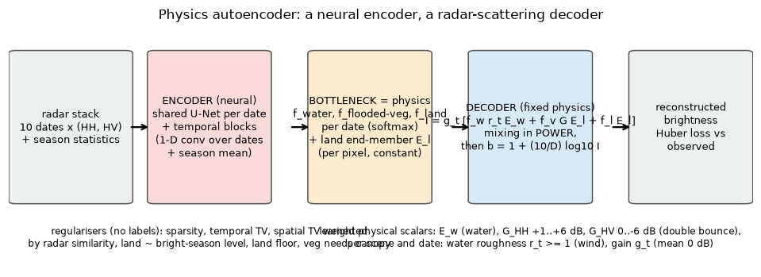
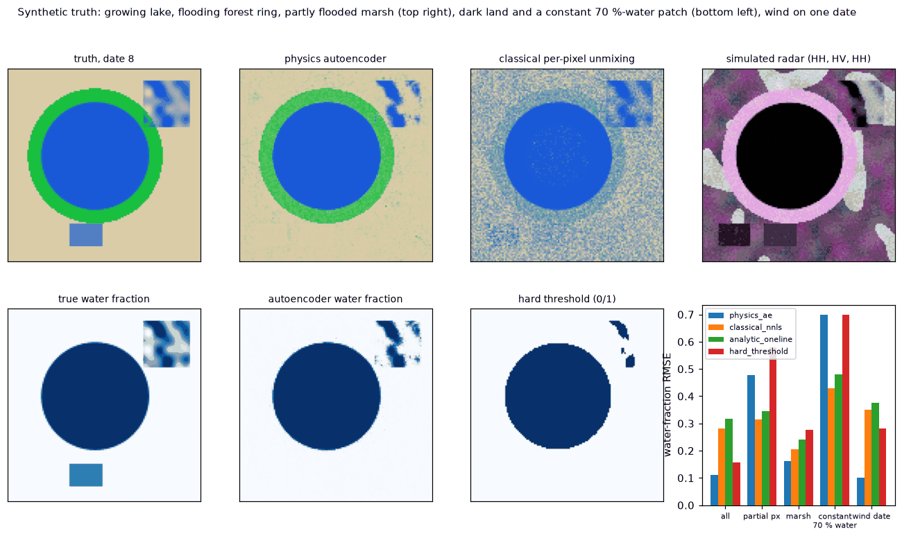
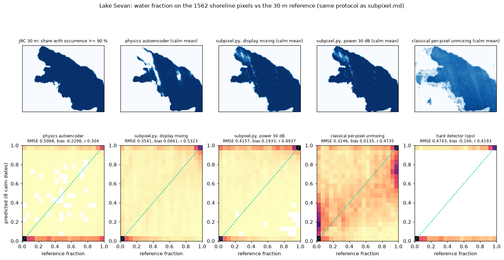
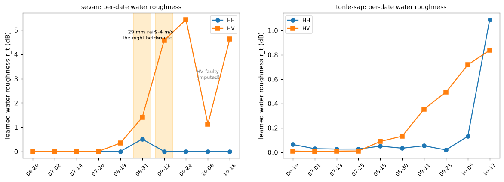
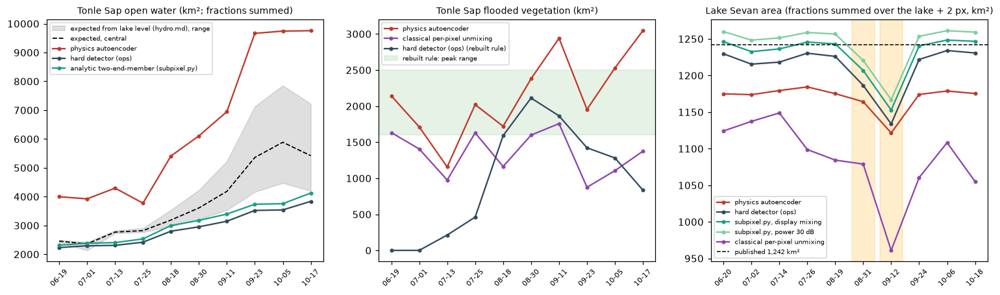
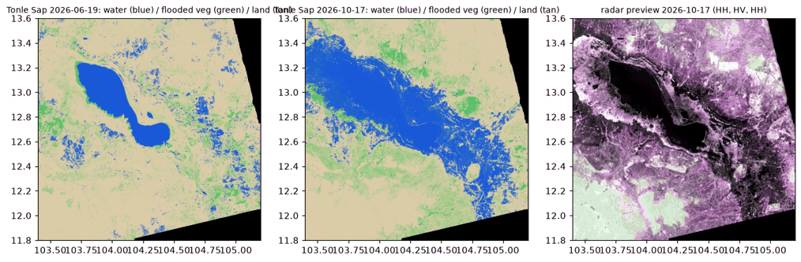
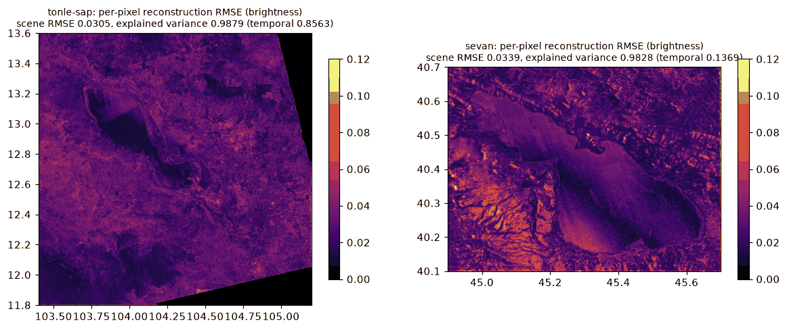
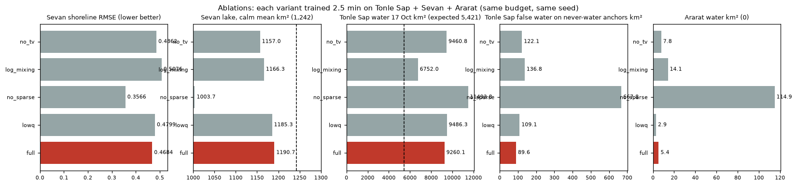

# Physics autoencoder: a neural encoder, a radar-physics decoder (unsupervised unmixing)

Code: `scripts/detect/unmix.py` · tests: `tests/test_unmix.py` (8 tests) · figures and every number:
`docs/eda/unmix/` (`results.json`) · products: `data/processed/<area>/unmix/products.pt` (3 core + 7 world areas) ·
model: `data/processed/models/unmix_full.pt` (268,003 parameters).

```
.venv/bin/python -m scripts.detect.unmix prepare --area all     # cache the ops-preprocessed stacks (~45 s)
.venv/bin/python -m scripts.detect.unmix synthetic --minutes 3  # synthetic-truth study (do this first)
.venv/bin/python -m scripts.detect.unmix train --area all --minutes 10
.venv/bin/python -m scripts.detect.unmix evaluate               # products + all checks + figures 01-07
.venv/bin/python -m scripts.detect.unmix ablate --variants full,lowq,no_sparse,log_mixing,no_tv --minutes 2.5
```

## Verdict first

**The physics autoencoder does not beat the simple analytic sub-pixel fraction (`subpixel.py`), and it does not
replace the hard detector. The app should not show its fractions.** On Lake Sevan's shoreline its water fraction is
*worse* than subpixel.py (RMSE 0.507 vs 0.354, correlation 0.30 vs 0.53, 30 m reference, same protocol) and even
worse than the hard mask (0.474), because in practice it outputs almost 0 or 1 at the shore; its lake area is 5 %
low (1,177 vs 1,242 km²; subpixel.py: 1,242.5). At Tonle Sap it counts 4,000 → 9,757 km² of open water, far above
the independent 2026 estimate (2,458 → 5,421 km², range up to 7,222), and only about half of its water lies inside
that estimate. Where it *does* add something: (1) on synthetic scenes with known truth it is the best of all
methods overall (water RMSE 0.110 vs 0.158 hard, 0.281 classical unmixing, 0.317 analytic one-liner), it recovers
the wind on a windy date (4.7 / 7.6 dB learned vs 5 / 8 dB true) and keeps the lake water while the threshold loses
half of it; (2) at Lake Sevan its learned water roughness jumps only on **31 Aug** (the pass after 29 mm of rain),
by +0.5 dB HH / +1.4 dB HV; (3) it splits the floodveg "going under" state cleanly into *open water* (96 % of those
pixel-dates) — it says that state is partly open water, not submerging canopy; (4) its rank agreement with long-term
occurrence in the Tonle Sap floodplain is the highest of all methods (Spearman 0.596 vs 0.519 hard, 0.569 subpixel).
It is a working, honest piece of unsupervised physics + deep learning — a good *talk* item, not a product layer.

## 1. The idea in three sentences

Every ~180 m radar pixel is a mix of open water, vegetation standing in water, and dry land, and radar echoes from
those parts add up in **power**. A small neural network (the *encoder*) looks at one pixel's whole season (plus its
neighbourhood) and proposes, for every date, the three fractions and the pixel's dry-land brightness. A fixed piece
of physics (the *decoder*, the radar mixing equation) turns that proposal back into the HH and HV images, and the
network is trained only by asking that the rebuilt images match the real ones — no labels anywhere.



## 2. The model, equation by equation

Symbols. Pixel $i$, date $t$, channel $c\in\{\mathrm{HH},\mathrm{HV}\}$. Preview brightness $b^c_t(i)\in[0,1]$
(display value). Assumed display stretch $D = 30$ dB. Power (pseudo-intensity) and brightness are linked by

$$I = 10^{D\,(b-1)/10}, \qquad b = 1 + \tfrac{10}{D}\log_{10} I .$$

**Fractions** (encoder output, softmax over the three types, so $f\ge 0$ and they sum to one):
$f_{w,t}(i)$ open water, $f_{v,t}(i)$ vegetation standing in water, $f_{l,t}(i)$ dry land.

**Decoder (fixed physics, power domain):**

$$\hat I^c_t(i) = g^c_t\Big[f_{w,t}(i)\,E^c_w\,r^c_t\,q^c(i) \;+\; f_{v,t}(i)\,G^c\,E^c_l(i) \;+\; f_{l,t}(i)\,E^c_l(i)\Big] \;+\; N^c(i),
\qquad \hat b^c_t(i) = \operatorname{softclip}\!\Big(1+\tfrac{10}{D}\log_{10}\hat I^c_t(i)\Big)$$

| symbol | meaning | learned or fixed |
|---|---|---|
| $E^c_l(i)$ | dry-land end-member of the pixel, constant in time, never darker than a **land floor** (HH 0.10, HV 0.03 brightness) | encoder output |
| $q^c(i)\ge 1$ | per-pixel water brightness factor (shallow/turbid water), up to +8 dB, penalised | encoder output |
| $E^c_w$ | open-water end-member (one per channel, at the display floor) | learned global scalar |
| $r^c_t \ge 1$ | **water roughness** of date $t$ in this scene (wind/rain brighten water without turning it into land), 0–20 dB | learned per scene and date |
| $G^c$ | double-bounce gains of flooded vegetation: $G^{HH}$ +1…+6 dB, $G^{HV}$ 0…−6 dB (HV falls, HH stays bright, as in `floodveg.md`) | learned global scalars |
| $g^c_t$ | residual radiometric gain of the date (±0.5 dB, mean 0 dB) | learned per scene and date |
| $N^c(i)$ | additive noise floor (NESZ) of the scene, measured on its own surely-open water, smoothed (see §6) + learned offset | measured map + learned scalar |
| softclip | the display range [1/255, 1] with smooth corners, so gradients survive near black | fixed |

**Loss** (all terms averaged over valid pixel-dates):

$$\mathcal L = \underbrace{\textstyle\sum \mathrm{Huber}\!\big(\tfrac{\hat b-b}{\sigma}\big)+\log\tfrac{\sigma}{\sigma_0}}_{\text{reconstruction},\;\sigma^2=\sigma_0^2+f_w\sigma_w^2}
+ 0.15\,H(f) + 1.0\,\overline{4f_w(1-f_w)} + 0.4\,\overline{|f_t-f_{t-1}|} + 0.1\,\overline{w_{ij}|f(i)-f(j)|}
+ 0.1\,\mathrm{Huber}\big(E_l - \bar b_{\text{bright half}}\big) + 0.5\,\overline{f_v\,[0.25-E^{HV}_l]_+}/0.25 + 0.05\,\overline{f_w\,\mathrm{dB}(q)} + 10\,\overline{g}^2$$

In words: rebuild the images (noise is roughly additive in brightness, with extra noise allowed over water); most
pixels are one thing (entropy $H$) and water is all-or-nothing unless the data insist ($4f_w(1-f_w)$); fractions
change in jumps, not flicker (temporal L1); neighbours that look alike on that date get alike fractions (spatial L1
weighted by radar similarity $w_{ij}=\exp(-\|b_i-b_j\|^2/2\cdot0.05^2)$); the land end-member stays near the pixel's
bright-season appearance (mean of its brighter half of dates); flooded vegetation needs vegetation (bright land HV);
per-pixel water brightness costs a little; date gains average to 0 dB. The terrain mask
(`terrain.cached_water_possible`) is applied **after** inference (water and flooded-vegetation fractions moved to
land where standing water is impossible). Entropy and sparsity are switched on gradually from 40 % to 80 % of
training (from the start they freeze rarely used fractions at zero).

**Encoder** (268 k parameters): a small 2-level U-Net on ten season statistics per pixel (2nd-lowest, median,
2nd-highest, spread, bright-half mean, per channel) gives spatial context; a light per-date CNN (shared over dates);
two temporal blocks (1-D convolution over the dates of each pixel + the season mean broadcast to every date); heads:
per-date fraction logits (a per-pixel linear layer) and the land end-member. Inputs are the **unfiltered** preview
brightness after the ops footprint rules and per-date gains (the 3×3 speckle filter would smear every shoreline).

**What is learned and what is fixed.** Learned: the encoder weights; 2 water end-members, 2 double-bounce gains
(global); per scene 10×2 roughness, 10×2 gains, 2 water-noise scales, 2 floor offsets. Fixed: the mixing equation
(power), the brightness↔power conversion ($D$ = 30 dB), the display clipping, the land floor, the ranges of every
physical parameter, the noise-floor map, the terrain mask.

**Quality control.** Armenia's 6 October HV channel is faulty (`qc.json`); it is replaced by each pixel's median HV
of the other dates (`impute_bad_channels`), so the Sevan/Ararat HV roughness of 6 Oct carries no information.

## 3. Identifiability, honestly

A dark pixel can be "100 % dark land" or "70 % water + 30 % brighter land": in power both rebuild the same two
numbers. **Time breaks the tie only for pixels that change.** For a pixel that is dark and flat in time, the answer
comes from the priors (the land floor, the land end-member tie, sparsity), not from the data. The code flags these
pixels (`prior_driven`: second-brightest HH below 0.30 and above the floor, and a season range inside the scene's
own noise level). On the synthetic scene the flag catches 84 % of the constant dark-land patch but only 7 % of a
constant 70 %-water patch (its speckle makes it look "changing"), and the network calls **both** patches land
(water 0.002 and 0.001; truth 0 and 0.7). That is the right default for dark land and the wrong one for a
permanently half-flooded pixel — no unsupervised model can know the difference from these data. At Tonle Sap
1,022 km² are prior-driven and the model puts on average 833 km² of water on them: a large part of its over-count
(§5) is exactly this unidentifiable case. A second identifiability problem: $f_v$ and $G$ trade off ($f_vG$ is what
the data see); $G^{HH}$ ends at its upper bound (+5.3 dB synthetic vs +3 true; +6.0 dB on real data).

## 4. Synthetic truth first

Two 128×128 scenes, ten dates, known fractions (8×8 super-sampled): a lake that grows, a forest ring that floods
(double bounce from date 3) and is then submerged by the lake, textured fields with forest blocks, a constant dark
patch (dark land), a constant 70 %-water patch, a partly flooded marsh, wind on one date (+5 dB HH, +8 dB HV on
water), a per-date gain drift (0.3 dB), 12-look speckle, 8-bit display quantisation, then the ops date
normalisation. A third scene (wind on another date) is held out. Training 3 minutes (1,191 steps) on the GPU.

| water-fraction RMSE (in-sample scene) | physics AE | classical per-pixel unmixing (same physics, no network) | analytic one-line (2 end-members) | hard threshold (ops rule) |
|---|---|---|---|---|
| all pixels, all dates | **0.110** | 0.281 | 0.317 | 0.158 |
| partially-water pixels (0.02 < f < 0.98) | 0.477 | **0.314** | 0.344 | 0.579 |
| partly flooded marsh | **0.162** | 0.206 | 0.242 | 0.276 |
| windy date | **0.101** | 0.350 | 0.375 | 0.282 |
| constant dark land (mean water; truth 0) | **0.002** | 0.339 | 0.316 | 0.008 |
| constant 70 %-water patch (mean water; truth 0.7) | 0.001 | 0.313 | 0.268 | 0.000 |
| flooded-vegetation RMSE (all) / on the ring | 0.135 / 0.227 | 0.324 / – | – | – |

Held-out scene: water RMSE 0.110 (in-sample 0.110). Learned roughness on the windy date: 4.7 dB HH / 7.6 dB HV
(true 5 / 8); on the other dates 0.1–0.8 dB (true 0.5). Lake on the windy date: AE 0.999 water, hard threshold 0.57.

**Reading.** The network is the best overall because it never confuses dark land with water and it is not fooled by
wind; per-pixel unmixing without the network (same end-members, same physics) calls a third of all dark land water.
But **on partially-water pixels the network is worse than the per-pixel methods** (0.477): the sparsity term that
keeps dark land dry also pushes shoreline pixels to 0 or 1. Without it (ablation `no_sparse`) shoreline fractions
improve but dark land floods (§8). This trade-off is the central finding.



## 5. Real data

### 5.1 Lake Sevan vs the 30 m reference (protocol of `subpixel.md`, identical masks)

Reference fraction = share of 30 m JRC pixels with occurrence ≥ 90 % (and the 38-year maximum extent); 1,562 / 1,685
shoreline pixels (reference strictly between 0 and 1, within 5 px of the lake); 8 calm dates pooled.

| method | RMSE (occ ≥ 90) | bias | r | RMSE (max ext.) | bias | r | calm-median map RMSE / r |
|---|---|---|---|---|---|---|---|
| **physics autoencoder** | 0.507 | −0.230 | 0.30 | 0.553 | −0.427 | 0.29 | 0.507 / 0.31 |
| hard detector | 0.474 | −0.106 | 0.42 | 0.514 | −0.364 | 0.43 | 0.473 / 0.42 |
| subpixel.py, display mixing | 0.354 | +0.066 | **0.53** | **0.329** | −0.150 | **0.63** | 0.348 / 0.54 |
| subpixel.py, power 30 dB | 0.416 | +0.193 | 0.49 | 0.365 | +0.005 | 0.56 | 0.410 / 0.50 |
| classical per-pixel unmixing (AE's physics, no network) | **0.325** | +0.014 | 0.47 | 0.337 | −0.148 | 0.51 | **0.295** / **0.55** |
| analytic one-line (pixel's own bright date as land) | 0.382 | −0.067 | 0.37 | 0.421 | −0.211 | 0.26 | 0.344 / 0.47 |

Reliability (pooled, occ ≥ 90): the autoencoder puts 70 % of shoreline pixel-dates below 0.1 (where the reference
averages 0.42) and 22 % above 0.9 (reference 0.67): it is a hard classifier at the shore. subpixel.py fills every
bin. (`results.json → real.sevan.sevan_protocol.methods.*.reliability_pooled_occ90`.)



**Lake area** (fractions summed over the detector's largest water body + 2 px; published 1,242 km²):

| method | 20 Jun | 2 Jul | 14 Jul | 26 Jul | 19 Aug | **31 Aug** | **12 Sep** | 24 Sep | 6 Oct | 18 Oct | calm mean (sd) |
|---|---|---|---|---|---|---|---|---|---|---|---|
| physics AE | 1,175.0 | 1,173.8 | 1,179.4 | 1,184.4 | 1,175.2 | 1,164.2 | 1,121.5 | 1,174.1 | 1,178.8 | 1,175.4 | 1,177.0 (3.7), −65 |
| subpixel.py (display) | 1,246.3 | 1,232.6 | 1,236.3 | 1,245.7 | 1,243.2 | 1,206.9 | 1,152.7 | 1,240.5 | 1,248.4 | 1,246.7 | **1,242.5** (5.6), +0.5 |
| hard detector | | | | | | 1,186.5 | 1,133.9 | | | | 1,225.9 (6.6), −16 |

The autoencoder is the most *stable* on calm dates (sd 3.7 km²) but 5 % low; on the two rough dates it loses 13 and
56 km² (subpixel.py 36 and 90, hard 39 and 92): roughness absorbs part of the wind, as designed. Where the 65 km²
go: the earlier model (noise floor as a plane) lost 131 km², almost all in the north-west bay of Small Sevan, whose
open-water HV sits at 0.23 instead of 0.05 (swath noise floor); it called the bay "dark land". The measured
noise-floor map (§2) recovered half of that. The rest are shoreline pixels pushed to 0 by sparsity.

**Water roughness vs the weather** (learned $10\log_{10} r_t$, dB, HH / HV; weather from `validation2026`):

| date | 20 Jun | 2 Jul | 14 Jul | 26 Jul | 19 Aug | **31 Aug** | **12 Sep** | 24 Sep | 6 Oct | 18 Oct |
|---|---|---|---|---|---|---|---|---|---|---|
| HH | 0.01 | 0.01 | 0.01 | 0.00 | 0.01 | **0.51** | 0.01 | 0.00 | 0.00 | 0.00 |
| HV | 0.00 | 0.00 | 0.01 | 0.01 | 0.35 | **1.40** | 4.57 | 5.43 | (1.13, HV imputed) | 4.62 |
| weather | calm | calm | calm | calm | calm | 29 mm rain the night before | 2–4 m/s breeze | calm | – | calm |

HH roughness rises on **31 Aug only** — the one clear match. 12 Sep (breeze) is not seen in HH. HV roughness drifts up
from late August to October regardless of weather (4.6–5.4 dB on calm 24 Sep and 18 Oct as well as on 12 Sep): it
tracks the late-season HV noise level over the lake, not wind. No source shows wind above ~3 m/s at pass time, so
the honest reading is "HH roughness is a usable rough-water flag; HV roughness is not".



### 5.2 Tonle Sap

**Open water per date** (km², fractions summed in the hydro domain; expected = `hydro.md`, made without radar):

| date | 19 Jun | 1 Jul | 13 Jul | 25 Jul | 18 Aug | 30 Aug | 11 Sep | 23 Sep | 5 Oct | 17 Oct |
|---|---|---|---|---|---|---|---|---|---|---|
| expected (central) | 2,458 | 2,361 | 2,772 | 2,822 | 3,189 | 3,609 | 4,185 | 5,360 | 5,888 | 5,421 |
| expected range | 2,415–2,496 | 2,137–2,425 | 2,729–2,827 | 2,766–2,909 | 2,969–3,541 | 3,216–4,231 | 3,533–5,233 | 4,163–7,134 | 4,473–7,859 | 4,198–7,222 |
| **physics AE** | 3,998 | 3,924 | 4,296 | 3,776 | 5,412 | 6,109 | 6,951 | 9,666 | 9,744 | 9,757 |
| hard detector | 2,234 | 2,297 | 2,310 | 2,421 | 2,803 | 2,954 | 3,147 | 3,522 | 3,541 | 3,837 |
| subpixel.py | 2,315 | 2,388 | 2,405 | 2,535 | 2,999 | 3,177 | 3,396 | 3,738 | 3,757 | 4,127 |

The autoencoder is the only method that reaches the expected late-season range — and overshoots it on every date,
already by 1,500 km² in June. Share of its water inside the expected set: 0.49–0.65 (hard detector 0.86–0.97);
recall of the expected set: 0.83–0.91 (hard 0.53–0.91); IoU at 0.5: 0.45–0.60 (hard 0.49–0.86). So it finds most of
the water the strict detector misses late in the season, but adds as much again outside the expected set (dark,
flat floodplain fields — the prior-driven pixels of §3).

Other checks: Spearman rank correlation of the mean water fraction with long-term occurrence in the ambiguous
floodplain: **0.596** (hard 0.519, subpixel.py 0.569, classical unmixing 0.554; math detector 0.50–0.52). Held-out
TEST-strip anchors, fraction ≥ 0.5: recall 0.995, false-positive rate 0.015, balanced accuracy 0.990 (hard 0.996,
subpixel.py 0.996) — 84 km² of false water per date on the "never water" anchors vs 0.3 km² for the hard detector.

**Flooded vegetation** (km², summed $f_v$): AE 2,143 / 1,712 / 1,157 / 2,021 / 1,721 / 2,380 / 2,940 / 1,954 / 2,530 /
3,045 (19 Jun → 17 Oct) vs the rebuilt rule 1 / 1 / 213 / 462 / 1,591 / **2,113** / 1,865 / 1,423 / 1,282 / 836. The AE's
values on 30 Aug (2,380) fall in the rule's 1,600–2,500 band, but it has ~2,000 km² of "flooded vegetation" already in
dry June: it uses $f_v$ for any pixel whose HH is above its own land level (bright fields, towns). Not usable as is.

**The "going under" question.** On the rule's state 2 (both channels fall: submerging canopy *or* partly open water),
the AE says open water: mean $f_w$ 0.87, 96 % of those pixel-dates mostly water, $f_v$ 0.015; their long-term JRC
occurrence is 29 %. On state 1 (double bounce) it says $f_w$ 0.29, $f_v$ 0.29 (occurrence 6 %). So the mixing model
does separate the two states, and it answers "partly open water" for state 2 — consistent with the floodveg note that
open water appears in 25–36 % of the surrounding window from 30 Aug, but unverified per pixel.





### 5.3 Armenia controls (Ararat valley: no lake)

Water fraction summed, km² per date: **0.7–4.9** with the terrain prior, 5.7–8.9 without (hard detector 0.5–3.8).
Away from any JRC water: 0.5–3.6 km². Flooded vegetation: **37–142 km²** (peak 31 Aug, the QC-flagged HH date) — a
clear false signal on irrigated fields; the terrain mask does not remove it (flat valley floor). Sevan scene, water
outside the lake zone: 3.3–11.3 km² per date (hard detector 7.1–18.1).

## 6. Display-domain vs power-domain decoder

`subpixel.md` found that on previews, mixing *display brightness* fits the 30 m reference better than mixing power.
Same test here: the `log_mixing` variant mixes brightness linearly (the display domain); everything else identical,
both trained 2.5 min on the three core scenes:

| decoder | Sevan shore RMSE / bias / r | Sevan lake calm km² | Tonle Sap 17 Oct km² | inside expected | false km² on never-anchors | Ararat water km² |
|---|---|---|---|---|---|---|
| power (physics) | **0.468** / −0.204 / **0.37** | **1,191** | 9,260 | 0.54 | **90** | **5.4** |
| display (linear in brightness) | 0.508 / −0.269 / 0.26 | 1,166 | **6,752** | **0.59** | 137 | 14.1 |

For this model the **power decoder fits Sevan better**, the opposite of subpixel.py's finding; the display decoder
gives a more plausible Tonle Sap total but more false water. Neither changes the verdict. On calibrated γ⁰ the power
decoder is the physically correct one (see §10).

## 7. Reconstruction and residuals

Brightness RMSE of the rebuilt images: Tonle Sap 0.031 (explains 98.8 % of all variance, **86 % of the temporal
variance**), Sevan 0.034 (98.3 %; 14 % temporal — the lake hardly changes), Ararat 0.023 (98.5 %; 5 % temporal). World
areas: 0.027–0.047. Largest residuals: steep mountain slopes around Sevan (terrain brightness the three-type model
has no term for), the south-east of the lake in HV (noise), towns. Residual maps say where the three-surface physics
is wrong, not where water is.



## 8. Ablations (2.5 min each, three core scenes, same seed)

| variant | Sevan shore RMSE / bias | Sevan lake calm km² (31 Aug, 12 Sep) | Tonle Sap 19 Jun → 17 Oct km² | inside expected | false km² never-anchors | Ararat water / fv km² | Spearman |
|---|---|---|---|---|---|---|---|
| full | 0.468 / −0.204 | 1,191 (1,163, 1,118) | 4,047 → 9,260 | 0.54 | 90 | 5.4 / 71 | 0.619 |
| lowq (water brightness ≤ +3 dB, 4× cost) | 0.480 / −0.206 | 1,185 (1,150, 1,097) | 4,318 → 9,486 | 0.53 | 109 | 2.9 / 31 | 0.628 |
| no_sparse (no $4f_w(1-f_w)$) | **0.357** / −0.086 | 1,004 (919, 847) | 9,349 → 11,494 | 0.31 | 668 | 115 / 61 | 0.598 |
| log_mixing (display decoder) | 0.508 / −0.269 | 1,166 (1,155, 1,122) | 3,946 → 6,752 | 0.59 | 137 | 14.1 / 30 | 0.619 |
| no_tv (no temporal smoothness) | 0.486 / −0.248 | 1,157 (1,041, 968) | 4,467 → 9,461 | 0.52 | 122 | 7.8 / 135 | 0.634 |

* **Sparsity is load-bearing and is the trade-off.** Without it the shoreline fraction becomes as good as
  subpixel.py (0.357 vs 0.354) — but the lake loses 240 km², Tonle Sap's water doubles in June and Ararat gets 115 km²
  of water. With it, dark land stays dry and the shoreline turns binary.
* **Temporal smoothness** mainly protects the rough dates (no_tv: −201 km² on 31 Aug/12 Sep vs −28/−73) and halves
  false flooded vegetation in Ararat.
* Capping per-pixel water brightness (lowq) changes little.
* Earlier fixes, kept: the double-bounce HV gain restricted to "HV falls" (when HV could brighten by +5 dB, $f_v$
  became "brighter land" in general; synthetic flooded-vegetation RMSE 0.275 → 0.135); the noise floor as a measured
  map instead of a plane (Sevan lake 1,111 → 1,177 km²).



## 9. Timings (Apple M5, MPS, while 3–4 other jobs ran)

Prepare inputs ~45 s for ten areas. Training 10 min budget = 4,790 steps (8 patches of 48×48×10 dates per step) on
ten scenes. Full-scene inference in 256 px tiles: Tonle Sap (1,105×1,078×10) 2.1 s, Sevan 0.3 s, a world area ≤ 1.1 s.
Classical per-pixel unmixing (250 Adam steps per pixel, no network) on Tonle Sap: 67 s. Full evaluation with all
baselines and figures: 2.5 min. Synthetic study 3 min + 1 min baselines. Ablations 2.5 min + ~1 min each.

## 10. Products and integration

`data/processed/<area>/unmix/products.pt`: `f_water`, `f_fv`, `f_land` [T,H,W] float16 (terrain prior applied),
`f_water_no_terrain`, `land_endmember` [2,H,W], `water_brightness_db`, `water_roughness` [T,2] dB, `gain_db`,
`global_params`, `water_km2_frac`, `fv_km2_frac` [T], `recon_rmse` (+ `recon`, `recon_rmse_map`), `prior_driven`
[H,W], `dates`, `bounds`, `km2_per_px`, `valid`. Function: `unmix.unmix(L_or_x, valid, area=None)`.

**Integration call: do not ship the fractions in the app.** Keep subpixel.py for shoreline fractions and the hard
detector for extent. If anything is used, use the Sevan HH roughness as a "rough water on this date" note, and the
state-2 answer ("mostly open water") as a supporting sentence in the flooded-vegetation explanation.

**Calibrated data** (`data/processed/tonle-sap-cal/gamma0/{hh,hv}/<date>.tif`, linear power, 80 m): what the code
needs — a `prepare` path that reads γ⁰ and converts to "brightness" with $b = 1 + \frac{10}{D}\log_{10}\gamma^0$ for a
chosen $D$ (or a decoder that takes power directly: replace `to_power`/`to_bright` by identity/log and drop the
display soft-clip); the land floor and the water end-member re-expressed in dB (e.g. land ≥ −18 dB HH, water ≈ −25 dB);
the noise-floor map from the product's NESZ instead of from dark water; a retrain (the scene parameters are
per-scene anyway). Not run.

## 11. Limits

* Not better than subpixel.py at the shoreline, and worse than the hard mask there (binary outputs).
* Over-counts Tonle Sap water by ~1,500 km² already in June and ~4,300 km² in October relative to the central
  expected value (above the plausible range from 23 Sep); a large part sits on dark, flat, prior-driven pixels.
* Flooded vegetation is not usable: ~2,000 km² in dry June at Tonle Sap, 37–142 km² in Ararat.
* Identifiability: constant partly-flooded pixels are called land (synthetic 70 %-water patch → 0.001); $f_v$ and
  $G$ trade off ($G^{HH}$ sits at its +6 dB bound).
* HV roughness follows the late-season HV noise, not wind; only the 31 Aug HH rise matches the weather.
* Previews only (display stretch assumed 30 dB, 8-bit, down-sampled after stretching); one seed per variant;
  ablations at 2.5 min, not the 10-min budget; 6 Oct HV in Armenia imputed.
* The 30 m reference is itself uncertain at the shoreline (occurrence ≥ 90 % vs maximum extent differ by a whole
  bias step), and the Tonle Sap expected set measures Landsat-visible water (it misses water under the forest).
* The 48×48 unit-test scene is too small to separate dark land from water after a few seconds of training (it calls
  the dark patch ~0.7–0.9 water); the dark-land guarantee is checked on the saved full synthetic study instead.
