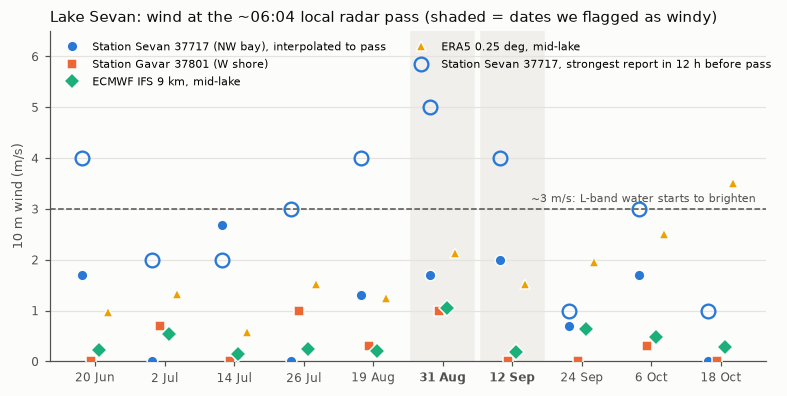
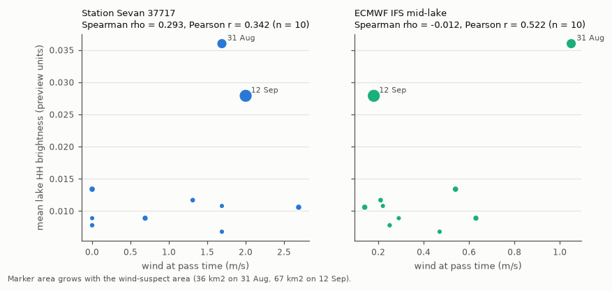
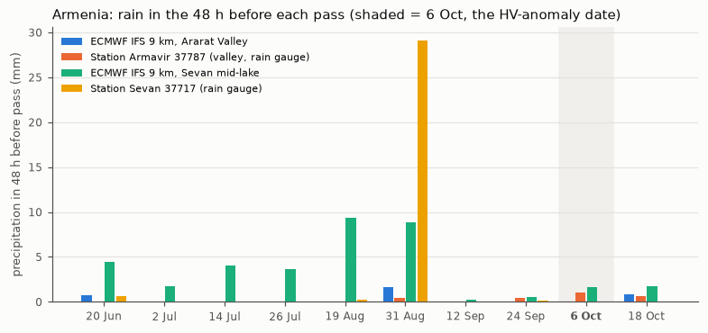
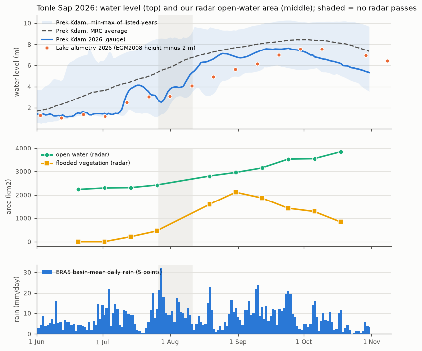
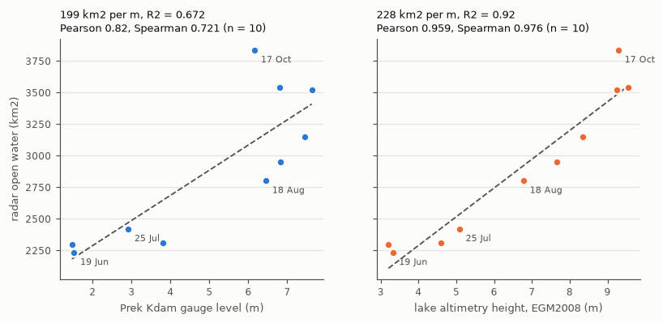

# Checking our 2026 radar claims against independent data

Our only independent check so far was the Landsat water history, which ends in 2021. Everything we said about 2026 had never been checked. This note tests three of those claims against independent 2026 data: weather reanalysis, weather-station reports, river gauges and satellite radar altimetry.

Reproduce: `.venv/bin/python -m scripts.detect.validate_2026`. It downloads the data once into `data/external/weather/` and `data/external/levels/` (git-ignored), then writes [`validation2026/results.json`](validation2026/results.json) and five figures. Every number below comes from `results.json`. The radar numbers come from `src/app/public/data/<area>/timeseries.json`, `docs/eda/stats.json` (lake HH) and `docs/DETECTION.md` section 6.2 (wind-suspect km²). No radar images were loaded.

## Verdicts at a glance

| Claim | Verdict | One line |
|---|---|---|
| 1. Sevan 31 Aug and 12 Sep: the lake looks brighter because **wind** roughened it at pass time | **undecided** | No source shows wind above the ~3 m/s L-band threshold at pass time on either date. Both dates had the strongest winds in the 12 h before the pass, but so did two calm dates. **31 Aug was also a rain night** (29 mm at the Sevan station), which we had not considered. |
| 2. Armenia 6 Oct: the HV anomaly comes from **rain before the pass**, or from an instrument/processing effect | **contradicted** (the rain part) | 0–1 mm of rain in the 48 h before the pass. 31 Aug was far wetter at the lake and around Yerevan (29 mm at Sevan and at Hrazdan), and that rain showed up in HH, not as an HV-only change. Instrument or processing stays the more likely cause, but this data does not test it. |
| 3a. Our Tonle Sap open-water area follows the flood | **supported** | Pearson 0.959 and Spearman 0.976 against NASA/USDA lake altimetry (n = 10). |
| 3b. The 2026 flood pulse **arrived late**, and the largest rise was between 11 and 23 Sep | **contradicted** (as worded) | The lake was low and behind in June–July and rose sharply in July, which our radar recorded as flooded vegetation. It peaked on 24–29 Sep, on time or early. The biggest **level** rises came in July and August, not mid-September. Open water kept growing until 17 Oct while the lake was already falling. |
| 4. Sevan level, Aug–Oct (context) | n/a | Altimetry shows the lake **fell** 0.23 m from 18 Jul to 7 Oct. It did not rise during our passes. |

---

## Data used

| Data | Provider | Resolution / sampling | 2026 coverage | URL (accessed 14 Nov 2026) | Licence / attribution |
|---|---|---|---|---|---|
| ERA5 hourly reanalysis (wind, gusts, rain, T, Td) | ECMWF Copernicus, via Open-Meteo | 0.25° (~28 × 21 km); Sevan mid-lake, Gavar and Martuni all fall in the **same** cell (40.25 N, 45.25 E) | to 20 Oct | `https://archive-api.open-meteo.com/v1/archive?latitude=…&longitude=…&start_date=2026-06-15&end_date=2026-10-20&hourly=wind_speed_10m,wind_gusts_10m,wind_direction_10m,precipitation,temperature_2m,dew_point_2m,relative_humidity_2m&models=era5,ecmwf_ifs&timezone=UTC&wind_speed_unit=ms` | CC BY 4.0 (Open-Meteo); contains modified Copernicus Climate Change Service information |
| ECMWF IFS operational analysis, hourly | ECMWF, via Open-Meteo (same request, `ecmwf_ifs`) | ~9 km | to 20 Oct | as above | CC BY 4.0 |
| NASA POWER hourly and daily | NASA Langley Research Center | 0.5° × 0.625° (MERRA-2 / GEOS-IT) | to 20 Oct (hourly), 31 Oct (daily) | `https://power.larc.nasa.gov/api/temporal/hourly/point?parameters=WS10M,PRECTOTCORR,T2M,T2MDEW&community=RE&longitude=…&latitude=…&start=20260615&end=20261020&format=JSON&time-standard=UTC` and `…/temporal/daily/point?parameters=PRECTOTCORR&community=AG…` | NASA open data; "Data obtained from the NASA Langley Research Center POWER Project" |
| SYNOP station reports, 3-hourly (wind 10-min mean, 12-h rain gauge, present weather) | Armenian Hydromet via the WMO GTS, retrieved from Ogimet | point; wind in whole m/s | 15 Jun–20 Oct, complete | `https://www.ogimet.com/cgi-bin/getsynop?block=<WMO id>&begin=202606150000&end=202610202359` for 37717 Sevan (NW bay shore, 40.566 N 45.008 E), 37801 Gavar, 37792 Hrazdan, 37785 Ashtarak, 37787 Armavir, 37871 Artashat | WMO-exchanged data; credit Ogimet / Armenian Hydromet |
| METAR, Yerevan Zvartnots (UDYZ), half-hourly | Iowa Environmental Mesonet archive | point | 15 Jun–21 Oct | `https://mesonet.agron.iastate.edu/cgi-bin/request/asos.py?station=UDYZ&data=sknt&data=gust&data=drct&data=tmpf&data=dwpf&data=wxcodes&data=p01m&year1=2026&month1=6&day1=15&year2=2026&month2=10&day2=21&tz=Etc/UTC&format=onlycomma…` | free; credit IEM |
| Daily water level: Prek Kdam (Tonle Sap River), Phnom Penh Port, Kratie, with the MRC long-term average and individual years | Mekong River Commission flood forecasting | daily | 1 Jun–31 Oct (3 days missing) | `https://ffw.mrcmekong.org/fetchwet_st.php?StCode=PRE` (also `PPP`, `KRA`) | © MRC; free use with attribution |
| Tonle Sap lake height, 10-day (target 000319) | G-REALM, NASA GSFC Global Water Monitor / USDA FAS; Sentinel-6A Michael Freilich in 2026 | one ground track crossing the lake at 12.52 N 104.48 E; ±0.05 m | to 8 Nov | `https://earth.gsfc.nasa.gov/gwm/timeseries/lake000319.10d.2.txt` | public (NASA / USDA); cite G-REALM, Birkett et al. |
| Lake Sevan height, 27-day (target 000260) | G-REALM, Sentinel-3A | one track; ±0.04 m | to 3 Nov | `https://earth.gsfc.nasa.gov/gwm/timeseries/lake000260.27a.2.txt` | as above |
| ERA5 daily rainfall at 5 Mekong-basin points, 2008–2026 | ECMWF, via Open-Meteo | 0.25° | to 31 Oct | `https://archive-api.open-meteo.com/v1/archive?latitude=12.8,13.1,12.49,15.12,17.97&longitude=104.1,103.2,106.02,105.8,102.6&start_date=2008-01-01&end_date=2026-10-31&daily=precipitation_sum&models=era5&timezone=UTC` | CC BY 4.0 / Copernicus |

**Sources tried that did not work**

- NOAA ISD global-hourly 2026. `https://www.ncei.noaa.gov/data/global-hourly/access/2026/37717099999.csv` redirects to the AWS bucket `noaa-global-hourly-pds`, which has **no 2026 files** (2025 is there).
- Meteostat. Its station inventory for Armenia ends in 2025.
- ERA5-Land via Open-Meteo. It returns null over Lake Sevan because lake cells are masked.
- USDA IPAD G-REALM site (`ipad.fas.usda.gov/cropexplorer/global_reservoir/`). It is retired and returns 503; G-REALM now lives at `earth.gsfc.nasa.gov/gwm`.
- MRC data API (`api.mrcmekong.org`). It returns 401 (login needed).
- Kampong Luong (the on-lake gauge). It is not among the MRC flood-forecast stations; Prek Kdam is the nearest.
- SYNOP 37788 Yerevan-Arabkir. Every 2026 report is `NIL`; the Zvartnots METAR covers Yerevan instead.
- Not tried: Hydroweb/DAHITI (login required) and GPM IMERG (Earthdata login). NASA POWER and G-REALM supplied the NASA sources instead.

**Data quality notes**

- Station 37717 codes the dew point as equal to the air temperature in about 95 % of night reports, so its humidity is not used.
- The MRC feed contains exact 0.00 values on 4 Sep, 23 Sep and 1 Oct at all three gauges. These are treated as missing. A first run without this fix wrongly interpolated the 23 Sep pass against 0.
- The MRC "AVG" column does not equal the mean of the 13 years listed beside it (largest difference 2.0 m), and its averaging period is not stated in the feed.
- Pass times come from `data/raw/previews/*/meta.json`: Armenia about 02:04 UTC (06:04 local), Tonle Sap about 22:36 UTC (05:36 local the next day).

---

## Claim 1: Lake Sevan on 31 Aug and 12 Sep, wind

**What we said.** On 31 Aug and 12 Sep the lake (especially the shallow north-west bay) was brighter in HH. The mean lake HH was 0.036 and 0.028, against 0.007–0.013 on the other eight dates. Wind-suspect area was 36.4 and 66.7 km², against at most 6.7 km² otherwise. We blamed wind at pass time. (The 0.040 quoted in some notes is from an earlier mask; `stats.json` has 0.036.)

**Test.** For each pass: the wind at the pass hour, the strongest hour in the pass hour plus the 3 hours before, and gusts, from ERA5, ECMWF IFS, NASA POWER, station Sevan (37717, on the NW bay shore) and station Gavar (37801). Station winds are interpolated between the 00 and 03 UTC reports. We also take the strongest station report in the 12 h before the pass. Then a one-sided Mann–Whitney test (2 flagged dates against 8 others) and correlations with lake HH and wind-suspect area.

**The test is very weak.** With 2 against 8 dates, the smallest p-value Mann–Whitney can return is 1/45 = 0.022. That happens only if the two flagged dates are the two windiest. We also tried 15 wind measures, so a few p < 0.05 are expected by chance.

Per-date wind (m/s). The pass is about 02:04 UTC; the flagged dates are in bold.

| Date | Sevan stn 00Z / 03Z (dir) | Sevan stn at pass | Sevan stn max 12 h before | Gavar stn at pass | IFS mid-lake | IFS mid-lake max 4 h | IFS NW bay | ERA5 mid-lake | ERA5 gust | POWER mid-lake |
|---|---|---|---|---|---|---|---|---|---|---|
| 20 Jun | 1 (280°) / 2 (320°) | 1.7 | 4 | 0.0 | 0.22 | 0.22 | 0.72 | 0.97 | 4.1 | 1.40 |
| 2 Jul | 0 / 0 | 0.0 | 2 | 0.7 | 0.54 | 1.21 | 0.82 | 1.33 | 3.1 | 1.83 |
| 14 Jul | 2 (310°) / 3 (310°) | 2.7 | 2 | 0.0 | 0.14 | 0.36 | 1.31 | 0.57 | 3.5 | 1.90 |
| 26 Jul | 0 / 0 | 0.0 | 3 | 1.0 | 0.25 | 0.25 | 1.05 | 1.52 | 4.4 | 1.35 |
| 19 Aug | 2 (310°) / 1 (160°) | 1.3 | 4 | 0.3 | 0.21 | 0.94 | 0.45 | 1.25 | 2.6 | 1.81 |
| **31 Aug** | 1 (200°) / 2 (40°) | 1.7 | **5** | 1.0 | **1.05** | **1.46** | **2.60** | 2.13 | 5.8 | 2.36 |
| **12 Sep** | 2 (310°) / 2 (300°) | 2.0 | **4** | 0.0 | 0.18 | **1.22** | 1.45 | 1.53 | 3.6 | **2.74** |
| 24 Sep | 0 / 1 | 0.7 | 1 | 0.0 | 0.63 | 0.67 | 1.28 | 1.95 | 4.8 | 1.83 |
| 6 Oct | 1 / 2 | 1.7 | 3 | 0.3 | 0.47 | 0.47 | 1.95 | 2.50 | 5.8 | 1.62 |
| 18 Oct | 0 / 0 | 0.0 | 1 | 0.0 | 0.29 | 0.51 | 1.69 | **3.51** | 6.2 | 2.20 |

Ranks of the two flagged dates among the 10 (1 = windiest), one-sided Mann–Whitney p, and correlations:

| Measure | Ranks (31 Aug, 12 Sep) | MW p | Spearman with lake HH | Spearman with wind-suspect km² |
|---|---|---|---|---|
| Sevan station, at pass | 3, 2 | 0.133 | 0.293 | 0.349 |
| Sevan station, max 12 h before | 1, 2 (4 m/s tied with 20 Jun, 19 Aug) | 0.044 | 0.572 | 0.270 |
| Gavar station, at pass | 1, 6 | 0.444 | 0.111 | 0.196 |
| IFS mid-lake, at pass | 1, 9 | 0.444 | −0.012 | 0.043 |
| IFS mid-lake, max of pass hour and 3 h before | 1, 2 | **0.022** (the minimum possible) | **0.717** (p 0.020) | **0.760** (p 0.011) |
| IFS NW bay, at pass | 1, 4 | 0.089 | −0.049 | 0.201 |
| IFS Gavar shore, at pass | 1, 3 | 0.044 | 0.413 | 0.225 |
| ERA5 mid-lake, at pass | 3, 5 | 0.267 | −0.243 | −0.116 |
| NASA POWER, at pass | 2, 1 | **0.022** | 0.595 | **0.640** (p 0.046) |

**What this says.**

1. **Against the claim (absolute level).** No station and no model puts the pass-time wind on 31 Aug or 12 Sep above the ~3 m/s at which L-band water starts to brighten noticeably. The Sevan station measured 1.7 and 2.0 m/s at the pass. Two calm-HH dates had the same or stronger wind at pass time: 14 Jul (2.7 m/s at the station) and 18 Oct (3.51 m/s in ERA5, the windiest of all ten in that model).
2. **For the claim (relative ranking).** Using the wind *in the hours before* the pass rather than at the instant, both flagged dates come out windiest in the IFS 4-hour maximum and in NASA POWER, and the Sevan station had its strongest pre-pass reports (5 and 4 m/s) then. But 20 Jun and 19 Aug also had 4 m/s in the 12 h before the pass and stayed calm in HH, so wind alone does not separate the dates.
3. **New finding: 31 Aug was a rain night.** The Sevan station reported 7 mm by 18 UTC on 30 Aug, slight rain (ww 61) at 00 UTC on 31 Aug, two hours before the pass, and 19 mm in the 12 h to 06 UTC. That is 29.1 mm in the 48-h window, the wettest of the ten passes by far (the next is 0.6 mm). Hrazdan had 29.9 mm, and Zvartnots reported thunderstorms with rain (−TSRA). Rain drops roughen a water surface, and wet ground explains why Armenian **land** was also brighter in HH on 31 Aug (+0.040 at Sevan in the EDA). The Pearson correlation of lake HH with the Sevan 48-h rain gauge is 0.786, but that is one wet date (Spearman 0.435). 12 Sep was dry (0.0 mm) with a steady north-west wind of 2–4 m/s through the night.

**Verdict: undecided.** The data does not show wind strong enough at pass time on either date, and it does not rule wind out: the stations are on the shore and report whole m/s, and the models are 9–28 km cells. Our wording should change from "wind" to "**surface roughening by wind and rain**", with rain as the better-documented cause on 31 Aug. The practical rule (flag these two dates, never read their lake drop as real) still holds.

---

## Claim 2: Armenia 6 Oct, the HV anomaly

**What we said.** HV on 6 Oct is off across the frame (+0.028 at Sevan, −0.056 at Ararat, east–west gradient flattened) while HH is normal. We said "rain before the pass, or an instrument/processing effect".

**Test.** Rain in the 48 h before each pass from the models (lake and valley points) and from six SYNOP rain gauges (four 12-h totals from 06 UTC two days before to 06 UTC on the pass day; the last 4 h are after the pass). Also METAR weather codes at Zvartnots, and temperature and dew point at pass time.

| 48-h rain before pass (mm) | 6 Oct | other nine: mean / max | 6 Oct rank (1 = wettest) |
|---|---|---|---|
| Sevan station 37717 | 0.0 | 3.33 / 29.1 (31 Aug) | 5 (tied at 0) |
| Gavar station 37801 | 0.0 | 0.53 / 3.7 | 5 (tied) |
| Hrazdan 37792 | 0.8 | 3.39 / 29.9 | 2 |
| Ashtarak 37785 | 0.5 | 0.29 / 1.4 | 4 |
| Armavir 37787 | 1.0 | 0.16 / 0.6 | 1 |
| Artashat 37871 | 0.1 | 0.0 / 0.0 | 1 |
| IFS Ararat Valley | 0.0 | 0.34 / 1.6 | 4 (tied) |
| ERA5 Ararat Valley | 0.8 | 1.31 / 3.2 | 6 |
| IFS Sevan mid-lake | 1.6 | 3.82 / 9.4 | 8 |
| NASA POWER Ararat Valley | 0.4 | 0.84 / 3.2 | 4 |

Light rain did fall in the valley about 5–6 h before the pass: Zvartnots −RA at 20:00–20:30 UTC on 5 Oct, and Armavir "rain in the last hour" at 21 UTC. Totals were 1 mm or less. 6 Oct was the coldest pass (Gavar 7.5 °C, Armavir 9.3 °C, Zvartnots 10 °C at pass time). There was no frost: no station was below 0 °C on any pass. Armavir was saturated at 00 UTC (T = Td = 9.3 °C), so dew is possible in the valley, but 18 Oct was almost as saturated (12.8 / 12.5 °C) with no HV anomaly.

**Verdict on the rain explanation: contradicted.** Rain was at most 1 mm. 31 Aug was much wetter at the lake and in the north (Sevan 29.1 mm, Hrazdan 29.9 mm, 35 rain or thunder reports at Zvartnots against 2 before 6 Oct), though not in the western valley (Armavir 0.4 mm on 31 Aug, 1.0 mm on 6 Oct). That 31 Aug rain showed up as **brighter HH and land** (the expected wet-surface response), not as an HV-only change of opposite sign in the two boxes. A trace of rain cannot flip HV up at Sevan and down at Ararat while leaving HH unchanged. **The more likely explanation is still an instrument/processing difference** (e.g. HV calibration, noise floor or the antenna pattern on that acquisition). Weather data cannot confirm this; calibrated GCOV with noise-equivalent sigma-0 and incidence-angle layers would.

---

## Claim 3: Tonle Sap flood timing

**What we said.** Open water barely grew from 19 Jun to 25 Jul (2,234 → 2,421 km²), then rose steadily to 3,837 km² on 17 Oct, with the largest step between 11 and 23 Sep, so the 2026 flood pulse arrived late. Flooded vegetation peaked around 30 Aug.

**Test.** We interpolated the daily MRC gauge levels and the 10-day Sentinel-6A lake altimetry to each pass time. Then: correlations, the timing of the onset and of the fastest rise, comparison with the MRC average and with a 2008–2025 altimetry mean (17 years), a linear fit of area against level, and basin rainfall timing.

*Two stacked panels on the same date axis rather than one chart with two y-axes. The altimetry is shifted down 2 m only so it sits near the gauge curve; the two datums differ.*

| Pass | Open water km² | Flooded veg km² | Prek Kdam m (MRC avg) | Lake altimetry m EGM2008 (2008–25 mean) |
|---|---|---|---|---|
| 19 Jun | 2,234 | 1 | 1.52 (2.93) | 3.32 (4.04) |
| 1 Jul | 2,297 | 1 | 1.47 (3.66) | 3.21 (4.47) |
| 13 Jul | 2,310 | 213 | 3.82 (4.46) | 4.60 (5.01) |
| 25 Jul | 2,421 | 462 | 2.92 (5.32) | 5.09 (5.64) |
| 18 Aug | 2,803 | 1,591 | 6.45 (7.17) | 6.78 (7.22) |
| 30 Aug | 2,954 | 2,113 | 6.81 (7.69) | 7.66 (7.79) |
| 11 Sep | 3,147 | 1,865 | 7.45 (8.08) | 8.35 (8.37) |
| 23 Sep | 3,522 | 1,423 | 7.63 (8.39) | 9.25 (8.90) |
| 5 Oct | 3,541 | 1,282 | 6.80 (8.39) | 9.55 (9.40) |
| 17 Oct | 3,837 | 836 | 6.16 (8.11) | 9.29 (9.60) |

**Does our area follow the water?** Yes, strongly.

| Area against | Pearson r | Spearman ρ | n |
|---|---|---|---|
| Lake altimetry | **0.959** | **0.976** | 10 |
| Prek Kdam gauge | 0.820 | 0.721 | 10 |
| Phnom Penh Port | 0.692 | 0.648 | 10 |
| Kratie (Mekong main stem) | 0.322 | 0.382 | 10 |
| Open water + flooded veg against altimetry | 0.945 | 0.758 | 10 |

The lake altimeter matches best, which makes sense because it measures the lake itself; the gauges are on rivers.

**Timing, and where the claim fails.**

- **The lake did not wait until late July.** Prek Kdam rose 2.76 m in the 12 days from 5 Jul, its fastest rise of the season, from 1.45 m to a first crest of 4.14 m on 17 Jul. It fell back to 2.52 m on 28 Jul, then rose again through August. The altimeter shows the lake up 1.3 m between 2 and 12 Jul and about 1.9 m higher on 25 Jul than on 1 Jul. Our *open water* barely changed in that period, but our **flooded vegetation went from 1 to 462 km²**. So the radar did see the early rise, as water spreading under vegetation rather than as open water. "Barely grew" is true of one class, not of the flood.
- **Low, partly late, but not a late peak.** Prek Kdam was 0.6–2.4 m below the MRC average on every pass date. Its onset (June mean + 0.5 m) was 10 Jul, against 2 Jul for the average. On the rising limb it was 9–36 days behind the average. But the 2026 crest came on **24 Sep (7.63 m)**, against **28 Sep (8.44 m)** for the average, so it was on time and 0.8 m low. The altimeter says the lake was 0.4–1.3 m below the 2008–2025 mean until late July, near normal from 30 Aug, and peaked on **29 Sep at 9.57 m**, against **18 Oct at 9.60 m** for the mean. That is a normal height about three weeks **early**. (The gauge and the altimeter disagree on how low the lake was in September; the altimeter measures the lake, the gauge the river leading to it.)
- **The 11→23 Sep step was not the biggest rise.** The level changes between consecutive passes were +2.35 m (1→13 Jul) and +3.54 m (25 Jul→18 Aug) at Prek Kdam, and +1.40 m and +1.70 m in the altimeter. Over 11→23 Sep the change was only +0.18 m at the gauge and +0.90 m in the altimeter. Our biggest area step (+375 km², 31.3 km²/day) is where water spread over flat ground and vegetation drowned into open water, not where the level rose fastest.
- **The radar missed the peak.** Our open water kept growing to 17 Oct (+296 km² after 5 Oct) while the lake was already falling (altimeter −0.26 m, gauge −0.64 m between those passes). Open water plus flooded vegetation did fall, from 4,823 to 4,673 km². So late in the season "open water" partly counts vegetation that died back or drowned, not more water.
- **Flooded-vegetation peak on 30 Aug.** This cannot be tested directly. It came when the lake was about 7.7 m and still rising, which fits the idea that deepening water turns flooded vegetation into open water. Flooded vegetation correlates with altimetry at Pearson 0.764.
- **Kratie** (the Mekong main stem) was below average through July but **above** average in Aug–Sep (crest 21.88 m on 23 Aug, against an average crest of 19.36 m). The main river's pulse was strong in August, yet the lake stayed below average.
- **Basin rainfall was not late.** Averaged over the five basin points, the May–Oct total was 1,403 mm in ERA5 against 1,368 mm for the 2008–2025 mean, and 1,455 against 1,304 in NASA POWER. June was dry (81 % and 70 % of normal), July wet (117 % and 126 %). Half the season's rain had fallen by 5 Aug in ERA5, against a median of 6 Aug. The low early lake is not explained by late local rain. Upstream causes (dams, the main-stem river) are plausible, as the science brief says, but this script does not test them.

**Area against level (a rough hypsometric relation).** Fitted over the 10 passes:

- Against altimetry: open water ≈ 1,379 + 228 × h km², with h in m EGM2008. R² 0.92, RMSE 159 km², for h between 3.2 and 9.6 m.
- Against Prek Kdam: ≈ 1,890 + 199 × level km². R² 0.67, RMSE 320 km².

This is about **230 km² of open water per metre** inside our frame. The published relation for the whole lake is several times steeper (roughly 2,500 to 10,000–16,000 km² over 1 to 9 m). Our number covers only our frame and only the open-water class, and flooded forest is exactly what open water misses. Treat it as a description of our detector, not of the lake.

**Verdict.** Area follows level: **supported** (ρ = 0.976). "The 2026 flood pulse arrived late, with the largest rise 11–23 Sep": **contradicted as worded**. The lake was low and somewhat behind in June–July, but it rose sharply in July (which our radar recorded as flooded vegetation, not open water) and peaked on time or early in late September. Our open water lagged the water: it kept rising after the lake had peaked.

---

## Claim 4 (context): Sevan level, Aug–Oct 2026

The G-REALM Sentinel-3A series puts the lake at 1,901.09 m on 21 Jun, **1,901.19 m on 18 Jul (the 2026 peak)**, 1,901.12 on 14 Aug, 1,901.04 on 10 Sep, 1,900.96 on 7 Oct and 1,900.86 on 3 Nov (EGM2008, ±0.04 m). The altimeter sits a constant 0.35–0.38 m above the Armenian gauge readings in the science brief (4 Jun, 21 Jun, 7 Jul, 19 Jul), so it follows the gauge's *changes* to within about 2 cm. That makes it a trustworthy stand-in for the missing Aug–Oct gauge data.

So between our passes the level moved only 0.25 m (1,901.17 down to 1,900.92 at pass times), and it was **falling** from August on: −0.23 m from 18 Jul to 7 Oct. "The lake rose and radar cannot see it" is true for January–July (+0.59 m on the gauge to 19 Jul), not for our pass window. This also confirms what `DETECTION.md` 6.6 found: the October excess in Sevan's water area is not lake growth.

---

## Limits

- **Tiny samples.** Two flagged dates against eight; the smallest attainable Mann–Whitney p is 0.022. Correlations use n = 10, and one wet or windy date can carry a Pearson r. We tried 15 wind measures, so expect some p < 0.05 by chance.
- **Model grids against a mountain lake.** The ERA5 cell is ~28 × 21 km. Sevan mid-lake, Gavar and Martuni all fall in the same ERA5 cell, at a grid elevation of 1,901 m. IFS is ~9 km and NASA POWER 0.5° × 0.625°. None of these resolves the lake surface, its shoreline winds, or the north-west bay. Model winds over the lake were mostly under 1 m/s at dawn, which is probably too low.
- **Stations are on the shore**, report the wind as a 10-minute mean in whole m/s every 3 hours, and do not see the open-lake wind or waves. The pass (02:04 UTC) falls between the 00 and 03 UTC reports, which we interpolate. Station 37717's dew points are unusable, and Yerevan 37788 is silent.
- **Wind is not the only thing that roughens water.** Rain does too, and so do waves left over from earlier wind. Our pre-pass windows (4 h for models, 12 h for stations) are a guess at how long waves last.
- **Gauges are not the lake.** Prek Kdam is on the Tonle Sap River. Kampong Luong, on the lake, was not available. The MRC average's period is not stated. Three days of zeros had to be treated as missing.
- **Altimetry is one ground track, every 10 days** (Tonle Sap; the record is flagged "narrow water crossing, shallow waters, complex region"), or every 27 days (Sevan). Values at pass dates are linear interpolations. The 2008–2025 mean mixes Jason-2, Jason-3 and Sentinel-6A with inter-mission bias corrections.
- **Our radar numbers are from preview images**, not calibrated backscatter (see `eda-findings.md`). Areas are for our frame only, not for the whole lake.
- **The basin rainfall** uses five 0.25° points in the lower and middle basin. It does not represent the upper Mekong, where dam releases and much of the flood water come from.

## Slide sentences

- "We checked our 2026 radar results against independent NASA and partner data. Our Tonle Sap open-water area tracks the lake level measured by the NASA/USDA G-REALM Sentinel-6 altimeter with a rank correlation of 0.98 over ten passes."
- "Independent data also corrected us. The lake started rising in early July, which our radar shows as water under vegetation, not open water. It peaked in late September, on time, and our open-water layer kept growing after the peak. On Lake Sevan, one of our two 'windy' days was really a rain night (29 mm at the shore station)."

## Files

- `scripts/detect/validate_2026.py`: downloads (cached), tests and figures.
- `docs/eda/validation2026/results.json`: every number above, with source URLs and access dates.
- `docs/eda/validation2026/fig1_sevan_wind_per_pass.png` … `fig5_area_vs_level.png`.
