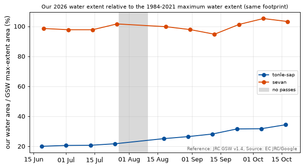
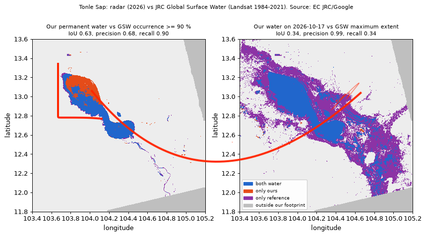
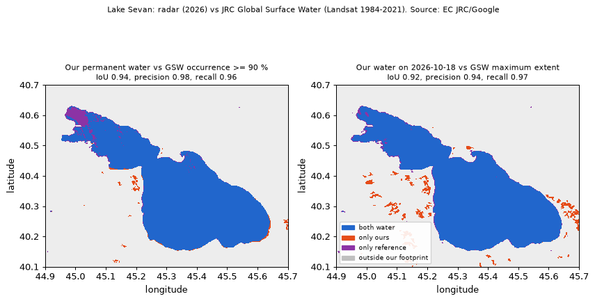
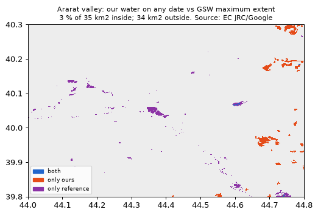
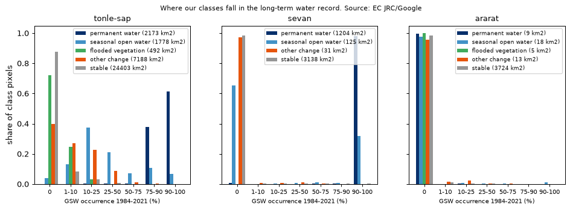

# Independent check: radar water maps vs JRC Global Surface Water

Regenerate everything (figures, `validation/results.json`) with one command:

    .venv/bin/python -m scripts.detect.validate          # all areas; or: ... validate sevan

Code: `scripts/detect/validate.py`. Every number below is copied from `docs/eda/validation/results.json`.
The detector being checked is described in `math-detection.md`.

## 1. The reference and why it is independent

**JRC Global Surface Water (GSW) v1.4**, 1984–2021: Pekel, J.-F., Cottam, A., Gorelick, N., Belward, A. S.
(2016). *High-resolution mapping of global surface water and its long-term changes.* Nature 540, 418–422.
**Source: EC JRC/Google** (attribution is a licence condition; keep it on every figure and slide that uses it).

* Built from **optical Landsat** images (30 m), every scene from 1984 to 2021. Our maps come from
  **NISAR L-band radar** previews (≈180 m) from June–October 2026. Different sensor physics, different
  satellite, different years, different team, different algorithm. Our thresholds were tuned on Sevan's
  published area (1,242 km²), never on GSW.
* Products used: `occurrence` (% of valid Landsat observations, 1984–2021, in which the pixel was water),
  `extent` (maximum extent: 1 = ever water in the record), `seasonality` (months of water in 2021; 12 =
  permanent in 2021). No-data value 255 (none occurred inside our footprints).
* Access: we read **only our window** of each 10°×10° tile remotely (HTTP range requests, GDAL `/vsicurl/`
  on `storage.googleapis.com/global-surface-water/downloads2021/...`). Tonle Sap 7,200×7,200 px per product,
  Sevan 2,400×3,200, Ararat two tiles (it straddles 40° N). Clips are cached in `data/external/gsw/`
  (≈13 MB total, git-ignored).

## 2. How we compared

1. **Resampling 30 m → our grid (exact).** Each of our pixels is a lon/lat box; we compute how much of each
   30 m pixel falls into it (overlap matrices, PyTorch) and take the area-weighted average:
   mean occurrence, and for yes/no layers the *fraction* of our pixel covered (e.g. fraction with occurrence
   ≥ 90 %, fraction inside the maximum extent). An our-pixel counts as "reference water" if ≥ 50 % of its
   area is covered.
2. **Domain.** Only pixels inside our radar footprint (imaged on all 10 dates) with valid reference.
3. **Comparisons.** Permanent water vs occurrence ≥ 75/90/95 % (and vs 2021 seasonality = 12); seasonal and
   late-season water (any of the last three dates, 23 Sep–17 Oct) vs maximum extent; per-date water as a
   fraction of the maximum-extent area; first date (June, low water) vs high-occurrence water and last date
   (October, high water) vs maximum extent; disagreements near vs far from a shoreline (band = 1 or 2 of our
   pixels around either map's boundary); flooded vegetation vs extent and occurrence.
4. **Geolocation sanity check.** Shifting our map by up to ±4 px does not improve agreement (Sevan best
   shift 0,0; Tonle Sap best shift (−1,−1) raises IoU only from 0.8373 to 0.8381). The grids line up.

## 3. Results

### Permanent water (our class "permanent water" = water on ≥ 90 % of our dates)

| area | reference | ours km² | ref km² | IoU | precision | recall |
|---|---|---|---|---|---|---|
| Tonle Sap | occurrence ≥ 75 % | 2,173.4 | 2,566.4 | 0.84 | 0.99 | 0.84 |
| Tonle Sap | occurrence ≥ 90 % | 2,173.4 | 1,661.5 | 0.63 | 0.68 | 0.90 |
| Tonle Sap | occurrence ≥ 95 % | 2,173.4 | 371.4 | 0.13 | 0.14 | 0.80 |
| Tonle Sap | permanent in 2021 (seasonality 12) | 2,173.4 | 2,341.7 | 0.90 | 0.98 | 0.91 |
| Sevan | occurrence ≥ 75 % | 1,204.4 | 1,247.4 | 0.94 | 0.99 | 0.95 |
| Sevan | occurrence ≥ 90 % | 1,204.4 | 1,239.3 | 0.94 | 0.98 | 0.96 |
| Sevan | occurrence ≥ 95 % | 1,204.4 | 1,234.8 | 0.94 | 0.98 | 0.96 |
| Sevan | permanent in 2021 | 1,204.4 | 1,259.9 | 0.94 | 0.99 | 0.95 |
| Ararat | occurrence ≥ 90 % | 8.9 | 1.1 | 0.00 | 0.00 | 0.00 |

Confusion (occurrence ≥ 90 %, km²): Tonle Sap TP 1,488.4 / FP 685.0 / FN 173.2; Sevan TP 1,185.2 / FP 19.2 /
FN 54.2; Ararat TP 0.0 / FP 8.9 / FN 1.1.

* **Sevan:** near-perfect and insensitive to the threshold. The 54 km² we miss is the shallow north-west bay
  (around 45.0 E, 40.6 N), the area that the wind roughens on 31 Aug / 12 Sep (see `math-detection.md`);
  it is missed because it is not water on ≥ 90 % of our dates, not because it is invisible.
* **Tonle Sap:** our permanent water is the lake as it looked on every pass from June to October. That is
  not the same as "≥ 90 % of all observations since 1984": the lake shrinks in March–May, outside our
  season, so its shallow north-western half has long-term occurrence 75–90 % (37.8 % of our permanent pixels
  fall in that bin, 61.5 % in 90–100 %). Against occurrence ≥ 75 % or against "water all 12 months of 2021"
  precision is 0.99 / 0.98. The ≥ 95 % row only shows that very few Tonle Sap pixels are water in ≥ 95 % of
  Landsat scenes. **Read: the threshold choice, not the detector, drives the 0.68.**

**Boundary effect (occurrence ≥ 90 %).** Share of all disagreeing pixels within 1 / 2 of our pixels of a
shoreline: Sevan 70 % / 79 %, Tonle Sap 35 % / 47 %. After excluding a 1-pixel band around the shorelines:
Sevan IoU 0.98 (precision 1.00, recall 0.98); Tonle Sap IoU 0.70 (precision 0.71, recall 0.97). So at
Sevan nearly all disagreement is the expected 180 m shoreline blur; at Tonle Sap the remaining disagreement
is the large NW lake area discussed above (a definition difference, not a shoreline effect).

### Seasonal and late-season water vs the 1984–2021 maximum extent

| area | layer | our km² | share inside max extent | km² outside |
|---|---|---|---|---|
| Tonle Sap | seasonal open water class | 1,778.4 | 96.1 % | 70.3 |
| Tonle Sap | water on last date (17 Oct) | 3,836.7 | 98.9 % | 44.2 |
| Tonle Sap | water on any of last 3 dates | 4,548.1 | 98.0 % | 93.4 |
| Sevan | seasonal open water class | 125.0 | 34.3 % | 82.2 |
| Sevan | water on last date (18 Oct) | 1,304.0 | 94.4 % | 73.3 |
| Sevan | water on any of last 3 dates | 1,363.2 | 90.7 % | 126.7 |
| Ararat | water on any date | 34.9 | 2.7 % | 34.0 |
| Ararat | water on any of last 3 dates | 31.4 | 2.7 % | 30.5 |

**Reference occurrence over our seasonal open water** (share of pixels per occurrence bin):
Tonle Sap 0 %: 3.9 %, 1–10: 13.2 %, 10–25: 37.4 %, 25–50: 21.0 %, 50–75: 7.3 %, 75–90: 10.7 %,
90–100: 6.7 % (median 22.6 %): i.e. mostly *intermediate* occurrence, exactly where seasonally flooded land
should be. Sevan: 65.4 % at 0 % and 31.8 % at 90–100 % (median 0): Sevan's "seasonal" water is either lake
pixels lost on windy dates or land that has never been water.

**Where is the late-season water outside the maximum extent?**

* **Tonle Sap (93.4 km², 2 %):** 95 % of it lies within 1 of our pixels of reference water and 99.97 % within
  3; none near the frame edge. It is shoreline blur / small growth at the edge of known floodplain (largest
  pieces 8.2 km² at 104.67 E 12.65 N, 5.0 km² at 105.08 E 12.17 N). **No sign of false water.**
* **Sevan (126.7 km², 9 %):** 96 % lies more than 3 pixels (> 540 m) from any water ever mapped by Landsat;
  none near the frame edge. **These are false positives**: dark land, not lake. Largest clusters:
  16.8 km² at 45.67 E 40.29 N (east of the lake), 10.2 km² at 45.14 E 40.12 N, 9.1 km² at 45.12 E 40.20 N,
  8.4 km² at 45.13 E 40.17 N (south-west of the lake), 8.6 km² at 45.20 E 40.37 N, 6.8 km² at 45.08 E 40.30 N.
* **Ararat (30.5 km², 97 %):** 94 % more than 3 pixels from any reference water. Our "water" sits in the
  eastern strip of the box (44.65–44.80 E: 7.2 km² at 44.69 E 39.96 N, 5.9 km² at 44.76 E 40.29 N, 2.5 km² at
  44.69 E 40.17 N), while the fish ponds and reservoirs that GSW does map (35.9 km² max extent, e.g. around
  44.37 E 40.05 N) are almost entirely missed (any-date water vs max extent: 2.7 % overlap). Ararat's
  "permanent water" (8.9 km²; 4.0 km² of it at 44.68 E 39.96 N) has 99.6 % of its pixels at occurrence 0.

### Water over time as a fraction of the maximum extent

| date | Tonle Sap water km² | % of GSW max extent | Sevan water km² | % of GSW max extent |
|---|---|---|---|---|
| 19/20 Jun | 2,234.0 | 20.0 | 1,245.3 | 98.6 |
| 1/2 Jul | 2,297.0 | 20.6 | 1,235.0 | 97.8 |
| 13/14 Jul | 2,310.0 | 20.7 | 1,234.8 | 97.8 |
| 25/26 Jul | 2,421.4 | 21.7 | 1,283.8 | 101.6 |
| 18/19 Aug | 2,802.5 | 25.1 | 1,260.6 | 99.8 |
| 30/31 Aug | 2,954.2 | 26.5 | 1,236.1 | 97.9 |
| 11/12 Sep | 3,147.4 | 28.2 | 1,197.1 | 94.8 |
| 23/24 Sep | 3,522.4 | 31.6 | 1,279.2 | 101.3 |
| 5/6 Oct | 3,541.0 | 31.7 | 1,329.1 | 105.2 |
| 17/18 Oct | 3,836.7 | 34.4 | 1,304.0 | 103.2 |

Reference areas inside our footprint: Tonle Sap max extent 11,156.9 km², occurrence ≥ 90 % 1,667.1 km²;
Sevan max extent 1,263.3 km², occurrence ≥ 90 % 1,239.7 km². On every date ≥ 97.6 % of Tonle Sap water
and ≥ 92.8 % of Sevan water lies inside the max extent.

* **June vs low-water state.** Tonle Sap first date vs occurrence ≥ 75 %: IoU 0.82, precision 0.97, recall
  0.85; Sevan first date vs occurrence ≥ 90 %: IoU 0.97, precision 0.98, recall 0.99.
* **October vs high-water state.** Tonle Sap last date vs max extent: precision 0.99 but recall 0.34
  (IoU 0.34). What we call water in October is almost all inside the historical flood zone, but we see only
  about a third of the historical maximum. Two reasons we cannot separate here: (a) the maximum extent is the
  union of *all* floods 1984–2021 (big years such as 2000 and 2011) plus every rice field ever seen wet;
  (b) **our detector only sees open water**: flooded forest and shrubland (most of the Tonle Sap
  floodplain) is bright in L-band, not dark. Excluding a 1-pixel boundary band recall is still 0.39, so this
  is not a resolution effect. Sevan last date vs max extent: IoU 0.92, precision 0.94, recall 0.97.

### Flooded vegetation

| area | layer | km² | share inside max extent | median occurrence |
|---|---|---|---|---|
| Tonle Sap | flooded-veg class | 491.9 | 27.6 % | 0.1 % |
| Tonle Sap | flooded veg on any date | 1,461.0 | 39.6 % | – |
| Sevan | flooded veg on any date | 7.9 | 3.5 % | – |
| Ararat | flooded veg on any date | 38.9 | 2.8 % | – |

Tonle Sap flooded-veg pixels have occurrence 0 % in 72.2 % and 1–10 % in 24.8 % of cases. The part outside
the max extent (882.8 km², any date) hugs the known floodplain: 80 % within 1 pixel and 94 % within 3 pixels
of reference water; largest blocks 279.6 km² at 103.50 E 13.06 N and 130.0 km² at 103.79 E 12.82 N (west /
north-west plain). **This test is weak by construction:** Landsat cannot see water under a canopy, so GSW
*should* show low occurrence for true flooded forest. The result is "plausible floodplain location, not
confirmed". In Armenia (no flooded forest) almost all flooded-veg pixels are outside any water ever mapped,
consistent with them being false alarms (wet soil / irrigation), as `math-detection.md` already suspected.

### Lake Sevan area, three ways

| source | km² |
|---|---|
| ours, permanent class | 1,204.4 |
| ours, per date | 1,197.1 – 1,329.1 |
| GSW occurrence ≥ 90 % (area-weighted) | 1,239.7 |
| GSW maximum extent 1984–2021 | 1,263.3 |
| published lake area | 1,242 |

(Ours per date includes the dark-land false positives listed above; the lake itself agrees to within a
shoreline pixel.)

### Figures

## 4. Real errors in our detector (to fix)

1. **Dark-land false positives in Armenia.** Sevan: ~127 km² of late-season "water" far from any lake,
   clusters at 45.67 E 40.29 N, 45.12–45.14 E 40.12–40.20 N, 45.20 E 40.37 N, 45.08 E 40.30 N; also 10.9 km²
   of "permanent water" outside any historical water (5.1 km² at 45.20 E 40.37 N). Ararat: essentially all of
   the 9–31 km² of "water" (eastern strip 44.65–44.80 E). Likely smooth dry fields or terrain effects that
   are as dark as calm water on the 8-bit previews; a fix could be a minimum-size / connectivity-to-known-water
   rule, a slope/shadow mask from a DEM, or using GSW max extent as a "plausible water" prior (then it is no
   longer independent validation).
2. **Ararat ponds are missed.** The fish ponds / reservoirs (GSW max extent 35.9 km²) are mostly smaller than
   our 180 m pixels; "Ararat fish ponds" claims are not supported by this data.
3. **Sevan "seasonal open water" (125 km²) is not seasonal water**: 65 % is land never seen as water,
   32 % is lake lost on windy dates. Do not present it as lake change.
4. **Flooded vegetation in Armenia** (39 km² Ararat, 8 km² Sevan on any date) lies outside known water
   false alarms.

## 5. What this does and does not prove

**Does show:** where our method says water, there usually was water in 38 years of Landsat, at Tonle Sap
98–99 % of our late-season water and 96 % of our seasonal water lie inside the historical maximum extent, and
seasonal water sits on intermediate-occurrence land; at Sevan the permanent lake matches with IoU 0.94 and the
remaining mismatch is mostly one shoreline pixel wide. The maps are correctly geolocated.

**Does not show:**

* **Nothing about 2026 timing.** GSW ends in 2021. It cannot confirm that the Tonle Sap flood grew after
  mid-August 2026, or any change date.
* **Not a calibrated or accurate-area validation.** Our inputs are uncalibrated 8-bit previews at ~180 m;
  areas carry about a pixel of shoreline uncertainty (tens of km² for a big lake).
* **Different epoch.** Lakes, reservoirs, fish ponds and land use change; 1984–2021 statistics are not
  2026 truth. Disagreement can be real change.
* **Different physics.** Landsat is blind under clouds (frequent in the Cambodian wet season, so high-water
  states are under-sampled in GSW) and under canopy; radar sees through clouds but sees flooded forest as
  bright. The October recall of 0.34 at Tonle Sap mixes "smaller flood this year" with "radar open-water rule
  misses flooded forest": we cannot tell them apart with this reference.
* **No accuracy for small water bodies** (< a few hundred m), and the Armenian false positives show the
  method is not reliable on dry land without a prior.

## 6. Slide sentences (honest)

* "Checked against 38 years of independent Landsat water maps (JRC Global Surface Water; Pekel et al. 2016,
  Nature), 99 % of the open water our radar method maps at Tonle Sap on 17 October 2026 lies inside the
  historical flood zone, and its seasonal water sits on land that floods in some years but not others."
* "At Lake Sevan our permanent water matches the long-term lake with IoU 0.94 (precision 0.98, recall 0.96);
  most of the mismatch is a single 180 m shoreline pixel."
* "This checks *where* water is, not *when*: it cannot confirm our 2026 dates, and it exposed false
  'water' on dark dry land in Armenia that we are fixing. Source: EC JRC/Google."
