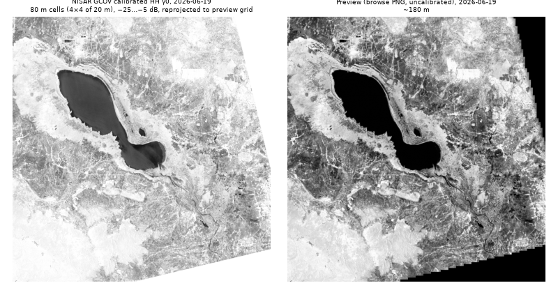
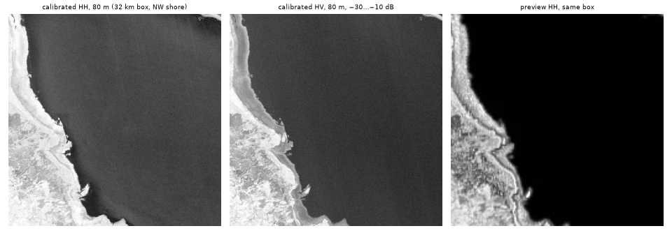

# Calibrated NISAR data (GCOV)

Status, Saturday 14 November 2026, about 14:20 Yerevan time. **Tonle Sap 19 June 2026 has been extracted, checked and compared with the preview.** The other nine Tonle Sap dates are running on the team server, and Armenia (Lake Sevan and Ararat Valley, track 85 frame 22) is queued to start automatically after them. This page will be updated when those runs finish.

Data credit: NISAR GCOV, NASA/JPL-Caltech and ISRO, distributed by the ASF DAAC. The calibration is **PROVISIONAL** (collection `NISAR_L2_GCOV_PROVISIONAL_V1`, release `P05023`).

## What was done

Until now the project used the 180 m browse PNGs. Those are uncalibrated display images. This work replaces them with the calibrated Level-2 GCOV product: radiometric-terrain-corrected gamma-naught in linear power, on a 20 m UTM grid.

The source files are 1.9 GB (Tonle Sap) and 7.5 GB (Armenia), so they are never copied to a laptop. A small Oracle cloud server (2 CPUs, 0.5 GB RAM) opens each file over HTTPS using range requests, without downloading it. It reads only the area's window, in 512-row blocks that match the HDF5 chunks, and averages the samples into the area's grid. Only the small result comes back: about 40 MB per date for Tonle Sap at 80 m.

| Piece | Role |
|---|---|
| `scripts/ingest/remote_extract.py` | Runs on the server. Python 3.9 with numpy, h5py and requests only. It searches ASF, gets an Earthdata token, opens the remote HDF5, writes the B4 report, and block-averages each area's window. The `--to-geotiff` mode runs on the laptop and writes contract A. |
| `scripts/ingest/remote_run.sh` | Runs on the laptop. It copies the script and a job file to the server, starts the job with `setsid nohup`, polls, copies the results back and converts them to GeoTIFF. |
| `tests/test_remote_extract.py` | Builds a synthetic GCOV file. It checks the UTM maths against rasterio (to 1 cm) and the block average against direct numpy. It also checks the half-pixel placement (one bright pixel must land in the right cell), the mask, NaN and ≤ 0 handling, block reads against one big read, reading through the HTTP range reader, and the GeoTIFF grid. Run it with `.venv/bin/python tests/test_remote_extract.py`. |

**Outputs (git-ignored):**

- `data/processed/<area>-cal/gamma0/{hh,hv}/<date>.tif` is contract A: one band, float32, linear-power gamma-naught, NaN for no-data, deflate compression, and every date on the same grid in the source UTM zone.
- `nlooks/{hh,hv}/<date>.tif` (uint16) holds the number of valid 20 m samples averaged into each cell.
- `grid.json` and `summary.json` hold the grid and the per-date timings and statistics.
- The raw `.npz` files, `passes.json`, `b4_report.txt` and the server log are in `data/raw/<area>-cal/`.
- The app's data and the preview areas are untouched.

**Averaging.** Each target cell is the mean in linear power of the 20 m samples whose centres fall inside it. A sample counts only if it is finite, greater than 0, and has a `mask` value other than 0 or 255. A cell is NaN when fewer than 25 % of its nominal samples are valid. The grid is aligned to the source pixel edges, and for Tonle Sap these edges also fall on multiples of 80 m. So every 80 m cell is exactly a 4 × 4 block of 20 m pixels: no interpolation, and no half-pixel shift.

**Pixel sizes.** Tonle Sap uses 80 m, which is 4 × 4 source pixels and gives a 2,503 × 2,546 grid. Sevan and Ararat use 30 m: Armenia is the 40 MHz mode, expected to have 10 m posting, which makes each cell 3 × 3 source pixels. The Armenia posting will be confirmed by its B4 report when that job starts.

## B4: answers to the open questions (from a real file)

File: `NISAR_L2_PR_GCOV_023_083_A_008_2005_DHDH_M_20260619T223637_20260619T223711_P05023_N_F_J_001.h5`. The full report is in `data/raw/tonle-sap-cal/b4_report.txt`.

| Question | Answer |
|---|---|
| Type of `projection` | A scalar `uint32` with the value `32648` (WGS 84 / UTM 48N). The same number is in `attrs['epsg_code']`, along with the full transverse-Mercator parameters and the WKT. |
| Pixel spacing | `xCoordinateSpacing` = 20.0 and `yCoordinateSpacing` = −20.0 metres. The array is 16,560 rows × 16,920 columns, about 331 × 338 km. |
| Coordinates | Pixel centres (`pixel_coordinate_convention = center`). `y` is **descending**: the first row is the northernmost. Centres sit at 10 m offsets, so pixel edges fall on multiples of 20 m. |
| Data type and units | `HHHH` and `HVHV` are float32 with `units = '1'`: **linear power, not dB, not complex**. They are diagonal covariance terms. |
| Gamma-naught? | Yes. The file carries `rtcGammaToSigmaFactor` ("normalize backscatter coefficients from gamma0 to sigma0"), so the stored values are RTC gamma-naught. The factor has a median of about 0.75 in flat terrain. |
| No-data | NaN. `_FillValue` is NaN, although the HDF5 dataset fill value is 0. Outside the swath both the data and the mask are filled. No zeros or negatives were seen in valid areas; they are still treated as no-data. |
| `mask` meaning | From its attribute: values 1…n give the **sub-swath number** of a valid sample. **0 means invalid** (partially focused, or an invalid radar sample in the averaging set). **255 means outside the acquisition** (`_FillValue`). In a 1,024² window in the middle of the scene every pixel was 1; at the swath edge every pixel was 255 and NaN. |
| `numberOfLooks` | float32, range 7.1–11.9 in the central window, median 9.5. The file attribute gives 0–24 with a mean of 9.3. |
| Chunks and compression | 512 × 512 chunks, gzip level 1 with shuffle (the mask uses gzip level 9). |
| Polarisations | `listOfPolarizations = [HH, HV]` and `listOfCovarianceTerms = [HHHH, HVHV]`. `frequencyB` (the 5 MHz side band) also exists and is ignored. |
| Other layers | `inputDataExceptionMask`, a bit flag where 2 means "qFSP-H1 sample slip". It is not used yet. `identification/isMixedMode = True` on this granule. |
| Product | Product specification 1.5.0, product version 1.0.11, DOI 10.5067/NIL2GCOV-P1. |

**Search details.** Each Tonle Sap date has three GCOV files. One is the 20+5 MHz file with "Full" frame coverage, about 1.85–1.90 GB. The other two are 40+5 MHz files with "Partial" coverage. The script keeps the Full file with HH and HV, a `_PR_` production name and the highest `crid`. All ten Tonle Sap dates are `P05023`, 20+5 MHz. All ten Armenia dates (track 85, frame 22) are `P05023`, 40+5 MHz, 7.44–7.65 GB.

**Authentication.** The script reads the netrc credentials with Python's `netrc` module and sends them to `https://urs.earthdata.nasa.gov/api/users/find_or_create_token`, which returns a bearer token. The token is kept in memory only. The ASF URL redirects to a signed storage URL. The script checks the first 8 bytes for the HDF5 signature, and if it receives an HTML page instead it stops and points to the data-use agreement. **The first real file returned HDF5, so the login and the data-use agreement both work.**

## Timings and data volumes (Tonle Sap, one date)

| Step | Time / volume |
|---|---|
| ASF search | about 2 s |
| Token and URL resolve | about 4 s |
| B4 report (first file only) | 113 s |
| Window read and averaging: 10,184 × 10,012 source pixels, HH, HV and mask | 634 s |
| Bytes fetched | 2.12 GB in 417 range requests (the file is 1.85 GB; the window is most of the frame, and some blocks were fetched twice by the cache) |
| Peak memory on the server | 230 MB |
| Result | 41 MB `.npz`; 18.7 MB HH GeoTIFF and 36 MB per date for all GeoTIFFs |

Ten Tonle Sap dates take about 2 hours. For Armenia only the two windows are read, about 1.5 GB of the 7.5 GB file per date if the window share holds, so the estimate is 10–20 minutes per date.

## Quick-look: is it the same lake, in the right place?





- **Same lake, same orientation, correctly placed.** The calibrated HH (in dB) was reprojected onto the preview's web grid. Its correlation with the preview brightness is **0.92**. The best alignment shift is 1 preview row (about 180 m), with 0 columns, and improves the correlation only from 0.925 to 0.929. So any offset is less than one preview pixel. That is consistent with the browse PNG's own placement accuracy, and the calibrated grid comes from the file's exact coordinates.
- **Resolution.** The source is 20 m. The 80 m grid has about 5 times finer linear resolution, or 5 × 5 = 25 times more pixels per km², than the roughly 180 m preview. In the close-up, the flooded-forest fringe, the channels and the small shoreline features are resolved, and they were blurred in the preview.
- **No saturation.** The preview clips the whole lake to black. In the calibrated data the lake has texture, with wind streaks at −22 to −17 dB, which is the information the threshold needs.
- Optional, not done: a 40 m version (2 × 2 of 20 m) of a sub-area such as the north-west shore. The cost is the same server read. Run it with `remote_run.sh tonle-sap:40` as a separate area id or with a smaller box.

## First calibrated numbers (19 June 2026, 80 m cells, 60 × 60-cell patches = 4.8 km)

| Place | HH median | HV median | ENL (mean² / variance, linear) |
|---|---|---|---|
| Lake centre (104.05 E, 12.85 N) | −19.2 dB | −25.5 dB | 62 (HH), 74 (HV) |
| Lake, north-west (103.95 E, 12.95 N) | −19.8 dB | −26.1 dB | 86 (HH), 101 (HV) |
| Upland SW (103.55 E, 12.05 N) | −5.2 dB | −9.6 dB | 10 / 7 (texture, not speckle) |
| Upland NE (104.9 E, 13.4 N) | −8.2 dB | −16.7 dB | mixed land cover |

- **Whole box:** HH median −8.7 dB (1st–99th percentile −20.7 to −2.7); HV median −16.6 dB (−26.4 to −8.9). 91 % of the box is valid; the rest lies outside the slanted swath.
- **Water.** Open water is about **−19 to −20 dB in HH** and −25 to −26 dB in HV. That is close to the expected value, but in June it sits *on* the untested `KNOBS["gamma0"]` threshold `water_hh_strong = −20` dB. Wind-roughened parts of the lake are brighter, around −17 dB.
- **Forest.** The south-west upland, −5 dB HH and −10 dB HV, is in the expected range for L-band forest gamma-naught (about −7 HH and −13 HV), perhaps 1–2 dB brighter.
- **ENL.** Each 80 m cell averages 16 samples of about 9.5 looks each, so the nominal figure is about 150. The measured 60–100 shows that neighbouring 20 m samples are correlated. Use **ENL ≈ 60** for 80 m cells in statistical tests; the per-cell sample count is in `nlooks/`.

## What the detector needs next

1. **Water thresholds.** On 19 June calm lake water is −19 to −20 dB HH, not "below −20". With `water_hh_strong = −20` the strong seed would cover only part of the lake. A first suggestion is about −18 dB for the strong seed and −15 dB for the weak one, but this must be checked against the land histogram before it is used. `water_hv_max = −24` dB fits (lake HV is about −25.5 dB).
2. The open-water area series and its rank correlation with the altimeter are **pending**: they need all ten dates. The plan is to load the GeoTIFFs directly, not through `run.py`, and run `ops.run_pipeline(x, valid, "gamma0")` on a cropped window. The results will be compared with the preview-based 2,234 km² (19 June) and 3,837 km² (17 October), with the range 1,967–4,769 km², and with the altimeter levels in `docs/eda/validation2026/results.json`.
3. `box = 7` is probably too much at 80 m with ENL of about 60: the data is already well averaged. Try 3.

## Commands to repeat

```bash
# one-time: server venv (numpy, h5py, requests in ~/work/venv) is already set up; ~/.netrc is on the server
.venv/bin/python tests/test_remote_extract.py                      # local checks, no network
scripts/ingest/remote_run.sh start tonle-sap --dates 2026-06-19    # start one date on the server
scripts/ingest/remote_run.sh status tonle-sap                      # log tail, still running?
scripts/ingest/remote_run.sh fetch tonle-sap                       # copy back + GeoTIFFs -> data/processed/tonle-sap-cal
scripts/ingest/remote_run.sh tonle-sap                             # all of it: start, wait, fetch (dates already done are skipped)
JOB=armenia scripts/ingest/remote_run.sh sevan,ararat              # both Armenia windows from the same files
scripts/ingest/remote_run.sh inner-niger                           # any area with track/frame in area.json
```

The job file's `pixel_m` can be overridden per area, for example `ararat:20`. Each area of a shared job gets its own folder `data/processed/<area>-cal/`.

## Limits

- **PROVISIONAL calibration.** The cookbook removed two faulty provisional scenes in its own example, so every date needs a look before it is used. Do not difference this data against beta-tier data.
- **Swath edges.** The Tonle Sap box extends beyond the slanted swath edge at its corners: 9 % of the box is NaN on 19 June.
- **No `inputDataExceptionMask` check yet.** Code 2 (sample slip) pixels are kept. The identification group says `hasInputDataException = 0` for this granule.
- **Server limits.** Reading is limited by the server's CPU (gzip decompression plus averaging) as much as by its network: about 3 MB/s effective. One job at a time, because of the 0.5 GB of RAM.
- **Partial files.** `remote_run.sh fetch` copies whatever has finished. A date being written at the moment of the copy can be partial, so rerun `fetch` after the job ends.
